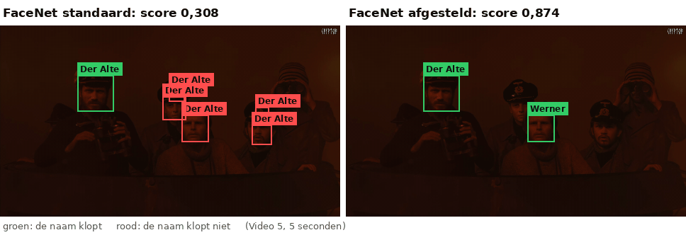
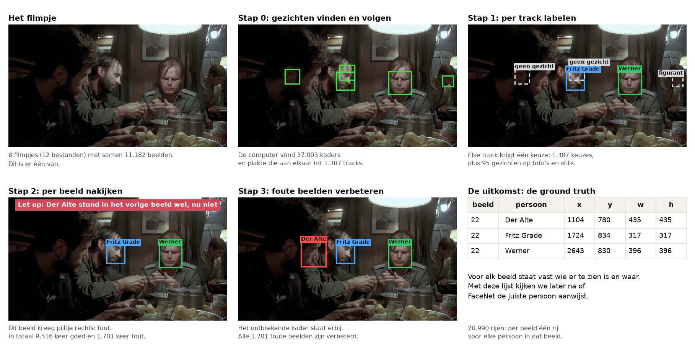

# FaceNet getest op *Das Boot*

Dit is ons project voor de opdracht *Face Recognizer* van de cursus *Key Topics in Artificial Intelligence* aan de Open Universiteit. We testen hoe goed het programma **FaceNet** vier personen herkent in fragmenten uit de film *Das Boot*: Der Alte, Fritz Grade, Johann en Werner.

FaceNet zet een gezicht om in getallen en vergelijkt die met voorbeeldfoto's van de vier personen. Als voorbeeld gebruiken we gewone foto's van de acteurs, en *stills*: losse beelden uit de film waarop de personen in kostuum staan.

> **Het antwoord in het kort.**
>
> - **FaceNet standaard is slecht.** De score is 0,074 met alleen gewone foto's en 0,308 met foto's + stills.
> - **Het getunde model is veel beter.** Getuned betekent dat we de beste instellingen hebben gezocht, bijvoorbeeld hoeveel beeld FaceNet rond een gezicht te zien krijgt. FaceNet zelf is niet opnieuw getraind. De score wordt 0,808 met alleen foto's en 0,874 met foto's + stills.
> - **Ons beste model heet [Periskop](experimenten/top_model/README.md).** Daarin komt alles samen wat we geleerd hebben. De score is 0,903, en Periskop zet bijna geen namen meer op de verkeerde plek.
> - **Die scores zijn iets te gunstig**, omdat de instellingen gekozen zijn op dezelfde beelden als waarop we meten. Kiezen we de instellingen op andere filmpjes, dan is de score 0,766 en 0,834 voor het getunde model, en 0,889 voor Periskop.
>
> Met *score* bedoelen we de score per gezicht: staat de juiste naam op het juiste gezicht? De score is een cijfer van 0 tot 1. Bij 1 krijgt elk gezicht van de vier personen de juiste naam, en klopt elke naam die FaceNet geeft.



*Hetzelfde stukje film, links met FaceNet standaard en rechts met het getunde model. Groen betekent dat de naam klopt, rood dat de naam niet klopt. Van de vier personen staan in dit stukje alleen Der Alte en Werner in beeld. De andere gezichten zijn figuranten, en die horen geen naam te krijgen. De scores boven het beeld gelden voor alle filmpjes samen, niet voor dit stukje.*


## Wat de opdracht vraagt

De opdracht vraagt om een eenvoudig programma dat gezichten herkent in video:

1. Verzamel voorbeelden van minstens drie personen.
2. Laat een bestaand programma van elk voorbeeld een rij getallen maken. Wij gebruiken FaceNet.
3. Zoek in elk beeld van een video de gezichten en vergelijk die met de voorbeelden, met de genormaliseerde Euclidische afstand. Beelden uit de video mogen geen voorbeeld zijn.
4. Laat zien hoe vaak elke persoon in de video voorkomt.
5. Laat een tijdlijn zien: wanneer is iemand in beeld?
6. Zoek uit wanneer het herkennen goed werkt, en wat helpt.


## Zo zit het project in elkaar

Het project bestaat uit drie delen, en elk deel bouwt voort op het vorige.

| Deel | Wat er gebeurt | Waar |
|---|---|---|
| **1. De filmpjes** | Acht fragmenten uit *Das Boot*, samen 11.182 beelden. | [`filmpjes/`](filmpjes/) |
| **2. Het labelen** | Met de hand is vastgelegd wie er in elk beeld staat en waar. Die lijst heet de *ground truth*. Daarmee kijken we FaceNet na. | [`labelen/`](labelen/README.md) |
| **3. De experimenten** | FaceNet wordt getest, standaard en getuned. Daarnaast zijn er acht andere proeven. Ook die staan er standaard én getuned in. Het top model Periskop combineert alles wat we geleerd hebben. | [`experimenten/`](experimenten/README.md) |



*Zo is de ground truth gemaakt. Eén beeld gaat door alle stappen: van het filmpje naar de lijst waarin staat wie er in dit beeld te zien is en waar. Een* kader *is de rechthoek om een gezicht. Een* track *is hetzelfde gezicht, gevolgd over beelden na elkaar.*


## Waar begin ik met lezen?

| Je wilt weten | Lees dan |
|---|---|
| wat er uit alle experimenten gekomen is | [Alle experimenten](experimenten/README.md#alle-experimenten) |
| hoe FaceNet aan een gezicht een naam geeft | [Zo werkt FaceNet](experimenten/README.md#zo-werkt-facenet) |
| hoe we meten of FaceNet goed is | [Zo meten we hoe goed FaceNet is](experimenten/README.md#zo-meten-we-hoe-goed-facenet-is) |
| waarom het getunde model zoveel beter is | [Waarom het getunde model zoveel beter is](experimenten/README.md#waarom-het-getunde-model-zoveel-beter-is) |
| wat een woord betekent | [De woordenlijst met plaatjes](experimenten/README.md#woordenlijst) |
| hoe FaceNet het doet zonder afstellen | [Basis](experimenten/basis/README.md) |
| hoe FaceNet het doet na het afstellen | [Tuned](experimenten/tuned/README.md) |
| wat het beste model is dat we gebouwd hebben | [Top model: Periskop](experimenten/top_model/README.md) |
| hoe de juiste antwoorden gemaakt zijn | [Het labelen](labelen/README.md) |


## Zelf draaien op Mac en Windows

Alle uitkomsten staan al in de mappen. Opnieuw draaien hoeft alleen als je iets wilt veranderen.

Zet eerst het project op je computer. Dat is ongeveer 1 GB. Zet de map niet in iCloud, OneDrive of een andere clouddienst.

Op een Mac en op Windows gaat dat hetzelfde:

```bash
git clone https://github.com/arieknarie/KTAI.git
```

Daarna kies je wat je wilt draaien. Per deel staat precies beschreven wat je op een Mac en op Windows moet doen:

- [Het labelen installeren en draaien](labelen/README.md#installeren-op-mac-en-windows)
- [De experimenten installeren en draaien](experimenten/README.md#installeren-op-mac-en-windows)

Op Windows hebben we de programma's niet zelf uitgeprobeerd. De opdrachten zijn daar beschreven zoals ze zouden moeten werken.
