# Resultaten

Resultaten van de drie stresstests. Hoe de herkenning en de scoring werken,
staat in de [README](README.md). Alle getallen komen uit
[`experiments/results/summary.csv`](experiments/results/summary.csv),
[`summary_by_identity.csv`](experiments/results/summary_by_identity.csv) en
[`per_face.csv`](experiments/results/per_face.csv).

Kort samengevat:

- Het grootste probleem zijn de veranderende gezichten. Met alleen de normale
  foto's van de acteurs als referentie herkent het systeem 15% van de gezichten.
  Met extra referenties uit de film stijgt dat naar 62%, maar dan krijgt 80% van
  de figuranten ten onrechte een naam.
- Bij lage resolutie daalt de herkenning merkbaar vanaf gezichten van ongeveer
  80 pixels breed en halveert ze bij ongeveer 40 pixels. Interpolatie zorgt
  dat de detector kleine gezichten blijft vinden, maar ze worden daardoor
  nauwelijks beter herkend.
- Bij slecht licht daalt de herkenning met de helderheid. CLAHE verandert het
  aantal herkende gezichten weinig, maar voorkomt een groot deel van de foute
  namen.
- In bewerkte en slechte beelden herkent FaceNet niet alleen minder gezichten,
  maar geeft het ook vaak met grote zekerheid een verkeerde naam. Slechte
  beelden lijken in FaceNet meer op elkaar dan op dezelfde persoon in een goed
  beeld, en de vaste drempel van 0,80 vangt dat niet op.

## Data

| Bron | Beelden | Gevonden gezichten | Gezichtsbreedte (mediaan) | Smaller dan 48 px | Helderheid gezicht (mediaan) | Donkerder dan 60 |
|---|---|---|---|---|---|---|
| foto's van de acteurs | 23 | 26 | 222 px | 0% | 140 | 0% |
| stills uit de film | 33 (plus 2 dubbele) | 111 | 100 px | 26% | 71 | 34% |
| filmfragmenten, 1 beeld per seconde | 589 | 1700 | 65 px | 22% | 32 | 73% |

De helderheid is hier de gemiddelde grijswaarde van het uitgeknipte gezicht (0 is
zwart, 255 is wit).

Van de 111 gezichten in de stills zijn er 52 van de vier personen (Der Alte 16,
Fritz 14, Werner 12, Johann 10) en 56 van figuranten; 3 hebben geen label. De
galerij bestaat uit 23 gezichten van de acteurs buiten hun rol (Der Alte 5,
Fritz 5, Johann 7, Werner 6) en, in de uitgebreide versie, de 52 gezichten uit
de stills.

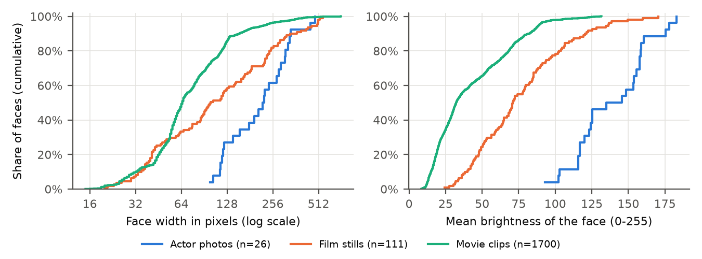

De gezichten in de filmfragmenten zijn kleiner en veel donkerder dan op de
stills. Met een mediane breedte van 65 pixels zitten ze tussen schaal 1/2 en 1/4
van stresstest 1 (83 en 42 pixels). Met een mediane helderheid van 32 zijn ze
ongeveer even donker als stand 0,5 van de gesimuleerde duisternis in stresstest
3, waarbij de gezichten van de vier een mediane helderheid van 29 hebben. Het
echte materiaal valt dus in het gebied waar de herkenning in de tests al tot 30
à 50% was gedaald. De gezichten in de fragmenten zijn niet gelabeld en dus niet
gescoord; dezelfde personen komen in veel opeenvolgende beelden terug, en in het
donker zet de detector soms een kader om iets dat geen gezicht is.

Een beeld uit de fragmenten: de bemanning onder rood alarmlicht, met tien
gevonden gezichten met een mediane breedte van 56 pixels.

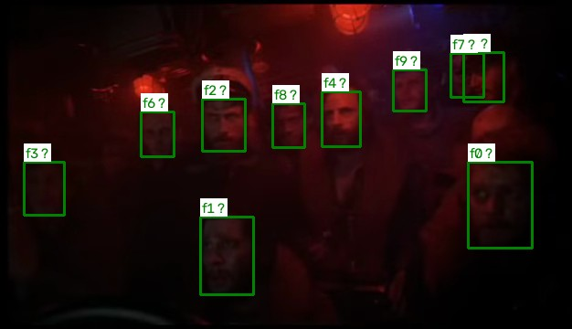

## Stresstest 2: veranderende gezichten

De originele stills zijn herkend met twee galerijen: alleen de foto's van de
acteurs buiten hun rol, en die foto's plus de gezichten uit de film zelf. Deze
test staat voorop, omdat de andere twee tests de uitgebreide galerij als
uitgangspunt gebruiken.

| Galerij | Herkend | Dichtstbijzijnde referentie juist | Verwisseld | Afgewezen | Figuranten met een naam | Precisie |
|---|---|---|---|---|---|---|
| alleen acteursfoto's | 15,4% (8/52) | 78,8% | 0% | 84,6% | 0/56 | 1,00 |
| acteursfoto's + filmgezichten | 61,5% (32/52) | 84,6% | 5,8% | 32,7% | 45/56 | 0,40 |

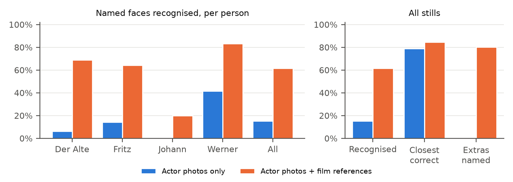

Per persoon:

| Persoon | Gezichten | Herkend, alleen acteursfoto's | Herkend, met filmgezichten | Precisie van de naam, met filmgezichten |
|---|---|---|---|---|
| Der Alte | 16 | 6% (1) | 69% (11) | 0,92 |
| Fritz | 14 | 14% (2) | 64% (9) | 0,24 |
| Johann | 10 | 0% (0) | 20% (2) | 0,10 |
| Werner | 12 | 42% (5) | 83% (10) | 1,00 |

Met alleen de acteursfoto's wijst het systeem in 79% van de gevallen wel de
juiste persoon aan als dichtstbijzijnde referentie, maar de afstand is te groot:
de mediaan is 0,97, ruim boven de drempel van 0,80. Daardoor wordt 85% van de
gezichten als "onbekend" afgewezen. Het systeem maakt in deze situatie geen
fouten, maar herkent ook bijna niemand. Baard, vuil, pet en belichting maken de
mannen in de film te verschillend van hun foto buiten de film.

Met de filmgezichten erbij daalt de afstand van de bekende gezichten naar een
mediaan van 0,73 en worden er vier keer zoveel herkend. Tegelijk komen de
figuranten veel dichter bij een referentie te liggen: hun mediane afstand
daalt van 1,12 naar 0,38, dichter dan de echte personen. Van de 56 figuranten
krijgen er 45 een naam.

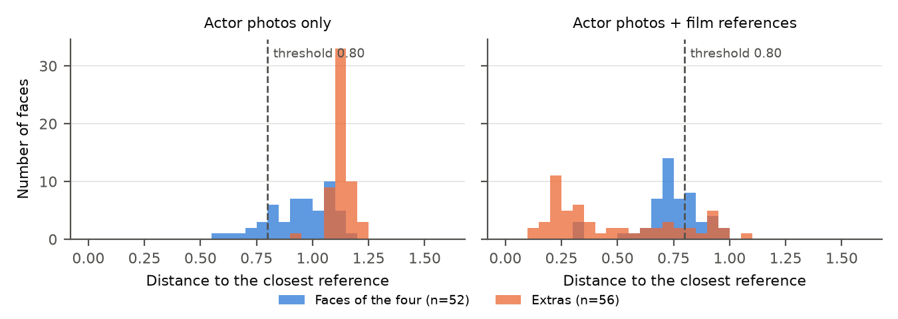

Die foute namen komen vrijwel allemaal via een paar slechte referenties uit de
film. Van de 45 figuranten met een naam kregen er 25 die naam via één onscherp,
donker gezicht van Fritz op de achtergrond van `alte_and_fritz2.png`, en 10 via
een donker gezicht van Johann uit `johann3.png`. Deze twee referenties zijn ook elkaars
dichtstbijzijnde buur (afstand 0,31), waardoor Fritz en Johann in die twee
stills met elkaar verwisseld worden. Daarom is de precisie van de namen Fritz
en Johann zo laag (0,24 en 0,10).

| De onscherpe referentie van Fritz | De donkere referentie van Johann |
|---|---|
| 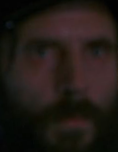 | 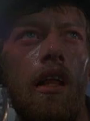 |

De referentie van Fritz komt uit deze still, waar hij onscherp op de
achtergrond staat (kader f1):

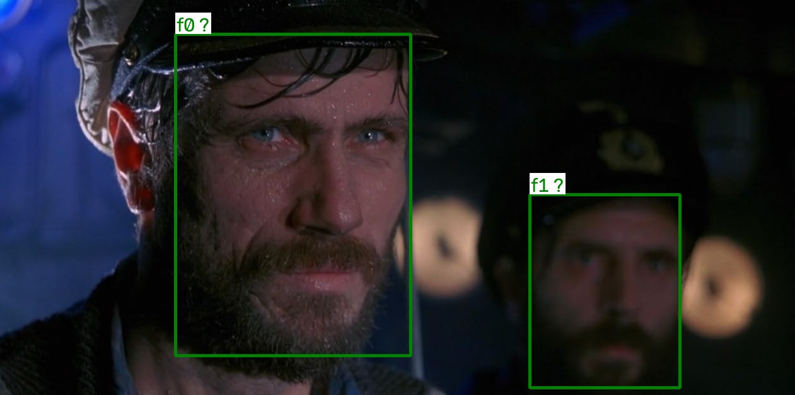

Een voorbeeld is de kade in `johann7.jpg`, met 17 gezichten. Met alleen
acteursfoto's worden alle 17 "onbekend", ook Johann. Met filmgezichten wordt
Johann herkend (groen), maar krijgen 16 figuranten een naam (rood): 12 keer
"FritzGrade" en 4 keer "Johann", met een mediane afstand van 0,33.

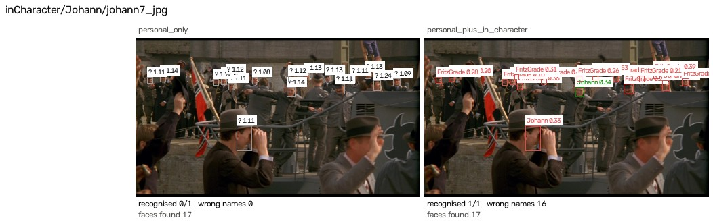

In een goed belichte still gaat het wel goed. In
`Werner/alte_and_werner_and_fritz.jpg` (galauniformen) wordt met alleen acteursfoto's
alleen Werner herkend; met filmgezichten ook Fritz. Der Alte blijft met 0,81
net boven de drempel. Er worden geen foute namen gegeven.

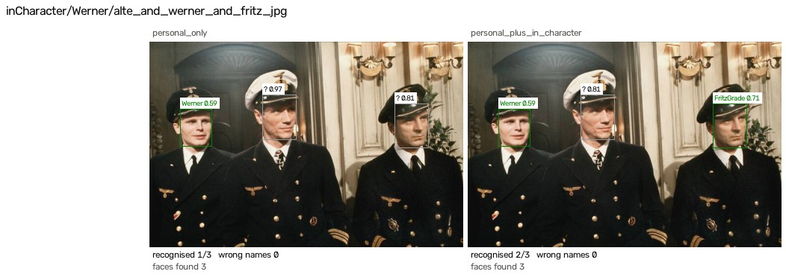

Antwoord op deelvraag 2: veranderende gezichten verlagen de herkenning sterk.
Met alleen de acteursfoto's ziet het systeem de juiste persoon meestal wel als
beste kandidaat, maar wijst het hem meestal toch af omdat de afstand boven de
drempel ligt. Extra referentiefoto's uit de film lossen dat voor een
groot deel op (van 15% naar 62%), maar alleen als die referenties van goede
kwaliteit zijn. Een paar donkere of onscherpe referenties trekken figuranten en
andere personen naar zich toe en zorgen voor veel foute namen.

## Stresstest 1: lage resolutie

Gebruikte galerij: acteursfoto's plus filmgezichten. De still wordt verkleind
en weer vergroot. De mediane breedte van de gezichten van de vier daalt
daarbij van 166 pixels naar 10 pixels.

| Schaal | Gezichtsbreedte (mediaan) | Herkend: nearest | bicubic | Lanczos | Niet gevonden: nearest | bicubic | Lanczos |
|---|---|---|---|---|---|---|---|
| 1 | 166 px | 61,5% | 61,5% | 61,5% | 0% | 0% | 0% |
| 1/2 | 83 px | 48,1% | 53,8% | 51,9% | 0% | 0% | 0% |
| 1/4 | 42 px | 30,8% | 28,8% | 30,8% | 5,8% | 0% | 0% |
| 1/8 | 21 px | 13,5% | 13,5% | 17,3% | 46,2% | 5,8% | 5,8% |
| 1/16 | 10 px | 1,9% | 19,2% | 17,3% | 96,2% | 25,0% | 25,0% |

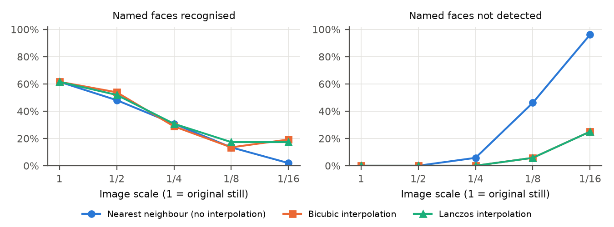

Bij een halvering (gezichten van ongeveer 80 pixels) wordt nog ongeveer de helft
herkend; bij 1/4 (ongeveer 40 pixels) nog 30%. Daaronder blijft er weinig over.
Het effect van interpolatie zit vooral in de detectie. Met nearest neighbour
bestaat het beeld bij 1/8 en 1/16 uit blokjes, en vindt de detector 46% en 96%
van de gezichten niet meer. Met bicubic of Lanczos blijft het beeld vloeiend en
mist de detector bij 1/8 maar 6% en bij 1/16 een kwart van de gezichten. Op de
herkenning zelf scheelt het weinig:
bij 1/2 is bicubic 6 procentpunt beter dan nearest neighbour, bij 1/4 is er geen
verschil.

De 17 tot 19% "herkend" bij 1/16 met interpolatie is grotendeels toeval. Bij die
schaal noemt het systeem bijna elk gezicht Fritz of Johann (bij bicubic 31 keer
Fritz en 20 keer Johann op 55 gevonden gezichten, figuranten meegeteld), de namen van de twee slechte
referenties uit stresstest 2. De echte Fritz- en Johann-gezichten tellen
daardoor als goed. Het aandeel verwisselde gezichten stijgt bij 1/8 en 1/16 met
interpolatie naar 50 tot 58%.

In het voorbeeld hieronder worden op ware grootte alle drie de personen
herkend. Bij 1/16 vindt de detector met nearest neighbour niemand meer (oranje
kaders). Met interpolatie vindt hij de gezichten wel, maar noemt het systeem ze
alle drie Fritz: Der Alte en Werner krijgen met een afstand van 0,13 tot 0,16
een verkeerde naam (rode kaders), en Fritz is daardoor toevallig goed (groen
kader).

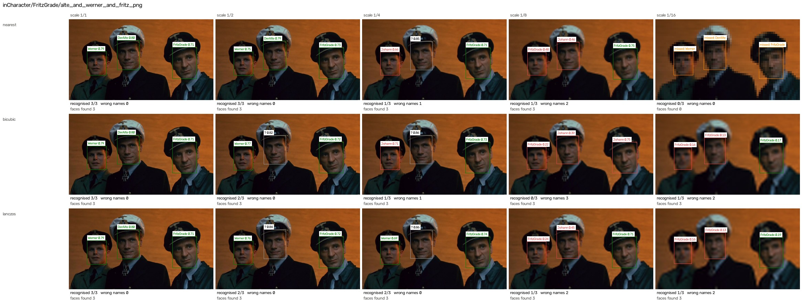

Antwoord op deelvraag 1: lage resolutie verlaagt de nauwkeurigheid merkbaar
vanaf gezichten van ongeveer 80 pixels en sterk vanaf ongeveer 40 pixels. Interpolatie voorkomt dat de detector
kleine gezichten mist, maar dat leidt vooral tot meer foute namen en nauwelijks
tot betere herkenning.

## Stresstest 3: slechte belichting

Gebruikte galerij: acteursfoto's plus filmgezichten; met CLAHE krijgen de stills
en de referentiefoto's dezelfde bewerking.

Duisternis:

| Ernst | Helderheid | Herkend | met CLAHE | Niet gevonden | met CLAHE | Figuranten met naam | met CLAHE |
|---|---|---|---|---|---|---|---|
| 0 | 63 | 61,5% | 63,5% | 0% | 0% | 45/56 | 10/56 |
| 0,25 | 37 | 46,2% | 50,0% | 0% | 0% | 47/52 | 7/55 |
| 0,5 | 22 | 36,5% | 32,7% | 5,8% | 0% | 40/42 | 7/46 |
| 0,75 | 13 | 19,2% | 23,1% | 23,1% | 13,5% | 31/31 | 3/35 |
| 0,9 | 9 | 19,2% | 13,5% | 40,4% | 32,7% | 16/16 | 6/20 |

Rood alarmlicht:

| Ernst | Helderheid | Herkend | met CLAHE | Niet gevonden | met CLAHE | Figuranten met naam | met CLAHE |
|---|---|---|---|---|---|---|---|
| 0 | 63 | 61,5% | 63,5% | 0% | 0% | 45/56 | 10/56 |
| 0,25 | 29 | 40,4% | 46,2% | 0% | 0% | 46/49 | 9/52 |
| 0,5 | 13 | 28,8% | 25,0% | 5,8% | 5,8% | 35/35 | 1/36 |
| 0,75 | 6 | 15,4% | 9,6% | 38,5% | 36,5% | 9/9 | 2/12 |
| 0,9 | 5 | 7,7% | 0% | 59,6% | 51,9% | 2/2 | 0/2 |

De helderheid is de gemiddelde grijswaarde van de stills zoals het systeem ze
kreeg (0 is zwart, 255 is wit), zonder CLAHE.

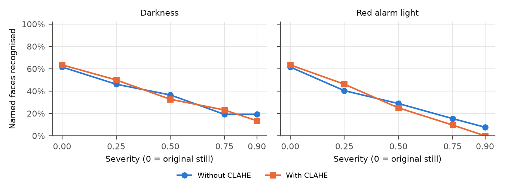

De herkenning daalt geleidelijk met de hoeveelheid licht, van 61,5% naar 19% bij
de donkerste stand en naar 8% bij het donkerste rode licht. In het donker
worden gezichten ook steeds vaker helemaal niet meer gevonden (tot 40% en 60%).

Bij dezelfde ernst is rood licht donkerder dan gewone duisternis (bij 0,5
helderheid 13 tegen 22). Bij gelijke helderheid is rood licht niet slechter: bij
rood 0,5 (helderheid 13) wordt 28,8% herkend, bij donker 0,75 (helderheid 13)
19,2%. De lagere herkenning bij rood licht komt dus vooral doordat het beeld
donkerder is.

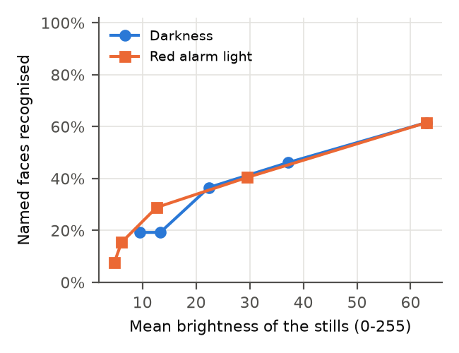

CLAHE verandert het aantal herkende gezichten weinig: afhankelijk van de stand
2 tot 8 procentpunt hoger of lager, wat bij 52 gezichten één tot vier gezichten
is. Het grote effect zit in de foute namen. Zonder CLAHE krijgt bij duisternis
80 tot 100% van de gevonden figuranten een naam; met CLAHE is dat 9 tot 30%.
Ook het aantal verwisselde personen daalt sterk (bij donker 0,5 van 36,5% naar
3,8%). De precisie stijgt daardoor bijvoorbeeld bij donker 0,5 van 0,24 naar
0,65.

De verklaring ligt opnieuw bij de slechte referenties uit stresstest 2. Zonder
CLAHE komt 77% van alle foute namen in deze test via de onscherpe referentie
van Fritz: een donker gemaakt gezicht lijkt in FaceNet het meest op een ander
donker, onscherp gezicht. CLAHE maakt zowel de stills als die referentie
lichter en contrastrijker, waardoor ze minder op elkaar lijken. Met CLAHE komt
nog maar 5% van de foute namen via die referentie.

In het voorbeeld hieronder geeft het systeem zonder CLAHE bij zwaar donker of
rood licht met grote zekerheid foute namen (rode kaders, meestal "FritzGrade" en
bij donker 0,75 twee keer "Johann", met afstanden van 0,2 tot 0,5). Met CLAHE worden de meeste van die gezichten "onbekend"
(grijze kaders).

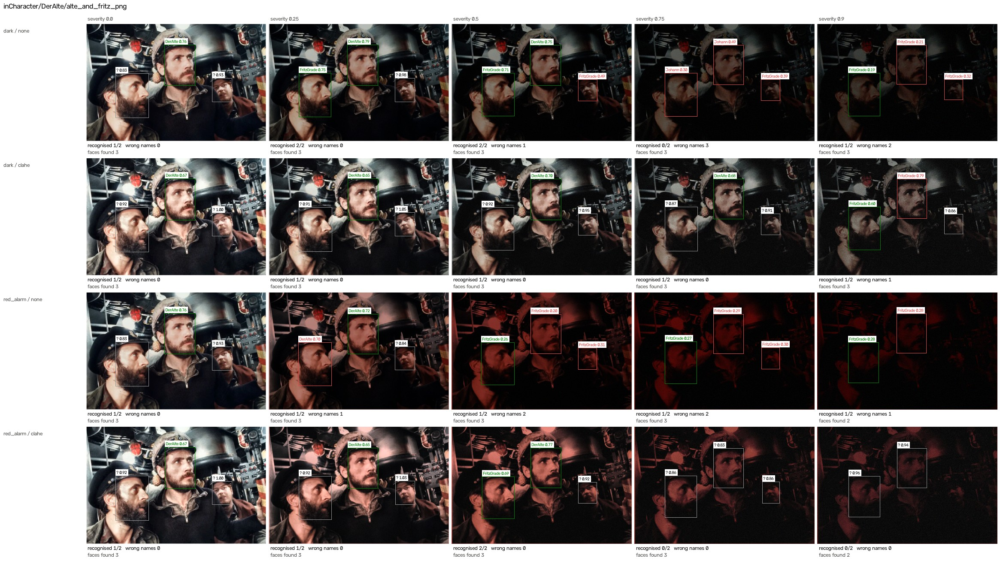

Antwoord op deelvraag 3: slechte belichting verlaagt de herkenning sterk,
vooral doordat er minder licht is; de rode kleur zelf maakt weinig uit. CLAHE
verbetert het lokale contrast, maar verhoogt het aantal herkende gezichten
niet aantoonbaar. Wel voorkomt CLAHE een groot deel van de foute namen.

## Conclusie

Hoe beïnvloeden lage resolutie, veranderende gezichten en slechte belichting
in *Das Boot* de prestaties van FaceNet?

Alle drie verlagen ze de herkenning sterk. Het grootste effect hebben de
veranderende gezichten: zonder referenties uit de film herkent het systeem maar
15% van de gezichten, terwijl het de juiste persoon meestal wel als beste
kandidaat ziet. Lage resolutie en weinig licht verlagen de herkenning verder,
tot 20 à 30% bij gezichten van ongeveer 40 pixels of een sterk verdonkerd
beeld.

In slechte beelden geeft FaceNet niet alleen minder namen, maar ook veel foute
namen met een kleine afstand, dus met grote zekerheid. Slechte beelden (klein, wazig, donker) lijken in FaceNet meer op
elkaar dan op dezelfde persoon in een goed beeld. Eén donkere, onscherpe
referentie kan zo tientallen gezichten naar zich toe trekken. De vaste drempel
van 0,80 beschermt daar niet tegen.

Van de geteste oplossingen helpt het toevoegen van referenties uit de film het
meest voor de herkenning, mits die referenties van goede kwaliteit zijn.
Interpolatie houdt kleine gezichten vindbaar maar verbetert de herkenning
nauwelijks. CLAHE verbetert de herkenning niet, maar voorkomt wel een groot deel
van de foute namen.

## Kanttekeningen

- Het gaat om 52 gezichten in 33 stills. Eén gezicht is ongeveer 2 procentpunt;
  verschillen van een paar procentpunt zijn dus niet betekenisvol.
- De degradaties zijn gesimuleerd. De statistieken van de filmfragmenten (zie
  Data) laten zien hoe het echte materiaal zich daartoe verhoudt.
- De slechte referenties zijn niet verwijderd, omdat dat de resultaten mooier
  zou maken dan ze zijn. Het effect ervan is wel zo groot dat het in de paper
  apart besproken moet worden.
- Zie ook de beperkingen in de [README](README.md#beperkingen).

## Bestanden

| Wat | Waar |
|---|---|
| alle scores | `experiments/results/summary.csv`, `summary_by_identity.csv` |
| elk gezicht in elke conditie | `experiments/results/per_face.csv` |
| grafieken (PDF voor de paper, PNG) | `experiments/results/figures/` |
| voorbeeldvellen in dit document | `experiments/results/examples/` |
| alle overzichtsvellen | `experiments/results/intermediate/` (na een eigen run) |
