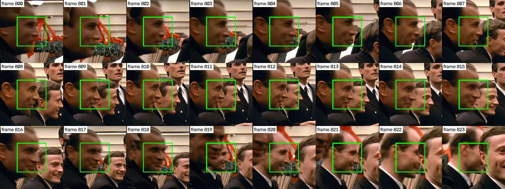
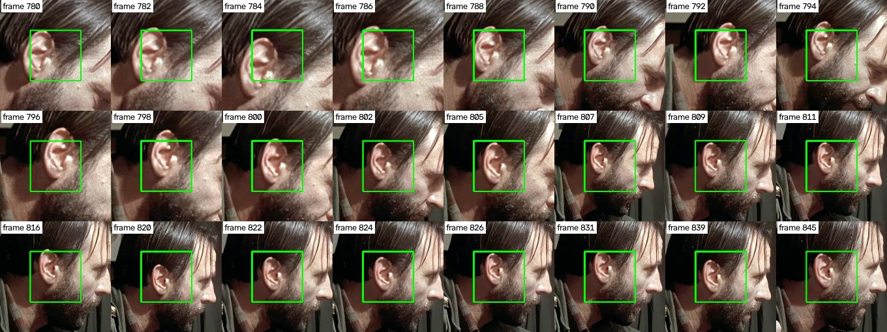

# Controle van het volgen

[← terug naar het overzicht](../README.md)

In stap 1 zoekt een programma, de detector, in elk beeld van de acht
filmfragmenten naar gezichten, en zet om elk gevonden gezicht een kader.
Daarna voegt de computer de kaders samen tot tracks. Een track is een reeks
kaders waarin hetzelfde gezicht gevolgd wordt over beelden na elkaar (zie
[Stap 1](stap1_gezichten_vinden_en_volgen.md)). In stap 2 geeft een mens, de
labelaar, bij elke track aan wie het is. De labelaar ziet van elke track maar
één beeld, en die ene keuze geldt voor alle kaders van de track. Zo ontstaat
het antwoordenblad: de tabel waarin straks bij elk kader staat wie het is, en
waarmee we het herkenningsprogramma nakijken (zie het voorbeeld in
[het overzicht](../README.md#hoe-het-antwoordenblad-eruitziet)).

Als het kader van een track halverwege overspringt naar een ander gezicht, of
naar bijvoorbeeld een hand, krijgt een deel van de kaders dus de verkeerde naam
op het antwoordenblad. De labelaar kan dat niet zien, want de labelaar ziet maar
één beeld van de track. Daarom hebben we vóór het labelen elk kader van elke
track bekeken. Daarnaast hebben we elk beeld van de fragmenten bekeken, om te
tellen hoeveel gezichten de detector mist. In dit document staat hoe we dat
gedaan hebben, wat eruit kwam, hoe we de fouten verbeterd hebben en wat nog
onzeker is.


## Hoe we de tracks gecontroleerd hebben

Vóór de controle waren er 1.307 tracks. Daarvan bestaan er 497 uit maar één
kader. In een track van één kader kan het kader nergens naartoe springen, en de
labelaar ziet precies dat ene kader. Die tracks zijn daarom niet in de
trackcontrole bekeken. De andere 810 tracks, met samen 36.506 kaders, zijn
allemaal bekeken, kader voor kader.

**De vellen.** Het programma
[`code/check_all_tracks.py`](../code/check_all_tracks.py) zet van elke track
álle kaders op volgorde onder elkaar op plaatjes, de vellen. Per kader staat er
een uitsnede: een klein vierkant stukje beeld rond het kader, met het kader
erin getekend en het beeldnummer eronder. Een gewoon kader is groen, een
verlenging oranje met een `v` achter het beeldnummer (een verlenging is een
zwakker kader dat alleen een track mag laten doorlopen, zie
[Stap 1](stap1_gezichten_vinden_en_volgen.md#de-regels)). Donkere uitsneden
maakt het programma lichter, zodat ook donkere scènes te beoordelen zijn. Een
lange track loopt door over meer vellen. Samen zijn het 553 vellen.

**De vraag bij elke track.** Blijft het kader in elk beeld op dezelfde persoon
of op hetzelfde ding? Een hoofd dat draait, wegkijkt, deels bedekt is of wazig
wordt, is nog steeds dezelfde persoon, dus dat is goed. Een track die van begin
tot eind op hetzelfde oor staat, is ook goed. Zo'n track is geen gezicht, maar
de labelaar kiest daar *Geen gezicht*, en dat klopt dan voor alle kaders van de
track. Bij elke track is ook vastgelegd waar de track het grootste deel van de
tijd op staat (het *hoofdding*): een gezicht of iets anders. Er is alleen
gekeken óf het kader op hetzelfde blijft, nooit wie iemand is.

De controle ging in drie rondes:

1. **Ronde 1: elk kader van elke track.** Elke track kreeg een oordeel: goed,
   fout of niet te zeggen. Bij een foute track zijn de beelden opgeschreven
   waarin het kader op iets anders staat.
2. **Ronde 2: nog een keer elk kader, los van ronde 1.** Een tweede keer is
   elke track bekeken, nu van achter naar voren, zonder het oordeel van ronde 1
   te kennen. De gedachte was dat een sprong van een paar beelden tussen
   honderden goede kaders makkelijk over het hoofd gezien wordt. Achteraf was
   ronde 2 niet nodig: ronde 1 vond alle 44 fouten, en ronde 2 vond er geen
   enkele bij (ronde 2 miste er zelf 4). Bij een volgende controle is één ronde
   genoeg, met daarna een nacontrole van alles wat die ronde meldt.
3. **Nacontrole.** De 194 tracks waarbij een ronde *fout* of *niet te zeggen*
   zei, of waarbij de twee rondes het oneens waren over het hoofdding, zijn
   opnieuw bekeken. Daarbij hoorden grotere uitsneden van álle kaders rond de
   plek waar het misging, het hele beeld met alle kaders, en scherpe uitsneden
   uit de originele 4K-beelden. Het oordeel van de nacontrole besliste.

Alle oordelen staan in `data/audit/controle_alle_tracks.csv`. Per track staan
daar het fragment, het eerste en het laatste beeld, het aantal kaders (kolom
`frames`), het oordeel (`goed`, `fout` of `niet_te_zeggen`), bij een foute
track de beelden waarin het kader op iets anders staat (`probleemframes`), het
hoofdding (`gezicht` of `geen_gezicht`), waarom een track nagekeken is
(`nagekeken`, leeg als dat niet nodig was) en een toelichting (`opmerking`). De
tracknummers in dat bestand zijn de nummers van vóór het knippen dat
[verderop](#wat-we-met-de-fouten-gedaan-hebben) staat.


## Wat eruit kwam

De tabel hieronder geeft de eindoordelen, verdeeld naar de lengte van de
track. De lengte tellen we in kaders: in hoeveel beelden de track een kader
heeft.

| Lengte van de track | Bekeken | Goed | Fout | Niet te zeggen |
|---|---|---|---|---|
| 2 tot 4 kaders | 281 | 273 | 6 | 2 |
| 5 tot 24 kaders | 284 | 262 | 22 | 0 |
| 25 tot 99 kaders | 151 | 140 | 11 | 0 |
| 100 kaders of meer | 94 | 89 | 5 | 0 |
| samen | 810 | 764 | 44 | 2 |

Van de 810 tracks staan er 457 vooral op een gezicht en 353 vooral op iets
anders. Dat zijn er veel: de detector ziet in deze 4K-beelden vaak een oor, de
zijkant van een hoofd, een hand of een pet voor een gezicht aan, en volgt dat
ding dan netjes van beeld tot beeld. Zo'n track krijgt van de labelaar het label
*Geen gezicht*.

In de 44 foute tracks staan samen 285 kaders op een andere persoon of op iets
anders. Dat is 0,8% van alle 37.003 kaders. Zonder verbetering zouden die 285
kaders op het antwoordenblad de naam van de rest van hun track krijgen, en dus
meestal een verkeerde naam.

### Twee voorbeelden

**Een track die naar een ander gezicht overspringt.** Track 437 staat in
fragment Das Boot 2b, van beeld 800 tot en met 823.



*Alle 24 uitsneden van track 437, van links naar rechts en van boven naar
beneden; het getal is het beeldnummer. Tot en met beeld 818 staat het groene
kader op het gezicht van de man vooraan, met donker, achterovergekamd haar, in
profiel. In beeld 819 schuift die man naar links weg, en springt het kader naar
de man die achter hem staat. Na het knippen zijn het twee tracks: beeld 800 tot
en met 818 houdt nummer 437, en beeld 819 tot en met 823 is nu track 1357.*

**Een track die nooit een gezicht is.** Het kader van track 84 staat in alle 48
beelden (beeld 780 tot en met 845 van Das Boot 1) op hetzelfde oor. Zo'n track
is goed: de labelaar kiest *Geen gezicht*, en dat klopt dan voor alle kaders.



*24 van de 48 uitsneden van track 84, gelijk verdeeld van begin tot eind. Het
kader blijft steeds op hetzelfde oor; het gezicht van de man staat ernaast en
heeft een eigen track.*


## Wat we met de fouten gedaan hebben

Het programma [`code/track_faces.py`](../code/track_faces.py) knipt de 44
foute tracks op de plekken die in de kolom `probleemframes` staan. Elk stuk
wordt een eigen track. Zo krijgt het stuk op een andere persoon straks een
eigen naam van de labelaar, en een stuk op een hand het label *Geen gezicht*.

Er is op 93 plekken geknipt. Dat gaf 80 nieuwe tracks; 13 nieuwe nummers zijn
niet gebruikt, omdat tussen twee knippen soms geen enkel kader lag. De nieuwe
tracks hebben nummers vanaf 1307 gekregen. Omdat de nieuwe nummers achter de
bestaande nummers komen, houden alle andere tracks hun nummer. In de bestanden
in `data/tracks/` staat in de kolom `track_ongeknipt` het nummer van vóór het
knippen. Na het knippen zijn er 1.387 tracks. Daarvan zijn er 540 maar één
kader lang (vóór het knippen 497), omdat 43 losgeknipte stukken uit één kader
bestaan.


## De controle van elk beeld

De trackcontrole kijkt alleen naar kaders. Een gezicht waar de detector geen
kader omheen zette, zit in geen enkele track. Om te weten hoeveel gezichten de
detector mist, hebben we daarom ook elk beeld van alle acht fragmenten bekeken:
alle 11.182 beelden, ook de 356 beelden waarin de detector niets vond. Van elk
beeld maakt `code/check_all_tracks.py --beelden` een plaatje van 1280 pixels
breed, met alle kaders erin en een nummer bij elk kader. Bij elk beeld is
opgeschreven hoeveel gezichten er te zien zijn, welke kaders niet op een
gezicht staan (helemaal niet, of maar half), en waar een gezicht zonder kader
staat. Een gezicht telt daarbij als er iets van het gezicht zelf te zien is
(ogen, neus, mond of wang), ook in profiel, donker, onscherp of klein op de
achtergrond. Een achterhoofd of een oor alleen telt niet.

Deze controle verandert niets aan het antwoordenblad. Een kader zonder gezicht
krijgt van de labelaar toch al *Geen gezicht*, en een gezicht zonder kader komt
alleen op het antwoordenblad als de labelaar het in het ene beeld van een track
zelf tekent (zie [Stap 2](stap2_labelen.md)). De controle geeft wel de getallen
voor het verslag: hoe vaak mist de detector een gezicht?

Elke vondst uit deze eerste blik is daarna nog een keer nagekeken, met scherpe
uitsneden uit de originele 4K-beelden. Dat is voor ongeveer de helft van de
vondsten gebeurd (736 van de 1.305 groepjes van 20 vondsten). Daarna zijn we
gestopt, omdat het nakijken veel tijd kost en het antwoordenblad er niet door
verandert. De andere vondsten staan in de tabel met `niet nagekeken`.

| Soort vondst | Gevonden | Nagekeken: klopt | Nagekeken: klopt niet | Extra gevonden bij het nakijken | Niet nagekeken |
|---|---|---|---|---|---|
| Gezicht zonder kader | 10.867 | 2.911 | 907 | 180 | 7.049 |
| Gezicht zonder kader op een foto of schilderij in beeld | 1.532 | 1.532 | 0 | 21 | 0 |
| Kader zonder gezicht | 4.691 | 3.103 | 4 | 0 | 1.584 |
| Kader dat maar half op een gezicht staat | 3.015 | 2.318 | 180 | 0 | 517 |

Een paar dingen om bij deze getallen te weten:

- Elke regel telt per beeld. Een gezicht dat de detector in 50 beelden na
  elkaar mist, telt 50 keer mee.
- Van de nagekeken gezichten zonder kader klopte ongeveer 3 van de 4 (2.911
  van 3.818). Bij de rest was het bijvoorbeeld een vlek, of had het gezicht toch
  een kader.
- Van de nagekeken kaders zonder gezicht klopten er 3.103 van de 3.107. De
  eerste blik was daar dus heel betrouwbaar.
- In een paar scènes hangt een ingelijst portret aan de muur. Het gezicht op
  dat portret heeft geen kader. Het is te zien als gezicht, maar het is geen
  persoon in de scène. Daarom staat het apart.

De uitkomst staat in twee bestanden in `data/audit/`.
`controle_alle_beelden.csv` heeft een regel per beeld: het fragment, het
beeldnummer, hoeveel kaders er staan, hoeveel gezichten er te zien zijn, welke
kaders (nummers zoals op het plaatje van dat beeld) geen gezicht zijn of maar
half, en hoeveel gezichten geen kader hebben. In
`controle_alle_beelden_vondsten.csv` staat elke vondst apart: het fragment, het
beeld, de soort, bij een kader het nummer en de track (nummer van vóór het
knippen), bij een gezicht zonder kader waar het staat (`cx` en `cy`: het midden
als deel van de breedte en hoogte van het beeld, van 0 tot 1) en hoe groot het
is (`grootte`: de breedte als deel van de beeldbreedte), wat de eerste blik
zag, en de uitkomst van het nakijken met een toelichting.

**Waar de twee controles elkaar tegenspreken.** Bij 177 tracks die volgens de
trackcontrole niet op een gezicht staan, noemt de controle van de beelden een
kader van die track in een paar beelden niet als *geen gezicht*. Bij een
voorbeeld dat we bekeken hebben (track 30, beeld 841 van Das Boot 1) stond het
kader gewoon op dezelfde hand als in de rest van de track; de controle van de
beelden had dat kader alleen niet genoemd. Deze plekken zijn verder niet
nagekeken, omdat elk kader van die tracks al twee keer in de trackcontrole
bekeken is.


## Wat nog onzeker is

**De 2 tracks die niet te zeggen waren.** Die tracks zijn niet geknipt. Het
beeld is daar te donker of te onduidelijk, dus de labelaar kiest daar
waarschijnlijk *Weet niet* (zie [Stap 2](stap2_labelen.md)).

**Fouten die geen enkele ronde gezien heeft.** Die kunnen er nog zijn, maar
elk kader van elke track is twee keer los van elkaar bekeken, en de tweede
ronde vond geen enkele fout die de eerste ronde gemist had.

**Gezichten die de detector mist.** Die staan niet op het antwoordenblad,
behalve als de labelaar ze in het ene beeld van een track tekent. Hoe vaak dat
voorkomt, staat bij [De controle van elk beeld](#de-controle-van-elk-beeld);
de helft van die getallen is alleen met de eerste blik geteld.

**Wat deze controle niet meet.** Vergissingen van de labelaar komen er nog
bij; die meten we met een tweede labelaar (zie
[Stap 2](stap2_labelen.md#wat-er-na-het-labelen-gebeurt)).


## Korte tracks

Tracks van één kader zijn niet in de trackcontrole bekeken, omdat het kader
daarin niet kan overspringen. Tracks van 2 tot 4 kaders zijn wel bekeken: van
de 281 waren er 6 fout (zie de tabel hierboven). **Alle tracks worden gelabeld,
ook die van één kader**: weglaten zou echte gezichten uit het antwoordenblad
halen, en een korte track labelen kost weinig werk.


## Zelf nakijken

Daarvoor moet het project eerst geïnstalleerd zijn (zie
[Zelf draaien](zelf_draaien.md#installeren)). Alle opdrachten hieronder geef je
vanuit de map `KTAI`.

Deze opdracht maakt alle 553 vellen opnieuw, in `data/audit/alle_tracks/`:

```bash
.venv/bin/python code/check_all_tracks.py
```

Deze opdracht maakt de plaatjes van alle 11.182 beelden, in
`data/audit/alle_beelden/`:

```bash
.venv/bin/python code/check_all_tracks.py --beelden
```

De vellen en de plaatjes staan niet op GitHub; deze opdrachten maken ze. Samen
zijn ze ongeveer 1,5 GB. Staat de projectmap in iCloud of OneDrive, zet er dan
`--uitvoer <map>` achter, met een map buiten de cloud, zodat de plaatjes niet
geüpload worden. Welke track op welk vel staat, staat in
`data/audit/alle_tracks_index.csv`. Bij de plaatjes van de beelden staat in
`kaders.csv` welk nummer bij welk kader en welke track hoort.

Om één track precies na te kijken, maakt deze opdracht een strook met alle
kaders van één track tussen twee beelden, groter dan op de vellen (hier track
437, van beeld 800 tot en met 823):

```bash
.venv/bin/python code/check_all_tracks.py --track 437 --van 800 --tot 823
```

Gebruik altijd het tracknummer uit `controle_alle_tracks.csv`, dus het nummer
van vóór het knippen (kolom `track_ongeknipt` in `data/tracks/`).


## Eerdere controles

Tot oktober 2026 gebruikten we drie andere filmfragmenten. Die fragmenten en de
controle daarvan (een steekproef van de tracks en van 120 beelden, en later een
controle van alle tracks) staan niet meer in de map, maar nog wel in de
geschiedenis van het project op GitHub. Bij de nieuwe fragmenten horen andere
tracks met andere nummers, dus die oude controles passen er niet meer bij. Wat
we ervan leerden, zit in de regels voor het volgen en in de werkwijze van deze
controle.
