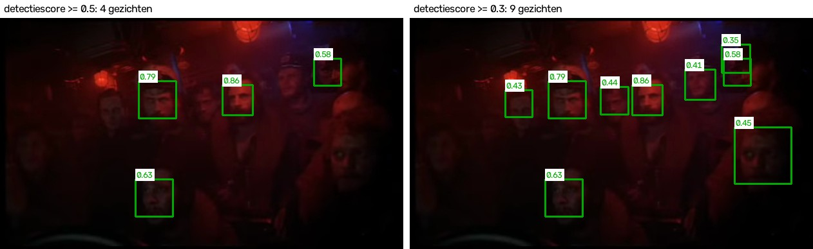
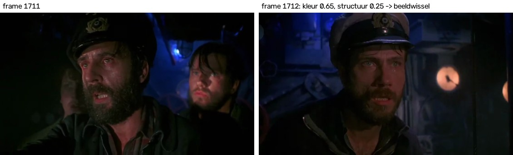
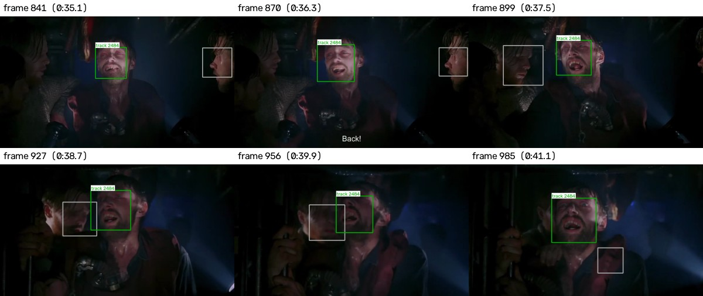

# Stap 1: gezichten vinden en volgen

[← terug naar het overzicht](../README.md)

In deze stap zoekt de computer in alle beelden van de drie filmfragmenten de
gezichten, en volgt de computer elk gezicht van beeld tot beeld. Het doel is
dat een mens in stap 2 niet bij elk gevonden gezicht in elk beeld hoeft aan te
geven wie het is (54.599 keer), maar alleen bij elk stukje (2.896 keer). Zo'n
stukje noemen we een **track**: één gezicht dat de computer volgt over een
reeks beelden na elkaar. Hieronder
staat hoe dat werkt, waarom we het zo gedaan hebben, en wat eruit kwam.

Het programma voor deze stap is [`code/track_faces.py`](../code/track_faces.py).

## De drie filmfragmenten

Een video is een reeks losse beelden die snel na elkaar getoond worden. Zo'n
los beeld heet een *frame*. De drie fragmenten zijn:

| Fragment | Lengte | Beelden per seconde | Aantal beelden | Grootte van een beeld (in pixels) |
|---|---|---|---|---|
| *Das Boot – die Auferstehung* | 5:53 | 25 | 8.817 | 626 × 360 |
| *Mon Gars Filmmusik* | 2:09 | 29 | 3.730 | 848 × 480 |
| *Go Back Johann* | 1:47 | 23,98 | 2.565 | 1280 × 720 |
| samen | ongeveer 10 minuten | | 15.112 | |

Het eerste fragment is het langste, maar ook het lastigste: de beelden zijn
klein (een gezicht is vaak maar 30 tot 50 pixels breed), en veel scènes spelen
zich af in een donkere onderzeeboot onder rood licht.

We nummeren de beelden van elk fragment vanaf 0, in de volgorde waarin ze in
het fragment staan. Onze programma's lezen de fragmenten met OpenCV, een
veelgebruikte gratis verzameling programmacode om beelden en video's te
bewerken. (Volgens de gegevens in het videobestand heeft het eerste fragment
8.818 beelden, maar het laatste daarvan is leeg. Een ander programma,
`ffprobe`, vindt bij het echt uitlezen ook 8.817 beelden, met dezelfde nummers
als OpenCV.)

## Hoe de computer gezichten vindt

Voor het vinden van gezichten gebruiken we de MediaPipe Face Detector (versie
1.1.1), een gratis programma van Google dat de opdracht aanraadt. Je geeft dit
programma een beeld, en het programma geeft voor elk gezicht dat het vindt een
rechthoek terug: waar het gezicht staat en hoe groot het is. Die rechthoek
noemen we het *kader*. Bij elk kader geeft het programma ook een getal tussen
0 en 1 dat zegt hoe zeker het programma ervan is dat daar echt een gezicht
staat: de *score*. Bij 0,9 is het programma heel zeker, bij 0,3 twijfelt het
programma.

MediaPipe heeft twee versies van dit programma. De ene versie is gemaakt voor
gezichten vlak voor de camera, zoals bij een webcam (tot ongeveer 2 meter). De
andere versie, *full range*, vindt ook gezichten die verder weg staan. In de
film staan mensen vaak verder weg en klein in beeld, dus we gebruiken de full
range-versie. Die versie is het bestand `models/blaze_face_full_range.tflite`.

Het programma bekijkt elk beeld van alle drie de fragmenten. Er wordt geen
enkel beeld overgeslagen.

Staat een gezicht voor een deel links of boven buiten het beeld, dan zet
MediaPipe het kader tegen de linker- of bovenrand van het beeld, maar houdt het
kader ongeveer de maat van het hele gezicht. Zo'n kader steekt daardoor rechts
of onder voorbij het gezicht uit, en bevat dus ook een stuk beeld naast het
gezicht. Dat zagen we in een proef: we sneden van een paar beelden links of
boven een stuk van een gezicht af, en MediaPipe zette het kader dan nooit voor
een deel buiten het beeld, maar steeds tegen de rand, met ongeveer de volle
maat. Die proef staat niet als bestand in dit project. Staat een gezicht voor
een deel rechts of onder buiten het beeld, dan knipt ons programma het kader af
aan de rand van het beeld; zo'n kader staat wel goed.

In de lijst van gevonden gezichten (het bestand `detections_0.3.csv`, zie
onderaan) herken je zo'n verschoven kader aan x = 0 (het kader begint
helemaal links) of y = 0 (het kader begint helemaal boven). Dat geldt voor
796 van de 54.599 kaders (ongeveer 1,5%), verdeeld over 85 tracks. Bij 65 van
de 2.896 tracks laat de labelapp in stap 2 zo'n kader zien; daar staat het
kader dus voor een deel naast het gezicht. Bij het herkennen van de gezichten
in stap 4 moeten we met deze kaders rekening houden.

### Hoe zeker moet het programma zijn?

Standaard laat MediaPipe alleen kaders door met een score van minstens 0,5. In
de donkere scènes van deze film mist het programma dan veel gezichten die een
mens wel ziet. In het voorbeeld hieronder (1 minuut en 13 seconden in het
eerste fragment, een groep mensen onder rood licht) vindt het programma bij een
grens van 0,5 vier gezichten. Bij een grens van 0,3 vindt het programma negen
kaders. (Rechtsboven staan twee kaders half over elkaar; die staan
waarschijnlijk op hetzelfde hoofd.)

*Hetzelfde beeld twee keer. Links staan alleen de kaders met een score van 0,5
of hoger, rechts alle kaders met een score van 0,3 of hoger. Het getal bij elk
kader is de score. De zwakke kaders met een score van 0,2 tot 0,3 (zie regel 5
bij het volgen) staan niet in dit plaatje.*

Met een lagere grens vindt het programma meer echte gezichten, maar ziet het
programma ook vaker iets voor een gezicht aan dat geen gezicht is, zoals een
lamp of een hand. Dat laatste is voor ons geen probleem: in stap 2 kan de
persoon die labelt bij zo'n kader *Geen gezicht* kiezen. Een gemist gezicht is
wel een probleem. Na het labelen maken we namelijk één tabel waarin bij elk
gevonden gezicht staat wie het is: het *antwoordenblad* waarmee we het
herkennen later nakijken (zie het voorbeeld in
[het overzicht](../README.md#hoe-het-antwoordenblad-eruitziet)).
Een gezicht zonder kader komt niet vanzelf in die tabel. Daarom bewaren we alle
kaders vanaf een score van 0,3. Kaders met een nog lagere score, van 0,2 tot
0,3, gebruiken we alleen om een gezicht dat al gevolgd wordt langer te volgen.
Zo'n zwak kader noemen we dan een *verlenging* (zie regel 5 bij het volgen).

### Hoeveel gezichten mist de detector?

Een gezicht dat de detector (MediaPipe) nooit vindt, krijgt geen kader en
komt dus ook niet vanzelf op het antwoordenblad. Daarom hebben we gemeten
hoeveel duidelijk zichtbare gezichten de detector mist. Uit elk fragment zijn
40 beelden genomen, gelijk verdeeld over het fragment: samen 120 beelden. Op
elk beeld is met het oog bepaald welke gezichten er duidelijk te zien zijn. Een
gezicht telt als gevonden als er een kader flink over het gezicht heen ligt:
het stuk dat kader en gezicht gemeen hebben, is minstens 30 procent van de
oppervlakte die ze samen bedekken (dezelfde maat als bij regel 2 van het
volgen, hieronder). Welke beelden en welke gezichten het zijn, staat in
`data/audit/detector_steekproef_beelden.csv`
en `data/audit/detector_steekproef.csv`. Het programma
[`code/detector_steekproef.py`](../code/detector_steekproef.py) rekent de
uitkomst uit.

In de 120 beelden staan 278 duidelijke gezichten. Hoe groot een gezicht in
beeld is, bepaalt bijna alles. Daarom tellen we grote en kleine gezichten
apart. Een gezicht telt als groot als het minstens 6% van de breedte van het
beeld beslaat (in het eerste fragment is dat ongeveer 38 pixels of breder).
Er zijn 220 grote en 54 kleine duidelijke gezichten. Van de overige 4 is de
grootte niet gemeten, omdat de detector er bij geen enkele instelling een
kader omheen zette.

| Welke kaders meetellen | Gevonden van alle 278 | Gevonden van de 220 grote | Gevonden van de 54 kleine |
|---|---|---|---|
| alleen kaders vanaf 0,5 (de standaard van MediaPipe) | 175 (63%) | 167 (76%) | 8 |
| kaders vanaf 0,3 | 229 (82%) | 206 (94%) | 23 |
| **kaders vanaf 0,3 plus de verlengingen (regel 5); dit gebruiken we** | **238 (86%)** | **209 (95%)** | **29** |

Met de manier die we gebruiken, vindt de detector dus bijna alle grote
gezichten, en ongeveer de helft van de kleine. Per fragment vindt de detector
96% in *die Auferstehung*, 74% in *Mon Gars Filmmusik* (veel kleine gezichten
van mensen op de achtergrond) en 94% in *Go Back Johann*. Niet elk kader staat
op een gezicht: in deze beelden stonden ook kaders op bijvoorbeeld een lamp,
een meter of een hand.

Bij de vorige versie van het volgen (versie 4, zie
[Hoe we bij deze regels kwamen](#hoe-we-bij-deze-regels-kwamen)) hebben we
ook andere instellingen van de detector geprobeerd. De getallen in dit lijstje
komen uit die eerdere meting:

- **Het beeld eerst vergroten** helpt niet (+1 tot +3 gezichten): de detector
  verkleint elk beeld toch eerst tot 192 × 192 pixels.
- **De grens voor alle kaders verlagen naar 0,25 of 0,2** vindt 3 tot 7
  procentpunt meer gezichten, maar geeft meer tracks om te labelen (35% meer
  bij 0,25, 91% meer bij 0,2) en veel meer kaders die geen gezicht zijn.
- **Het contrast eerst verbeteren** vindt wat meer donkere gezichten, maar mist
  juist een paar duidelijke gezichten.
- **Het beeld in negen overlappende stukken opdelen** en de detector ook op die
  stukken laten zoeken (alleen kaders met een score vanaf 0,6), vindt vooral
  meer kleine gezichten op de achtergrond: 87% in plaats van 82%, voor 11% meer
  tracks om te labelen. Die kleine gezichten zijn voor het herkennen nauwelijks
  bruikbaar.

Gekozen hebben we een lagere grens alleen voor gezichten die al gevolgd
worden: de verlengingen van regel 5. Een nieuwe track begint alleen bij een
kader met een score van 0,3 of hoger, maar een track die al loopt, mag ook
doorgaan met een kader vanaf 0,2. Dat heeft twee voordelen. Er komen meer
gezichten op het antwoordenblad: de detector vindt 86% van de duidelijke
gezichten in plaats van 82%. En er is minder labelwerk, omdat losse stukjes
van hetzelfde gezicht aan elkaar vast komen te zitten. Vóór de controle van
de tracks (zie verderop) waren het 2.736 tracks; bij versie 4 waren het er
vóór de controle van toen 3.191. Dat is 455 tracks minder (14%). Een
nadeel is dat een verlenging lang niet altijd op een gezicht staat. In een
eerdere meting stond ongeveer de helft van de extra kaders niet op een gezicht,
vooral in tracks die toch al geen gezicht zijn, zoals een track op een lamp of
een meter. Dat is niet erg: zo'n track krijgt in zijn geheel het label *Geen
gezicht*.

Van de 220 grote gezichten mist de detector er zo nog 11. Ziet de persoon die
labelt in stap 2 in een beeld een gezicht zonder kader van een van de vier
personen die we willen herkennen, dan tekent die persoon er zelf een kader
omheen (zie [Stap 2](stap2_labelen.md)). Zo'n getekend gezicht komt als
extra rij op het antwoordenblad. Dat kan alleen in de beelden die de labelapp
laat zien: van elke track één beeld. Andere gemiste gezichten, zoals kleine
gezichten van mensen op de achtergrond, ontbreken op het antwoordenblad. Dat
moeten we in het verslag zeggen.

### De tracks twee keer: met grens 0,3 en met grens 0,5

We maken de tracks twee keer: één keer met alle kaders vanaf 0,3 (plus de
verlengingen van regel 5), en één keer alleen met de kaders vanaf 0,5, zonder
verlengingen. Zo kunnen we later vergelijken hoe goed het herkennen werkt met
de strenge en met de ruime grens. Gelabeld worden de tracks met grens 0,3,
want daarin zitten alle kaders vanaf 0,5 ook.

## Elk beeld op volgorde

Onze programma's lezen een fragment altijd van het eerste tot het laatste
beeld, en springen nooit direct naar een bepaald beeld. Dat heeft drie
redenen:

- MediaPipe werkt in een speciale stand voor video. In die stand verwacht
  MediaPipe de beelden in de goede volgorde.
- Bij het volgen van een gezicht vergelijkt de computer elk beeld met het beeld
  ervoor. Dat kan alleen als de beelden op volgorde komen.
- We hebben gemerkt dat direct springen naar een bepaald beeld niet
  betrouwbaar is. In het eerste fragment krijg je vanaf beeld 4523 dan het
  beeld dat er vlak voor zit. Een plaatje dat een kader laat zien, zou het
  kader dan op het verkeerde beeld tekenen. Daarom lezen ook de programma's
  die plaatjes maken de fragmenten altijd op volgorde.

## Hoe de computer een gezicht volgt

### Het idee

Van het ene beeld naar het volgende beweegt een gezicht maar een klein beetje,
want er zit maar ongeveer een vijfentwintigste seconde tussen. Als er in het volgende
beeld een kader op bijna dezelfde plek staat, is dat dus waarschijnlijk
hetzelfde gezicht. De computer plakt de kaders van hetzelfde gezicht aan
elkaar tot een stukje: een *track*. Een track van 100 beelden is hetzelfde
gezicht in 100 beelden na elkaar, dus ongeveer vier seconden.

### Wat er mis kan gaan

Dat idee gaat in een film op twee manieren mis.

**De film springt naar een ander shot.** Een *shot* is een stuk film dat de
camera zonder onderbreking opneemt. In een film springt het beeld vaak ineens
naar een ander shot, met een ander camerastandpunt: eerst zie je de ene
persoon, een fractie later de andere. Zo'n plotselinge overgang noemen we een
*beeldwissel*. Na een beeldwissel kan er op precies dezelfde plek in beeld een ander gezicht staan.
Als de computer daar gewoon doorplakt, bevat de track eerst de ene persoon en
daarna een andere. Omdat de persoon die labelt per track maar één keer kiest,
krijgt dan een van de twee personen de verkeerde naam op het antwoordenblad.
Dat willen we zeker voorkomen.

**Het programma mist een gezicht heel even.** In donkere of bewogen beelden
vindt MediaPipe een gezicht soms een paar beelden lang niet, of alleen met een
lage score, en daarna weer gewoon. Als de track dan stopt, wordt hetzelfde
gezicht twee of drie losse tracks, en moet de persoon die labelt hetzelfde
gezicht twee of drie keer labelen. Dat kost alleen extra werk; het
antwoordenblad wordt er niet fout door.

Een fout in het antwoordenblad is erger dan extra werk. Daarom zijn de regels
hieronder streng waar een fout dreigt, en ruim waar alleen extra werk dreigt.

### De regels

De computer gaat de beelden van een fragment op volgorde langs en past bij
elk beeld zes regels toe.

**Regel 1: let op beeldwissels.** De computer vergelijkt elk beeld met het
beeld ervoor, op twee manieren: zijn de kleuren in het hele beeld nog
ongeveer hetzelfde, en is het patroon van lichte en donkere plekken nog
ongeveer hetzelfde? Beide vergelijkingen geven een getal van hoogstens 1
(precies gelijk). Hoe lager het getal, hoe minder de twee beelden op elkaar
lijken; rond 0 hebben ze niets gemeen. Binnen hetzelfde shot zijn beide
getallen bijna altijd 1. Is de kleur lager dan 0,9 of het licht-donkerpatroon
lager dan 0,7, dan telt het beeld als beeldwissel en stoppen alle tracks. Een
gezicht na een beeldwissel begint altijd een nieuwe track.

*Een beeldwissel in Go Back Johann. Tussen beeld 1711 en beeld 1712 springt de
film naar een ander shot. De kleur zakt naar 0,65 en het licht-donkerpatroon
(in het plaatje: structuur) naar 0,25. De computer laat hier alle tracks
stoppen.*

**Regel 2: het kader moet bijna op dezelfde plek staan.** Een nieuw kader
hoort bij een track als het nieuwe kader en het laatste kader van die track
flink over elkaar heen liggen: het stuk dat de twee kaders gemeen hebben, is
minstens 30 procent van de oppervlakte die de twee kaders samen bedekken.
Passen er twee kaders bij dezelfde track, dan krijgt het kader dat het meest
over het laatste kader van de track heen ligt de track.

**Regel 3: de omgeving moet nog hetzelfde zijn.** Soms merkt regel 1 een
beeldwissel niet op, bijvoorbeeld als twee shots ongeveer dezelfde kleuren
hebben. Daarom kijkt de computer ook naar de omgeving van het gezicht: een
ruim gebied om het kader heen. Dat gebied wordt vergeleken met precies
hetzelfde gebied in het vorige beeld van de track. Binnen hetzelfde shot is
die omgeving bijna hetzelfde gebleven; na een beeldwissel is die omgeving
helemaal anders. De vergelijking geeft weer zo'n getal van hoogstens 1
(precies gelijk), en dat getal moet minstens 0,6 zijn. (Het gebied is het
kader plus aan elke kant de helft van de langste zijde van het kader. Het
gebied wordt eerst iets wazig gemaakt en verkleind, zodat kleine verschillen
niet meetellen. Bij een gebied dat bijna overal even licht is, zoals een
donkere muur, zegt het patroon niets; daar kijkt de computer alleen of het
gebied ongeveer even licht gebleven is.)

**Regel 4: een gezicht mag even weg zijn.** Is er voor een track geen passend
kader (ook geen zwak kader, zie regel 5), dan wacht de computer maximaal 12
beelden (ongeveer een halve seconde). Komt het gezicht binnen die tijd terug,
en kloppen regel 2 en 3, dan loopt de track gewoon door. Over een beeldwissel
heen gebeurt dat nooit.

**Regel 5: een zwak kader mag een track alleen verlengen.** Naast de gewone
kaders, met een score van 0,3 of hoger, gebruikt de computer ook zwakke
kaders, met een score van 0,2 tot 0,3. Daarvoor gaat elk beeld nog een keer,
los van de andere beelden, door MediaPipe met de grens 0,2. Een zwak kader dat
flink over een gewoon kader heen ligt (dezelfde maat als bij regel 2), telt
niet mee: dat gezicht is al gevonden. In elk beeld koppelt de computer eerst de
gewone kaders aan de tracks. Daarna koppelt de computer de zwakke kaders aan
de tracks die dan nog geen kader hebben, met dezelfde regels 2, 3 en 4. Een
zwak kader dat zo een track verlengt, is een *verlenging*. Een zwak kader
begint nooit een nieuwe track; past het bij geen enkele track, dan vervalt
het. Zo loopt een track door als MediaPipe hetzelfde gezicht een paar beelden
lang alleen met een lage score vindt. Waarom we dit zo doen, staat hierboven
bij [Hoeveel gezichten mist de detector?](#hoeveel-gezichten-mist-de-detector).

**Regel 6: een gewoon kader dat nergens bij past, begint een nieuwe track.**
Een kader met een score van 0,3 of hoger dat bij geen enkele track past,
begint een nieuwe track.

Zo ziet een goede track eruit:

*Zes beelden uit track 2484 in Go Back Johann. Deze track duurt 145 beelden,
van 35,1 tot 41,1 seconden. Het groene kader is deze track, de grijze kaders
zijn andere tracks in hetzelfde beeld. Het groene kader blijft op hetzelfde
gezicht, ook als het gezicht beweegt.*

## Hoe we bij deze regels kwamen

De regels hierboven waren niet in één keer goed. Het is de vijfde versie.
Telkens hebben we een versie op alle beelden gedraaid, het resultaat bekeken,
een fout gevonden en de regels aangepast. Het aantal tracks laat goed zien wat
elke versie deed: veel tracks betekent dat gezichten in losse stukjes zijn
geknipt (extra werk), weinig tracks betekent dat er veel aan elkaar geplakt is
(meer kans dat twee personen in één track terechtkomen).

**Versie 1** keek alleen of het kader op bijna dezelfde plek stond, en of de
kleur van het gezicht leek op de kleur in het vorige beeld. Dat gaf 2.523
tracks. Bij het bekijken zagen we een track in Go Back Johann die doorliep over
twee beeldwissels. Het hele beeld veranderde daar ineens, en het gezicht in het
kader leek nauwelijks op het gezicht ervoor, maar de kleur van het gezicht
leek wel genoeg: in deze donkere scènes hebben bijna alle gezichten dezelfde
kleur. Daarom is regel 1 (let op beeldwissels) erbij gekomen.

**Versie 2** keek daarnaast of het gezicht in het kader in licht en donker
leek op het gezicht in het vorige beeld. Dat bleek veel te streng: het gaf
4.717 tracks. Het kader verschuift steeds een paar pixels, en veel gezichten
zijn klein, donker of onscherp, waardoor hetzelfde gezicht in het volgende
beeld er toch anders uitziet. Van de 2.592 keer dat een track stopte en er
meteen een nieuwe track op dezelfde plek begon, kwam het 1.808 keer door deze
controle. Van de heel korte tracks (1 tot 4 beelden) had 74 procent binnen
een paar beelden een andere track op dezelfde plek: het waren stukjes van één
gezicht. We hebben ook geprobeerd het gezicht uit het vorige beeld terug te
zoeken in het nieuwe beeld, maar die methode vond ook na een echte
beeldwissel bijna altijd iets dat leek, dus die methode hielp niet.

**Versie 3** vergelijkt daarom niet meer het gezicht zelf, maar de omgeving
van het gezicht (regel 3). Omdat de computer in beide beelden precies
hetzelfde gebied vergelijkt, maakt het niet meer uit als het kader een paar
pixels verschuift. Hoe groot dat gebied moet zijn, hebben we gemeten. We
wilden dat de vergelijking een beeldwissel zo vaak mogelijk opmerkt, en een
track binnen hetzelfde shot zo zelden mogelijk ten onrechte afbreekt:

| Gebied rond het kader | Beeldwissel opgemerkt | Ten onrechte afgebroken binnen een shot |
|---|---|---|
| alleen het kader zelf | 91 van de 100 keer | 3,7 van de 100 keer |
| kader plus 15% extra aan elke kant | 89 van de 100 keer | 2,9 van de 100 keer |
| kader plus 30% extra aan elke kant | 89 van de 100 keer | 2,3 van de 100 keer |
| **kader plus 50% extra aan elke kant** | **88 van de 100 keer** | **1,9 van de 100 keer** |

Met 50 procent extra breekt de computer de minste tracks ten onrechte af,
terwijl de computer bijna even vaak een beeldwissel opmerkt. De beeldwissels
die regel 3 mist, vangt regel 1 meestal al op. Versie 3 gaf 3.460 tracks.

**Versie 4** is versie 3, maar een gezicht mag nu 12 beelden weg zijn in
plaats van 5. In versie 3 stopten tracks nog vaak terwijl hetzelfde gezicht
kort daarna op dezelfde plek terugkwam, bijvoorbeeld omdat MediaPipe het
gezicht 6 of 7 beelden miste. Met 12 beelden daalde het aantal tracks naar
3.191. Van versie 4 hebben we een steekproef gecontroleerd: 215 tracks, plus
150 korte tracks. Daarbij bleek dat in 12 tracks het kader voor een deel op
een ander gezicht of op iets anders dan een gezicht stond. Die 12 tracks zijn
toen in stukken geknipt (14 knippen), waardoor het 3.205 tracks werden. We
leerden daarvan dat een track vooral in drukke scènes, met veel gezichten
dicht bij elkaar, naar een ander gezicht overspringt, en dat een kader aan het
begin of het eind van een track op iets anders kan staan, zoals een lamp of een
achterhoofd. Die steekproef staat als geschiedenis in de map
`data/audit/eerdere_steekproef/` (zie ook
[Controle van het volgen](stap1_controle.md#de-eerdere-steekproef)).

**Versie 5** is versie 4 plus regel 5: een track die al loopt, mag ook
doorgaan met een zwak kader (score 0,2 tot 0,3). De gewone kaders bleven
precies dezelfde, kader voor kader. Het aantal tracks daalde naar 2.736 (vóór
de correctie hieronder). Waarom we dit deden, staat bij
[Hoeveel gezichten mist de detector?](#hoeveel-gezichten-mist-de-detector).
Dat is de versie die we gebruiken. Omdat de tracks veranderden en andere
nummers kregen, hoorde de steekproef van versie 4 niet meer bij de tracks.
Daarom hebben we daarna alle tracks gecontroleerd, en niet meer een
steekproef.

**Daarna de correctie uit de controle.** Bij de controle hebben we van elke
track met twee of meer kaders bekeken of het kader van begin tot eind op
dezelfde persoon of hetzelfde ding blijft. In 123 tracks stond het kader voor
een deel op een andere persoon of op iets anders: samen 973 kaders, 1,8% van
alle kaders. Die 123 tracks zijn op die plekken in stukken geknipt, zodat elk
stuk een eigen label krijgt. Een stuk na een knip krijgt een nieuw
tracknummer achter de bestaande nummers; zo houden alle andere tracks hun
nummer. Door het knippen kwamen er 160 tracks bij: het zijn er nu 2.896. Zie
[Controle van het volgen](stap1_controle.md).

Met de strenge grens van 0,5 (zie boven) ging het aantal tracks op dezelfde
manier op en neer: de eerste vier versies gaven 900, 1.427, 1.399 en 1.262
tracks. Versie 5 geeft daar ook 1.262 tracks, want met de grens 0,5 gebruikt
de computer geen zwakke kaders.

## Wat eruit kwam

| Fragment | Beeldwissels | Kaders | Waarvan verlengingen | Tracks | Tracks met minstens 5 kaders | Tracks met minstens 25 kaders |
|---|---|---|---|---|---|---|
| *die Auferstehung* | 50 | 31.604 | 6.472 | 741 | 483 | 240 |
| *Mon Gars Filmmusik* | 51 | 18.415 | 4.287 | 1.832 | 676 | 165 |
| *Go Back Johann* | 82 | 4.580 | 426 | 323 | 100 | 47 |
| samen | 183 | 54.599 | 11.185 | 2.896 | 1.259 | 452 |

In alle 15.112 beelden samen vond MediaPipe 43.414 keer een gezicht met een
score van 0,3 of hoger. Daar komen 11.185 verlengingen bij: zwakke kaders
(score 0,2 tot 0,3) die een track verlengen (regel 5). De computer heeft die
54.599 kaders samengevoegd tot 2.896 tracks (inclusief de correctie uit de
controle). De persoon die labelt, hoeft in de fragmenten dus 2.896 keer te
kiezen: 309 keer minder dan bij versie 4 (3.205 tracks). (Met de strenge grens
van 0,5 zijn het 24.656 kaders in 1.262 tracks. Die tracks hebben geen
verlengingen en zijn niet gecorrigeerd, omdat de controle alleen op de tracks
met grens 0,3 gedaan is.)

Opvallend is *Mon Gars Filmmusik*: dat fragment is korter dan het eerste,
maar heeft meer dan twee keer zoveel tracks. In dat fragment dansen veel
mensen, vaak klein op de achtergrond: bij 959 van de 1.832 tracks is het
kader gemiddeld smaller dan 6% van de breedte van het beeld (in het eerste
fragment bij 53 van de 741 tracks). Zulke kleine gezichten vindt de detector
maar af en toe (zie hierboven), dus één gezicht valt vaak uiteen in veel korte
tracks.

De tabel hieronder laat zien hoe lang de tracks zijn. We tellen daarvoor per
track in hoeveel beelden de track een kader heeft (een gewoon kader of een
verlenging). De beelden waarin het gezicht even weg was (regel 4), tellen
niet mee. Dat gebeurt binnen de tracks 1.976 keer, samen 5.351 beelden.

| In hoeveel beelden de track een kader heeft | Aantal tracks | Kaders in die tracks | Deel van alle kaders |
|---|---|---|---|
| 1 beeld | 937 | 937 | 1,7% |
| 2 beelden | 395 | 790 | 1,4% |
| 3 of 4 beelden | 305 | 1.047 | 1,9% |
| 5 tot 9 beelden | 407 | 2.690 | 4,9% |
| 10 tot 24 beelden | 400 | 6.122 | 11,2% |
| 25 tot 99 beelden | 330 | 17.222 | 31,5% |
| 100 beelden of meer | 122 | 25.791 | 47,2% |

Bijna de helft van alle kaders zit in de 122 lange tracks met 100 of meer
kaders (ongeveer vier seconden of langer). Er zijn ook veel heel korte tracks:
937 tracks hebben maar één kader. Of zulke korte tracks echte gezichten zijn,
en waarom we ze toch allemaal labelen, staat in
[Controle van het volgen](stap1_controle.md#korte-tracks).

Of het volgen goed gaat, hebben we daarna bij alle tracks gecontroleerd; zie
[Controle van het volgen](stap1_controle.md).

## Welke bestanden deze stap maakt

Het programma `code/track_faces.py` zet alles in `data/tracks/`:

- `detections_0.3.csv` is de lijst van alle 54.599 kaders: in welk fragment,
  in welk beeld, op welk moment, waar het kader staat, de score, of het kader
  een verlenging is (kolom `verlengd`, zie regel 5), bij welke track het kader
  hoort, en (kolom `track_ongeknipt`) bij welke track het kader hoorde vóór de
  correctie uit de controle. Na het labelen wordt `detections_0.3.csv` samen
  met de keuzes van de persoon die labelt (het bestand `labels/labels.csv`)
  het antwoordenblad: elk kader krijgt de keuze van zijn track.
  `detections_0.5.csv` bevat alleen de kaders met een score van minstens 0,5,
  zonder verlengingen. De tracks in dat bestand zijn apart gemaakt, en hebben
  dus andere nummers dan in `detections_0.3.csv`.
- `tracks_0.3.csv` en `tracks_0.5.csv` zijn de lijsten van alle tracks: in
  welk fragment, het eerste en laatste beeld, de begin- en eindtijd, in hoeveel
  beelden de track een kader heeft, hoeveel daarvan verlengingen zijn (kolom
  `verlengd`), hoe breed het kader gemiddeld is, de gemiddelde en hoogste
  score, en (kolom `track_ongeknipt`) het nummer van de track vóór de correctie
  uit de controle.
- `frames.csv` is een lijst van alle 15.112 beelden: per beeld hoeveel het
  beeld lijkt op het beeld ervoor, en of het beeld als beeldwissel telt.
- `run_info.json` zegt waarmee de uitkomsten gemaakt zijn: de versies van de
  programma's, alle instellingen, en de controlegetallen (zie hieronder) van
  de video's, van het model (het bestand van MediaPipe in `models/`) en van de
  uitkomsten. Dit bestand is niet vastgelegd: elke keer dat het programma
  draait, vervangt het programma dit bestand gewoon.
- In de map `raw/` bewaart het programma alle gevonden gezichten (kader en
  score, ook de zwakke kaders) en de metingen voor regel 1 en regel 3. Het
  zoeken van gezichten duurt het langst; als het programma nog een keer draait,
  gebruikt het programma deze bestanden en doet het alleen het volgen opnieuw.
  Het programma zoekt vanzelf opnieuw als de video, het model, de versie van
  MediaPipe of OpenCV, of een instelling waar deze bestanden van afhangen,
  veranderd is. Deze map gaat niet mee naar GitHub.

Bij deze stap horen ook twee programma's die nakijken hoe goed stap 1 werkt.
Hun bestanden staan in `data/audit/`:

- [`code/check_all_tracks.py`](../code/check_all_tracks.py) maakt de
  controlevellen: plaatjes met per track kleine stukjes beeld rond het kader,
  waarop we alle tracks gecontroleerd hebben (zie
  [Controle van het volgen](stap1_controle.md)). De uitkomst van de controle
  staat in `controle_alle_tracks.csv`; `code/track_faces.py` knipt de tracks
  op de plekken die daarin staan.
- [`code/detector_steekproef.py`](../code/detector_steekproef.py) rekent uit
  hoeveel duidelijke gezichten de detector vindt, met de steekproef in
  `detector_steekproef_beelden.csv` en `detector_steekproef.csv` (zie
  [Hoeveel gezichten mist de detector?](#hoeveel-gezichten-mist-de-detector)).

**Herhaalbaar.** Op dezelfde computer gaf het programma elke keer dat het
opnieuw draaide dezelfde uitkomst. Bij versie 4 hebben we dat gecontroleerd
door alles vanaf het begin opnieuw te draaien: de bestanden waren precies
gelijk, tot in het kleinste detail. Bij versie 5 kwamen alle gewone kaders
precies hetzelfde terug. Op een andere computer kan dat anders zijn: een heel klein verschil in hoe een
video wordt uitgelezen, geeft al andere kaders en andere tracknummers. Daarom
zijn de uitkomsten vastgelegd met controlegetallen in `checksums.sha256` (een
controlegetal verandert zodra er ook maar iets in een bestand verandert). Geeft `code/track_faces.py` een
andere uitkomst, dan overschrijft het programma de vastgelegde bestanden niet,
maar zet het de nieuwe uitkomst ernaast in een nieuw bestand, bijvoorbeeld
`detections_0.3.nieuw.csv` (zie [Zelf draaien](zelf_draaien.md)). Zo'n
nieuw bestand gaat niet mee naar GitHub.

De plaatjes in dit document maakt het programma
[`code/step1_images.py`](../code/step1_images.py).
