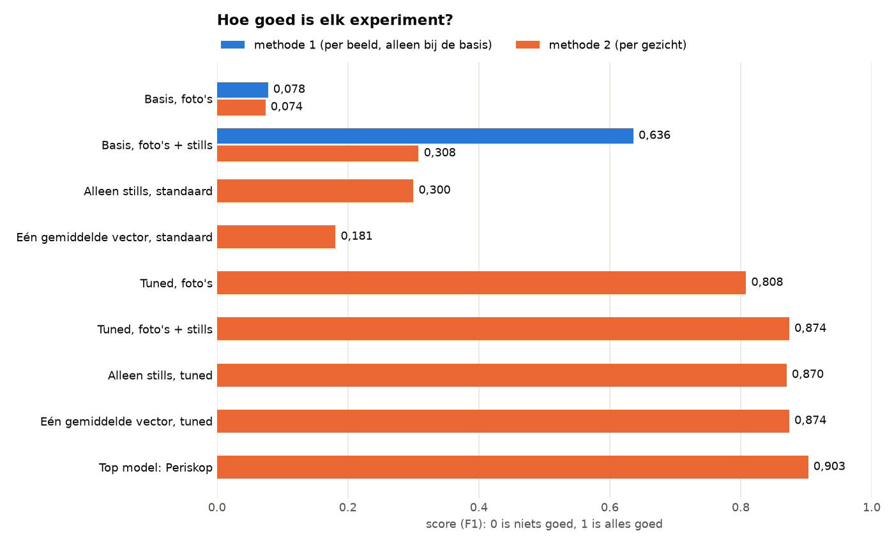

# Het lijstje

Dit is de checklist van alles wat we in deze branch wilden doen. Een vinkje betekent: klaar en op GitHub. Elke link gaat naar de uitleg van dat onderdeel, met daarin hoe het gedaan is, wat eruit kwam en hoe je het draait op een Mac en op Windows.

*De uitkomst van de experimenten in één plaatje. Zo lees je het plaatje: een langere balk is beter. Oranje is de score per gezicht: daarmee beoordelen we FaceNet.*

## De basis van het project

- [x] De [filmpjes](../filmpjes/) in hun eigen map
- [x] Het [labelen](../labelen/README.md): de code per stap, de uitkomst van elke stap in `output/` en een uitleg met foto's
- [x] [Installeren en draaien](README.md#installeren-op-mac-en-windows) op een Mac en op Windows

## De experimenten

Elk los experiment is gedaan met FaceNet standaard én met het getunde model.

- [x] [Basis](basis/README.md): FaceNet standaard, met foto's en met foto's + stills
- [x] [Twee meetmethodes](basis/README.md#de-twee-meetmethodes), per beeld en per gezicht, met een keuze voor de tweede. De meting per beeld staat alleen bij de basis
- [x] [Tuned](tuned/README.md): FaceNet met de best mogelijke instellingen, algemeen en per filmpje
- [x] Bij elke herkenning rapporteren welke foto het meest op het kader leek: `voorspellingen.csv` en `gebruik_per_foto.csv`
- [x] [Moving average](moving_average/README.md): een filter met ondergrens 0,2 en bovengrens 0,7
- [x] [Spreiding](spreiding/README.md): de grootste afstand binnen een persoon en de kleinste afstand tussen personen, voor out-of-character, in-character en de totale set
- [x] [Grootste spreiding](spreiding/README.md#krijgt-een-kader-dat-geen-van-de-vier-personen-is-vaak-de-persoon-met-de-grootste-spreiding): krijgt een onherkenbaar kader vaak die persoon?
- [x] [Alleen in karakter](alleen_in_karakter/README.md): de tijdlijnen met alleen de stills, en wat er gebeurt zonder de gewone foto's
- [x] [Leave-one-out](leave_one_out/README.md): welke foto's maken het resultaat slechter?
- [x] [Herkenningsdichtheid](herkenningsdichtheid/README.md): een convolutiefilter over de tijdlijn, met vensters van 10 tot 20 beelden
- [x] [Wie wordt Johann](wie_wordt_johann/README.md): wie wordt als Johann herkend op plekken waar Johann er niet is?
- [x] [Eén gemiddelde vector](gemiddelde_vector/README.md) per persoon
- [x] [Werner met baard](werner_baard/README.md): meer stills van Werner met baard, alleen met stills en dus niet met beelden uit de filmpjes
- [x] [Top model: Periskop](top_model/README.md): het beste dat we kunnen bouwen met alles wat we geleerd hebben
- [x] [Overzicht van alle experimenten](README.md#alle-experimenten)

## Zo voer je het lijstje uit op Mac en Windows

Alles op dit lijstje is al gedaan. Wil je het opnieuw draaien, volg dan [Zo draai je de experimenten](README.md#zo-draai-je-de-experimenten). Daar staat per experiment wat je op een Mac en wat je op Windows typt.
