# De experimenten: hoe goed herkent FaceNet de vier personen?

In deze map testen we **FaceNet**, een programma dat gezichten herkent, op acht fragmenten uit de film *Das Boot*. We zoeken vier personen: Der Alte, Fritz Grade, Johann en Werner. De juiste antwoorden komen uit [het labelen](../labelen/README.md).

> **Het antwoord in het kort.**
>
> - **FaceNet standaard is slecht.** Met alleen gewone foto's als voorbeeld krijgt bijna niemand een naam (score 0,074). Met de gewone foto's én de stills uit de film krijgt bijna iedereen een naam, vaak de verkeerde (score 0,308).
> - **Het getunde model haalt 0,874.** Dat is FaceNet met de best gevonden instellingen. Dat getal is iets te gunstig, omdat de instellingen gekozen zijn op dezelfde beelden als waarop we meten. Kiezen we de instellingen op andere filmpjes, dan is de score 0,834.
> - **Het top model, [Periskop](top_model/README.md), haalt 0,903.** Dat is alles wat we geleerd hebben in één model. De eerlijke schatting is 0,889, en het zet bijna geen namen meer op de verkeerde plek.
> - **De winst komt vooral van** het lichter maken van donkere gezichten, extra ruimte om het kader, vergelijken met het gemiddelde van de foto's en per track beslissen, met een drempel die daarbij past. Periskop kijkt daarbovenop met twee modellen tegelijk, en alleen naar de beste beelden van een track. Alleen de drempel veranderen helpt bij foto's + stills bijna niet: de score gaat dan van 0,308 naar 0,315.

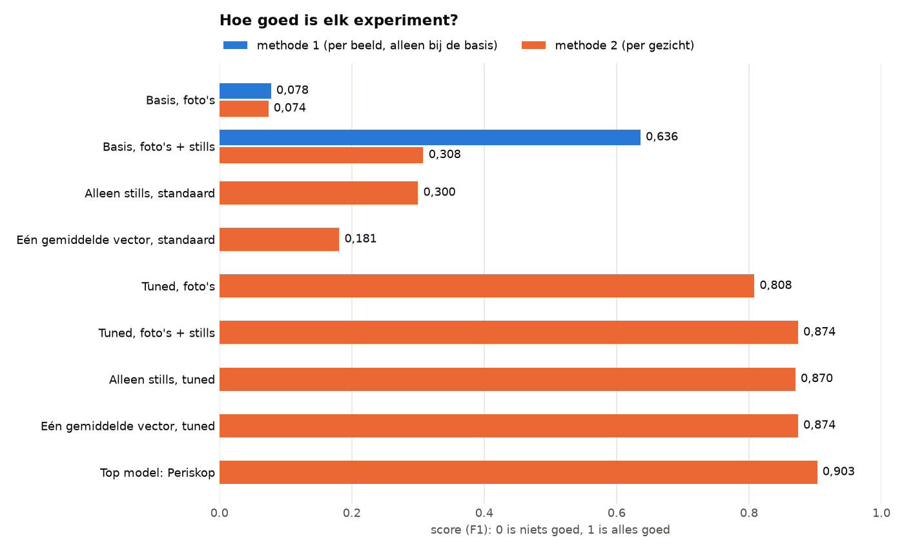

*Zo lees je dit plaatje: hier staan de experimenten die één score per set voorbeelden hebben. De andere staan in de tabel [Alle experimenten](#alle-experimenten). Een langere balk is beter. Oranje is de score per gezicht: staat de naam op het juiste gezicht? Daarmee beoordelen we FaceNet. Blauw is de score per beeld: noemt FaceNet de naam ergens in het beeld? Die maat is te gunstig en staat daarom alleen bij de basis. Dezelfde getallen staan in [`overzicht.csv`](overzicht.csv).*

**In deze uitleg:**
[Zo werkt FaceNet](#zo-werkt-facenet) ·
[Zo meten we](#zo-meten-we-hoe-goed-facenet-is) ·
[Waarom het getunde model zoveel beter is](#waarom-het-getunde-model-zoveel-beter-is) ·
[Alle experimenten](#alle-experimenten) ·
[Woordenlijst](#woordenlijst) ·
[Installeren](#installeren-op-mac-en-windows) ·
[Draaien](#zo-draai-je-de-experimenten) ·
[Wat er in deze map staat](#wat-er-in-deze-map-staat)


## Zo werkt FaceNet

FaceNet kent geen namen. FaceNet maakt van een gezicht een rij van 128 getallen, een *vector*. Twee foto's van dezelfde persoon geven rijen die op elkaar lijken. Daarom geven we FaceNet voorbeeldfoto's van de vier personen, en vergelijken we elk gezicht in de film daarmee.

Zo krijgt een gezicht een naam. De nummers zijn dezelfde als in het plaatje.

1. In het labelen heeft de detector *kaders* gezet om de gezichten die hij vond. Niet elk gezicht heeft een kader.
2. FaceNet krijgt het gezicht uit het kader.
3. FaceNet maakt daarvan een vector.
4. We meten de afstand tot de vectoren van alle voorbeeldfoto's. De persoon met de kleinste afstand is de kandidaat.
5. Is die afstand kleiner dan de *drempel*, dan krijgt het kader die naam. Zo niet, dan is het *iemand anders*: geen van de vier personen.

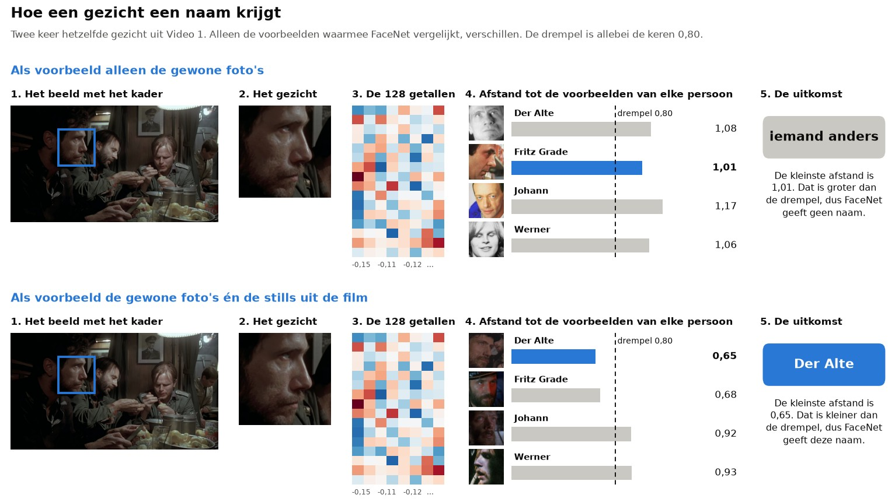

*Zo lees je dit plaatje: dit is twee keer hetzelfde gezicht, en je leest elke rij van links naar rechts. Elk gekleurd vakje bij stap 3 is één van de 128 getallen. Bij stap 4 staat per persoon de foto die het meest op het gezicht lijkt, met de afstand ernaast. De blauwe balk is de kleinste afstand. Bovenaan zijn er alleen gewone foto's. Daarvan lijkt er geen genoeg op dit gezicht: de kleinste afstand is 1,01 en dat is meer dan de drempel. Onderaan zijn er ook stills uit de film. De kleinste afstand is dan 0,65, en het gezicht krijgt de juiste naam.*


## Zo meten we hoe goed FaceNet is

De ground truth zegt per beeld wie er te zien is en waar. Daarmee kijken we elke naam van FaceNet na: **staat de naam op het gezicht van die persoon?** Dat noemen we de *score per gezicht*. Alle experimenten gebruiken deze maat, met dezelfde code ([`gedeeld/meten.py`](gedeeld/meten.py)). Als er alleen *score* staat, bedoelen we deze score.

Om te bepalen of een kader op een gezicht ligt, meten we de *overlap*: het oppervlak dat de twee kaders delen, gedeeld door het oppervlak dat ze samen bedekken. Die overlap moet minstens 30% zijn.

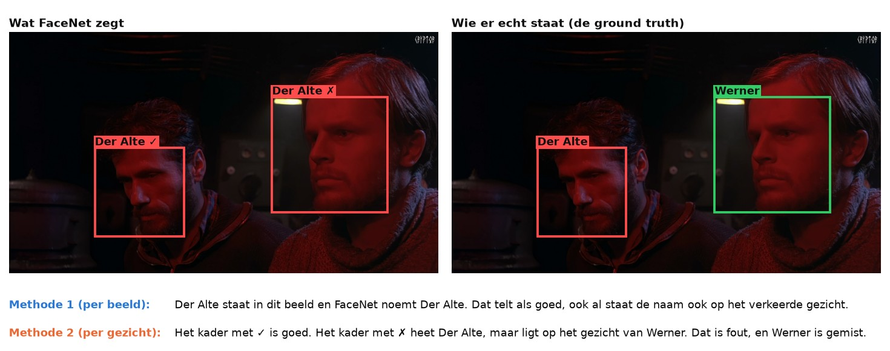

*Waarom we per gezicht meten. FaceNet zet in dit beeld twee keer de naam Der Alte. Een meting per beeld rekent Der Alte goed, want die staat in het beeld. Een meting per gezicht rekent één van de twee namen fout, want die staat op het gezicht van Werner. De kleuren horen hier bij de personen, niet bij goed of fout.*

Alleen bij de [basis](basis/README.md#de-twee-meetmethodes) laten we ook de meting per beeld zien, om het verschil te tonen. Die maat is te gunstig: een naam op het verkeerde gezicht telt daar als goed.

De score komt uit drie getallen, allemaal van 0 tot 1:

- **Precisie:** als FaceNet een naam geeft, hoe vaak klopt die naam dan?
- **Recall:** van alle gezichten van de vier personen, hoeveel krijgen de juiste naam?
- **De score (F1):** 2 × precisie × recall, gedeeld door precisie + recall. Dat is geen gewoon gemiddelde: het laagste getal weegt het zwaarst. Daarom is de score bij alleen foto's maar 0,074, ook al klopt 93% van de namen.

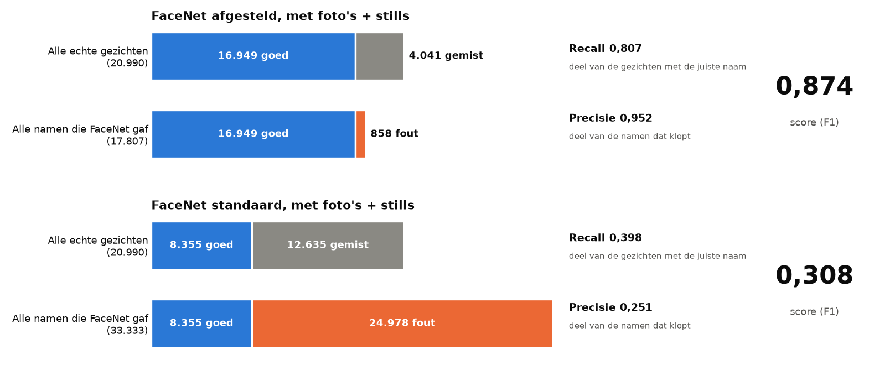

*Zo lees je dit plaatje: blauw is goed, grijs is gemist en oranje is fout. De 20.990 is hoe vaak een van de vier personen in een beeld staat, opgeteld over alle beelden. Figuranten tellen daar niet in mee. FaceNet bekijkt alle 37.003 kaders, ook die op figuranten en op dingen die geen gezicht zijn. Daarom kan FaceNet meer namen geven dan er gezichten van de vier personen zijn. Standaard zijn er drie keer zoveel foute namen als goede namen.*

De score kan hier niet 1 worden. FaceNet bekijkt alleen kaders, en 1.611 van de 20.990 gezichten hebben geen kader. Zelfs als elke naam klopt, blijft de score onder 0,96.


## Waarom het getunde model zoveel beter is

Een kader krijgt alleen een naam als de afstand kleiner is dan de drempel. Goed en fout moeten dus aan verschillende kanten van de drempel liggen.

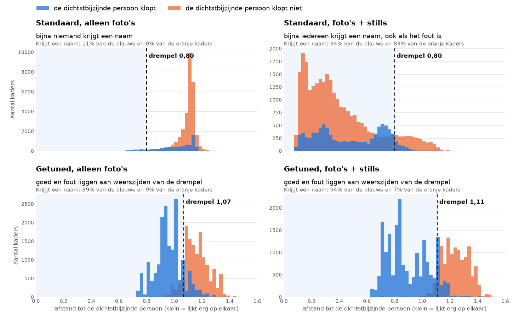

*Zo lees je dit plaatje: elke grafiek telt hoeveel kaders een bepaalde afstand hebben. Blauw: de dichtstbijzijnde persoon klopt. Oranje: die klopt niet, en daar horen ook alle kaders op figuranten en op dingen die geen gezicht zijn bij. Waar blauw en oranje over elkaar vallen, zie je donkerblauw. Links van de stippellijn krijgt een kader een naam. Let op: de verticale as verschilt per grafiek. De afstand loopt van 0 tot 2.*

- **Standaard, alleen foto's (linksboven).** Bijna alle afstanden zijn groter dan 0,80. De gewone foto's lijken te weinig op de donkere gezichten in de film, dus bijna niemand krijgt een naam.
- **Standaard, foto's + stills (rechtsboven).** De meeste afstanden zijn kleiner dan 0,80, ook als de persoon niet klopt. De oranje kaders liggen zelfs het verst naar links. De donkere en wazige stills lijken voor FaceNet op bijna alles, dus bijna iedereen krijgt een naam.
- **Getuned (onder).** Door de andere instellingen veranderen de afstanden zelf: blauw en oranje komen los van elkaar te liggen. Pas daarna kan één drempel goed en fout uit elkaar halen. Een andere drempel alleen kan dat niet, want die verschuift geen enkele balk.


## Alle experimenten

Basis en Tuned zijn de twee hoofdproeven. De acht proeven daarna hebben we met allebei gedaan: met FaceNet standaard en met het getunde model. Onderaan staat het top model, waarin alles samenkomt. Elke naam is een link naar de volledige uitleg.

| Experiment | De vraag | Met FaceNet standaard | Met het getunde model |
|---|---|---|---|
| [**Basis**](basis/README.md) | Hoe goed is FaceNet zonder afstellen? | Slecht. Score 0,074 met foto's, 0,308 met foto's + stills. | |
| [**Tuned**](tuned/README.md) | Hoe goed is FaceNet met de best mogelijke instellingen? | | Veel beter. Score 0,808 met foto's, 0,874 met foto's + stills. Eerlijke schatting: 0,766 en 0,834. |
| [**Alleen in karakter**](alleen_in_karakter/README.md) | Hoe belangrijk zijn de gewone foto's als de stills er al zijn? | Bijna niet. Score 0,300 zonder en 0,308 met de gewone foto's. | Bijna niet. Score 0,870 zonder en 0,874 met de gewone foto's. |
| [**Eén gemiddelde vector**](gemiddelde_vector/README.md) | Werkt één gemiddelde per persoon beter dan alle foto's los? | Nee. De score zakt van 0,308 naar 0,181. | Ja, als er stills in de set zitten. De score gaat van 0,773 naar 0,874. |
| [**Spreiding**](spreiding/README.md) | Hoe ver liggen de voorbeelden uit elkaar? Krijgt een kader dat geen van de vier personen is, vaak de persoon met de grootste spreiding? | Sommige stills van verschillende personen lijken sterk op elkaar (kleinste afstand 0,24). Het idee over de spreiding klopt in 1 van de 3 sets. | Die stills liggen veel verder uit elkaar (kleinste afstand 0,82). Het idee klopt in geen van de 3 sets. |
| [**Wie wordt Johann**](wie_wordt_johann/README.md) | Wie wordt als Johann herkend waar Johann er niet is? | 5.858 kaders, vooral figuranten en Der Alte. Daarvan komt 86% door één voorbeeldfoto: `johann3.png`. | Nog maar 120 kaders. |
| [**Werner met baard**](werner_baard/README.md) | Vindt FaceNet Werner beter als er meer stills zijn waarop Werner een baard heeft? | Ja. De score van Werner gaat van 0,311 naar 0,431. | Een beetje. De score van Werner gaat van 0,902 naar 0,919. |
| [**Leave-one-out**](leave_one_out/README.md) | Welke voorbeeldfoto's maken het resultaat slechter? | Vooral `johann3.png`. Zonder die foto is de score 0,357 in plaats van 0,308. | Geen enkele foto doet nog veel kwaad. Het grootste effect is +0,005. |
| [**Moving average**](moving_average/README.md) | Wordt het beter met een filter dat losse flitsen weghaalt? | Een beetje. Hoogstens van 0,308 naar 0,345. | Nee. De score blijft gelijk of wordt lager. |
| [**Herkenningsdichtheid**](herkenningsdichtheid/README.md) | Wanneer staat de juiste naam op het juiste gezicht, en wanneer op een verkeerde plek? | Vaak op een verkeerde plek. | Meestal op het juiste gezicht. |
| [**Top model: Periskop**](top_model/README.md) | Wat is het beste dat we kunnen bouwen met alles wat we geleerd hebben? | | Score 0,903, eerlijke schatting 0,889. Nog maar 139 namen op de verkeerde plek. |

Welke voorbeeldfoto bij elk kader het meest op het gezicht leek, staat per experiment in `voorspellingen.csv` (kolom `foto`). Hoe vaak elke foto gekozen is, staat in `gebruik_per_foto.csv`. De filmpjes met de namen van FaceNet staan bij [de basis](basis/README.md#de-filmpjes), [tuned](tuned/README.md#de-filmpjes) en [alleen in karakter](alleen_in_karakter/README.md).

Bij elk los experiment staan de uitkomsten in twee mappen: `resultaten/` (FaceNet standaard) en `resultaten_tuned/` (het getunde model).


## Woordenlijst

| Woord | Zo ziet het eruit | Wat het betekent |
|---|---|---|
| **Beeld** (*frame*) | 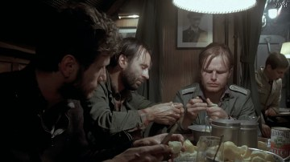 | Een film is een reeks losse beelden die snel na elkaar komen, meestal 25 per seconde. |
| **Kader** | 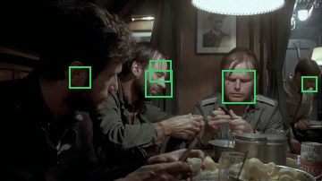 | De rechthoek die de detector om een gezicht zet. Een kader kan ook op iets staan dat geen gezicht is. |
| **Track** | 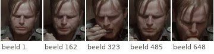 | Hetzelfde gezicht, gevolgd over beelden na elkaar. Een track is dus een reeks kaders. |
| **Ground truth** | 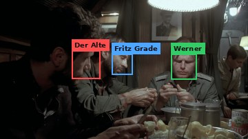 | De lijst die met de hand gemaakt en gecontroleerd is: per beeld wie van de vier personen er te zien is en waar. Daarmee kijken we FaceNet na. Het bestand heet [`ground_truth.csv`](../labelen/output/stap_3_fouten_verbeteren/ground_truth.csv). |
| **Foto en still** | 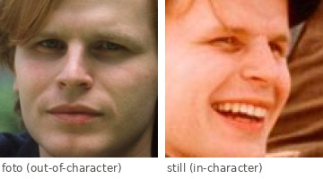 | De voorbeelden voor FaceNet. Een *foto* is een gewone foto van de acteur, buiten de film (*out-of-character*). Een *still* is een los beeld uit de film, in kostuum (*in-character*). |
| **Vector** | 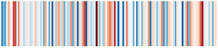 | De rij getallen die FaceNet van een gezicht maakt. |
| **Afstand en drempel** | 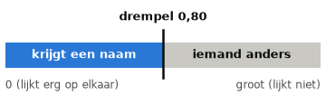 | De *afstand* zegt hoe verschillend twee vectoren zijn: klein is lijkt op elkaar. De *drempel* is de grens: is de afstand kleiner, dan krijgt het kader een naam. |

| Woord | Wat het betekent |
|---|---|
| **Detector** | Het programma dat in een beeld gezichten zoekt en er een kader omheen zet. |
| **Figurant** | Een gezicht dat niet een van de vier personen is. |
| **Iemand anders** | Een kader dat geen naam krijgt, omdat de afstand te groot is. |
| **Set** | De groep voorbeelden die FaceNet krijgt: alleen foto's, alleen stills, of foto's + stills. We tellen gezichten en geen foto's, want op één foto of still kunnen meer gezichten staan. |
| **Label** | De keuze van de labelaar: wie staat er in dit kader? De naam van een bestand zegt niet wie erop staat. |
| **Overlap** | Het oppervlak dat twee kaders delen, gedeeld door het oppervlak dat ze samen bedekken. |
| **Score (F1), precisie, recall** | Zie [Zo meten we hoe goed FaceNet is](#zo-meten-we-hoe-goed-facenet-is). |
| **Tuned, getuned** | FaceNet met de beste instellingen die we gevonden hebben. FaceNet zelf is niet opnieuw getraind. |
| **Euclidische afstand** | De rechte lijn tussen twee punten, maar dan met 128 getallen in plaats van twee. *Genormaliseerd* betekent dat elke vector eerst lengte 1 krijgt. De afstand ligt dan altijd tussen 0 en 2. Deze afstand schrijft de opdracht voor. De *cosinusafstand* kijkt alleen naar de richting van de vectoren. |
| **Venster** | Het aantal beelden waarover we een gemiddelde nemen. |
| **Beeldwissel** | De plek waar de film ineens naar een ander shot springt. |


## Installeren op Mac en Windows

Dit hoef je maar één keer te doen.

**1. Open een terminal in de map `experimenten`.** Een terminal is het venster waarin je opdrachten typt.

- **Mac:** open het programma Terminal, typ `cd ` (met een spatie erachter), sleep de map `experimenten` naar het venster en druk op Enter.
- **Windows:** open de map `experimenten` in de Verkenner, klik bovenin op de balk met de naam van de map, typ `cmd` en druk op Enter.

**2. Installeer Python 3.12** vanaf <https://www.python.org/downloads/>. Zet op Windows in het eerste scherm een vinkje bij *Add python.exe to PATH*.

**3. Installeer de pakketten:** deepface (FaceNet), TensorFlow, pandas, NumPy, OpenCV en matplotlib.

Op een Mac:

```bash
python3.12 -m venv .venv
.venv/bin/pip install -r requirements.txt
```

Op Windows:

```bat
py -3.12 -m venv .venv
.venv\Scripts\pip install -r requirements.txt
```

**4. Installeer ffmpeg.** Dat programma is nodig voor de filmpjes. Open daarna een nieuw terminalvenster.

Op een Mac:

```bash
brew install ffmpeg
```

Op Windows:

```bat
winget install Gyan.FFmpeg
```

De eerste keer haalt deepface de gewichten van FaceNet op, ongeveer 90 MB per model. Op Windows hebben we de programma's niet zelf uitgeprobeerd.


## Zo draai je de experimenten

Alle uitkomsten staan al in de mappen. Opnieuw draaien hoeft alleen als je iets verandert. Doe het vanuit de map `experimenten`, in deze volgorde.

Op een Mac typ je `.venv/bin/python`, gevolgd door het script uit de tabel:

```bash
.venv/bin/python basis/draai_alles.py
```

Op Windows typ je `.venv\Scripts\python`, gevolgd door het script, met `\` in plaats van `/`:

```bat
.venv\Scripts\python basis\draai_alles.py
```

| Experiment | Script | Getuned erbij? | Hoe lang het duurt |
|---|---|---|---|
| Basis | `basis/draai_alles.py` | | de eerste keer een kwartier |
| Tuned | `tuned/draai_alles.py` | | de eerste keer een uur |
| Top model | `top_model/draai_alles.py` | | de eerste keer twintig minuten, na Tuned |
| Alleen in karakter | `alleen_in_karakter/draai.py` | zet er `--model tuned` achter | enkele minuten |
| Eén gemiddelde vector | `gemiddelde_vector/draai.py` | zet er `--model tuned` achter | een halve minuut |
| Spreiding | `spreiding/draai.py` | zet er `--model tuned` achter | een halve minuut |
| Wie wordt Johann | `wie_wordt_johann/draai.py` | zet er `--model tuned` achter | een halve minuut |
| Werner met baard | `werner_baard/draai.py` | zet er `--model tuned` achter | een halve minuut |
| Leave-one-out | `leave_one_out/draai.py` | zet er `--model tuned` achter | een halve minuut; getuned twee minuten |
| Moving average | `moving_average/draai.py` | zet er `--model tuned` achter | een halve minuut |
| Herkenningsdichtheid | `herkenningsdichtheid/draai.py` | zet er `--model tuned` achter | een halve minuut |
| Het overzicht bovenaan | `maak_overzicht.py` | | een paar seconden |
| De uitlegplaatjes | `fotos/maak_fotos.py` | | een halve minuut |

De vectoren van alle gezichten worden één keer uitgerekend en bewaard in de map `tussenbestanden/`. Die map gaat niet mee naar GitHub.


## Wat er in deze map staat

| Map of bestand | Wat het is |
|---|---|
| `basis/`, `tuned/` | De twee hoofdproeven, elk met de code in stappen, een map `resultaten` en een eigen uitleg. |
| `top_model/` | Periskop, het beste model dat we hebben gebouwd, met de code in stappen, een map `resultaten` en een eigen uitleg. |
| `alleen_in_karakter/`, `gemiddelde_vector/`, `spreiding/`, `wie_wordt_johann/`, `werner_baard/`, `leave_one_out/`, `moving_average/`, `herkenningsdichtheid/` | De andere experimenten, elk met de code, de mappen `resultaten` (standaard) en `resultaten_tuned` (getuned) en een eigen uitleg. |
| `gedeeld/` | De code die alle experimenten gebruiken: waar de bestanden staan, FaceNet aanroepen, de voorbeelden, het meten, het getunde model en het filmpje. |
| `fotos/` | De uitlegplaatjes in deze README's, en `maak_fotos.py` die ze maakt. |
| `maak_overzicht.py`, `overzicht.csv`, `overzicht.png` | Het overzicht bovenaan deze uitleg. |
| `requirements.txt` | De pakketten met de versies waarmee gewerkt is. |
| `LIJSTJE.md` | De checklist van wat er gedaan is. |
