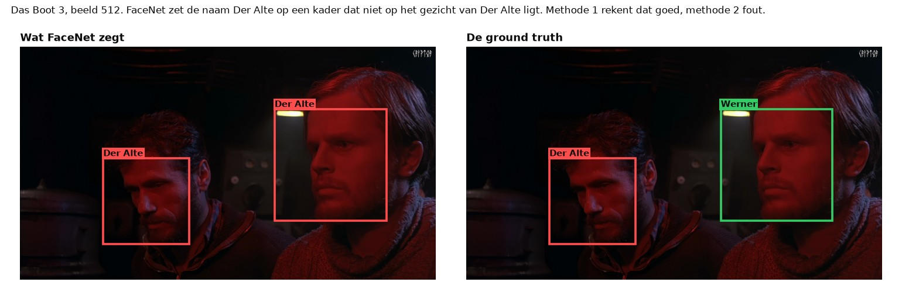

# Experimenten

In deze map staan alle experimenten met FaceNet op de filmpjes uit *Das Boot*. Elk experiment heeft een eigen map met de code, een map `resultaten` en een eigen uitleg. De juiste antwoorden (de ground truth) komen uit [het labelen](../labelen/README.md).


*F1 is één getal tussen 0 en 1: hoe goed FaceNet de vier personen vindt én hoe vaak een naam klopt. Oranje is de strengste maat (methode 2, per gezicht). Hetzelfde staat in [`overzicht.csv`](overzicht.csv).*

Wat er op dit moment gedaan is, staat in [het lijstje](LIJSTJE.md).


## De twee meetmethodes

Elk experiment meet op dezelfde manier, met de code in [`gedeeld/meten.py`](gedeeld/meten.py):

- **Methode 1, per beeld.** We weten wie er in elk beeld is en tellen: ziet FaceNet deze persoon in dit beeld?
- **Methode 2, per gezicht.** We weten ook waar elk gezicht staat. Een naam is alleen goed als het kader met die naam minstens 30% overlapt met het gezicht van die persoon. Dit is onze keuze om het model op te beoordelen.

De volledige uitleg, met een voorbeeld, staat bij [de basis](basis/README.md#de-twee-meetmethodes).


## Alle experimenten

| Experiment | De vraag | De uitkomst | Map |
|---|---|---|---|
| **Basis** | Hoe goed is FaceNet met de standaardinstellingen, met twee sets foto's? | F1 per gezicht 0,074 met foto's, 0,308 met foto's + stills. Rapporteert ook welke foto de doorslag gaf. | [`basis/`](basis/README.md) |
| **Tuned** | Hoe goed is FaceNet met de best mogelijke instellingen, met twee sets foto's? | F1 per gezicht 0,808 met foto's en 0,874 met foto's + stills (eerlijke schatting 0,766 en 0,834). | [`tuned/`](tuned/README.md) |
| **Alleen in karakter** | Hoe ziet de tijdlijn eruit met alleen de stills, en hoe belangrijk zijn de out-of-character foto's? | Met alleen stills is de F1 0,300. De gewone foto's voegen nog 0,008 toe. | [`alleen_in_karakter/`](alleen_in_karakter/README.md) |
| **Eén gemiddelde vector** | Werkt één gemiddelde vector per persoon beter? | Bij de standaarddrempel slechter (0,181 in plaats van 0,308 met foto's + stills). | [`gemiddelde_vector/`](gemiddelde_vector/README.md) |
| **Spreiding** | Hoe ver liggen de foto's van één persoon uit elkaar, en hoe dicht verschillende personen? Kiest FaceNet bij een onherkenbaar kader de grootste spreiding? | De stills liggen veel verder uit elkaar, en verschillende personen veel dichter bij elkaar (0,24). Het idee over de spreiding klopt in één van de drie sets. | [`spreiding/`](spreiding/README.md) |
| **Wie wordt Johann** | Wie wordt als Johann herkend waar Johann er niet is? | Vooral figuranten of dingen die geen gezicht zijn (41%) en Der Alte (39%). 86% komt door één foto. | [`wie_wordt_johann/`](wie_wordt_johann/README.md) |
| **Werner met baard** | Wat doen meer stills van Werner met baard? | De F1 van Werner stijgt van 0,311 naar 0,431, bijna helemaal door één still. | [`werner_baard/`](werner_baard/README.md) |
| **Leave-one-out** | Welke foto's maken het resultaat slechter? | `johann3.png` het meest (F1 +0,049 zonder die foto). Met acht foto's minder is de F1 0,426. | [`leave_one_out/`](leave_one_out/README.md) |
| **Moving average** | Wat doet een filter met een onder- en bovengrens (0,2 en 0,7)? | Op de herkenning: F1 per beeld van 0,636 naar 0,664. Op de detectorscore: F1 per gezicht van 0,308 naar 0,345. | [`moving_average/`](moving_average/README.md) |
| **Herkenningsdichtheid** | Hoe vaak herkent FaceNet iemand per tijdseenheid? | Een tijdlijn met de dichtheid per persoon, met vensters van 10, 15 en 20 beelden. | [`herkenningsdichtheid/`](herkenningsdichtheid/README.md) |

Bij elk experiment staat in de uitleg hoe het gedaan is, wat eruit kwam en wat dat betekent, met plaatjes. De filmpjes staan bij de [basis](basis/README.md#de-filmpjes), [tuned](tuned/README.md#de-filmpjes) en [alleen in karakter](alleen_in_karakter/resultaten/filmpje.mp4).



*Het verschil tussen de twee meetmethodes, op een echt beeld.*


## Installeren op Mac en Windows

Dit hoef je maar één keer te doen, vanuit de map `experimenten`. Een terminal openen in die map doe je zo:

- **Mac:** open Terminal, typ `cd ` (met een spatie erachter), sleep de map `experimenten` naar het venster en druk op Enter.
- **Windows:** open de map `experimenten` in de Verkenner, klik bovenin op de balk met de naam van de map, typ `cmd` en druk op Enter.

Je hebt Python 3.12 nodig (<https://www.python.org/downloads/>). Installeer daarna de pakketten: deepface (FaceNet), TensorFlow, pandas, NumPy, OpenCV en matplotlib.

Op een Mac:

```bash
python3.12 -m venv .venv
.venv/bin/pip install -r requirements.txt
```

Op Windows:

```bat
py -3.12 -m venv .venv
.venv\Scripts\pip install -r requirements.txt
```

De eerste keer haalt deepface de gewichten van FaceNet op (ongeveer 90 MB per model). Voor de filmpjes is ook het programma ffmpeg nodig: op een Mac `brew install ffmpeg`, op Windows `winget install Gyan.FFmpeg`. Op Windows hebben we de programma's niet zelf uitgeprobeerd; het zou daar wel moeten werken.


## Zo draai je de experimenten

Alle uitkomsten staan al in de mappen; opnieuw draaien hoeft alleen als je iets verandert. Doe het in deze volgorde, vanuit de map `experimenten`:

| Experiment | Mac | Windows | Duur |
|---|---|---|---|
| Basis | `.venv/bin/python basis/draai_alles.py` | `.venv\Scripts\python basis\draai_alles.py` | de eerste keer een kwartier |
| Alleen in karakter | `.venv/bin/python alleen_in_karakter/draai.py` | `.venv\Scripts\python alleen_in_karakter\draai.py` | enkele minuten |
| Eén gemiddelde vector | `.venv/bin/python gemiddelde_vector/draai.py` | `.venv\Scripts\python gemiddelde_vector\draai.py` | een halve minuut |
| Spreiding | `.venv/bin/python spreiding/draai.py` | `.venv\Scripts\python spreiding\draai.py` | een halve minuut |
| Wie wordt Johann | `.venv/bin/python wie_wordt_johann/draai.py` | `.venv\Scripts\python wie_wordt_johann\draai.py` | een halve minuut |
| Werner met baard | `.venv/bin/python werner_baard/draai.py` | `.venv\Scripts\python werner_baard\draai.py` | een halve minuut |
| Leave-one-out | `.venv/bin/python leave_one_out/draai.py` | `.venv\Scripts\python leave_one_out\draai.py` | een halve minuut |
| Moving average | `.venv/bin/python moving_average/draai.py` | `.venv\Scripts\python moving_average\draai.py` | een halve minuut |
| Herkenningsdichtheid | `.venv/bin/python herkenningsdichtheid/draai.py` | `.venv\Scripts\python herkenningsdichtheid\draai.py` | een halve minuut |
| Tuned | `.venv/bin/python tuned/draai_alles.py` | `.venv\Scripts\python tuned\draai_alles.py` | de eerste keer een uur |
| Overzicht | `.venv/bin/python maak_overzicht.py` | `.venv\Scripts\python maak_overzicht.py` | een paar seconden |

De vectoren van alle gezichten worden één keer uitgerekend en bewaard in `tussenbestanden/`; die map gaat niet mee naar GitHub.


## Wat er in deze map staat

| Map of bestand | Wat het is |
|---|---|
| `basis/`, `tuned/`, `alleen_in_karakter/`, `gemiddelde_vector/`, `spreiding/`, `wie_wordt_johann/`, `werner_baard/`, `leave_one_out/`, `moving_average/`, `herkenningsdichtheid/` | De experimenten, elk met code, een map `resultaten` en een eigen uitleg. |
| `gedeeld/` | De code die alle experimenten gebruiken: waar de bestanden staan, FaceNet aanroepen, de voorbeelden, de twee meetmethodes en het filmpje. |
| `requirements.txt` | De pakketten met de versies waarmee gewerkt is. |
| `maak_overzicht.py`, `overzicht.csv`, `overzicht.png` | Het overzicht bovenaan deze uitleg. |
| `LIJSTJE.md` | Wat er gedaan is. |
