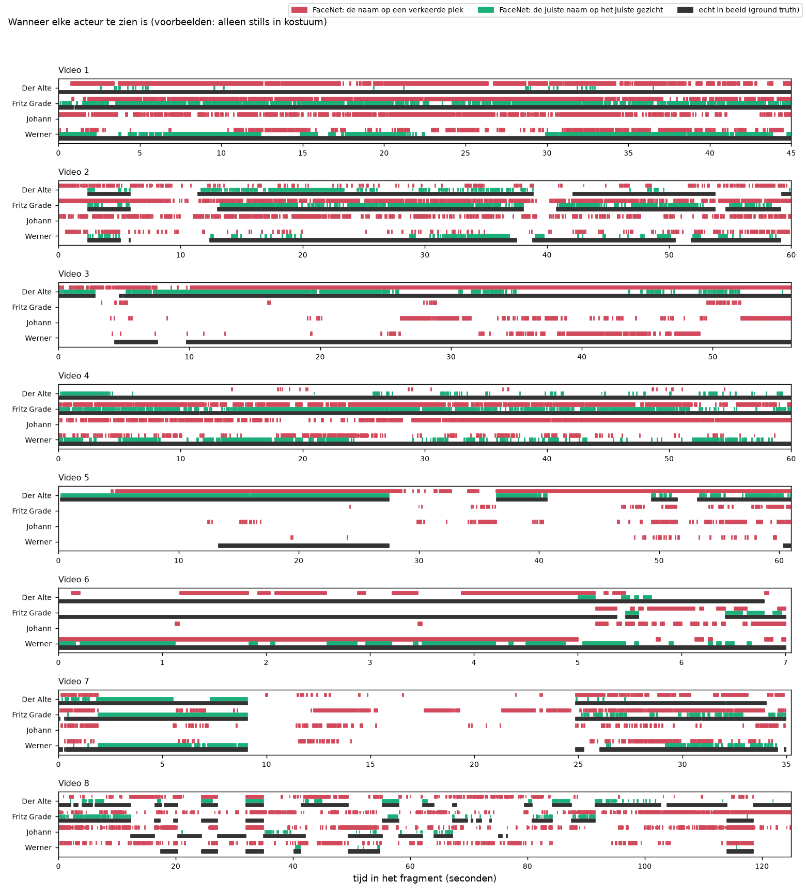
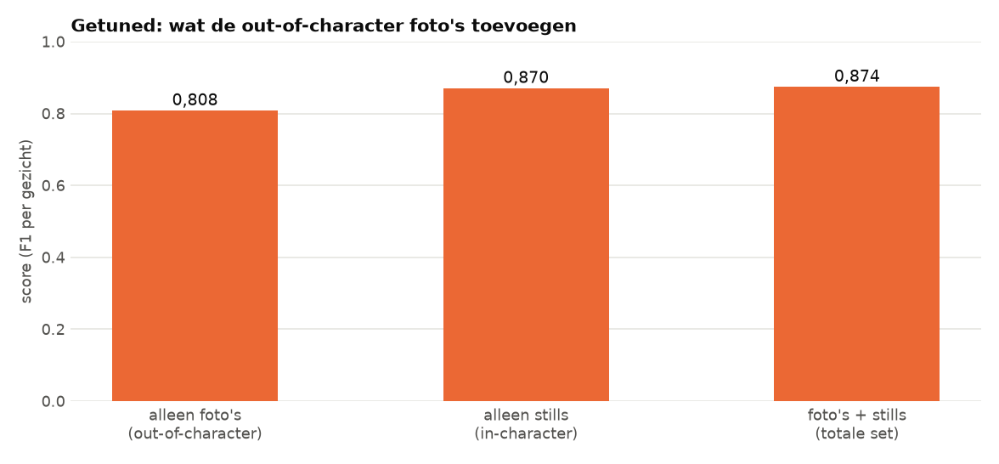
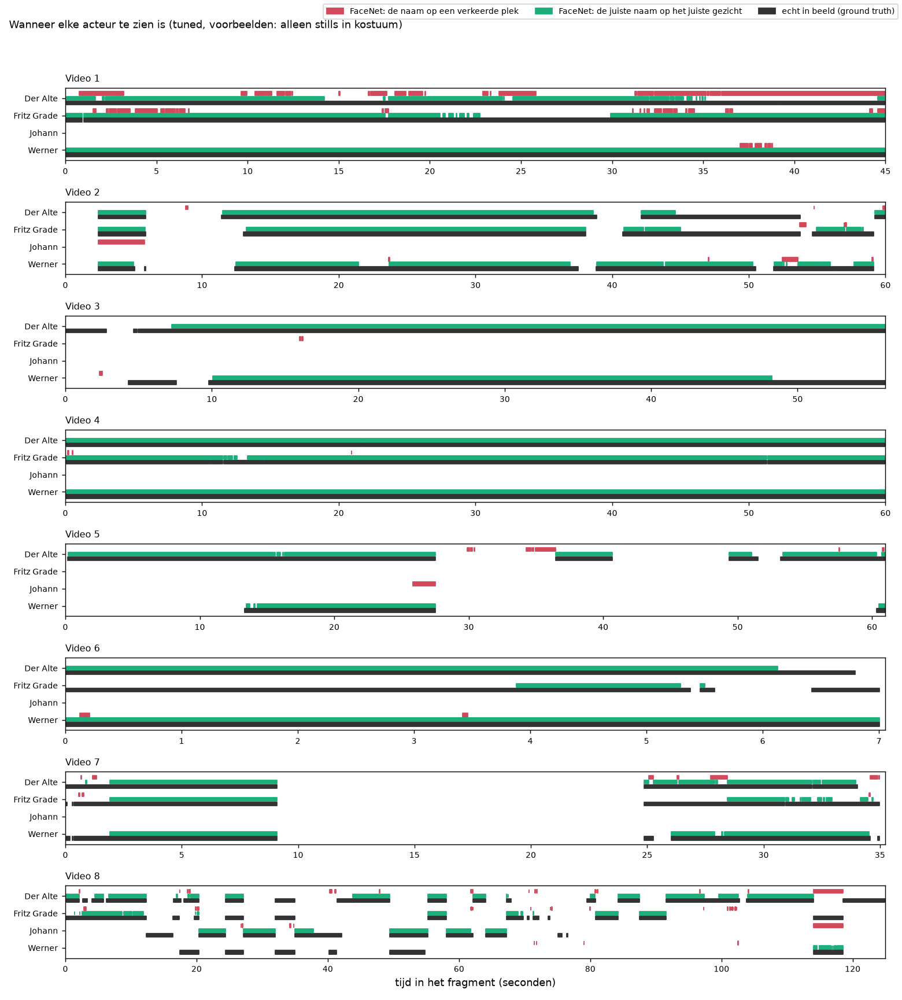

# Alleen de in-karakter foto's

> **De vraag.** Hoe goed werkt FaceNet als de voorbeelden alleen stills uit de film zijn, en hoe belangrijk zijn de gewone foto's dan nog?
>
> **Het antwoord.** De gewone foto's voegen bijna niets toe als de stills er al zijn. Met FaceNet standaard is de score 0,300 zonder en 0,308 met de gewone foto's. Met het getunde model is dat 0,870 zonder en 0,874 met de gewone foto's.


*FaceNet standaard. Zo lees je dit plaatje: elke balk is een set voorbeelden, en een hogere balk is beter. Het middelste en het rechterbalkje zijn bijna even hoog: de gewone foto's maken dus bijna geen verschil.*

Wat de woorden betekenen, staat in [de woordenlijst](../README.md#woordenlijst).


## Waarom dit experiment

De voorbeelden voor FaceNet bestaan uit twee soorten foto's:

- **Out-of-character:** gewone foto's van de acteurs, buiten de film (23 gezichten).
- **In-character:** stills uit de film, met de personen in kostuum (50 gezichten).

We willen weten wat er gebeurt als we de gewone foto's weglaten. Zo'n proef, waarbij je een onderdeel weglaat om te zien wat het doet, heet een *ablation*.


## Hoe we het gedaan hebben

1. We draaien precies dezelfde stappen als bij de [basis](../basis/README.md), maar met als voorbeelden alleen de 50 gezichten op de stills.
2. De drie stills die (bijna) een beeld uit een van de filmpjes zijn, doen niet mee. Een beeld uit de filmpjes mag geen voorbeeld zijn.
3. We meten per gezicht en zetten de drie sets naast elkaar.
4. Daarna doen we hetzelfde met het getunde model. We zoeken dan op dezelfde manier als bij [tuned](../tuned/README.md) de beste instellingen voor alleen de stills.


*Dit zijn alle voorbeelden in dit experiment, per persoon. Elk klein plaatje is precies wat FaceNet te zien krijgt.*


## Wat eruit kwam met FaceNet standaard

| Voorbeelden | Aantal gezichten | Score |
|---|---|---|
| Alleen foto's (out-of-character) | 23 | 0,074 |
| Alleen stills (in-character) | 50 | 0,300 |
| Foto's + stills (de totale set) | 73 | 0,308 |

Laat je de gewone foto's weg, dan zakt de score maar 0,008. Vrijwel alle winst komt van de stills. Andersom geldt dat niet: met alleen de gewone foto's herkent FaceNet bijna niemand.



*De tijdlijn met alleen stills. Elke regel is een persoon, en de tijd loopt van links naar rechts. Zwart is wanneer de persoon echt in beeld is. Groen is wanneer FaceNet de juiste naam op het gezicht van die persoon zet. Rood is wanneer FaceNet die naam op een verkeerde plek zet.*

Alle getallen per persoon staan in [de uitkomsten met alleen stills](resultaten/README.md). Het filmpje met de namen van FaceNet is [`resultaten/filmpje.mp4`](resultaten/filmpje.mp4).


## Met het getunde model

We hebben ook voor de set met alleen stills de beste instellingen gezocht: Facenet512, 30% extra ruimte, lichter maken, vergelijken met het gemiddelde, per track beslissen en een drempel van 1,0440.



*Het getunde model. Zo lees je dit plaatje: elke balk is een set voorbeelden, elk met de eigen beste instellingen. Alle balken zijn hoog, en het middelste en het rechterbalkje zijn bijna even hoog.*

| Voorbeelden | Aantal gezichten | Score met de eigen beste instellingen | Score met de instellingen van foto's + stills |
|---|---|---|---|
| Alleen foto's | 23 | 0,808 | 0,636 |
| Alleen stills | 50 | 0,870 | 0,838 |
| Foto's + stills | 73 | 0,874 | 0,874 |

De laatste kolom gebruikt precies de instellingen van de set met foto's + stills. Dan verandert alleen de lijst met voorbeelden. Dat is de zuiverste manier om te zien wat een set voorbeelden doet.



*De tijdlijn met alleen stills en het getunde model. Groen loopt op de meeste plekken gelijk met zwart.*

De eerlijke schatting met alleen stills, waarbij de instellingen steeds op andere filmpjes gekozen zijn, is 0,837. Alle getallen staan in [de uitkomsten van het getunde model](resultaten_tuned/README.md), met het filmpje [`resultaten_tuned/filmpje.mp4`](resultaten_tuned/filmpje.mp4).


## Wat dit betekent

- **Vrijwel alle winst komt van de stills.** Laat je de gewone foto's weg, dan zakt de score maar 0,008 bij FaceNet standaard, en 0,004 bij het getunde model.
- **De stills zijn niet per se nodig.** Met goede instellingen haalt FaceNet met alleen gewone foto's al 0,808. De stills geven daarna nog 0,06 extra.
- **De gezichten in de film lijken meer op de stills dan op de gewone foto's.** Daarom is de winst van de stills bij FaceNet standaard zo groot.


## Zo draai je het op een Mac en op Windows

Doe dit vanuit de map `experimenten`. Draai eerst de [basis](../basis/README.md), en voor het getunde model ook [tuned](../tuned/README.md). Installeren hoeft één keer, zie [Installeren op Mac en Windows](../README.md#installeren-op-mac-en-windows).

Op een Mac:

```bash
.venv/bin/python alleen_in_karakter/draai.py
.venv/bin/python alleen_in_karakter/draai.py --model tuned
```

Op Windows:

```bat
.venv\Scripts\python alleen_in_karakter\draai.py
.venv\Scripts\python alleen_in_karakter\draai.py --model tuned
```
