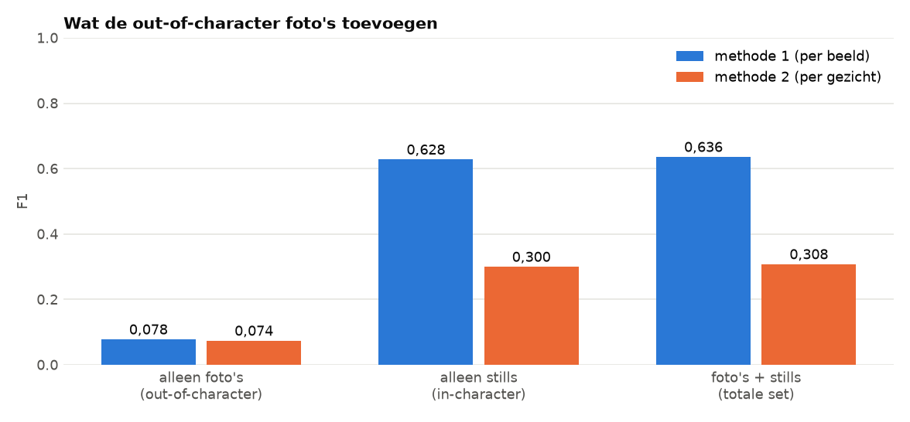
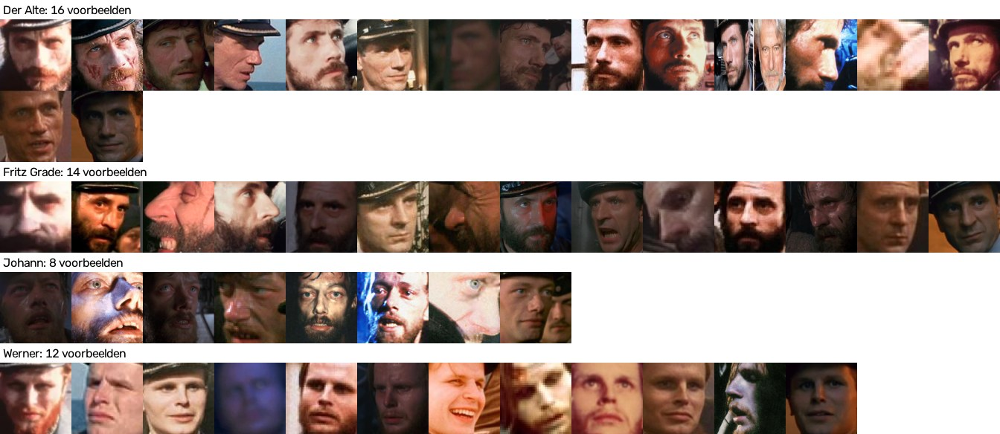
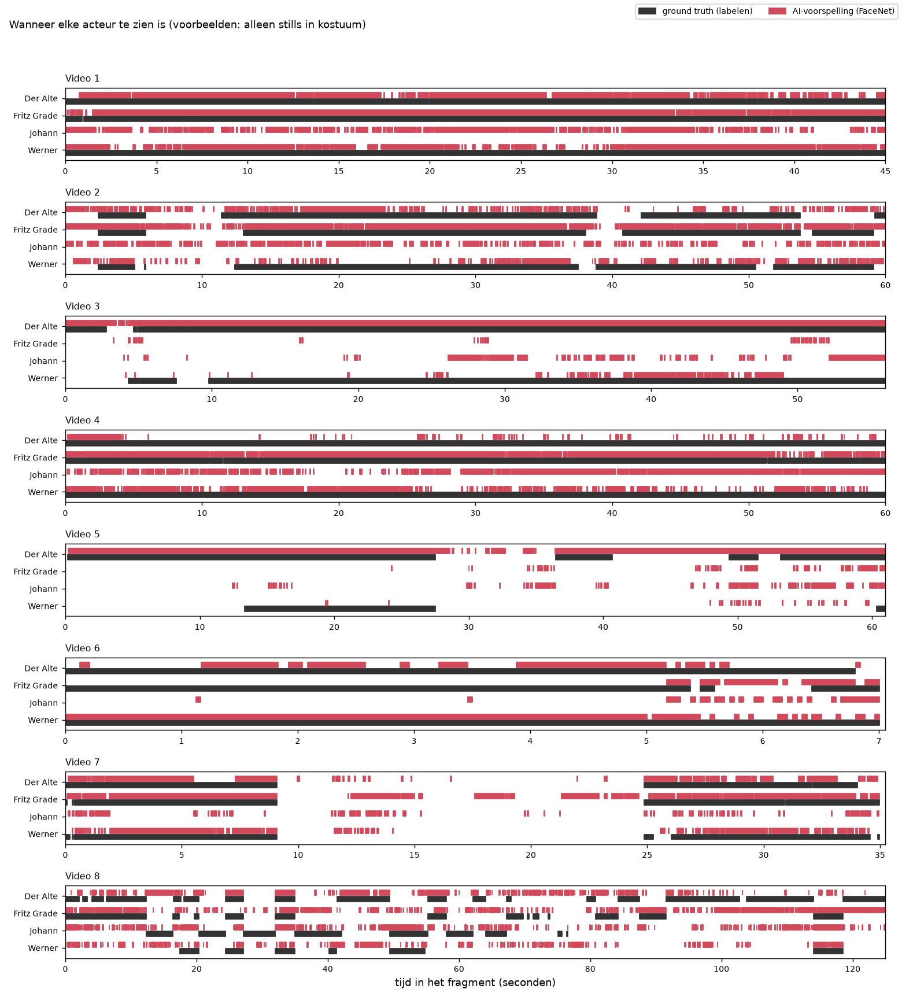

# Alleen de in-karakter foto's

> **De vraag.** Hoe goed werkt FaceNet als de voorbeelden alleen stills uit de film zijn, en hoe belangrijk zijn de gewone foto's dan nog?
>
> **Het antwoord.** De gewone foto's voegen bijna niets toe. Met alleen stills is de score 0,300, en met de gewone foto's erbij 0,308. Andersom geldt dat niet: met alleen gewone foto's is de score 0,074.



*Zo lees je dit plaatje: elk groepje is een set voorbeelden, en een hogere balk is beter. Blauw is de score per beeld, oranje de score per gezicht. Het middelste en het rechtergroepje zijn bijna even hoog: de gewone foto's maken dus bijna geen verschil.*

Wat de woorden betekenen, staat in [de woordenlijst](../README.md#woordenlijst).


## Waarom dit experiment

De voorbeelden voor FaceNet bestaan uit twee soorten foto's:

- **Out-of-character:** gewone foto's van de acteurs, buiten de film (23 gezichten).
- **In-character:** stills uit de film, met de personen in kostuum (50 gezichten).

We willen weten wat er gebeurt als we de gewone foto's weglaten. Zo'n proef, waarbij je een onderdeel weglaat om te zien wat het doet, heet een *ablation*.


## Hoe we het gedaan hebben

1. We draaien precies dezelfde stappen als bij de [basis](../basis/README.md): FaceNet standaard, drempel 0,80.
2. Als voorbeelden gebruiken we alleen de 50 gezichten op de stills.
3. De drie stills die (bijna) een beeld uit een van de filmpjes zijn, doen niet mee. Een beeld uit de filmpjes mag geen voorbeeld zijn.
4. We meten met beide meetmethodes en zetten de drie sets naast elkaar.



*Dit zijn alle voorbeelden in dit experiment, per persoon. Elk klein plaatje is precies wat FaceNet te zien krijgt.*


## Wat eruit kwam

| Voorbeelden | Aantal gezichten | Score per gezicht (methode 2) | Score per beeld (methode 1) |
|---|---|---|---|
| Alleen foto's (out-of-character) | 23 | 0,074 | 0,078 |
| Alleen stills (in-character) | 50 | 0,300 | 0,628 |
| Foto's + stills (de totale set) | 73 | 0,308 | 0,636 |



*De tijdlijn met alleen stills. Elke regel is een persoon, en de tijd loopt van links naar rechts. Zwart is wanneer de persoon echt in beeld is, rood wanneer FaceNet de persoon ziet. Lopen rood en zwart gelijk, dan klopt het. Rood zonder zwart betekent dat FaceNet de persoon ten onrechte ziet.*

Alle getallen per persoon staan in [de uitleg bij de uitkomsten](resultaten/README.md). Het filmpje met de namen van FaceNet is [`resultaten/filmpje.mp4`](resultaten/filmpje.mp4).


## Wat dit betekent

- **Vrijwel alle winst komt van de stills.** Laat je de gewone foto's weg, dan zakt de score maar 0,008.
- **De gewone foto's voegen weinig toe zodra de stills er zijn.** De gezichten in de film lijken meer op de stills dan op de gewone foto's.
- **Dit geldt voor FaceNet zonder afstellen.** Hoe het eruitziet met de best mogelijke instellingen, staat bij [tuned](../tuned/README.md).


## Zo draai je het op een Mac en op Windows

Doe dit vanuit de map `experimenten`, nadat de [basis](../basis/README.md) gedraaid heeft. Installeren hoeft één keer, zie [Installeren op Mac en Windows](../README.md#installeren-op-mac-en-windows).

Op een Mac:

```bash
.venv/bin/python alleen_in_karakter/draai.py
```

Op Windows:

```bat
.venv\Scripts\python alleen_in_karakter\draai.py
```
