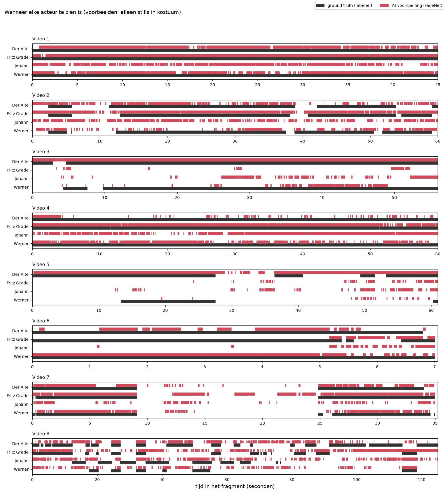
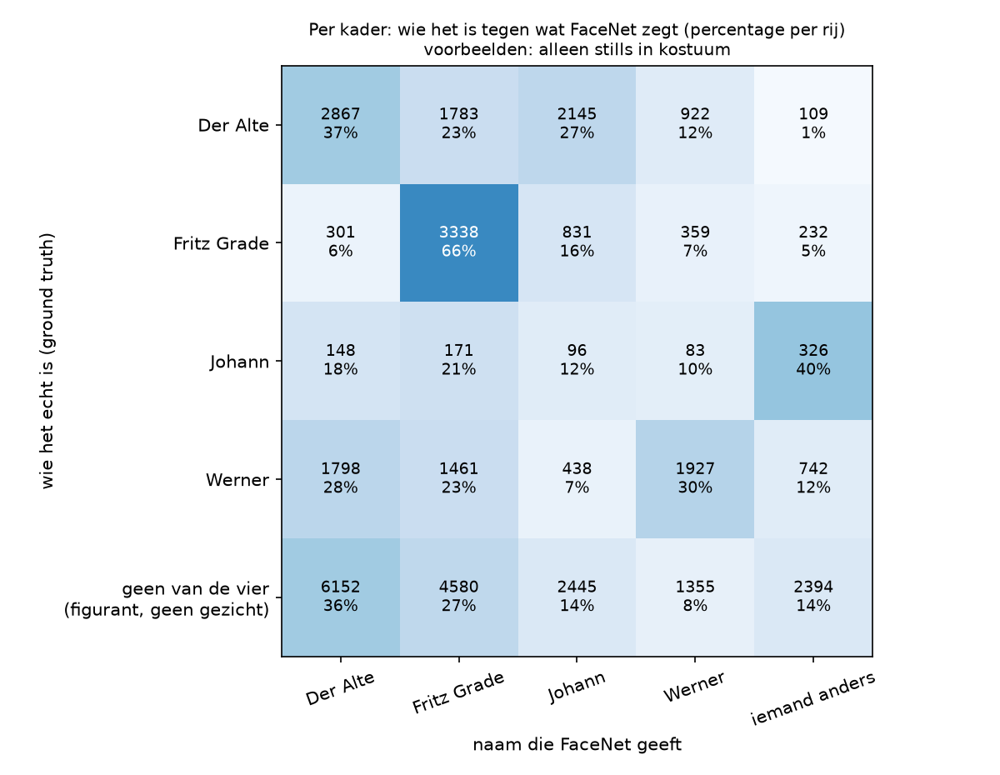

# Basis (voorbeelden: alleen stills in kostuum)

Dit is het basisexperiment: FaceNet staat zo standaard mogelijk ingesteld en vergelijkt elk gezicht in de filmpjes met de voorbeelden uit deze set. De uitleg van het experiment staat in [de README van de basis](../../basis/README.md).

## De instellingen

| Instelling | Waarde |
|---|---|
| Model | Facenet |
| Extra ruimte om het kader | 0% |
| Afstand | genormaliseerde Euclidische afstand |
| Drempel | 0,80 |
| Per persoon | de afstand tot de meest gelijkende voorbeeldfoto |
| Toewijzen | elk kader los |
| Voorbeelden | alleen stills in kostuum |

## Methode 1: per beeld

We weten wie er in elk beeld te zien is, en tellen per persoon in hoeveel beelden FaceNet die persoon ziet. *Goed* is een beeld waarin FaceNet de persoon terecht ziet, *fout* een beeld waarin FaceNet de persoon ten onrechte ziet, en *gemist* een beeld waarin de persoon wel staat maar FaceNet de persoon niet ziet. Waar in het beeld FaceNet de persoon ziet, maakt bij deze methode niet uit.

| Acteur | Ground truth (beelden) | FaceNet (beelden) | Foutmarge | Goed | Fout | Gemist | Precisie | Recall | F1 |
|---|---|---|---|---|---|---|---|---|---|
| Der Alte | 8.326 | 6.158 | 26,0% | 5.121 | 1.037 | 3.205 | 0,832 | 0,615 | 0,707 |
| Fritz Grade | 5.321 | 5.919 | 11,2% | 4.505 | 1.414 | 816 | 0,761 | 0,847 | 0,802 |
| Johann | 849 | 4.303 | 406,8% | 206 | 4.097 | 643 | 0,048 | 0,243 | 0,080 |
| Werner | 6.494 | 3.747 | 42,3% | 3.075 | 672 | 3.419 | 0,821 | 0,474 | 0,601 |
| **samen** | 20.990 | 20.127 | 4,1% | 12.907 | 7.220 | 8.083 | 0,641 | 0,615 | **0,628** |



## Methode 2: per gezicht

We weten ook waar elk gezicht staat. Een naam van FaceNet telt alleen als goed als het kader met die naam minstens 30% overlapt met het kader van die persoon in de ground truth. *Gemist* is verdeeld in: geen kader van de detector op die plek, wel een kader maar geen naam, of wel een kader maar een andere naam.

| Acteur | Gezichten | Goed | Fout benoemd | Gemist | waarvan geen kader | waarvan geen naam | waarvan andere naam | Precisie | Recall | F1 |
|---|---|---|---|---|---|---|---|---|---|---|
| Der Alte | 8.326 | 2.820 | 8.398 | 5.506 | 707 | 111 | 4.688 | 0,251 | 0,339 | 0,289 |
| Fritz Grade | 5.321 | 3.249 | 7.975 | 2.072 | 515 | 231 | 1.326 | 0,289 | 0,611 | 0,393 |
| Johann | 849 | 95 | 5.859 | 754 | 61 | 326 | 367 | 0,016 | 0,112 | 0,028 |
| Werner | 6.494 | 1.934 | 2.711 | 4.560 | 328 | 710 | 3.522 | 0,416 | 0,298 | 0,347 |
| **samen** | 20.990 | 8.098 | 24.943 | 12.892 | 1.611 | 1.378 | 9.903 | 0,245 | 0,386 | **0,300** |



## Het filmpje

[`filmpje.mp4`](filmpje.mp4) is alle filmpjes achter elkaar, met een vierkantje om elk gezicht dat FaceNet als een van de vier personen herkent, en de naam erbij.

## De bestanden in deze map

| Bestand | Wat erin staat |
|---|---|
| `voorspellingen.csv` | Per kader wie FaceNet zegt dat het is (`facenet`), de dichtstbijzijnde persoon (`dichtstbij`), de afstand (`afstand`) en de voorbeeldfoto die de doorslag gaf (`foto`). |
| `gebruik_per_foto.csv` | Per voorbeeldfoto hoe vaak die foto de doorslag gaf, en hoe vaak dat goed of fout was. |
| `methode_1_tabel.csv`, `methode_1_tabel.png`, `methode_1_tijdlijn.png` | De uitkomst van methode 1. |
| `methode_2_tabel.csv`, `methode_2_tabel.png` | De uitkomst van methode 2. |
| `methode_2_verwarring.csv`, `methode_2_verwarring.png` | Per kader wie het echt is tegen de naam van FaceNet. |
| `methode_2_overlap.csv` | De uitkomst van methode 2 bij andere grenzen voor de overlap. |
| `filmpje.mp4` | Het filmpje. |

## Zo maak je dit opnieuw

Vanuit de map `experimenten` (installeren: zie [de uitleg over alle experimenten](../../README.md#installeren-op-mac-en-windows)).

Op een Mac:

```bash
.venv/bin/python basis/draai_alles.py --voorbeelden alleen_kostuum
```

Op Windows:

```bat
.venv\Scripts\python basis\draai_alles.py --voorbeelden alleen_kostuum
```
