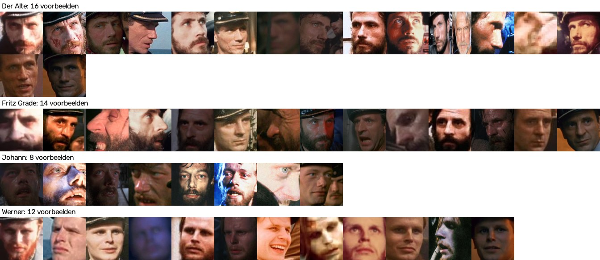
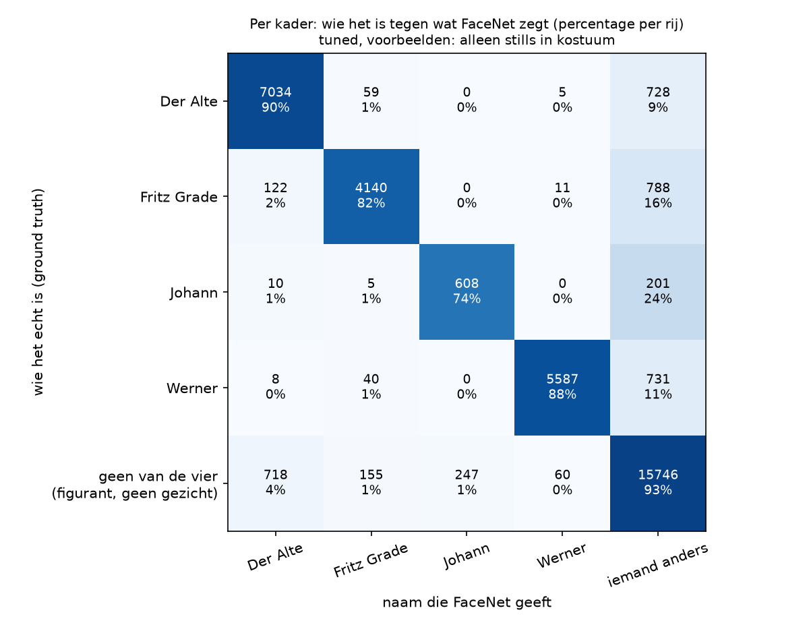
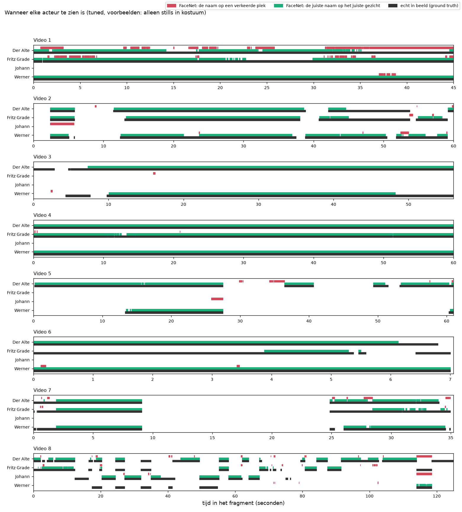
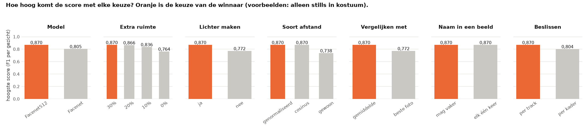

# De uitkomsten van het getunde model: alleen stills

Dit zijn de uitkomsten van FaceNet met de best gevonden instellingen voor deze voorbeelden. FaceNet krijgt hier als voorbeelden alleen de stills uit de film. Waarom we dit doen en hoe we de instellingen gezocht hebben, staat in [de uitleg van tuned](../../tuned/README.md).

> **In het kort.** De score per gezicht is **0,870**. De score is een cijfer van 0 tot 1: bij 1 krijgt elk gezicht van de vier personen de juiste naam, en klopt elke naam die FaceNet geeft.
>
> - Van de 20.990 gezichten krijgen er 17.236 de juiste naam (82%).
> - FaceNet zette 18.636 namen in de filmpjes, en daarvan klopten er 17.236 (92%).
> - Het best herkend: Werner (score 0,916). Het slechtst herkend: Johann (score 0,714).

**Het filmpje:** [`filmpje.mp4`](filmpje.mp4) laat alle fragmenten achter elkaar zien, met een vierkantje om elk gezicht dat FaceNet als een van de vier personen herkent. Klik op GitHub op de link en daarna op *View raw* om het filmpje te downloaden.

Wat de woorden betekenen, staat in [de woordenlijst](../../README.md#woordenlijst). Hoe we meten, staat bij [Zo meten we hoe goed FaceNet is](../../README.md#zo-meten-we-hoe-goed-facenet-is).


## De instellingen

Dit zijn de instellingen waarmee deze uitkomsten gemaakt zijn.

| Instelling | Waarde |
|---|---|
| Model | Facenet512 |
| Extra ruimte om het kader | 30% |
| Lichter maken | ja |
| Afstand | genormaliseerde Euclidische afstand |
| Vergelijken met | het gemiddelde van de foto's van elke persoon |
| Naam in een beeld | mag vaker |
| Beslissen | per track |
| Drempel | 1,0440 |



*De voorbeelden in deze set. Elk klein plaatje is precies wat FaceNet van een voorbeeld te zien krijgt.*


## De score per gezicht

Dit is de maat waarmee we FaceNet beoordelen. We weten waar elk gezicht staat. Een naam telt alleen als goed als het kader met die naam minstens 30% overlapt met het gezicht van die persoon.

**De score per persoon.** Precisie zegt hoe vaak een naam klopt. Recall zegt hoeveel van de echte gezichten de juiste naam krijgen. De score (F1) is die twee samen.

| Persoon | Score (F1) | Precisie | Recall |
|---|---|---|---|
| Der Alte | 0,864 | 0,891 | 0,838 |
| Fritz Grade | 0,850 | 0,949 | 0,770 |
| Johann | 0,714 | 0,711 | 0,716 |
| Werner | 0,916 | 0,986 | 0,855 |
| **alle vier samen** | **0,870** | **0,925** | **0,821** |

**De aantallen.** *Goed* is een gezicht met de juiste naam. *Naam op de verkeerde plek* is een kader met een naam dat niet op het gezicht van die persoon ligt. *Gemist* is een gezicht zonder de juiste naam.

| Persoon | Gezichten | Goed | Naam op de verkeerde plek | Gemist |
|---|---|---|---|---|
| Der Alte | 8.326 | 6.979 | 855 | 1.347 |
| Fritz Grade | 5.321 | 4.099 | 222 | 1.222 |
| Johann | 849 | 608 | 247 | 241 |
| Werner | 6.494 | 5.550 | 76 | 944 |
| **alle vier samen** | **20.990** | **17.236** | **1.400** | **3.754** |

**Waarom een gezicht gemist wordt.** Soms heeft de detector op die plek geen kader gevonden. Soms is er wel een kader, maar geeft FaceNet geen naam of een andere naam.

| Persoon | Geen kader | Wel kader, geen naam | Wel kader, andere naam |
|---|---|---|---|
| Der Alte | 707 | 612 | 28 |
| Fritz Grade | 515 | 570 | 137 |
| Johann | 61 | 170 | 10 |
| Werner | 328 | 558 | 58 |
| **alle vier samen** | **1.611** | **1.910** | **233** |

De score kan hier niet 1 worden. FaceNet bekijkt alleen kaders, dus de 1.611 gezichten zonder kader krijgen nooit een naam. Zelfs als elke naam klopt, blijft de score onder 0,96.



*Zo lees je dit plaatje: elke rij is wie het echt is, elke kolom is de naam die FaceNet geeft. Bij een goed resultaat staan de hoge percentages op de schuine lijn van linksboven naar rechtsonder. De onderste rij zijn kaders die op geen van de vier personen liggen: figuranten en dingen die geen gezicht zijn. Daar hoort alles in de laatste kolom te staan. Dit plaatje telt kaders, de tabellen hierboven tellen gezichten. Daarom zijn de getallen niet precies gelijk.*



*Zo lees je dit plaatje: elke regel is een persoon, en van links naar rechts loopt de tijd in het filmpje. Zwart is wanneer de persoon echt in beeld is. Groen is wanneer FaceNet de juiste naam op het gezicht van die persoon zet. Rood is wanneer FaceNet die naam op een verkeerde plek zet. Hoe meer groen gelijk loopt met zwart en hoe minder rood er is, hoe beter.*

**Een eerlijke schatting.** De instellingen zijn gekozen op dezelfde beelden als waarop we meten. Daardoor is de score hierboven iets te gunstig. Bij de eerlijke schatting kiezen we de instellingen steeds op zeven filmpjes en meten we op het achtste. Dan is de score **0,837** (zie `eerlijke_schatting.csv`). Alle geprobeerde instellingen staan in `alle_instellingen.csv`, en per filmpje de beste instelling in `beste_per_filmpje.csv`.



*Zo lees je dit plaatje: elk blok is één instelling. De balken laten zien hoe hoog de score kan worden met elke keuze. De oranje balk is de keuze van de winnaar.*


## De bestanden in deze map

| Bestand | Wat erin staat |
|---|---|
| `voorspellingen.csv` | Elk kader op een regel: wie FaceNet zegt dat het is (`facenet`), de persoon die het dichtstbij is (`dichtstbij`), de afstand (`afstand`) en de voorbeeldfoto die het meest op het kader lijkt (`foto`). |
| `gebruik_per_foto.csv` | Per voorbeeldfoto hoe vaak die foto het meest op een kader leek, en hoe vaak de naam dan goed of fout was. |
| `voorbeelden.jpg` | De voorbeelden in deze set. |
| `methode_2_tabel.csv`, `methode_2_tabel.png`, `methode_2_tijdlijn.png` | De uitkomst per gezicht. |
| `methode_2_verwarring.csv`, `methode_2_verwarring.png` | Per kader wie het echt is tegen de naam van FaceNet. |
| `methode_2_overlap.csv` | De uitkomst van methode 2 als de grens voor de overlap anders is. |
| `filmpje.mp4` | Het filmpje met de namen van FaceNet. |


## Zo maak je dit opnieuw

Doe dit vanuit de map `experimenten`. Installeren hoeft één keer, zie [Installeren op Mac en Windows](../../README.md#installeren-op-mac-en-windows).

Op een Mac:

```bash
.venv/bin/python tuned/draai_alles.py --voorbeelden alleen_kostuum
```

Op Windows:

```bat
.venv\Scripts\python tuned\draai_alles.py --voorbeelden alleen_kostuum
```
