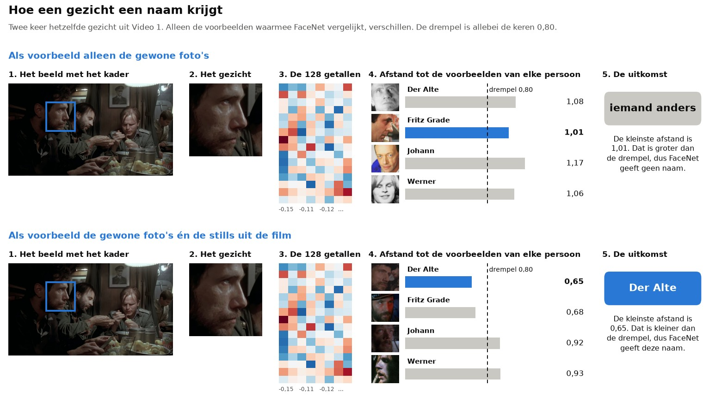
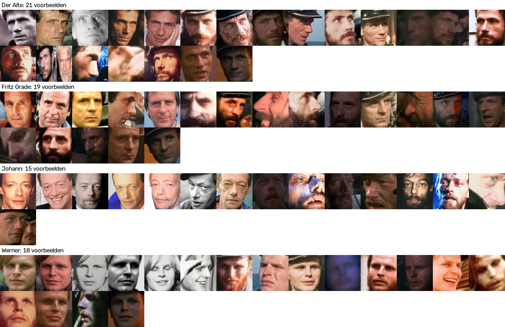
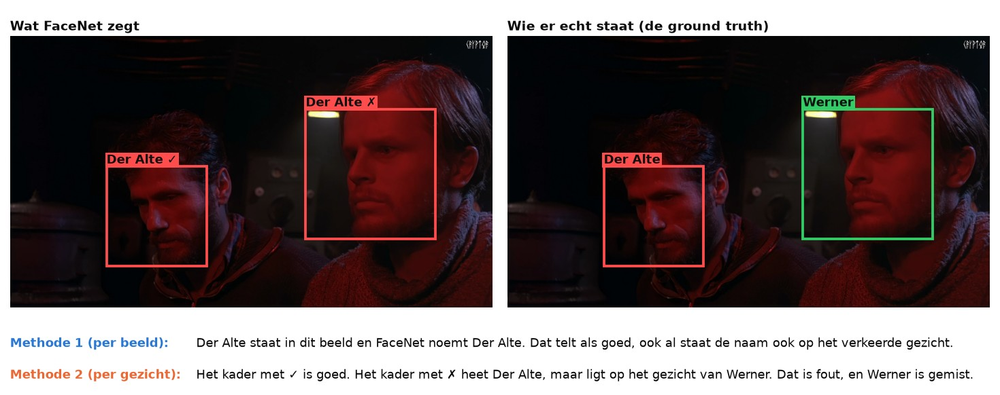
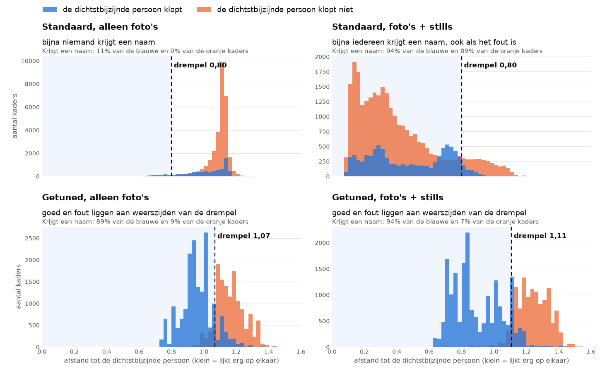
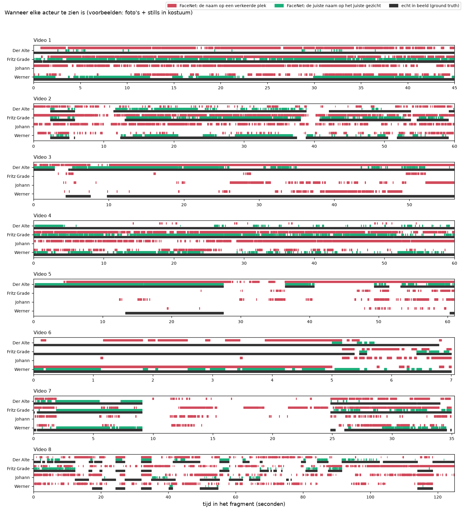
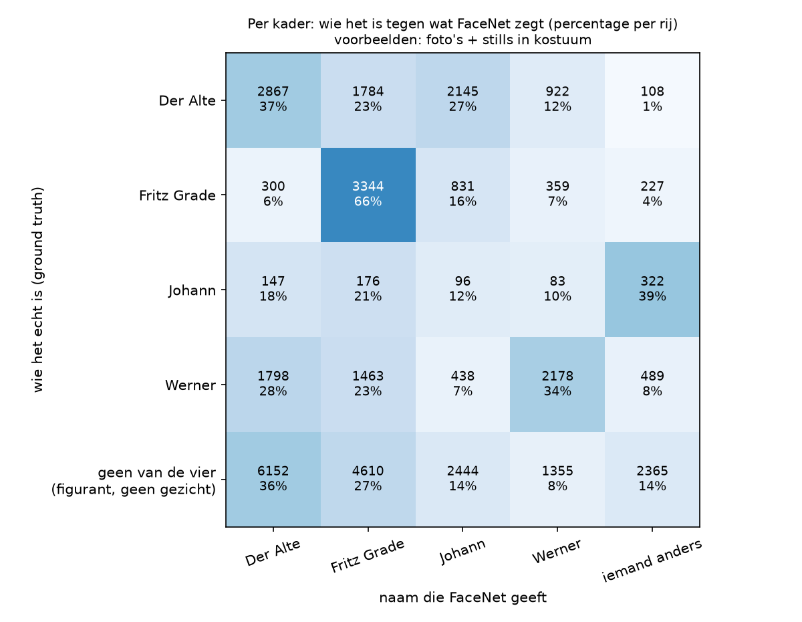

# Basis: FaceNet zoals het standaard is ingesteld

> **De vraag.** Hoe goed herkent FaceNet de vier personen als we niets afstellen?
>
> **Het antwoord.** Slecht. Met alleen gewone foto's als voorbeeld krijgt bijna niemand een naam (score 0,074). Met de gewone foto's én de stills uit de film krijgt bijna iedereen een naam, maar vaak de verkeerde (score 0,308).



*Zo werkt FaceNet. Dit is twee keer hetzelfde gezicht uit de film, en je leest elke rij van links naar rechts. Bovenaan krijgt FaceNet alleen gewone foto's als voorbeeld. Die lijken te weinig op dit gezicht, dus het gezicht krijgt geen naam. Onderaan zijn er ook stills uit de film, en krijgt het gezicht de juiste naam.*

Wat de woorden betekenen, staat in [de woordenlijst](../README.md#woordenlijst).

**In deze uitleg:**
[Waarom](#waarom-dit-experiment) ·
[Wat we gedaan hebben](#wat-we-gedaan-hebben) ·
[De instellingen](#de-instellingen) ·
[De twee meetmethodes](#de-twee-meetmethodes) ·
[Wat eruit kwam](#wat-eruit-kwam) ·
[Wat dit betekent](#wat-dit-betekent) ·
[De filmpjes](#de-filmpjes) ·
[Zelf draaien](#zo-draai-je-het-op-een-mac-en-op-windows)


## Waarom dit experiment

Met de standaardinstellingen zien we hoe goed FaceNet is zonder dat wij iets afstellen. Dat is ons vertrekpunt: alle andere experimenten vergelijken we hiermee.

We doen het met twee sets voorbeelden. We tellen gezichten en geen foto's, want op één foto of still kunnen meer gezichten staan.

| Set voorbeelden | Wat erin zit | Aantal | De uitkomsten |
|---|---|---|---|
| **Foto's** | Gewone foto's van de acteurs, buiten de film | 23 gezichten | [`resultaten/fotos/`](resultaten/fotos/README.md) |
| **Foto's + stills** | Dezelfde foto's, en stills uit de film in kostuum | 73 gezichten | [`resultaten/fotos_en_kostuum/`](resultaten/fotos_en_kostuum/README.md) |



*Dit zijn alle voorbeelden in de set met foto's + stills, per persoon. Elk klein plaatje is precies wat FaceNet te zien krijgt. Let op hoe verschillend ze zijn: naast scherpe foto's staan er donkere en wazige stills. Beelden uit de filmpjes die we testen, gebruiken we nooit als voorbeeld.*


## Wat we gedaan hebben

Elke stap is een eigen script.

| Stap | Wat er gebeurt | Script |
|---|---|---|
| 1 | Van elke voorbeeldfoto maakt FaceNet een vector. | [`stap_1_voorbeelden.py`](stap_1_voorbeelden.py) |
| 2 | Van elk kader in de filmpjes maakt FaceNet een vector, en die wordt vergeleken met de voorbeelden. | [`stap_2_herkennen.py`](stap_2_herkennen.py) |
| 3 | Meten met methode 1: wie is er per beeld te zien? | [`stap_3_methode_1_per_beeld.py`](stap_3_methode_1_per_beeld.py) |
| 4 | Meten met methode 2: staat de naam op het juiste gezicht? | [`stap_4_methode_2_per_gezicht.py`](stap_4_methode_2_per_gezicht.py) |
| 5 | Een filmpje maken van alle fragmenten, met de namen van FaceNet. | [`stap_5_filmpje.py`](stap_5_filmpje.py) |
| 6 | De README bij de uitkomsten maken, met de getallen uit de metingen. | [`stap_6_uitleg.py`](stap_6_uitleg.py) |

De kaders in de filmpjes en de juiste antwoorden (de ground truth) komen uit [het labelen](../../labelen/README.md).


## De instellingen

Alle instellingen staan op één plek, in [`instellingen.py`](instellingen.py).

| Instelling | Waarde | Wat dat betekent |
|---|---|---|
| Model | Facenet | De standaardversie in deepface, de programmacode waarmee we FaceNet draaien. FaceNet maakt hiermee 128 getallen per gezicht. |
| Afstand | genormaliseerde Euclidische afstand | De maat voor hoe ver twee vectoren uit elkaar liggen. Deze afstand schrijft de opdracht voor. |
| Drempel | 0,80 | De grens die deepface voor deze afstand gebruikt. Is de afstand kleiner, dan krijgt het kader een naam. Anders is het *iemand anders*. |
| Extra ruimte om het kader | geen | FaceNet krijgt precies het kader van de detector te zien. |
| Vergelijken met | de beste foto van elke persoon | Elke voorbeeldfoto is een los vergelijkingspunt. |
| Gezicht rechtzetten | nee | Rechtzetten is het gezicht draaien tot de ogen recht staan. Wij geven FaceNet het kader zoals het is. |


## De twee meetmethodes

We kijken in dit experiment op twee manieren hoe goed FaceNet is, en kiezen daarna één manier. De code staat in [`../gedeeld/meten.py`](../gedeeld/meten.py).

| | Methode 1: per beeld | Methode 2: per gezicht |
|---|---|---|
| **De vraag** | Noemt FaceNet deze persoon in dit beeld? | Staat de naam op het gezicht van deze persoon? |
| **Wat als goed telt** | De persoon staat in het beeld, en FaceNet noemt die naam ergens in het beeld. | Het kader met de naam ligt op het gezicht van die persoon: de overlap is minstens 30%. |
| **Het nadeel** | Een naam op het verkeerde gezicht telt ook als goed. | Een goede naam telt als fout als het kader te ver naast het gezicht staat. Daarom is de grens maar 30%. |



*Zo verschillen de twee methodes op een echt beeld. FaceNet zet twee keer de naam Der Alte. Methode 1 rekent Der Alte goed, want die staat in het beeld, en rekent Werner als gemist, want die naam valt nergens. Methode 2 rekent daarnaast één van de twee namen Der Alte fout, omdat die op het gezicht van Werner staat. De kleuren horen hier bij de personen, niet bij goed of fout.*

**Onze keuze: methode 2.** Methode 1 ziet een belangrijke fout niet: staat een persoon ergens in beeld, dan telt elke naam van die persoon als goed, ook op een figurant of op iets dat geen gezicht is. **Daarom meten alle andere experimenten alleen per gezicht. De meting per beeld staat alleen in deze map.** De tabel en de tijdlijn uit de opdracht laten we hier wel met beide methodes zien.

**Zo werkt methode 2 precies.** Per beeld vergelijken we de kaders die van FaceNet een naam kregen met de gezichten in de ground truth.

| Uitkomst | Wanneer |
|---|---|
| **Goed** | Een gezicht uit de ground truth waarop een kader met de juiste naam ligt. Twee kaders op hetzelfde hoofd met de juiste naam tellen samen één keer. |
| **Naam op de verkeerde plek** | Een kader met een naam dat niet op het gezicht van die persoon ligt. |
| **Gemist** | Een gezicht uit de ground truth zonder de juiste naam: er is geen kader op die plek, of wel een kader maar geen naam of een andere naam. |

*Overlap* (*IoU*) is het oppervlak dat twee kaders delen, gedeeld door het oppervlak dat ze samen bedekken.

**Waarom 30%.** Dat is dezelfde grens als bij het volgen van de gezichten in het labelen. Een kader dat in het labelen met de hand gezet is, staat soms iets naast het gezicht, dus een strengere grens zou goede namen afkeuren. De keuze maakt weinig uit, zoals de tabel laat zien (set met foto's + stills).

| Overlap minstens | 10% | 20% | **30%** | 40% | 50% | 70% |
|---|---|---|---|---|---|---|
| Score | 0,318 | 0,311 | **0,308** | 0,304 | 0,300 | 0,286 |

**De score.** Uit de tellingen volgen de *precisie* (als FaceNet een naam geeft, hoe vaak klopt die?), de *recall* (hoeveel gezichten krijgen de juiste naam?) en de *score* (F1). Dat staat met de echte aantallen uitgelegd in [Zo meten we hoe goed FaceNet is](../README.md#zo-meten-we-hoe-goed-facenet-is).


## Wat eruit kwam

| Voorbeelden | Score per gezicht (methode 2) | Score per beeld (methode 1) | Gezichten met de juiste naam (recall) | Namen die kloppen (precisie) |
|---|---|---|---|---|
| Foto's | **0,074** | 0,078 | 804 van de 20.990 (4%) | 93% |
| Foto's + stills | **0,308** | 0,636 | 8.355 van de 20.990 (40%) | 25% |



*Zo lees je dit plaatje: kijk naar de twee grafieken bovenaan, dat is de basis. Elke grafiek telt hoeveel kaders een bepaalde afstand hebben. Links van de stippellijn krijgt een kader een naam. Linksboven liggen bijna alle kaders rechts van de drempel: bijna niemand krijgt een naam. Rechtsboven liggen de meeste kaders links van de drempel, ook de oranje kaders waarbij de naam niet klopt.*



*De tijdlijn per gezicht, met foto's + stills. Elke regel is een persoon, en de tijd loopt van links naar rechts. Zwart is wanneer de persoon echt in beeld is. Groen is wanneer FaceNet de juiste naam op het gezicht van die persoon zet. Rood is wanneer FaceNet die naam op een verkeerde plek zet. Er is hier veel rood, en maar weinig groen loopt gelijk met zwart.*



*Zo lees je dit plaatje: elke rij is wie het echt is, elke kolom is de naam die FaceNet geeft. Bij een goed resultaat staan de hoge percentages op de schuine lijn. Hier zijn de getallen verdeeld over de hele tabel. In de onderste rij zie je dat figuranten en dingen die geen gezicht zijn, meestal toch een naam krijgen.*

Hoe het per persoon uitpakt, ook met methode 1 en de tijdlijn per beeld, staat in de uitkomsten van [alleen foto's](resultaten/fotos/README.md) en [foto's + stills](resultaten/fotos_en_kostuum/README.md).


## Wat dit betekent

- **Met alleen foto's herkent FaceNet bijna niemand.** Als FaceNet een naam geeft, klopt die bijna altijd (93%), maar van de 20.990 gezichten krijgen er maar 804 de juiste naam. De gewone foto's lijken te weinig op de donkere gezichten in de film.
- **Met de stills erbij geeft FaceNet veel vaker een naam.** Per beeld ziet dat er goed uit (score 0,636), maar per gezicht valt de score terug naar 0,308: drie van de vier namen staan op de verkeerde plek. Dat is precies waarom we per gezicht meten.
- **Johann wordt veel te vaak gezien.** Met de stills erbij zegt FaceNet in 4.302 beelden Johann, terwijl Johann maar in 849 beelden staat. Wie er dan echt staat, staat bij [Wie wordt Johann](../wie_wordt_johann/README.md).
- **Eén voorbeeld kan heel veel invloed hebben.** In de set met foto's + stills leken 10.016 kaders het meest op één voorbeeld: het gezicht met het label Der Alte in `Fritz4.png`. Bij 7.922 van die kaders was de naam fout. De naam van een bestand zegt niet wie erop staat, en op één still kunnen meer gezichten staan. Welke foto's het resultaat echt slechter maken, staat bij [Leave-one-out](../leave_one_out/README.md).


## De filmpjes

Een filmpje laat alle fragmenten achter elkaar zien, met een vierkantje om elk gezicht dat FaceNet als een van de vier personen herkent, en de naam erbij. Klik op GitHub op de link en daarna op *View raw* om een filmpje te downloaden.

- [Filmpje met alleen foto's](resultaten/fotos/filmpje.mp4)
- [Filmpje met foto's + stills](resultaten/fotos_en_kostuum/filmpje.mp4)


## Zo draai je het op een Mac en op Windows

Doe dit vanuit de map `experimenten`. Installeren hoeft één keer, zie [Installeren op Mac en Windows](../README.md#installeren-op-mac-en-windows).

Op een Mac:

```bash
.venv/bin/python basis/draai_alles.py
```

Op Windows:

```bat
.venv\Scripts\python basis\draai_alles.py
```

Dit draait alle stappen voor beide sets. Eén set kan ook, door er `--voorbeelden fotos` of `--voorbeelden fotos_en_kostuum` achter te zetten.

Een losse stap draai je zo:

```bash
.venv/bin/python basis/stap_2_herkennen.py --voorbeelden fotos
```

```bat
.venv\Scripts\python basis\stap_2_herkennen.py --voorbeelden fotos
```

Stap 2 duurt de eerste keer ongeveer een kwartier, omdat FaceNet dan alle 37.003 kaders bekijkt. De vectoren worden bewaard in `tussenbestanden/`, en daarna duurt stap 2 nog een minuut.
