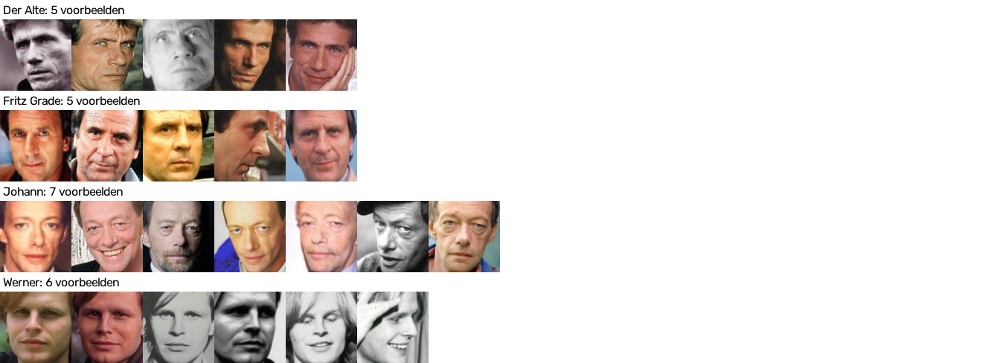
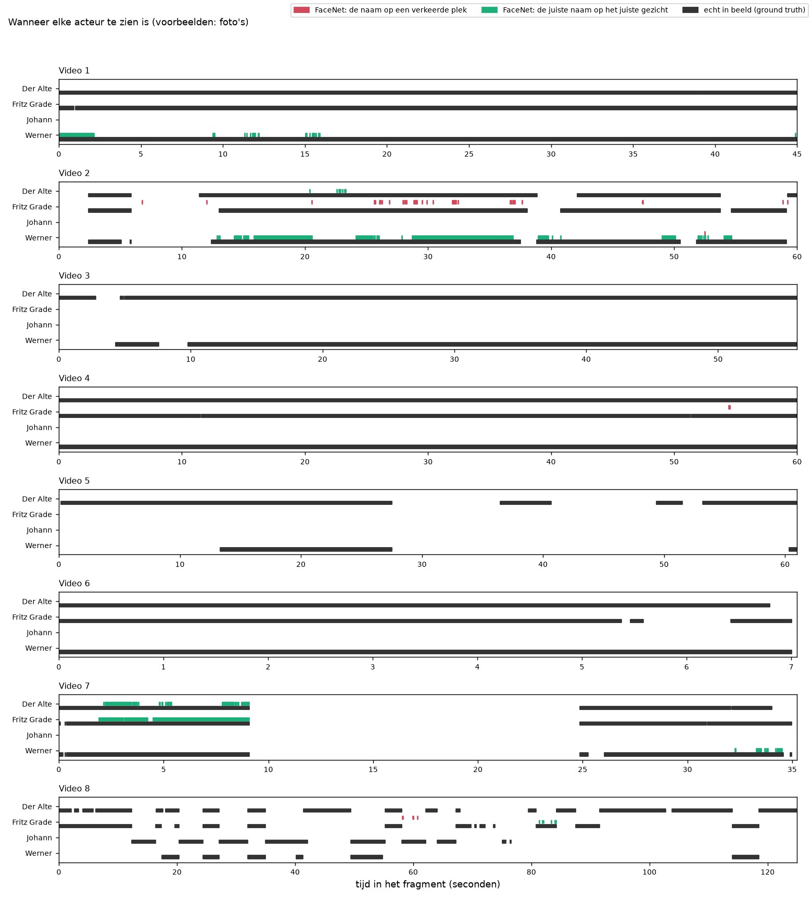

# De uitkomsten van de basis: foto's

Dit zijn de uitkomsten van FaceNet met de standaardinstellingen. Als voorbeelden krijgt FaceNet hier: foto's. Waarom we dit doen en hoe het werkt, staat in [de uitleg van de basis](../../README.md).

> **In het kort.** De score per gezicht is **0,074**. De score is een cijfer van 0 tot 1: bij 1 vindt FaceNet alle gezichten en klopt elke naam.
>
> - Van de 20.990 gezichten krijgen er 804 de juiste naam (4%).
> - FaceNet zette 865 namen in de filmpjes, en daarvan klopten er 804 (93%).
> - Het best herkend: Werner (score 0,156). Het slechtst herkend: Johann (score 0,000).

**Het filmpje:** [`filmpje.mp4`](filmpje.mp4) laat alle fragmenten achter elkaar zien, met een vierkantje om elk gezicht dat FaceNet als een van de vier personen herkent. Klik op GitHub op de link en daarna op *View raw* om het filmpje te downloaden.

Wat de woorden betekenen, staat in [de woordenlijst](../../../README.md#woordenlijst). Hoe we meten, staat bij [Zo meten we hoe goed FaceNet is](../../../README.md#zo-meten-we-hoe-goed-facenet-is).


## De instellingen

Dit zijn de instellingen waarmee deze uitkomsten gemaakt zijn.

| Instelling | Waarde |
|---|---|
| Model | Facenet |
| Extra ruimte om het kader | 0% |
| Afstand | genormaliseerde Euclidische afstand |
| Drempel | 0,80 |
| Per persoon | de afstand tot de meest gelijkende voorbeeldfoto |
| Toewijzen | elk kader los |
| Voorbeelden | foto's |



*De voorbeelden in deze set. Elk klein plaatje is precies wat FaceNet van een voorbeeld te zien krijgt.*


## Methode 2: per gezicht

Dit is de maat waarmee we FaceNet beoordelen. We weten waar elk gezicht staat. Een naam telt alleen als goed als het kader met die naam minstens 30% overlapt met het gezicht van die persoon.

**De score per persoon.** Precisie zegt hoe vaak een naam klopt. Recall zegt hoeveel van de echte gezichten de juiste naam krijgen. De score (F1) is die twee samen.

| Persoon | Score (F1) | Precisie | Recall |
|---|---|---|---|
| Der Alte | 0,019 | 1,000 | 0,010 |
| Fritz Grade | 0,063 | 0,746 | 0,033 |
| Johann | 0,000 | 0,000 | 0,000 |
| Werner | 0,156 | 0,998 | 0,084 |
| **alle vier samen** | **0,074** | **0,929** | **0,038** |

**De aantallen.** *Goed* is een gezicht met de juiste naam. *Naam op de verkeerde plek* is een kader met een naam dat niet op het gezicht van die persoon ligt. *Gemist* is een gezicht zonder de juiste naam.

| Persoon | Gezichten | Goed | Naam op de verkeerde plek | Gemist |
|---|---|---|---|---|
| Der Alte | 8.326 | 80 | 0 | 8.246 |
| Fritz Grade | 5.321 | 176 | 60 | 5.145 |
| Johann | 849 | 0 | 0 | 849 |
| Werner | 6.494 | 548 | 1 | 5.946 |
| **alle vier samen** | **20.990** | **804** | **61** | **20.186** |

**Waarom een gezicht gemist wordt.** Soms heeft de detector op die plek geen kader gevonden. Soms is er wel een kader, maar geeft FaceNet geen naam of een andere naam.

| Persoon | Geen kader | Wel kader, geen naam | Wel kader, andere naam |
|---|---|---|---|
| Der Alte | 707 | 7.537 | 2 |
| Fritz Grade | 515 | 4.630 | 0 |
| Johann | 61 | 779 | 9 |
| Werner | 328 | 5.613 | 5 |
| **alle vier samen** | **1.611** | **18.559** | **16** |


*Zo lees je dit plaatje: elke rij is wie het echt is, elke kolom is de naam die FaceNet geeft. Bij een goed resultaat staan de hoge percentages op de schuine lijn van linksboven naar rechtsonder. De onderste rij zijn kaders die op geen van de vier personen liggen: figuranten en dingen die geen gezicht zijn. Daar hoort alles in de laatste kolom te staan.*



*Zo lees je dit plaatje: elke regel is een persoon, en van links naar rechts loopt de tijd in het filmpje. Zwart is wanneer de persoon echt in beeld is. Groen is wanneer FaceNet de juiste naam op het gezicht van die persoon zet. Rood is wanneer FaceNet die naam op een verkeerde plek zet. Hoe meer groen gelijk loopt met zwart en hoe minder rood er is, hoe beter.*


## Methode 1: per beeld

Deze maat staat in de opdracht, maar is te gunstig: een naam op het verkeerde gezicht telt ook als goed. Daarom laten we deze maat alleen bij de basis zien. We weten wie er in elk beeld te zien is, en tellen per persoon in hoeveel beelden FaceNet die persoon ziet. Waar in het beeld FaceNet de persoon ziet, maakt niet uit.

| Persoon | Score (F1) | Precisie | Recall |
|---|---|---|---|
| Der Alte | 0,019 | 1,000 | 0,010 |
| Fritz Grade | 0,081 | 0,949 | 0,042 |
| Johann | 0,000 | 0,000 | 0,000 |
| Werner | 0,156 | 1,000 | 0,085 |
| **alle vier samen** | **0,078** | **0,986** | **0,041** |

**De aantallen.** De *foutmarge* zegt hoeveel procent het aantal beelden van FaceNet afwijkt van het echte aantal beelden. *Goed* is een beeld waarin FaceNet de persoon terecht ziet, *fout* een beeld waarin FaceNet de persoon ten onrechte ziet, en *gemist* een beeld waarin de persoon wel staat maar FaceNet de persoon niet ziet.

| Persoon | Echt in beeld | FaceNet ziet | Foutmarge | Goed | Fout | Gemist |
|---|---|---|---|---|---|---|
| Der Alte | 8.326 | 80 | 99,0% | 80 | 0 | 8.246 |
| Fritz Grade | 5.321 | 236 | 95,6% | 224 | 12 | 5.097 |
| Johann | 849 | 0 | 100,0% | 0 | 0 | 849 |
| Werner | 6.494 | 549 | 91,5% | 549 | 0 | 5.945 |
| **alle vier samen** | **20.990** | **865** | **95,9%** | **853** | **12** | **20.137** |


*Zo lees je dit plaatje: elke regel is een persoon, en van links naar rechts loopt de tijd in het filmpje. Zwart is wanneer de persoon echt in beeld is, rood is wanneer FaceNet de persoon ziet. Lopen zwart en rood gelijk, dan klopt het. Rood zonder zwart betekent dat FaceNet de persoon ten onrechte ziet, en zwart zonder rood dat FaceNet de persoon mist.*


## De bestanden in deze map

| Bestand | Wat erin staat |
|---|---|
| `voorspellingen.csv` | Elk kader op een regel: wie FaceNet zegt dat het is (`facenet`), de persoon die het dichtstbij is (`dichtstbij`), de afstand (`afstand`) en de voorbeeldfoto die het meest op het kader lijkt (`foto`). |
| `gebruik_per_foto.csv` | Per voorbeeldfoto hoe vaak die foto het meest op een kader leek, en hoe vaak de naam dan goed of fout was. |
| `voorbeelden.csv`, `voorbeelden.jpg` | De voorbeelden in deze set. |
| `methode_1_tabel.csv`, `methode_1_tabel.png`, `methode_1_tijdlijn.png` | De uitkomst van methode 1. |
| `methode_2_tabel.csv`, `methode_2_tabel.png`, `methode_2_tijdlijn.png` | De uitkomst per gezicht. |
| `methode_2_verwarring.csv`, `methode_2_verwarring.png` | Per kader wie het echt is tegen de naam van FaceNet. |
| `methode_2_overlap.csv` | De uitkomst van methode 2 als de grens voor de overlap anders is. |
| `filmpje.mp4` | Het filmpje met de namen van FaceNet. |


## Zo maak je dit opnieuw

Doe dit vanuit de map `experimenten`. Installeren hoeft één keer, zie [Installeren op Mac en Windows](../../../README.md#installeren-op-mac-en-windows).

Op een Mac:

```bash
.venv/bin/python basis/draai_alles.py --voorbeelden fotos
```

Op Windows:

```bat
.venv\Scripts\python basis\draai_alles.py --voorbeelden fotos
```
