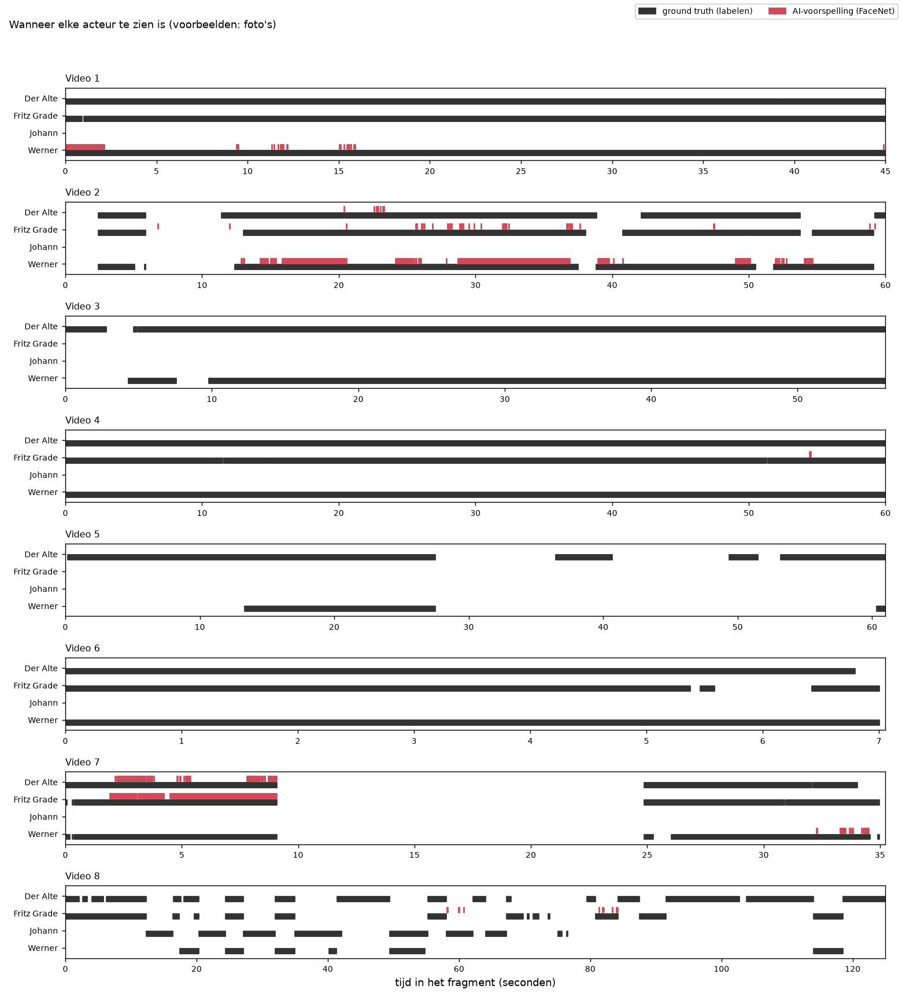
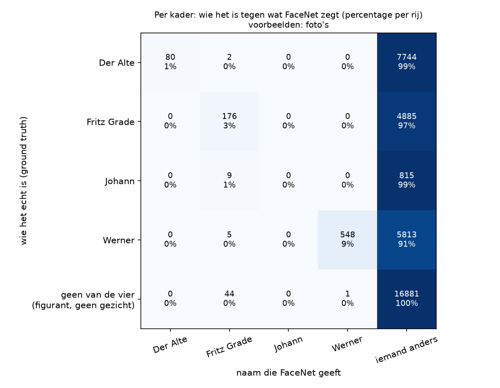

# Basis (voorbeelden: foto's)

Dit is het basisexperiment: FaceNet staat zo standaard mogelijk ingesteld en vergelijkt elk gezicht in de filmpjes met de voorbeelden uit deze set. De uitleg van het experiment staat in [de README van de basis](../../README.md).

## De instellingen

| Instelling | Waarde |
|---|---|
| Model | Facenet |
| Extra ruimte om het kader | 0% |
| Afstand | genormaliseerde Euclidische afstand |
| Drempel | 0,80 |
| Per persoon | de afstand tot de meest gelijkende voorbeeldfoto |
| Toewijzen | elk kader los |
| Voorbeelden | foto's |

## Methode 1: per beeld

We weten wie er in elk beeld te zien is, en tellen per persoon in hoeveel beelden FaceNet die persoon ziet. *Goed* is een beeld waarin FaceNet de persoon terecht ziet, *fout* een beeld waarin FaceNet de persoon ten onrechte ziet, en *gemist* een beeld waarin de persoon wel staat maar FaceNet de persoon niet ziet. Waar in het beeld FaceNet de persoon ziet, maakt bij deze methode niet uit.

| Acteur | Ground truth (beelden) | FaceNet (beelden) | Foutmarge | Goed | Fout | Gemist | Precisie | Recall | F1 |
|---|---|---|---|---|---|---|---|---|---|
| Der Alte | 8.326 | 80 | 99,0% | 80 | 0 | 8.246 | 1,000 | 0,010 | 0,019 |
| Fritz Grade | 5.321 | 236 | 95,6% | 224 | 12 | 5.097 | 0,949 | 0,042 | 0,081 |
| Johann | 849 | 0 | 100,0% | 0 | 0 | 849 | 0,000 | 0,000 | 0,000 |
| Werner | 6.494 | 549 | 91,5% | 549 | 0 | 5.945 | 1,000 | 0,085 | 0,156 |
| **samen** | 20.990 | 865 | 95,9% | 853 | 12 | 20.137 | 0,986 | 0,041 | **0,078** |



## Methode 2: per gezicht

We weten ook waar elk gezicht staat. Een naam van FaceNet telt alleen als goed als het kader met die naam minstens 30% overlapt met het kader van die persoon in de ground truth. *Gemist* is verdeeld in: geen kader van de detector op die plek, wel een kader maar geen naam, of wel een kader maar een andere naam.

| Acteur | Gezichten | Goed | Fout benoemd | Gemist | waarvan geen kader | waarvan geen naam | waarvan andere naam | Precisie | Recall | F1 |
|---|---|---|---|---|---|---|---|---|---|---|
| Der Alte | 8.326 | 80 | 0 | 8.246 | 707 | 7.537 | 2 | 1,000 | 0,010 | 0,019 |
| Fritz Grade | 5.321 | 176 | 60 | 5.145 | 515 | 4.630 | 0 | 0,746 | 0,033 | 0,063 |
| Johann | 849 | 0 | 0 | 849 | 61 | 779 | 9 | 0,000 | 0,000 | 0,000 |
| Werner | 6.494 | 548 | 1 | 5.946 | 328 | 5.613 | 5 | 0,998 | 0,084 | 0,156 |
| **samen** | 20.990 | 804 | 61 | 20.186 | 1.611 | 18.559 | 16 | 0,929 | 0,038 | **0,074** |



## Het filmpje

[`filmpje.mp4`](filmpje.mp4) is alle filmpjes achter elkaar, met een vierkantje om elk gezicht dat FaceNet als een van de vier personen herkent, en de naam erbij.

## De bestanden in deze map

| Bestand | Wat erin staat |
|---|---|
| `voorspellingen.csv` | Per kader wie FaceNet zegt dat het is (`facenet`), de dichtstbijzijnde persoon (`dichtstbij`), de afstand (`afstand`) en de voorbeeldfoto die de doorslag gaf (`foto`). |
| `gebruik_per_foto.csv` | Per voorbeeldfoto hoe vaak die foto de doorslag gaf, en hoe vaak dat goed of fout was. |
| `methode_1_tabel.csv`, `methode_1_tabel.png`, `methode_1_tijdlijn.png` | De uitkomst van methode 1. |
| `methode_2_tabel.csv`, `methode_2_tabel.png` | De uitkomst van methode 2. |
| `methode_2_verwarring.csv`, `methode_2_verwarring.png` | Per kader wie het echt is tegen de naam van FaceNet. |
| `methode_2_overlap.csv` | De uitkomst van methode 2 bij andere grenzen voor de overlap. |
| `filmpje.mp4` | Het filmpje. |

## Zo maak je dit opnieuw

Vanuit de map `experimenten` (installeren: zie [de uitleg over alle experimenten](../../../README.md)).

Op een Mac:

```bash
.venv/bin/python basis/draai_alles.py --voorbeelden fotos
```

Op Windows:

```bat
.venv\Scripts\python basis\draai_alles.py --voorbeelden fotos
```
