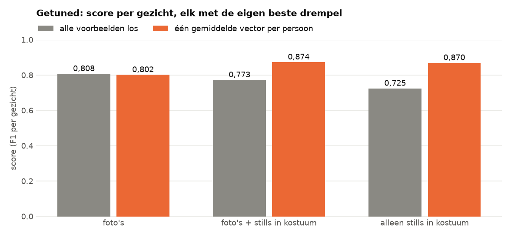

# Eén gemiddelde vector per persoon

> **De vraag.** Werkt FaceNet beter als elke persoon één gemiddelde vector krijgt, in plaats van alle voorbeeldfoto's los?
>
> **Het antwoord.** Dat hangt af van de drempel. Bij FaceNet standaard, met een drempel van 0,80, werkt het slechter: de score zakt van 0,308 naar 0,181. Bij het getunde model, waar de drempel past bij het gemiddelde, werkt het juist beter: de score gaat van 0,773 naar 0,874.


*FaceNet standaard. Zo lees je dit plaatje: elk groepje is een set voorbeelden, en een hogere balk is beter. Grijs zijn alle voorbeelden los, oranje is één gemiddelde vector per persoon. Oranje is steeds lager.*

Wat de woorden betekenen, staat in [de woordenlijst](../README.md#woordenlijst).


## Waarom dit experiment

In de [basis](../basis/README.md) is elke voorbeeldfoto een los vergelijkingspunt: een gezicht krijgt de naam van de foto die er het meest op lijkt. Zo kan één slechte foto veel fouten veroorzaken. Het idee is dat een gemiddelde daar minder last van heeft.


## Hoe we het gedaan hebben

1. We maken van alle voorbeeldfoto's van een persoon vectoren met lengte 1.
2. We nemen per persoon het gemiddelde van die vectoren, en brengen dat gemiddelde weer op lengte 1.
3. We vergelijken elk gezicht in de filmpjes alleen nog met die vier vectoren.
4. We meten per gezicht, en doen dat voor drie sets voorbeelden.

Met FaceNet standaard blijft de drempel 0,80. Met het getunde model staan alle andere instellingen op de beste waarden, en krijgen *alle foto's los* en *één gemiddelde vector* elk hun eigen beste drempel. Een gemiddelde ligt namelijk verder van elk gezicht, dus daar past een andere drempel bij.


## Wat eruit kwam met FaceNet standaard

| Voorbeelden | Alle foto's los | Eén gemiddelde vector |
|---|---|---|
| Foto's | 0,074 | 0,059 |
| Foto's + stills | 0,308 | 0,181 |
| Alleen stills | 0,300 | 0,114 |

Bij een drempel van 0,80 geeft FaceNet met een gemiddelde veel minder namen. Met foto's + stills klopt een naam nu vaak (precisie 0,818), maar krijgt maar één op de tien gezichten de juiste naam (recall 0,102). Een gemiddelde van heel verschillende foto's ligt ver van elk echt gezicht, dus de afstand komt vaak boven de drempel.


*Zo lees je dit plaatje: elke rij is wie het echt is, elke kolom is de naam die FaceNet geeft. Bij een goed resultaat staan de hoge percentages op de schuine lijn. Hier staan de meeste kaders in de laatste kolom: FaceNet geeft ze geen naam.*


## Met het getunde model



*Het getunde model. Grijs zijn alle voorbeelden los, oranje is één gemiddelde vector per persoon. Bij de sets met stills is oranje duidelijk hoger.*

| Voorbeelden | Alle foto's los | Drempel | Eén gemiddelde vector | Drempel |
|---|---|---|---|---|
| Foto's | 0,808 | 1,0684 | 0,802 | 1,1349 |
| Foto's + stills | 0,773 | 1,0315 | **0,874** | 1,1076 |
| Alleen stills | 0,725 | 0,9715 | **0,870** | 1,0440 |

Alle getallen staan per set in [`resultaten_tuned/`](resultaten_tuned/), en de vergelijking in [`vergelijking.csv`](resultaten_tuned/vergelijking.csv).


## Wat dit betekent

- **De uitkomst hangt af van de drempel.** Bij de standaarddrempel van 0,80 is een gemiddelde slechter, omdat de afstanden groter worden en bijna niemand nog een naam krijgt.
- **Met een passende drempel is een gemiddelde juist beter**, als er stills in de set zitten. Eén donkere of wazige still weegt dan minder zwaar.
- **Bij alleen gewone foto's maakt het bijna niets uit** (0,808 tegen 0,802). Die foto's zijn scherp en lijken meer op elkaar.


## Zo draai je het op een Mac en op Windows

Doe dit vanuit de map `experimenten`. Draai eerst de [basis](../basis/README.md) en [alleen in karakter](../alleen_in_karakter/README.md), en voor het getunde model ook [tuned](../tuned/README.md). Installeren hoeft één keer, zie [Installeren op Mac en Windows](../README.md#installeren-op-mac-en-windows).

Op een Mac:

```bash
.venv/bin/python gemiddelde_vector/draai.py
.venv/bin/python gemiddelde_vector/draai.py --model tuned
```

Op Windows:

```bat
.venv\Scripts\python gemiddelde_vector\draai.py
.venv\Scripts\python gemiddelde_vector\draai.py --model tuned
```
