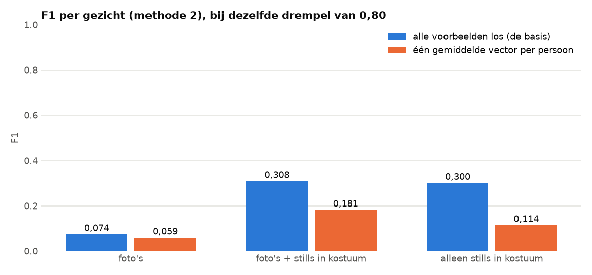
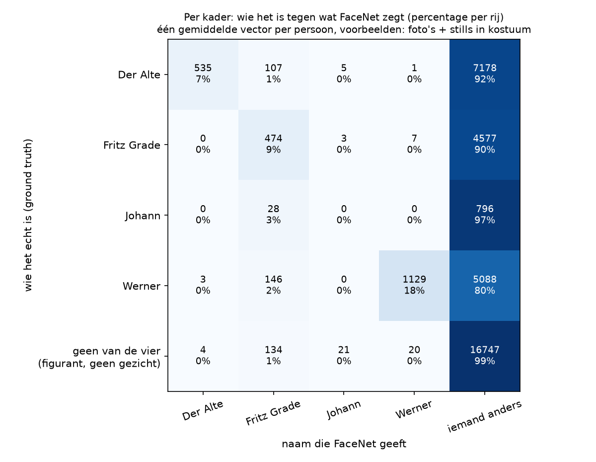

# Eén gemiddelde vector per persoon

In de basis is elke voorbeeldfoto een los vergelijkingspunt: een kader krijgt de naam van de meest gelijkende foto. In dit experiment voegen we alle foto's van een persoon samen tot **één gemiddelde vector**, en vergelijken we een kader alleen nog met die vier vectoren. Het idee is dat een gemiddelde minder last heeft van één slechte foto.

## Hoe we het gedaan hebben

Alles is hetzelfde als bij de [basis](../basis/README.md): hetzelfde model, dezelfde drempel van 0,80 en dezelfde twee meetmethodes. Alleen de voorbeelden veranderen: per persoon nemen we het gemiddelde van de vectoren met lengte 1, en brengen we dat gemiddelde weer op lengte 1. We doen dat voor de drie sets voorbeelden. De uitkomsten staan per set in [`resultaten/`](resultaten/).



| Voorbeelden | Methode 1: alle voorbeelden los | gemiddelde vector | Methode 2: alle voorbeelden los | gemiddelde vector |
|---|---|---|---|---|
| Foto's | 0,078 | 0,060 | 0,074 | 0,059 |
| Foto's + stills in kostuum | 0,636 | 0,206 | 0,308 | 0,181 |
| Alleen stills in kostuum | 0,628 | 0,211 | 0,300 | 0,114 |



**Wat dit betekent.** Bij de drempel van 0,80 werkt één gemiddelde vector slechter dan alle voorbeelden los. FaceNet geeft dan veel minder namen: met foto's + stills is de precisie per gezicht 0,818, maar de recall nog maar 0,102. Een gemiddelde van heel verschillende foto's ligt ver van elk echt gezicht, dus de afstand komt vaak boven de drempel. Bij een andere drempel kan het gemiddelde beter werken; dat is meegenomen in [`tuned`](../tuned/README.md).

## Zo draai je het op een Mac en op Windows

Doe dit vanuit de map `experimenten`, nadat de [basis](../basis/README.md) gedraaid heeft. Installeren hoeft één keer, zie [de uitleg over alle experimenten](../README.md#installeren-op-mac-en-windows).

Op een Mac:

```bash
.venv/bin/python gemiddelde_vector/draai.py
```

Op Windows:

```bat
.venv\Scripts\python gemiddelde_vector\draai.py
```
