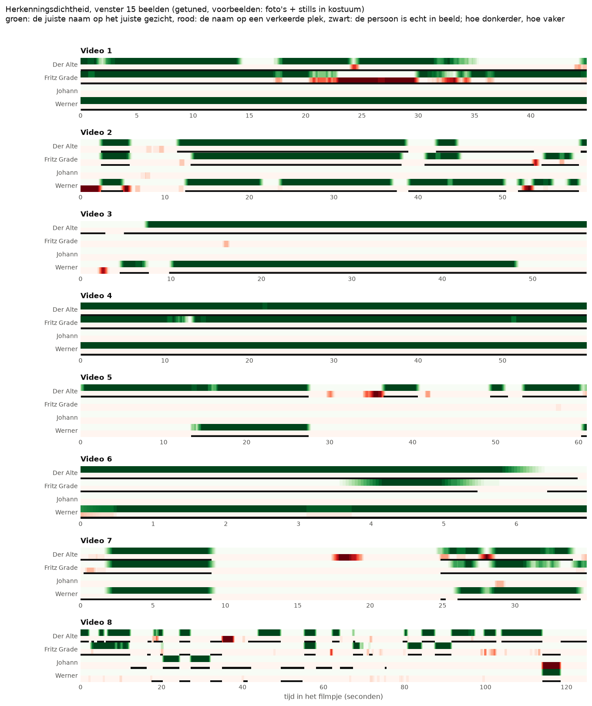

# Herkenningsdichtheid op de tijdlijn

> **De vraag.** Wanneer staat de juiste naam op het juiste gezicht, en wanneer staat de naam op een verkeerde plek?
>
> **Het antwoord.** Bij FaceNet standaard staan de namen vaak op een verkeerde plek: Johann wordt bijna overal genoemd, terwijl Johann bijna nergens in beeld is. Bij het getunde model staat de juiste naam meestal op het juiste gezicht, en is er bijna geen rood meer.


*FaceNet standaard, foto's + stills, venster 15 beelden. Zo lees je dit plaatje: per filmpje staan vier personen onder elkaar, en de tijd loopt van links naar rechts. Elke persoon heeft een groene strook (de juiste naam staat op het juiste gezicht) en daaronder een rode strook (de naam staat op een verkeerde plek). Hoe donkerder, hoe vaker. De zwarte lijn laat zien wanneer de persoon echt in beeld is. Kijk bijvoorbeeld naar Video 3: bij Johann is de rode strook vaak donker, maar er is geen zwarte lijn. Daar noemt FaceNet Johann ten onrechte.*

Wat de woorden betekenen, staat in [de woordenlijst](../README.md#woordenlijst).


## Waarom dit experiment

Een herkenning springt in een rommelig stuk film heen en weer, en dan is moeilijk te zien hoe zeker FaceNet is. Daarom rekenen we de *herkenningsdichtheid* uit: hoe vaak staat de naam goed, of fout, in een korte tijd?


## Hoe we het gedaan hebben

We gebruiken een *convolutiefilter*. Dat klinkt ingewikkeld, maar het is een schuivend venster:

1. Per persoon en per beeld is het signaal 1 als FaceNet de naam op het juiste gezicht zet, en anders 0. Een tweede signaal is 1 als de naam op een verkeerde plek staat.
2. Elk beeld krijgt het gemiddelde van het venster eromheen.
3. Een dichtheid van 0,8 betekent dat de naam in 80% van de beelden in het venster op het juiste gezicht staat.
4. We proberen vensters van 10, 15 en 20 beelden: ongeveer een halve tot een hele seconde.
5. We doen dat met FaceNet standaard en met het getunde model.


*Zo werkt het schuivende venster, op een echt stukje film. Bovenaan is elk vakje een beeld: zwart betekent dat de juiste naam op het gezicht staat. Het oranje venster telt 6 van de 15 beelden, dus de dichtheid van het middelste beeld is 0,40. Daarna schuift het venster één beeld op. Onderaan zie je de dichtheid van elk beeld als kleur.*


## Wat eruit kwam

Gemiddeld over alle beelden, met foto's + stills en een venster van 15 beelden:

| Persoon | Standaard: juiste naam | Standaard: verkeerde plek | Getuned: juiste naam | Getuned: verkeerde plek | Echt in beeld |
|---|---|---|---|---|---|
| Der Alte | 0,252 | 0,448 | 0,625 | 0,022 | 0,745 |
| Fritz Grade | 0,291 | 0,448 | 0,366 | 0,031 | 0,476 |
| Johann | 0,008 | 0,378 | 0,020 | 0,011 | 0,076 |
| Werner | 0,195 | 0,219 | 0,505 | 0,013 | 0,581 |

*Zo lees je de tabel: de juiste naam kan nooit vaker staan dan de persoon echt in beeld is. Hoe dichter *juiste naam* bij *echt in beeld* ligt en hoe lager *verkeerde plek* is, hoe beter.*



*Het getunde model, dezelfde strepen. Bijna alles is nu groen, en groen valt meestal samen met de zwarte lijn. Het rood is bijna weg.*


## Wat dit betekent

- **Bij FaceNet standaard staat een naam vaker op een verkeerde plek dan op het juiste gezicht.** Zie [Wie wordt als Johann herkend?](../wie_wordt_johann/README.md) voor Johann.
- **Bij het getunde model is het precies andersom.** De juiste naam staat meestal op het juiste gezicht, en een naam op een verkeerde plek is zeldzaam.
- **De grootte van het venster maakt weinig uit.** De gemiddelde dichtheid verandert vrijwel niet ([`dichtheid_samenvatting.csv`](resultaten/dichtheid_samenvatting.csv)). Een groter venster maakt de strook alleen rustiger.

De dichtheid per beeld staat in `dichtheid_venster_<n>.csv` in [`resultaten/`](resultaten/) en [`resultaten_tuned/`](resultaten_tuned/), per set.


## Zo draai je het op een Mac en op Windows

Doe dit vanuit de map `experimenten`. Draai eerst de [basis](../basis/README.md), en voor het getunde model ook [tuned](../tuned/README.md). Installeren hoeft één keer, zie [Installeren op Mac en Windows](../README.md#installeren-op-mac-en-windows).

Op een Mac:

```bash
.venv/bin/python herkenningsdichtheid/draai.py
.venv/bin/python herkenningsdichtheid/draai.py --model tuned
```

Op Windows:

```bat
.venv\Scripts\python herkenningsdichtheid\draai.py
.venv\Scripts\python herkenningsdichtheid\draai.py --model tuned
```
