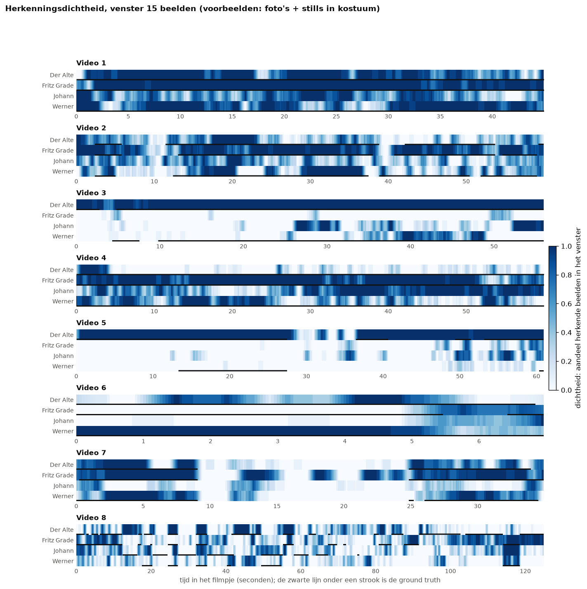
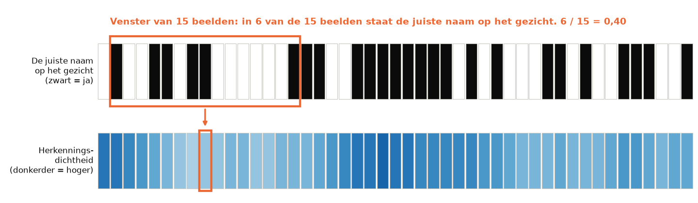

# Herkenningsdichtheid op de tijdlijn

> **De vraag.** Hoe vaak ziet FaceNet een persoon in een korte tijd, en waar is de herkenning zeker?
>
> **Het antwoord.** De dichtheid laat in één oogopslag zien waar FaceNet zeker is en waar de naam heen en weer springt. Met de standaardinstellingen ziet FaceNet Der Alte en Werner te weinig, en Johann veel te vaak.



*Zo lees je dit plaatje: per filmpje staan vier stroken, één per persoon, en de tijd loopt van links naar rechts. Hoe donkerder de strook, hoe vaker FaceNet de persoon ziet. De zwarte lijn onder een strook laat zien wanneer de persoon echt in beeld is. Kijk bijvoorbeeld naar Video 3: bij Der Alte is de strook donker en loopt de zwarte lijn door, en dat klopt. Bij Johann is de strook vanaf 26 seconden vaak donker, maar er is geen zwarte lijn: daar ziet FaceNet Johann ten onrechte.*

Wat de woorden betekenen, staat in [de woordenlijst](../README.md#woordenlijst).


## Waarom dit experiment

De tijdlijn van de [basis](../basis/README.md) laat voor elk beeld zien of FaceNet een persoon ziet: aan of uit. In een rommelig stuk film springt dat heen en weer, en dan is moeilijk te zien hoe zeker de herkenning is. Daarom rekenen we de *herkenningsdichtheid* uit: hoe vaak FaceNet een persoon ziet in een korte tijd.


## Hoe we het gedaan hebben

We gebruiken een *convolutiefilter*. Dat klinkt ingewikkeld, maar het is een schuivend venster:

1. Per persoon en per beeld is het signaal 1 als FaceNet die persoon in dat beeld ziet, en anders 0.
2. Elk beeld krijgt het gemiddelde van het venster eromheen.
3. Een dichtheid van 0,8 betekent dat FaceNet de persoon in 80% van de beelden in het venster ziet.
4. We proberen vensters van 10, 15 en 20 beelden: ongeveer een halve tot een hele seconde.



*Zo werkt het schuivende venster, op een echt stukje film. Bovenaan is elk vakje een beeld: zwart betekent dat FaceNet de persoon ziet. Het oranje venster telt 8 van de 15 beelden, dus de dichtheid van het middelste beeld is 0,53. Daarna schuift het venster één beeld op. Onderaan zie je de dichtheid van elk beeld als kleur.*


## Wat eruit kwam

Gemiddeld over alle beelden, met foto's + stills en een venster van 15 beelden:

| Persoon | Dichtheid volgens FaceNet | Echte dichtheid | Gemiddeld verschil per beeld |
|---|---|---|---|
| Der Alte | 0,551 | 0,745 | 0,372 |
| Fritz Grade | 0,531 | 0,476 | 0,195 |
| Johann | 0,385 | 0,076 | 0,418 |
| Werner | 0,356 | 0,581 | 0,342 |


## Wat dit betekent

- **Der Alte en Werner worden te weinig gezien.** De dichtheid is lager dan de echte dichtheid.
- **Johann wordt veel te vaak gezien.** De dichtheid is vijf keer zo hoog als de echte dichtheid. Zie [Wie wordt als Johann herkend?](../wie_wordt_johann/README.md).
- **De grootte van het venster maakt weinig uit.** De gemiddelde dichtheid verandert vrijwel niet ([`dichtheid_samenvatting.csv`](resultaten/dichtheid_samenvatting.csv)). Een groter venster maakt de strook alleen rustiger.

De dichtheid per beeld staat in `dichtheid_venster_<n>.csv` in [`resultaten/`](resultaten/), per set.


## Zo draai je het op een Mac en op Windows

Doe dit vanuit de map `experimenten`, nadat de [basis](../basis/README.md) gedraaid heeft. Installeren hoeft één keer, zie [Installeren op Mac en Windows](../README.md#installeren-op-mac-en-windows).

Op een Mac:

```bash
.venv/bin/python herkenningsdichtheid/draai.py
```

Op Windows:

```bat
.venv\Scripts\python herkenningsdichtheid\draai.py
```
