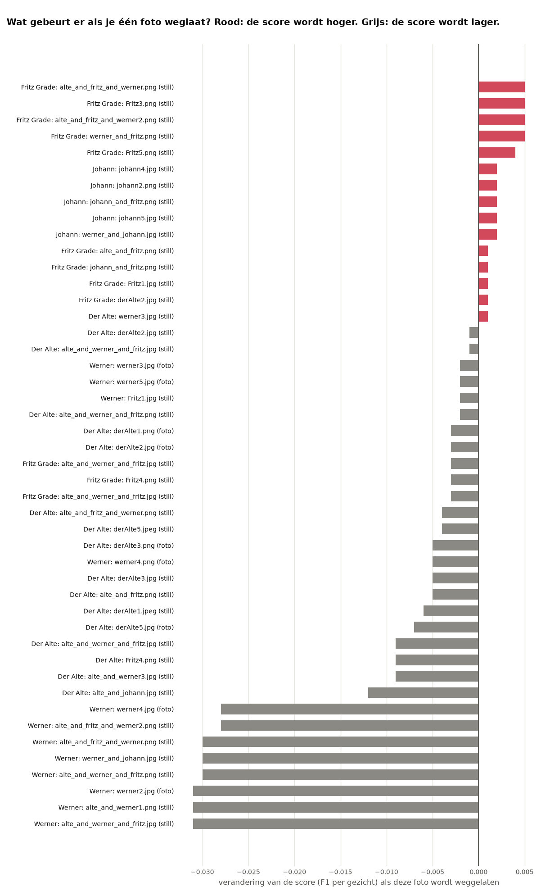

# Leave-one-out: welke voorbeeldfoto's maken het resultaat slechter?

> **De vraag.** Zitten er voorbeeldfoto's tussen die FaceNet juist slechter maken?
>
> **Het antwoord.** Bij FaceNet standaard wel. Zonder de ene foto `johann3.png` gaat de score van 0,308 naar 0,357. Laat je zo acht foto's weg, dan is de score 0,426. Bij het getunde model doet geen enkele foto nog veel kwaad: het grootste effect is +0,005. Die foto's zijn gekozen op dezelfde beelden als waarop we meten, dus de scores na het weglaten zijn te gunstig.


*FaceNet standaard, set met foto's + stills. Zo lees je dit plaatje: elke regel is één voorbeeld. Een rode balk naar rechts betekent dat de score hoger wordt zonder dat voorbeeld: die foto is dus schadelijk. Een grijze balk naar links betekent dat de score lager wordt: die foto helpt. Voorbeelden die niets veranderen, staan er niet bij.*

Wat de woorden betekenen, staat in [de woordenlijst](../README.md#woordenlijst).


## Waarom dit experiment

Niet elke voorbeeldfoto helpt. Een donkere of wazige foto kan ervoor zorgen dat veel gezichten de verkeerde naam krijgen. Met *leave-one-out* (één weglaten) vinden we die foto's.


## Hoe we het gedaan hebben

1. We laten één voorbeeld weg en meten opnieuw per gezicht. De vectoren veranderen niet, alleen de lijst met voorbeelden verandert.
2. Dat doen we voor elk voorbeeld, en voor de drie sets voorbeelden: alleen foto's, alleen stills en foto's + stills.
3. Daarna laten we stap voor stap steeds de foto weg die de score het meest verbetert, tot weglaten niet meer helpt.
4. We doen dat met FaceNet standaard (drempel 0,80) en met het getunde model. De drempel blijft steeds gelijk.


## Wat eruit kwam met FaceNet standaard

Van de 73 voorbeelden in de set met foto's + stills maken er 5 het resultaat slechter, 22 maken het beter en 46 veranderen niets.

Dit zijn de 5 foto's waarbij het resultaat beter wordt zonder die foto. De naam van een bestand zegt niet wie erop staat: op één still kunnen meer gezichten staan, en het *label* is de persoon die de labelaar bij dat gezicht koos.

| Foto | Label van dit gezicht | Verandering van de score als de foto weg is |
|---|---|---|
| `johann3.png` | Johann | **+0,049** |
| `alte_and_werner_and_fritz.jpg` | Fritz Grade | +0,014 |
| `Fritz1.jpg` | Werner | +0,012 |
| `Fritz5.png` | Fritz Grade | +0,001 |
| `johann2.png` | Johann | +0,001 |


*Deze foto's maken het resultaat slechter. Boven elke foto staat het label en hoeveel de score stijgt zonder die foto. Bijna allemaal zijn ze donker, wazig of half in beeld.*

Dit gebeurt er als je steeds de schadelijkste foto weglaat:

| Stap | Weggelaten | Voorbeelden over | Score |
|---|---|---|---|
| 0 | niets | 73 | 0,308 |
| 1 | Johann: `johann3.png` | 72 | 0,357 |
| 2 | Werner: `Fritz1.jpg` | 71 | 0,388 |
| 3 | Fritz Grade: `alte_and_werner_and_fritz.jpg` | 70 | 0,404 |
| 4 | Fritz Grade: `Fritz5.png` | 69 | 0,407 |
| 5 | Johann: `johann2.png` | 68 | 0,412 |
| 6 | Fritz Grade: `derAlte2.jpg` | 67 | 0,414 |
| 7 | Johann: `werner_and_johann.jpg` | 66 | 0,421 |
| 8 | Johann: `johann_and_fritz.png` | 65 | 0,426 |

`derAlte2.jpg` helpt als je alleen die foto weglaat, maar in stap 6 levert weglaten toch winst op, omdat er dan al andere foto's weg zijn.

Een foto die vaak gekozen wordt, is niet altijd schadelijk. Het gezicht met het label Der Alte in `Fritz4.png` leek 10.016 keer het meest op een kader. Zonder die foto daalt de score toch met 0,020, omdat die kaders dan naar een andere persoon gaan.

Met alleen de gewone foto's maakt geen enkele foto het resultaat slechter: 11 foto's helpen en 12 veranderen niets ([`resultaten/fotos/`](resultaten/fotos/)). FaceNet geeft met die foto's dan ook bijna geen namen.


## Met het getunde model



*Het getunde model, set met foto's + stills. Let op de schaal: de grootste winst is 0,005. De foto's met de grootste grijze balken zijn stills van Werner: die zijn juist belangrijk.*

| Set voorbeelden | Score met alle foto's | Maken het slechter | Helpen | Veranderen niets | Score na steeds de schadelijkste foto weglaten |
|---|---|---|---|---|---|
| Foto's | 0,808 | 2 | 9 | 12 | 0,824 (3 foto's weg) |
| Foto's + stills | 0,874 | 15 | 31 | 27 | 0,883 (4 foto's weg) |
| Alleen stills | 0,870 | 6 | 29 | 15 | 0,881 (6 foto's weg) |

Ook deze scores zijn te gunstig, want de foto's zijn gekozen op dezelfde beelden als waarop we meten.


## Wat dit betekent

- **Bij FaceNet standaard doet één foto het meeste kwaad.** Zonder `johann3.png` stijgt de score van 0,308 naar 0,357.
- **Het getunde model is veel minder gevoelig voor één slechte foto.** Het grootste effect van één foto is +0,005 bij foto's + stills. Het getunde model vergelijkt met het gemiddelde van de foto's, en daarin weegt één foto minder zwaar.
- **Een slechte foto weghalen is minder nodig dan goed afstellen.** Met alle foto's en goede instellingen is de score 0,874. Met FaceNet standaard en acht foto's minder is die 0,426.

De bestanden per set staan in [`resultaten/`](resultaten/) en [`resultaten_tuned/`](resultaten_tuned/): `leave_one_out.csv` (elke foto), `weglaten_stap_voor_stap.csv`, `leave_one_out.png` en `slechtste_fotos.jpg`.


## Zo draai je het op een Mac en op Windows

Doe dit vanuit de map `experimenten`. Draai eerst de [basis](../basis/README.md) en [alleen in karakter](../alleen_in_karakter/README.md), en voor het getunde model ook [tuned](../tuned/README.md). Installeren hoeft één keer, zie [Installeren op Mac en Windows](../README.md#installeren-op-mac-en-windows).

Op een Mac:

```bash
.venv/bin/python leave_one_out/draai.py
.venv/bin/python leave_one_out/draai.py --model tuned
```

Op Windows:

```bat
.venv\Scripts\python leave_one_out\draai.py
.venv\Scripts\python leave_one_out\draai.py --model tuned
```
