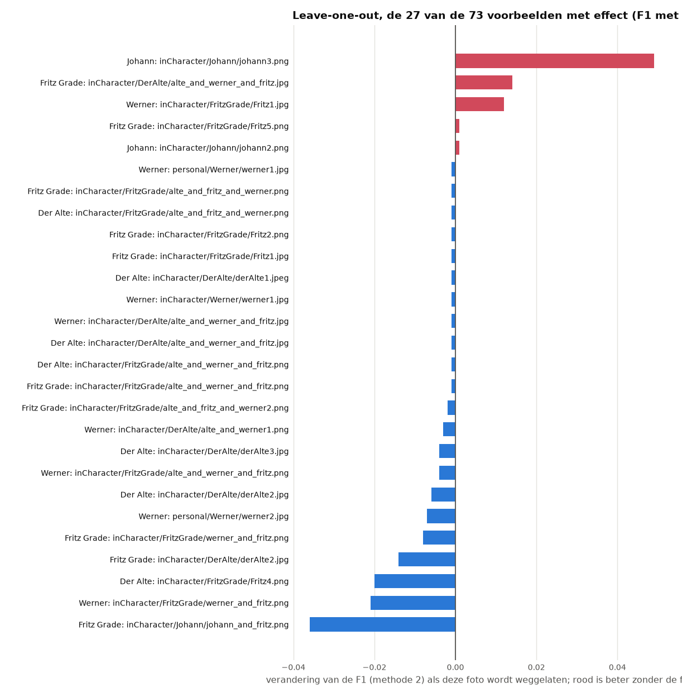
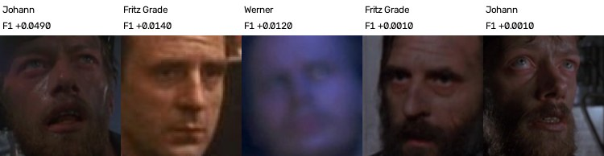

# Leave-one-out: welke voorbeeldfoto's maken het resultaat slechter?

Niet elke voorbeeldfoto helpt. Een donkere of wazige foto kan ervoor zorgen dat veel gezichten de verkeerde naam krijgen. In dit experiment kijken we per voorbeeldfoto wat er gebeurt als die ene foto er niet in zit: wordt het resultaat dan beter, dan is die foto schadelijk.

## Hoe we het gedaan hebben

FaceNet staat standaard (drempel 0,80), en we meten met methode 2 (per gezicht) en ook met methode 1. Per voorbeeld laten we alleen dat voorbeeld weg en meten we opnieuw. De vectoren veranderen niet, alleen de lijst met voorbeelden. We doen dat voor de drie sets voorbeelden.

Daarna laten we stap voor stap steeds de foto weg die de F1 het meest verbetert, tot weglaten niet meer helpt. **Let op:** die foto's zijn uitgekozen op dezelfde beelden als waarop we meten. Dat laat zien wat er te winnen valt, maar de score is daardoor te gunstig.

## Wat eruit kwam



*De set met foto's + stills. Rood is beter zonder de foto, blauw is slechter zonder de foto. De voorbeelden die niets veranderen staan er niet bij.*

Van de 73 voorbeelden in die set maken er 5 het resultaat slechter, 22 maken het beter en 46 veranderen niets.

| Foto | Label | F1 per gezicht als de foto weg is | F1 per beeld als de foto weg is |
|---|---|---|---|
| `inCharacter/Johann/johann3.png` | Johann | **+0,049** | +0,085 |
| `inCharacter/DerAlte/alte_and_werner_and_fritz.jpg` | Fritz Grade | +0,014 | +0,006 |
| `inCharacter/FritzGrade/Fritz1.jpg` | Werner | +0,012 | -0,029 |
| `inCharacter/FritzGrade/Fritz5.png` | Fritz Grade | +0,001 | -0,002 |
| `inCharacter/Johann/johann2.png` | Johann | +0,001 | +0,003 |



*Deze foto's maken het resultaat slechter. Bijna allemaal zijn ze donker, wazig of half in beeld.*

Steeds de schadelijkste foto weglaten geeft (set met foto's + stills):

| Stap | Weggelaten | Voorbeelden over | F1 per gezicht | F1 per beeld |
|---|---|---|---|---|
| 0 | niets | 73 | 0,308 | 0,636 |
| 1 | Johann: `johann3.png` | 72 | 0,357 | 0,721 |
| 2 | Werner: `Fritz1.jpg` | 71 | 0,388 | 0,696 |
| 3 | Fritz Grade: `alte_and_werner_and_fritz.jpg` | 70 | 0,404 | 0,711 |
| 4 | Fritz Grade: `Fritz5.png` | 69 | 0,407 | 0,710 |
| 5 | Johann: `johann2.png` | 68 | 0,412 | 0,724 |
| 6 | Fritz Grade: `derAlte2.jpg` | 67 | 0,414 | 0,713 |
| 7 | Johann: `werner_and_johann.jpg` | 66 | 0,421 | 0,731 |
| 8 | Johann: `johann_and_fritz.png` | 65 | 0,426 | 0,741 |

**Wat dit betekent.** Eén foto doet het meeste kwaad: zonder `johann3.png` stijgt de F1 per gezicht van 0,308 naar 0,357. Met acht foto's minder is de F1 0,426. Een foto die veel de doorslag geeft, is niet altijd schadelijk: het gezicht met het label Der Alte in `Fritz4.png` geeft 10.016 keer de doorslag, maar zonder die foto wordt het resultaat juist slechter (F1 per gezicht -0,020), omdat die kaders dan naar een andere persoon gaan.

Met alleen de gewone foto's maakt geen enkele foto het resultaat slechter: 11 foto's helpen en 12 veranderen niets ([`resultaten/fotos/`](resultaten/fotos/)). Dat komt doordat FaceNet met die foto's bijna geen namen geeft.

De bestanden per set staan in [`resultaten/`](resultaten/): `leave_one_out.csv` (elke foto), `weglaten_stap_voor_stap.csv`, `leave_one_out.png` en `slechtste_fotos.jpg`.

## Zo draai je het op een Mac en op Windows

Doe dit vanuit de map `experimenten`, nadat de [basis](../basis/README.md) gedraaid heeft. Installeren hoeft één keer, zie [de uitleg over alle experimenten](../README.md#installeren-op-mac-en-windows).

Op een Mac:

```bash
.venv/bin/python leave_one_out/draai.py
```

Op Windows:

```bat
.venv\Scripts\python leave_one_out\draai.py
```
