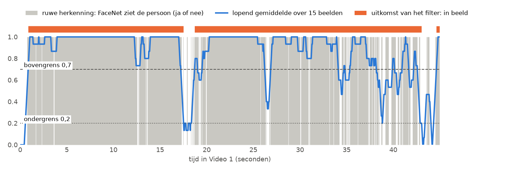
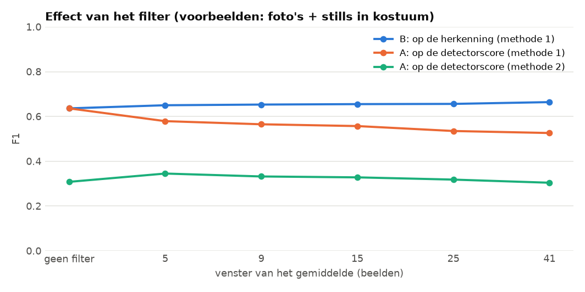
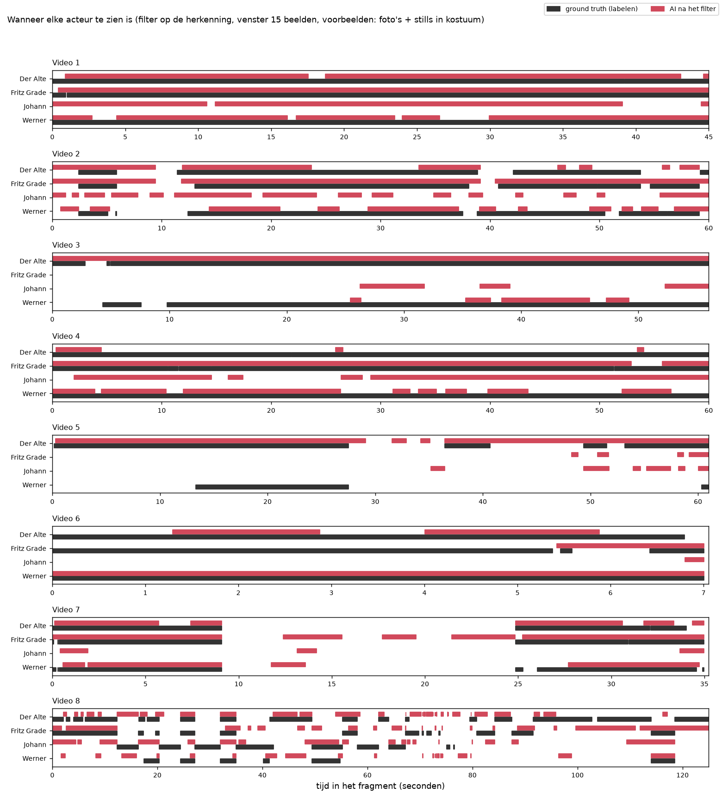

# Moving average filter op de detectie

Een herkenning springt van beeld tot beeld aan en uit. Een *moving average* (lopend gemiddelde) middelt over een aantal beelden en haalt zulke sprongen eruit. We gebruiken twee grenzen: **onder 0,2 is er geen detectie, boven 0,7 wel, en daartussen blijft het zoals het was**. Doordat de twee grenzen verschillen, flikkert de uitkomst niet aan en uit als het gemiddelde rond één grens schommelt (dat heet *hysterese*).

## Hoe we het gedaan hebben

"Detectie" kan twee dingen zijn, dus we hebben het filter op twee plekken geprobeerd. FaceNet staat standaard (drempel 0,80), en we proberen vensters van 5 tot 41 beelden. Het venster is gecentreerd: evenveel beelden ervoor als erna.

- **A. Op de score van de detector, per track.** Het signaal is de score van het kader in elk beeld van een track (0 als er even geen kader is). Kaders in beelden waar het filter uit staat, tellen niet meer mee.
- **B. Op de herkenning, per persoon.** Het signaal is 1 als FaceNet die persoon in dat beeld ziet, anders 0. Het filter zegt per beeld of de persoon in beeld is. Het venster loopt nooit over een beeldwissel heen.



*Wat het filter doet, op Der Alte in Video 1 (venster 15 beelden). Grijs is de ruwe herkenning, blauw het lopend gemiddelde en oranje de uitkomst.*

## Wat eruit kwam



Foto's + stills in kostuum:

| Venster (beelden) | geen | 5 | 9 | 15 | 25 | 41 |
|---|---|---|---|---|---|---|
| A: kaders over | 37.003 | 21.460 | 20.471 | 19.702 | 18.828 | 18.203 |
| A: F1 methode 1 (per beeld) | 0,636 | 0,579 | 0,565 | 0,557 | 0,535 | 0,526 |
| A: F1 methode 2 (per gezicht) | 0,308 | **0,345** | 0,332 | 0,328 | 0,318 | 0,304 |
| B: F1 methode 1 (per beeld) | 0,636 | 0,650 | 0,653 | 0,655 | 0,656 | **0,664** |

**Wat dit betekent.**

- **Op de score van de detector (A)** gooit het filter veel kaders weg: met een bovengrens van 0,7 blijft maar 58% van de kaders over bij een venster van 5 beelden. Daardoor verdwijnen er ook kaders zonder gezicht, en wordt de F1 per gezicht iets beter (van 0,308 naar 0,345 bij een venster van 5). Per beeld wordt het juist slechter (0,636 naar 0,579), omdat er ook echte gezichten verdwijnen.
- **Op de herkenning (B)** wordt de tijdlijn rustiger en de F1 per beeld iets beter (van 0,636 naar 0,664 bij een venster van 41 beelden): de precisie stijgt, de recall blijft bijna gelijk.
- Met alleen de gewone foto's verandert er bijna niets, omdat FaceNet dan toch bijna geen namen geeft ([`resultaten/fotos/`](resultaten/fotos/)).



*De tijdlijn na het filter op de herkenning (venster 15 beelden). Rood is FaceNet na het filter.*

De getallen staan per set in [`resultaten/`](resultaten/): `filter_A_detector.csv` en `filter_B_herkenning.csv`.

## Zo draai je het op een Mac en op Windows

Doe dit vanuit de map `experimenten`, nadat de [basis](../basis/README.md) gedraaid heeft. Installeren hoeft één keer, zie [de uitleg over alle experimenten](../README.md#installeren-op-mac-en-windows).

Op een Mac:

```bash
.venv/bin/python moving_average/draai.py
```

Op Windows:

```bat
.venv\Scripts\python moving_average\draai.py
```
