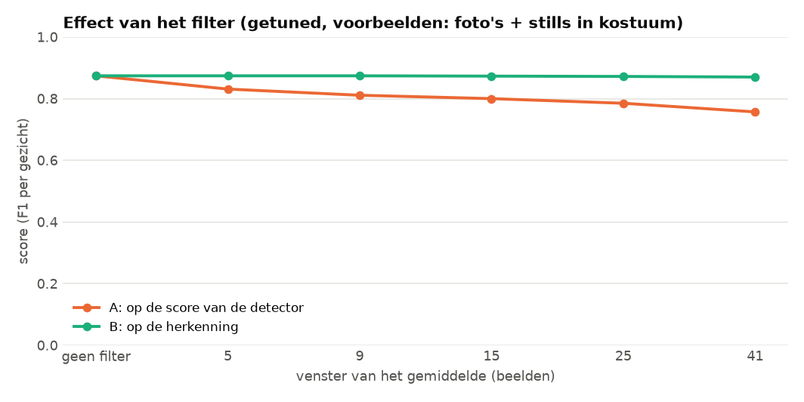

# Moving average: een filter dat losse flitsen weghaalt

> **De vraag.** Wordt het resultaat beter met een filter dat losse flitsen weghaalt?
>
> **Het antwoord.** Nauwelijks. Bij FaceNet standaard gaat de score hoogstens van 0,308 naar 0,345. Dat is als het filter kijkt naar hoe zeker de detector van een kader is, met een venster van 5 beelden. Als het filter de namen van FaceNet gladstrijkt, blijft de score gelijk. Bij het getunde model helpt het filter niet: de score blijft 0,874 of wordt lager. Die beste vensters zijn gekozen op dezelfde beelden als waarop we meten.


*Zo lees je dit plaatje: dit is Der Alte in Video 1, bij FaceNet standaard. Grijs zijn de beelden waarin FaceNet Der Alte noemt. De blauwe lijn zegt in welk deel van de 15 beelden eromheen dat zo is: 1,0 betekent in alle 15. Oranje bovenaan is de uitkomst: het filter zegt dat Der Alte in beeld is zodra de lijn boven 0,7 komt, en pas niet meer als de lijn onder 0,2 zakt.*

Wat de woorden betekenen, staat in [de woordenlijst](../README.md#woordenlijst).


## Waarom dit experiment

FaceNet ziet een persoon in het ene beeld wel en in het volgende niet. Iemand die vijf seconden in beeld is, wordt dan in losse stukjes herkend. Op ons lijstje stond daarom een *moving average* (lopend gemiddelde) op de detectie, met een ondergrens van 0,2 en een bovengrens van 0,7.


## Hoe het filter werkt

1. **Het signaal.** Per beeld is er een getal.
2. **Het lopend gemiddelde.** Elk beeld krijgt het gemiddelde van de beelden eromheen, evenveel ervoor als erna. Dat stuk heet het *venster*.
3. **De twee grenzen.** Onder 0,2 is er geen detectie, boven 0,7 wel. Daartussen blijft het zoals het was.

Doordat er twee verschillende grenzen zijn, flikkert de uitkomst niet aan en uit als het gemiddelde rond één grens schommelt.


## Hoe we het gedaan hebben

Met *detectie* kun je twee dingen bedoelen: dat de detector een kader vond, of dat FaceNet een persoon ziet. Daarom proberen we allebei. We proberen vensters van 5 tot 41 beelden, en meten per gezicht. Dat doen we met FaceNet standaard en met het getunde model.

| | A. Op de zekerheid van de detector | B. Op de namen van FaceNet |
|---|---|---|
| **Waarop** | Per track | Per persoon |
| **Het signaal** | Hoe zeker de detector is van het kader in elk beeld (0 als er even geen kader is) | 1 als FaceNet de persoon in dat beeld noemt, anders 0 |
| **Wat het filter doet** | Kaders in beelden waar het filter uit staat, tellen niet meer mee | Een kader houdt zijn naam alleen in de beelden waar het filter van die persoon aan staat. Het venster loopt nooit over een beeldwissel heen |


## Wat eruit kwam

Dit is de score met foto's + stills.

| Venster (beelden) | geen | 5 | 9 | 15 | 25 | 41 |
|---|---|---|---|---|---|---|
| Standaard, A: zekerheid detector | 0,308 | **0,345** | 0,332 | 0,328 | 0,318 | 0,304 |
| Standaard, B: namen | 0,308 | 0,307 | 0,308 | 0,308 | 0,308 | 0,306 |
| Getuned, A: zekerheid detector | **0,874** | 0,831 | 0,811 | 0,800 | 0,785 | 0,757 |
| Getuned, B: namen | **0,874** | 0,874 | 0,874 | 0,873 | 0,872 | 0,870 |

Met alleen de gewone foto's zakt de score bij FaceNet standaard (0,074 wordt 0,073 of minder). Bij het getunde model zakt de score met A (0,808 wordt 0,710 tot 0,785), en gaat die met B een heel klein beetje omhoog (0,808 wordt 0,810 of 0,811).


*FaceNet standaard. Zo lees je dit plaatje: van links naar rechts wordt het venster groter. Helemaal links staat de score zonder filter. Oranje (A) stijgt eerst een beetje en zakt daarna. Groen (B) blijft gelijk.*



*Het getunde model. Oranje (A) daalt: het filter gooit ook goede kaders weg. Groen (B) blijft bijna gelijk.*


*De tijdlijn na het filter op de namen (FaceNet standaard, venster 15 beelden). Zwart is wanneer de persoon echt in beeld is. Groen is de juiste naam op het juiste gezicht, rood is de naam op een verkeerde plek. Er blijft veel rood over: het filter haalt alleen losse flitsen weg.*


## Wat dit betekent

- **Op de zekerheid van de detector (A) gooit het filter veel kaders weg.** Met een bovengrens van 0,7 blijft bij een venster van 5 beelden maar 58% van de kaders over. Bij FaceNet standaard verdwijnen daardoor ook veel kaders zonder gezicht, en wordt de score iets beter. Bij het getunde model zijn er weinig foute namen om weg te halen, en verdwijnen vooral echte gezichten. Daar wordt de score lager.
- **Op de namen van FaceNet (B) verandert er bijna niets.** Bij FaceNet standaard blijven de meeste foute namen staan, want die zijn geen losse flitsen. Het getunde model beslist al per track, dus losse flitsen zijn er bijna niet meer.
- **Het grote verschil zit in het afstellen.** Het filter haalt alleen losse flitsen weg. Het grote probleem van FaceNet standaard blijft: FaceNet geeft vaak de verkeerde naam. Zie [tuned](../tuned/README.md).

De getallen staan per set in [`resultaten/`](resultaten/) en [`resultaten_tuned/`](resultaten_tuned/): `filter_A_detector.csv` en `filter_B_herkenning.csv`.


## Zo draai je het op een Mac en op Windows

Doe dit vanuit de map `experimenten`. Draai eerst de [basis](../basis/README.md), en voor het getunde model ook [tuned](../tuned/README.md). Installeren hoeft één keer, zie [Installeren op Mac en Windows](../README.md#installeren-op-mac-en-windows).

Op een Mac:

```bash
.venv/bin/python moving_average/draai.py
.venv/bin/python moving_average/draai.py --model tuned
```

Op Windows:

```bat
.venv\Scripts\python moving_average\draai.py
.venv\Scripts\python moving_average\draai.py --model tuned
```
