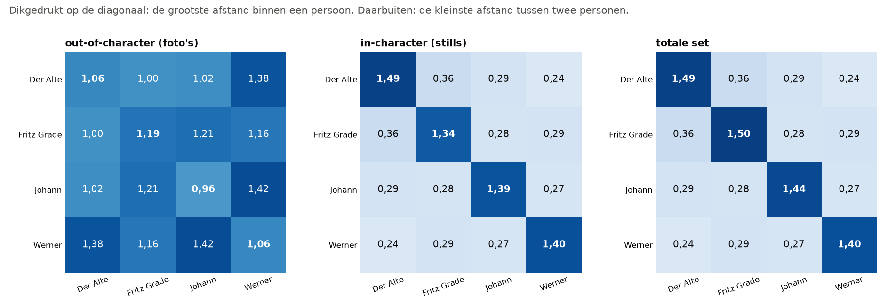
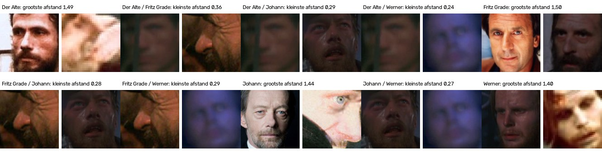
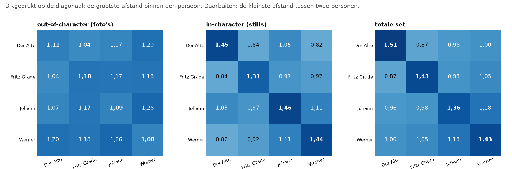

# Spreiding: hoe ver liggen de voorbeeldfoto's uit elkaar?

> **De vraag.** Hoe verschillend zijn de foto's van één persoon voor FaceNet, en hoe dicht liggen de foto's van verschillende personen bij elkaar?
>
> **Het antwoord.** Bij FaceNet standaard verschillen sommige stills van dezelfde persoon sterk (grootste afstand per persoon 1,34 tot 1,49; de afstand loopt van 0 tot 2). Sommige stills van verschillende personen lijken juist sterk op elkaar (kleinste afstand per paar 0,24 tot 0,36, ver onder de drempel van 0,80). Bij het getunde model liggen die stills veel verder uit elkaar (kleinste afstand 0,82 tot 1,11).



*FaceNet standaard. Zo lees je dit plaatje: er zijn drie sets voorbeelden. In de vakjes op de schuine lijn staat de grootste afstand tussen twee foto's van dezelfde persoon: de spreiding. In de andere vakjes staat de kleinste afstand tussen twee foto's van verschillende personen. Hoe groter de afstand, hoe minder de foto's voor FaceNet op elkaar lijken. Kijk naar de middelste tabel: de lichte vakjes (0,24 tot 0,36) liggen ver onder de drempel van 0,80.*

Wat de woorden betekenen, staat in [de woordenlijst](../README.md#woordenlijst).


## Waarom dit experiment

FaceNet geeft een naam als de afstand tot een voorbeeld klein genoeg is. Dat werkt alleen als foto's van verschillende personen ver genoeg uit elkaar liggen. Daarom kijken we naar de voorbeeldfoto's zelf.


## Hoe we het gedaan hebben

1. We rekenen de genormaliseerde Euclidische afstand uit tussen alle voorbeelden in een set.
2. Per persoon zoeken we de grootste afstand binnen die persoon: de *spreiding*.
3. Per paar personen zoeken we de kleinste afstand tussen die twee.
4. We doen dat voor drie sets: de gewone foto's (out-of-character), de stills (in-character) en de totale set.
5. We doen dat met de vectoren van FaceNet standaard, en met de vectoren van het getunde model voor die set.

Dit zijn de uiterste paren: de twee foto's die het verst uit elkaar liggen, en de twee die het dichtst bij elkaar liggen.


## Wat eruit kwam

| Set | Grootste afstand binnen een persoon | Kleinste afstand tussen twee personen |
|---|---|---|
| **Standaard:** gewone foto's | 0,96 tot 1,19 | 1,00 tot 1,42 |
| **Standaard:** stills | 1,34 tot 1,49 | 0,24 tot 0,36 |
| **Standaard:** totale set | 1,40 tot 1,50 | 0,24 tot 0,36 |
| **Getuned:** gewone foto's | 1,08 tot 1,18 | 1,04 tot 1,26 |
| **Getuned:** stills | 1,31 tot 1,46 | 0,82 tot 1,11 |
| **Getuned:** totale set | 1,36 tot 1,51 | 0,87 tot 1,18 |



*FaceNet standaard, de totale set. Zo lees je dit plaatje: boven elk paar foto's staat wat het paar laat zien. Bij* grootste afstand *staan de twee foto's van dezelfde persoon die het minst op elkaar lijken. Bij* kleinste afstand *staan twee foto's van verschillende personen die voor FaceNet het meest op elkaar lijken. Dat laatste zijn steeds donkere of wazige beelden.*



*Het getunde model. Dezelfde drie tabellen. De kleinste afstanden tussen verschillende personen zijn nu veel groter: de vakjes buiten de schuine lijn zijn donkerder.*

Zulke paren kunnen verkeerde namen geven. Hoeveel fouten ze echt geven, meten we hier niet. Dezelfde donkere en wazige foto's, zoals `Fritz4.png`, `Fritz1.jpg`, `johann3.png` en `johann_and_fritz.png`, komen wel terug bij [Leave-one-out](../leave_one_out/README.md) en [Wie wordt Johann](../wie_wordt_johann/README.md).


## Krijgt een kader dat geen van de vier personen is, vaak de persoon met de grootste spreiding?

Dit idee stond op ons lijstje. De gedachte is: hoe verder de voorbeelden van een persoon uit elkaar liggen, hoe groter de kans dat er een in de buurt ligt van een kader dat geen van de vier personen is. Daarom tellen we bij alle kaders op figuranten en op dingen die geen gezicht zijn, welke persoon het dichtstbij is.

| Model | Set | Grootste spreiding | Vaakst dichtstbij | Klopt het idee? |
|---|---|---|---|---|
| Standaard | Gewone foto's | Fritz Grade (1,19) | Werner (81,2%) | nee |
| Standaard | Stills | Der Alte (1,49) | Der Alte (38,8%) | ja |
| Standaard | Totale set | Fritz Grade (1,50) | Der Alte (38,9%) | nee |
| Getuned | Gewone foto's | Fritz Grade (1,18) | Werner (41,4%) | nee |
| Getuned | Stills | Johann (1,46) | Werner (42,8%) | nee |
| Getuned | Totale set | Der Alte (1,51) | Werner (38,7%) | nee |

Het idee is dus niet algemeen waar. Bij de totale set van FaceNet standaard scheelt de spreiding maar 0,01 (Fritz Grade 1,50, Der Alte 1,49), dus dat *nee* zegt weinig. Wie er wint, lijkt vooral af te hangen van welke foto's er in de set zitten.

Alle getallen staan in [`spreiding.csv`](resultaten/spreiding.csv), [`kleinste_afstand.csv`](resultaten/kleinste_afstand.csv) en [`onherkenbaar.csv`](resultaten/onherkenbaar.csv), en voor het getunde model in [`resultaten_tuned/`](resultaten_tuned/).


## Wat dit betekent

- **Bij FaceNet standaard lijken sommige donkere stills van verschillende personen sterk op elkaar.** Dat past bij het hoge aantal foute namen in de [basis](../basis/README.md).
- **Bij het getunde model liggen die stills veel verder uit elkaar.** Donkere gezichten lichter maken en meer van het beeld laten zien, geeft FaceNet meer houvast.
- **Het idee over de grootste spreiding houdt geen stand.**


## Zo draai je het op een Mac en op Windows

Doe dit vanuit de map `experimenten`. Draai eerst de [basis](../basis/README.md) en [alleen in karakter](../alleen_in_karakter/README.md), en voor het getunde model ook [tuned](../tuned/README.md). Installeren hoeft één keer, zie [Installeren op Mac en Windows](../README.md#installeren-op-mac-en-windows).

Op een Mac:

```bash
.venv/bin/python spreiding/draai.py
.venv/bin/python spreiding/draai.py --model tuned
```

Op Windows:

```bat
.venv\Scripts\python spreiding\draai.py
.venv\Scripts\python spreiding\draai.py --model tuned
```
