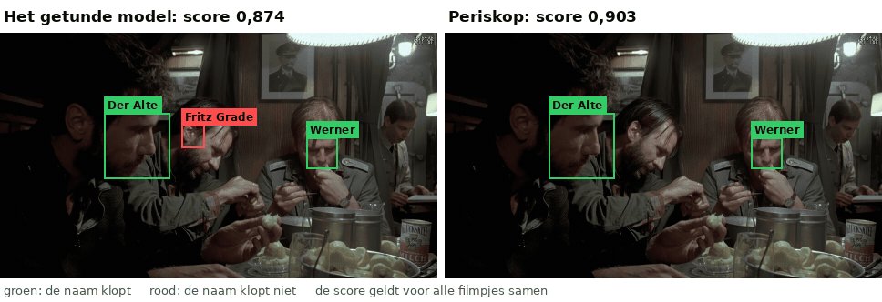
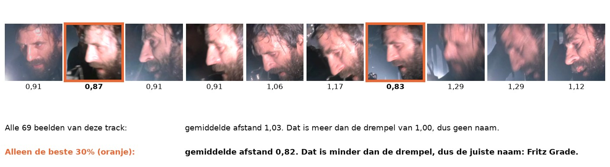
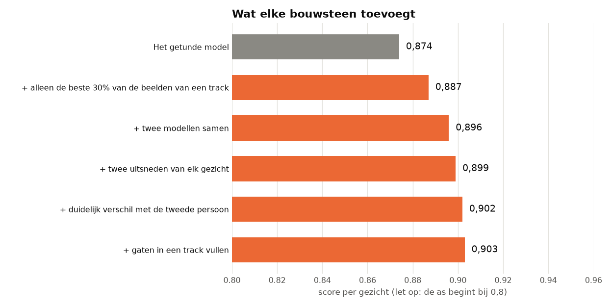
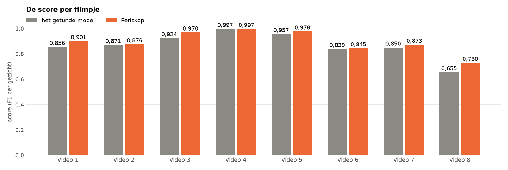
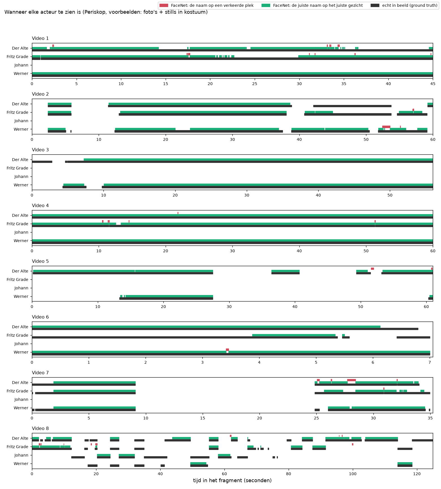
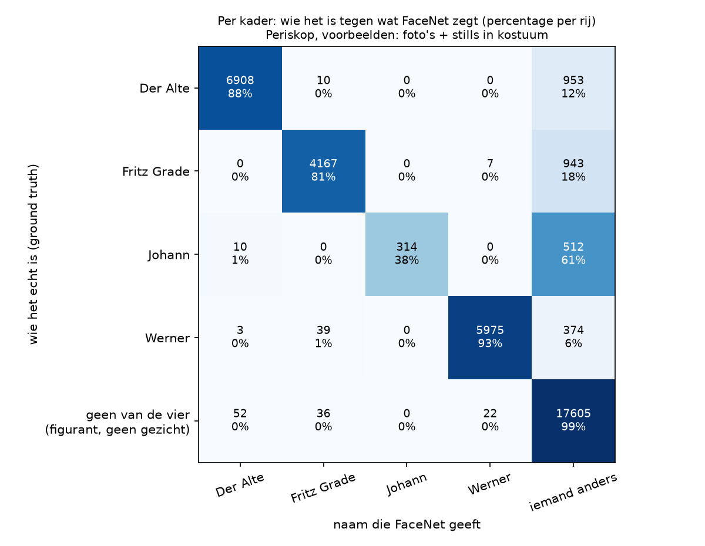

# Top model: Periskop

> **De vraag.** Wat is het beste dat we kunnen bouwen met alles wat we in de experimenten geleerd hebben?
>
> **Het antwoord.** **Periskop**, met een score van **0,903**. Het getunde model haalt 0,874. Periskop zet ook veel minder namen op de verkeerde plek: 139 in plaats van 858. De score is iets te gunstig, omdat de instellingen gekozen zijn op dezelfde beelden als waarop we meten. Kiezen we de instellingen op andere filmpjes, dan is de score **0,889**. Bij het getunde model is dat 0,834.



*Hetzelfde stukje uit Video 1, links met het getunde model en rechts met Periskop. Groen betekent dat de naam klopt, rood dat de naam niet klopt. Links staat de naam Fritz Grade op een verkeerde plek. Rechts krijgt dat kader geen naam. De scores boven het beeld gelden voor alle filmpjes samen, niet voor dit stukje.*

**Waarom deze naam?** De film *Das Boot* speelt zich af op een onderzeeboot. Met een periscoop kijk je vanuit het donker naar buiten, en je kijkt alleen op de goede momenten. Dat doet dit model ook: het maakt donkere gezichten lichter, en het kijkt alleen naar de beste beelden van een gezicht.

Wat de woorden betekenen, staat in [de woordenlijst](../README.md#woordenlijst).

**In deze uitleg:**
[Wat we geleerd hebben](#wat-we-geleerd-hebben) ·
[Hoe Periskop werkt](#hoe-periskop-werkt) ·
[Hoe we het gebouwd hebben](#hoe-we-het-gebouwd-hebben) ·
[Wat eruit kwam](#wat-eruit-kwam) ·
[Wat er nog misgaat](#wat-er-nog-misgaat) ·
[Het filmpje](#het-filmpje) ·
[Zelf draaien](#zo-draai-je-het-op-een-mac-en-op-windows)


## Wat we geleerd hebben

Periskop gebruikt wat de andere experimenten hebben laten zien.

| Wat we geleerd hebben | Uit welk experiment | Wat Periskop daarmee doet |
|---|---|---|
| De stills uit de film maken het grootste verschil, en foto's + stills samen werken het best. | [Alleen in karakter](../alleen_in_karakter/README.md) | Gebruikt alle foto's en stills als voorbeeld. |
| Donkere gezichten lichter maken en extra ruimte om het kader helpen veel. | [Tuned](../tuned/README.md) | Maakt elk gezicht lichter en laat FaceNet ook de omgeving van het gezicht zien. |
| Eén gemiddelde per persoon werkt goed, als de drempel daarbij past. | [Eén gemiddelde vector](../gemiddelde_vector/README.md) | Vergelijkt elk gezicht met het gemiddelde van de voorbeelden van een persoon. |
| Eén los beeld is onbetrouwbaar. Een hele track weet meer. | [Tuned](../tuned/README.md) | Beslist per track. |
| Elke persoon kan maar één keer in een beeld staan. | [Tuned](../tuned/README.md) | Geeft elke naam hoogstens één keer per beeld. |
| De meeste foute namen staan op figuranten en dingen die geen gezicht zijn. | [Wie wordt Johann](../wie_wordt_johann/README.md) | Geeft alleen een naam als één persoon duidelijk beter past dan de rest. |
| Eén slechte foto doet bij het getunde model weinig kwaad. | [Leave-one-out](../leave_one_out/README.md) | Laat geen foto's weg. |
| Een filter over de tijd helpt niet bij het getunde model. | [Moving average](../moving_average/README.md) | Gebruikt geen filter. |

Beelden uit de filmpjes gebruikt Periskop nooit als voorbeeld, ook niet automatisch. De voorbeelden zijn alleen de foto's en de stills. FaceNet zelf is niet opnieuw getraind.


## Hoe Periskop werkt

1. **Vier keer kijken.** Van elk gezicht maken we vier vectoren: met twee versies van FaceNet (Facenet en Facenet512), en met twee uitsneden (20% en 30% extra ruimte om het kader). Elk gezicht wordt eerst lichter gemaakt.
2. **De afstanden middelen.** Elke versie geeft per persoon een afstand tot het gemiddelde van de voorbeelden. Periskop neemt het gemiddelde van die vier afstanden. Twee versies van FaceNet maken verschillende fouten, en die vallen deels tegen elkaar weg.
3. **Alleen de beste beelden van een track.** Per track en per persoon tellen alleen de 30% beelden met de kleinste afstand mee. Een gezicht van opzij, wazig of in het donker trekt het gemiddelde dan niet meer omlaag.
4. **Elke naam één keer per beeld.** De naam gaat naar het kader met de kleinste afstand tot die persoon.
5. **Alleen bij een duidelijk verschil.** Staat de tweede persoon bijna even dichtbij (verschil kleiner dan 0,05), dan krijgt de track geen naam.
6. **De drempel.** Is de afstand kleiner dan 0,9973, dan krijgt de track de naam. Anders is het *iemand anders*.
7. **Gaten vullen.** Was de detector een gezicht binnen een track even kwijt, dan maakt Periskop daar een kader bij, tussen twee kaders met dezelfde naam. Zo komen er 927 kaders bij.

Stap 3 is de belangrijkste nieuwe bouwsteen:



*Zo lees je dit plaatje: dit zijn tien beelden uit één track, in de volgorde van de film, zoals FaceNet ze te zien krijgt. Onder elk beeld staat de afstand tot de juiste persoon, en een kleine afstand is goed. Sommige beelden zijn wazig of van opzij, en hebben een grote afstand. Oranje zijn beelden die bij de beste 30% horen. Met alle beelden krijgt deze track geen naam, met alleen de beste beelden wel.*


## Hoe we het gebouwd hebben

We hebben 108 combinaties van bouwstenen geprobeerd, elk met 200 drempels. De combinatie met de hoogste score wint.

| Bouwsteen | Wat we proberen | De winnaar |
|---|---|---|
| Hoe FaceNet kijkt | twee modellen; twee modellen en twee uitsneden; ook gespiegeld | twee modellen en twee uitsneden |
| Deel van de track dat meetelt | alle beelden, de beste 50%, de beste 30% | de beste 30% |
| Verschil met de tweede persoon | 0, 0,03, 0,05 | 0,05 |
| Zekerheid van de detector, gemiddeld over de track | geen eis, minstens 0,35 | geen eis |
| Gaten in een track vullen | nee, ja | ja |



*Zo lees je dit plaatje: bovenaan staat het getunde model, en bij elke regel komt er een bouwsteen bij. Let op: de as begint bij 0,8, om de verschillen goed te kunnen zien. De grootste stappen komen van de beste beelden en van twee modellen samen.*

| Stap | Script |
|---|---|
| 1. De vectoren van de gespiegelde gezichten maken, en de vectoren van [tuned](../tuned/README.md) klaarzetten. | [`stap_1_vectoren.py`](stap_1_vectoren.py) |
| 2. Alle combinaties proberen, en de eerlijke schatting uitrekenen. | [`stap_2_afstellen.py`](stap_2_afstellen.py) |
| 3. Herkennen met de beste combinatie. | [`stap_3_herkennen.py`](stap_3_herkennen.py) |
| 4. Meten per gezicht. | [`stap_4_meten_per_gezicht.py`](stap_4_meten_per_gezicht.py) |
| 5. Het filmpje maken. | [`stap_5_filmpje.py`](stap_5_filmpje.py) |
| 6. De README bij de uitkomsten maken. | [`stap_6_uitleg.py`](stap_6_uitleg.py) |

Het model zelf staat in [`model.py`](model.py), de instellingen in [`instellingen.py`](instellingen.py).

**Wat niet hielp.**

- **Ook het spiegelbeeld bekijken.** De hoogste score is dan 0,898 in plaats van 0,903.
- **Tracks weglaten waar de detector onzeker van is.** De score blijft 0,903, dus Periskop doet dit niet.
- **Slechte foto's weglaten.** De score gaat hoogstens van 0,9033 naar 0,9047, en ook dat is te gunstig gemeten. Periskop laat daarom geen foto's weg ([`foto_weglaten.csv`](resultaten/foto_weglaten.csv)).

**Een eerlijke schatting.** De score van 0,903 is gemeten op dezelfde beelden als waarop de instellingen gekozen zijn. Daarom kiezen we de combinatie en de drempel ook steeds op zeven filmpjes, en meten we op het achtste. Dat geeft **0,889**. In zeven van de acht rondes wint dezelfde combinatie met dezelfde drempel, dus Periskop is stabiel.

| Filmpje | Getunde model, eerlijke schatting | Periskop, eerlijke schatting |
|---|---|---|
| Video 1 | 0,856 | 0,898 |
| Video 2 | 0,871 | 0,876 |
| Video 3 | 0,638 | 0,970 |
| Video 4 | 0,997 | 0,997 |
| Video 5 | 0,957 | 0,960 |
| Video 6 | 0,839 | 0,845 |
| Video 7 | 0,850 | 0,873 |
| Video 8 | 0,588 | 0,630 |
| **alle filmpjes samen** | **0,834** | **0,889** |


## Wat eruit kwam

| | Score | Eerlijke schatting | Gezichten met de juiste naam (recall) | Namen die kloppen (precisie) | Namen op de verkeerde plek |
|---|---|---|---|---|---|
| Het getunde model | 0,874 | 0,834 | 81% | 95% | 858 |
| **Periskop** | **0,903** | **0,889** | **83%** | **99%** | **139** |

| Persoon | Getunde model: score | **Periskop: score** | Periskop: precisie | Periskop: recall |
|---|---|---|---|---|
| Der Alte | 0,898 | **0,903** | 0,991 | 0,830 |
| Fritz Grade | 0,839 | **0,878** | 0,989 | 0,790 |
| Johann | 0,374 | **0,540** | 1,000 | 0,370 |
| Werner | 0,919 | **0,956** | 0,995 | 0,920 |



*De score per filmpje. Grijs is het getunde model, oranje is Periskop. Periskop is in elk filmpje minstens even goed.*



*Zo lees je dit plaatje: elke regel is een persoon, en de tijd loopt van links naar rechts. Zwart is wanneer de persoon echt in beeld is. Groen is wanneer Periskop de juiste naam op het gezicht van die persoon zet. Rood is wanneer de naam op een verkeerde plek staat. Er is bijna geen rood meer.*



*Zo lees je dit plaatje: elke rij is wie het echt is, elke kolom is de naam die Periskop geeft. De hoge percentages staan op de schuine lijn. Van de kaders op figuranten en dingen die geen gezicht zijn (onderste rij), krijgt 99% terecht geen naam.*

Periskop werkt ook met minder voorbeelden. Met alleen de gewone foto's is de score 0,853 (eerlijke schatting 0,849), met alleen de stills 0,895 (eerlijke schatting 0,885).

Alle getallen staan in [de uitkomsten van Periskop](resultaten/README.md).


## Wat er nog misgaat

Periskop maakt bijna geen foute namen meer. Wat overblijft, zijn gezichten zonder naam: 3.586 van de 20.990.

| Waarom een gezicht gemist wordt | Aantal |
|---|---|
| De detector heeft op die plek geen kader gevonden | 1.540 |
| Er is een kader, maar de afstand is te groot | 1.978 |
| Er is een kader, maar met een andere naam | 68 |

- **De detector is de grens.** FaceNet bekijkt alleen kaders. Daarom kan de score hier nooit hoger worden dan ongeveer 0,96.
- **Johann blijft het moeilijkst** (score 0,540). Als Periskop Johann zegt, klopt dat altijd, maar maar 37% van de gezichten van Johann krijgt die naam. Johann lijkt in de film weinig op de voorbeelden.
- **Video 8 blijft het zwakst** (score 0,730).


## Het filmpje

[`resultaten/filmpje.mp4`](resultaten/filmpje.mp4) laat alle fragmenten achter elkaar zien, met een vierkantje om elk gezicht dat Periskop als een van de vier personen herkent. Klik op GitHub op de link en daarna op *View raw* om het filmpje te downloaden.


## Zo draai je het op een Mac en op Windows

Doe dit vanuit de map `experimenten`. Installeren hoeft één keer, zie [Installeren op Mac en Windows](../README.md#installeren-op-mac-en-windows).

Op een Mac:

```bash
.venv/bin/python top_model/draai_alles.py
```

Op Windows:

```bat
.venv\Scripts\python top_model\draai_alles.py
```

Dit draait alle stappen. Stap 1 duurt de eerste keer ongeveer een uur en twintig minuten, omdat FaceNet dan alle vectoren uitrekent. De vectoren worden bewaard in `tussenbestanden/`, en daarna duurt alles nog een paar minuten.

Of foto's weglaten nog helpt, test je zo:

```bash
.venv/bin/python top_model/extra_foto_weglaten.py
```

```bat
.venv\Scripts\python top_model\extra_foto_weglaten.py
```
