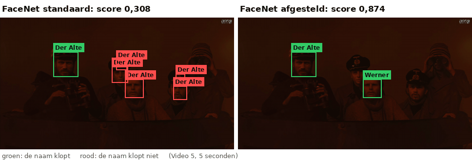
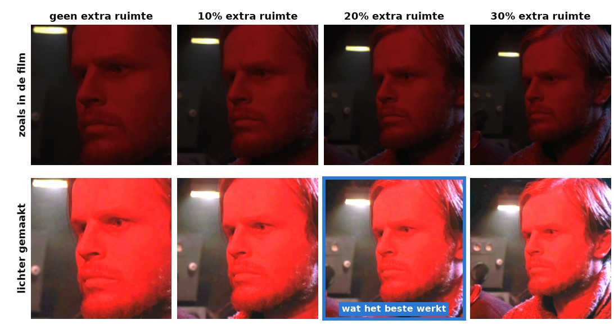
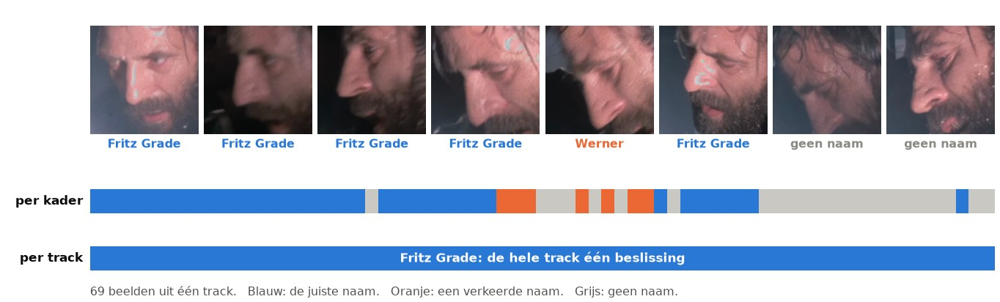
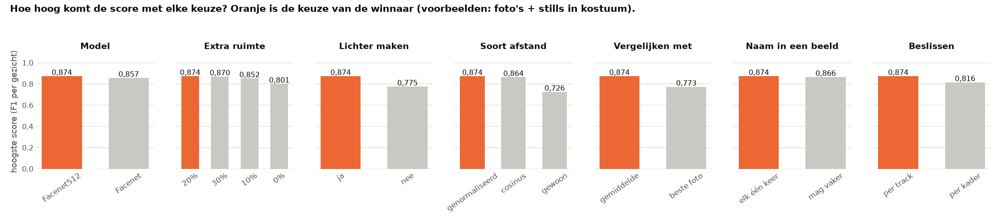
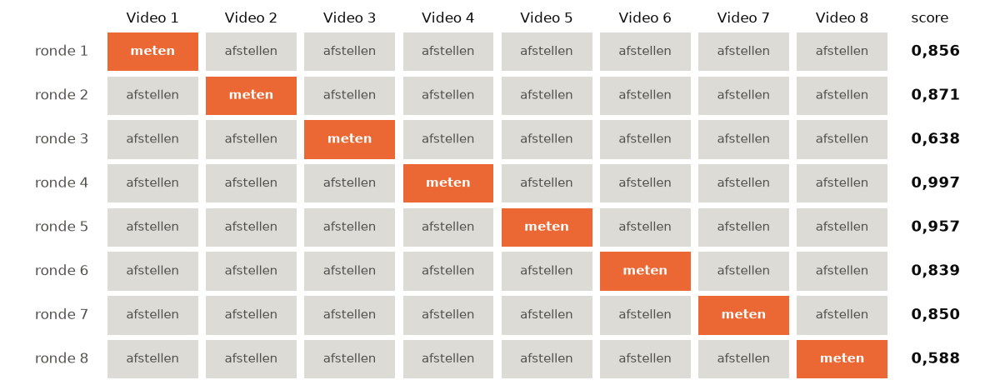
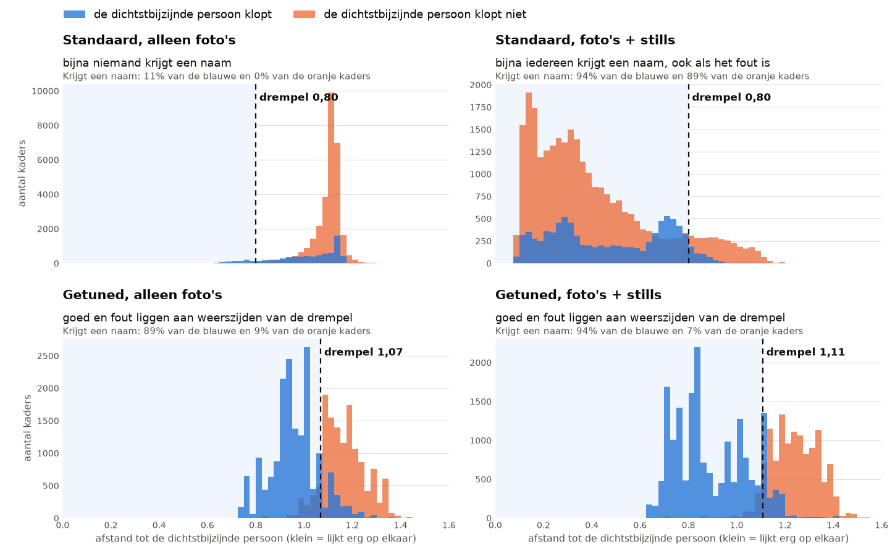
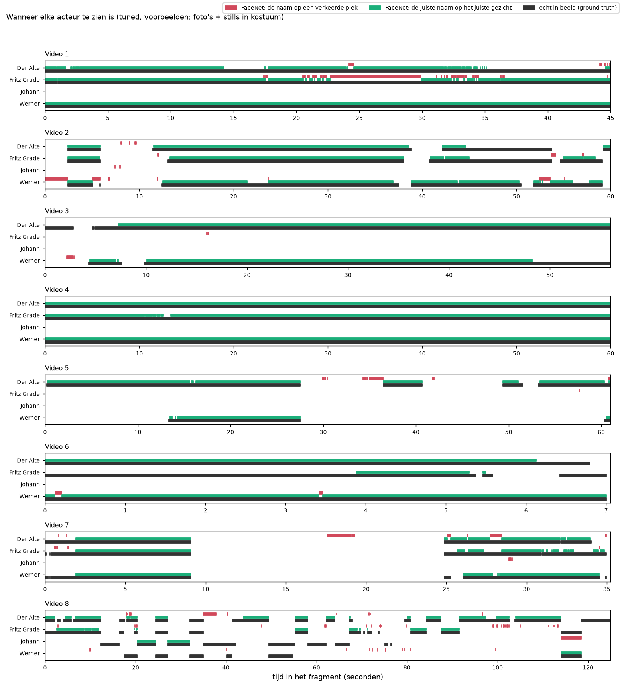
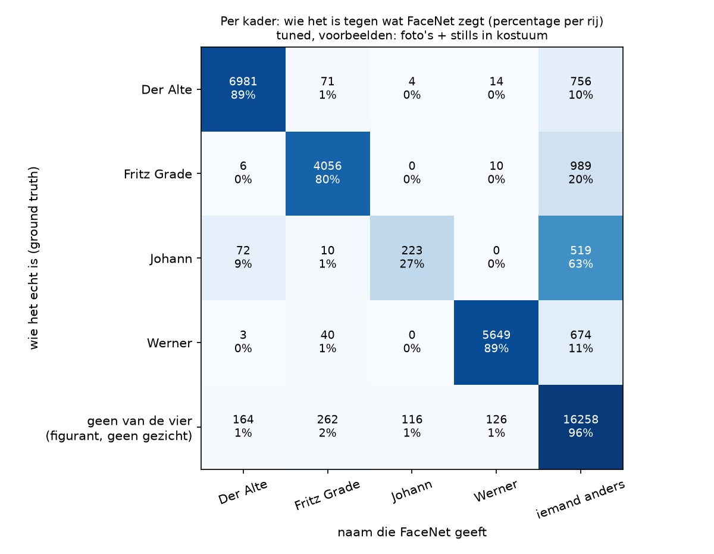

# Tuned: FaceNet zo goed mogelijk afgesteld

> **De vraag.** Hoe goed kan FaceNet de vier personen herkennen met de best mogelijke instellingen?
>
> **Het antwoord.** Veel beter dan standaard. De score gaat van 0,074 naar **0,808** met alleen foto's, en van 0,308 naar **0,874** met foto's + stills. Die scores zijn iets te gunstig, omdat de instellingen gekozen zijn op dezelfde beelden als waarop we meten. Kiezen we de instellingen op andere filmpjes, dan is de score 0,766 en 0,834.



*Hetzelfde stukje film, links met FaceNet standaard en rechts met het getunde model. Groen betekent dat de naam klopt, rood dat de naam niet klopt. De scores boven het beeld gelden voor alle filmpjes samen, niet voor dit stukje.*

Wat de woorden betekenen, staat in [de woordenlijst](../README.md#woordenlijst).

**In deze uitleg:**
[Wat we gedaan hebben](#wat-we-gedaan-hebben) ·
[Wat we afstellen](#wat-we-afstellen) ·
[Een eerlijke schatting](#een-eerlijke-schatting) ·
[De beste instellingen](#de-beste-instellingen) ·
[Wat eruit kwam](#wat-eruit-kwam) ·
[Wat dit betekent](#wat-dit-betekent) ·
[De filmpjes](#de-filmpjes) ·
[Zelf draaien](#zo-draai-je-het-op-een-mac-en-op-windows)


## Wat we gedaan hebben

In de [basis](../basis/README.md) staat FaceNet standaard ingesteld. Hier zoeken we de best mogelijke instellingen. FaceNet zelf trainen we niet opnieuw. Daarna doen we hetzelfde als bij de basis: meten per gezicht, een map `resultaten`, een filmpje en een uitleg. Dat doen we voor twee sets voorbeelden:

- [Alleen foto's](resultaten/fotos/README.md)
- [Foto's + stills](resultaten/fotos_en_kostuum/README.md)

| Stap | Wat er gebeurt | Script |
|---|---|---|
| 1 | FaceNet maakt van elk kader en elk voorbeeld een vector, voor elk model en elke manier van uitsnijden. | [`stap_1_vectoren.py`](stap_1_vectoren.py) |
| 2 | Afstellen: alle combinaties van instellingen worden geprobeerd, en de beste wint. | [`stap_2_afstellen.py`](stap_2_afstellen.py) |
| 3 | Herkennen met de beste instellingen. | [`stap_3_herkennen.py`](stap_3_herkennen.py) |
| 4 | Meten per gezicht. | [`stap_4_methode_2_per_gezicht.py`](stap_4_methode_2_per_gezicht.py) |
| 5 | Het filmpje maken. | [`stap_5_filmpje.py`](stap_5_filmpje.py) |
| 6 | De README bij de uitkomsten maken, met de getallen uit de metingen. | [`stap_6_uitleg.py`](stap_6_uitleg.py) |

Hoe we meten en waarom per gezicht, staat in [Zo meten we hoe goed FaceNet is](../README.md#zo-meten-we-hoe-goed-facenet-is).

Ook de andere experimenten hebben we met dit getunde model gedaan. Die uitkomsten staan bij elk experiment, zie [Alle experimenten](../README.md#alle-experimenten).


## Wat we afstellen

We proberen alle combinaties van de instellingen hieronder. Dat zijn 384 combinaties per set voorbeelden, elk met 200 drempels. De combinatie met de hoogste score wint. De instellingen staan in [`instellingen.py`](instellingen.py).

| Instelling | Wat we proberen | Wat het betekent |
|---|---|---|
| **Model** | Facenet, Facenet512 | Twee versies van FaceNet: 128 of 512 getallen per gezicht. |
| **Extra ruimte** (marge) | 0%, 10%, 20%, 30% | Hoeveel extra van het beeld rond het kader FaceNet te zien krijgt. |
| **Lichter maken** | nee, ja | Een donker gezicht eerst lichter maken, net als *Beeld lichter* in de labelapp. Hoe donkerder het gezicht, hoe meer: tot 5 keer zo licht. |
| **Soort afstand** | genormaliseerd, cosinus, gewoon | Drie manieren om te meten hoe ver twee vectoren uit elkaar liggen, zie [de woordenlijst](../README.md#woordenlijst). |
| **Vergelijken met** | de beste foto, het gemiddelde | Vergelijkt FaceNet een kader met de meest gelijkende foto van een persoon, of met het gemiddelde van alle foto's van die persoon? |
| **Naam in een beeld** | mag vaker, elk één keer | Mag dezelfde naam twee keer in één beeld staan? Bij *elk één keer* gaat de naam naar het kader met de kleinste afstand tot die persoon. |
| **Beslissen** | per kader, per track | Krijgt elk kader los een naam, of tellen alle kaders van een track samen? Bij *per track* rekenen we per persoon de gemiddelde afstand over de hele track uit. Zo krijgt een track normaal gesproken één naam. |
| **Drempel** | 200 waarden | Vanaf welke afstand een kader *iemand anders* is. |

Drie van die instellingen laten we hieronder zien.



*Extra ruimte en lichter maken op een echt gezicht. Van links naar rechts krijgt FaceNet meer van het beeld om het gezicht te zien. De onderste rij is lichter gemaakt. Veel scènes in de film zijn erg donker, en FaceNet ziet daardoor weinig van een gezicht. Blauw is wat bij foto's + stills het beste werkt.*



*Per kader of per track beslissen. Dit is één track met hetzelfde gezicht, en de acht gezichten zijn een steekproef uit de 69 beelden. De balk* per kader *laat beeld voor beeld zien wat FaceNet zegt als elk kader los beslist: soms de juiste naam (blauw), soms een verkeerde naam (oranje) en soms geen naam (grijs). Bij* per track *tellen alle kaders samen: het gemiddelde is betrouwbaarder dan één los beeld, en de hele track krijgt de juiste naam.*



*Zo lees je dit plaatje: elk blok is één instelling. De balken laten zien hoe hoog de score kan worden met elke keuze. Oranje is de keuze van de winnaar. Hoe groter het verschil tussen de balken, hoe belangrijker die instelling is.*


## Een eerlijke schatting

De winnende instellingen zijn gekozen op dezelfde beelden als waarop we meten. Dat is alsof je een toets maakt waarvan je de vragen al kent: de instellingen passen precies bij deze beelden, en de score is daardoor te hoog.

Daarom kiezen we de instellingen ook steeds op zeven filmpjes, en meten we op het achtste (*leave-one-fragment-out*). De goede, foute en gemiste gezichten van de acht rondes tellen we bij elkaar op, en daaruit rekenen we één score uit.



*Elke regel is één ronde, met foto's + stills. Op de grijze filmpjes kiezen we de instellingen, op het oranje filmpje meten we. Rechts staat de score op dat filmpje. Video 8 is het moeilijkst. Video 3 is alleen in deze proef laag: in die ronde wint een iets lagere drempel (1,101 in plaats van 1,1076), en dan worden veel gezichten gemist. Een klein verschil in de drempel kan dus veel uitmaken.*


## De beste instellingen

| Instelling | Alleen foto's | Foto's + stills | [Alleen stills](../alleen_in_karakter/README.md) |
|---|---|---|---|
| Model | Facenet | Facenet512 | Facenet512 |
| Extra ruimte | 20% | 20% | 30% |
| Lichter maken | ja | ja | ja |
| Soort afstand | genormaliseerd | genormaliseerd | genormaliseerd |
| Vergelijken met | de beste foto | het gemiddelde | het gemiddelde |
| Naam in een beeld | elk één keer | elk één keer | mag vaker |
| Beslissen | per track | per track | per track |
| Drempel | 1,0684 | 1,1076 | 1,0440 |

Dit zijn de keuzes die het meeste helpen bij foto's + stills:

| Keuze | Score met deze keuze | Hoogste score zonder deze keuze |
|---|---|---|
| Donkere gezichten lichter maken | 0,874 | 0,775 |
| Vergelijken met het gemiddelde van de foto's | 0,874 | 0,773 |
| Extra ruimte om het kader (20%) | 0,874 | 0,801 zonder extra ruimte, 0,870 met 30% |
| Per track beslissen | 0,874 | 0,816 |

Alleen de drempel veranderen is niet genoeg: met de standaardinstellingen en de beste drempel is de score bij foto's + stills 0,315 in plaats van 0,308. Bij alleen foto's wordt die score 0,261 in plaats van 0,074.

Lichter maken en per track beslissen helpen in alle sets. Dat past bij deze film: de scènes zijn donker, en een hele track geeft meer informatie dan één beeld.

Een gemiddelde van heel verschillende foto's ligt ver van elk echt gezicht. De afstanden worden daardoor groter, en bij de standaarddrempel van 0,80 krijgt dan bijna niemand een naam (zie [één gemiddelde vector](../gemiddelde_vector/README.md)). Met een hogere drempel (hier 1,1076) wint het gemiddelde bij foto's + stills wel.


## Wat eruit kwam

| Experiment | Score | Eerlijke schatting | Gezichten met de juiste naam (recall) | Namen die kloppen (precisie) |
|---|---|---|---|---|
| Standaard, alleen foto's | 0,074 | | 4% | 93% |
| **Getuned, alleen foto's** | **0,808** | 0,766 | 72% | 92% |
| Standaard, foto's + stills | 0,308 | | 40% | 25% |
| **Getuned, foto's + stills** | **0,874** | 0,834 | 81% | 95% |

De score kan hier niet 1 worden: 1.611 van de 20.990 gezichten hebben geen kader, en die kan FaceNet nooit een naam geven. Zelfs als elke naam klopt, blijft de score onder 0,96.



*Waarom het getunde model zo helpt: kijk naar de twee grafieken onderaan. Blauw zijn kaders waarbij de dichtstbijzijnde persoon klopt, oranje zijn kaders waarbij die niet klopt. Door de andere instellingen veranderen de afstanden zelf: blauw en oranje komen aan weerszijden van de drempel te liggen. Bij FaceNet standaard (bovenaan) lopen ze door elkaar.*



*De tijdlijn per gezicht met het getunde model (foto's + stills). Elke regel is een persoon, en de tijd loopt van links naar rechts. Zwart is wanneer de persoon echt in beeld is. Groen is wanneer FaceNet de juiste naam op het gezicht van die persoon zet. Rood is wanneer FaceNet die naam op een verkeerde plek zet. Groen loopt nu op de meeste plekken gelijk met zwart. Vooral in Video 8 mist FaceNet nog veel: daar staat bij Johann en Werner vaak zwart zonder groen. Vergelijk dit met [de tijdlijn van FaceNet standaard](../basis/resultaten/fotos_en_kostuum/methode_2_tijdlijn.png).*



*Zo lees je dit plaatje: elke rij is wie het echt is, elke kolom is de naam die FaceNet geeft. De hoge percentages staan nu op de schuine lijn: dat is goed. In de onderste rij krijgen figuranten en dingen die geen gezicht zijn, nu bijna altijd terecht geen naam.*

### De score per filmpje

*Algemeen beste* is de winnaar over alle filmpjes. *Eerlijke schatting* is de instelling die op de andere filmpjes gekozen is. *Beste voor dit filmpje* is de instelling die alleen op dat filmpje het best werkt (`beste_per_filmpje.csv`).

Met alleen foto's:

| Filmpje | Algemeen beste | Eerlijke schatting | Beste voor dit filmpje |
|---|---|---|---|
| Video 1 | 0,797 | 0,721 | 0,872 |
| Video 2 | 0,838 | 0,711 | 0,850 |
| Video 3 | 0,968 | 0,946 | 0,969 |
| Video 4 | 0,972 | 0,972 | 0,997 |
| Video 5 | 0,716 | 0,716 | 0,900 |
| Video 6 | 0,788 | 0,469 | 0,852 |
| Video 7 | 0,818 | 0,818 | 0,860 |
| Video 8 | 0,414 | 0,414 | 0,572 |

Met foto's + stills:

| Filmpje | Algemeen beste | Eerlijke schatting | Beste voor dit filmpje |
|---|---|---|---|
| Video 1 | 0,856 | 0,856 | 0,887 |
| Video 2 | 0,871 | 0,871 | 0,892 |
| Video 3 | 0,924 | 0,638 | 0,971 |
| Video 4 | 0,997 | 0,997 | 0,997 |
| Video 5 | 0,957 | 0,957 | 0,974 |
| Video 6 | 0,839 | 0,839 | 0,855 |
| Video 7 | 0,850 | 0,850 | 0,863 |
| Video 8 | 0,655 | 0,588 | 0,671 |

Bij foto's + stills wint in zes van de acht rondes dezelfde instelling als over alle filmpjes. Daarom zijn die getallen vaak gelijk.


## Wat dit betekent

- **Tunen maakt het verschil.** De score gaat van 0,308 naar 0,874 met foto's + stills, en van 0,074 naar 0,808 met alleen foto's. Ook de eerlijke schattingen blijven hoog (0,834 en 0,766).
- **Foto's + stills blijft het beste**, maar met goede instellingen komen de gewone foto's al een heel eind.
- **Johann blijft het moeilijkst** (score 0,374 met foto's + stills). Van de 849 gezichten van Johann krijgen er maar 223 de juiste naam. Bij 483 van de gemiste gezichten staat er wel een kader, maar krijgt dat geen naam. Johann is maar 4% van alle gezichten, en daarom merk je dit nauwelijks in de totale score.
- **Video 8 blijft het zwakst.**

Let op: bij *per track beslissen* gebruiken we de tracks uit het labelen. Die zijn automatisch gemaakt, maar 44 tracks zijn bij het controleren met de hand geknipt. Een systeem zonder die controle heeft die geknipte tracks niet. De winst van per track beslissen kan daar dus kleiner zijn. Hoeveel kleiner, hebben we niet gemeten.


## De filmpjes

Klik op GitHub op de link en daarna op *View raw* om een filmpje te downloaden.

- [Filmpje met alleen foto's](resultaten/fotos/filmpje.mp4)
- [Filmpje met foto's + stills](resultaten/fotos_en_kostuum/filmpje.mp4)


## Zo draai je het op een Mac en op Windows

Doe dit vanuit de map `experimenten`. Installeren hoeft één keer, zie [Installeren op Mac en Windows](../README.md#installeren-op-mac-en-windows).

Op een Mac:

```bash
.venv/bin/python tuned/draai_alles.py
```

Op Windows:

```bat
.venv\Scripts\python tuned\draai_alles.py
```

Dit draait alle stappen voor beide sets. Eén set kan ook, door er `--voorbeelden fotos` of `--voorbeelden fotos_en_kostuum` achter te zetten. Stap 1 duurt ongeveer een uur. De vectoren worden bewaard in `tussenbestanden/`, en daarna duurt alles nog een paar minuten.
