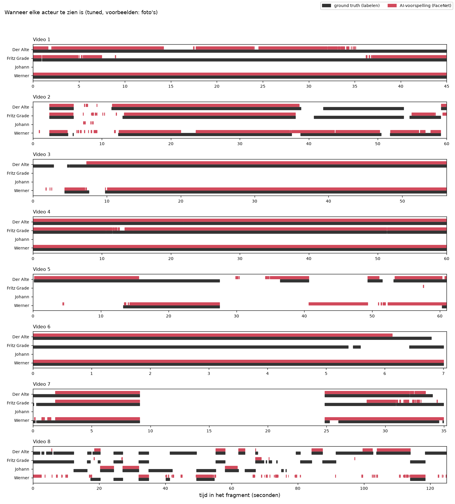
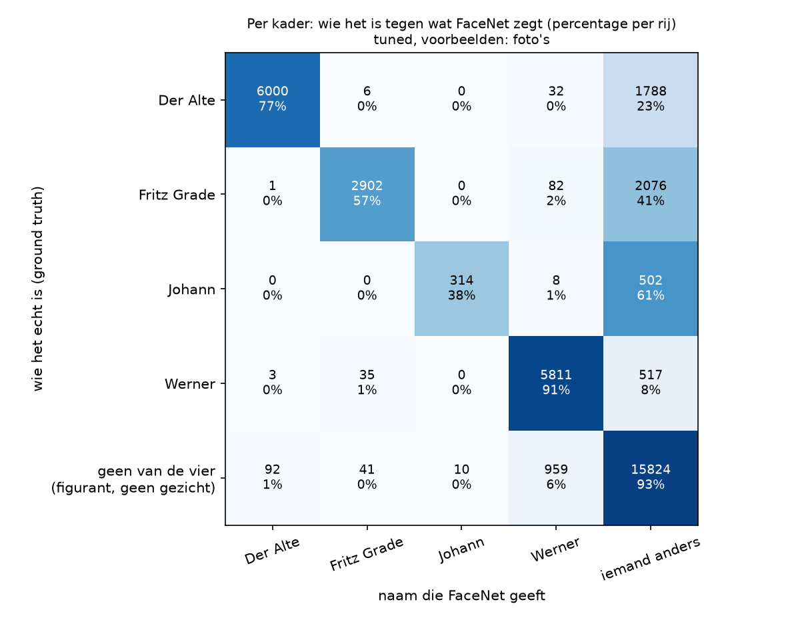
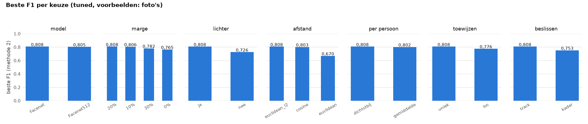
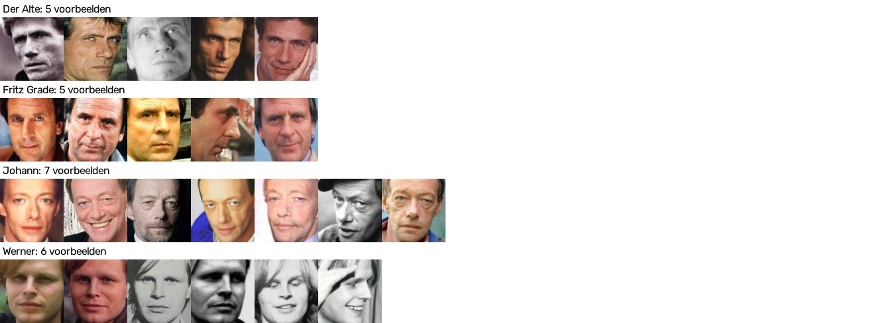

# Tuned (voorbeelden: foto's)

In dit experiment staat FaceNet zo goed mogelijk afgesteld op deze set voorbeelden. De winnende instellingen staan hieronder. De uitleg van het experiment staat in [de README van tuned](../../README.md).

## De instellingen

| Instelling | Waarde |
|---|---|
| Model | Facenet |
| Extra ruimte om het kader | 20% |
| Donkere gezichten lichter maken | ja |
| Afstand | genormaliseerde Euclidische afstand |
| Per persoon | de afstand tot de meest gelijkende voorbeeldfoto |
| Toewijzen | per beeld elke persoon hoogstens één keer |
| Beslissen | per track |
| Drempel | 1,0684 |

## Methode 1: per beeld

We weten wie er in elk beeld te zien is, en tellen per persoon in hoeveel beelden FaceNet die persoon ziet. *Goed* is een beeld waarin FaceNet de persoon terecht ziet, *fout* een beeld waarin FaceNet de persoon ten onrechte ziet, en *gemist* een beeld waarin de persoon wel staat maar FaceNet de persoon niet ziet. Waar in het beeld FaceNet de persoon ziet, maakt bij deze methode niet uit.

| Acteur | Ground truth (beelden) | FaceNet (beelden) | Foutmarge | Goed | Fout | Gemist | Precisie | Recall | F1 |
|---|---|---|---|---|---|---|---|---|---|
| Der Alte | 8.326 | 6.096 | 26,8% | 6.037 | 59 | 2.289 | 0,990 | 0,725 | 0,837 |
| Fritz Grade | 5.321 | 2.984 | 43,9% | 2.946 | 38 | 2.375 | 0,987 | 0,554 | 0,709 |
| Johann | 849 | 324 | 61,8% | 314 | 10 | 535 | 0,969 | 0,370 | 0,535 |
| Werner | 6.494 | 6.892 | 6,1% | 6.159 | 733 | 335 | 0,894 | 0,948 | 0,920 |
| **samen** | 20.990 | 16.296 | 22,4% | 15.456 | 840 | 5.534 | 0,948 | 0,736 | **0,829** |



## Methode 2: per gezicht

We weten ook waar elk gezicht staat. Een naam van FaceNet telt alleen als goed als het kader met die naam minstens 30% overlapt met het kader van die persoon in de ground truth. *Gemist* is verdeeld in: geen kader van de detector op die plek, wel een kader maar geen naam, of wel een kader maar een andere naam.

| Acteur | Gezichten | Goed | Fout benoemd | Gemist | waarvan geen kader | waarvan geen naam | waarvan andere naam | Precisie | Recall | F1 |
|---|---|---|---|---|---|---|---|---|---|---|
| Der Alte | 8.326 | 6.003 | 93 | 2.323 | 707 | 1.595 | 21 | 0,985 | 0,721 | 0,832 |
| Fritz Grade | 5.321 | 2.936 | 48 | 2.385 | 515 | 1.783 | 87 | 0,984 | 0,552 | 0,707 |
| Johann | 849 | 314 | 10 | 535 | 61 | 466 | 8 | 0,969 | 0,370 | 0,535 |
| Werner | 6.494 | 5.811 | 1.081 | 683 | 328 | 317 | 38 | 0,843 | 0,895 | 0,868 |
| **samen** | 20.990 | 15.064 | 1.232 | 5.926 | 1.611 | 4.161 | 154 | 0,924 | 0,718 | **0,808** |



De instellingen zijn gekozen op dezelfde beelden als waarop gemeten is; deze F1 is daardoor wat te gunstig. De eerlijke schatting, waarbij de instelling steeds op de andere filmpjes gekozen is, geeft een F1 van **0,766** (zie `eerlijke_schatting.csv`). Alle geprobeerde instellingen staan in `alle_instellingen.csv`, en per filmpje de beste instelling in `beste_per_filmpje.csv`.





## Het filmpje

[`filmpje.mp4`](filmpje.mp4) is alle filmpjes achter elkaar, met een vierkantje om elk gezicht dat FaceNet als een van de vier personen herkent, en de naam erbij.

## De bestanden in deze map

| Bestand | Wat erin staat |
|---|---|
| `voorspellingen.csv` | Per kader wie FaceNet zegt dat het is (`facenet`), de dichtstbijzijnde persoon (`dichtstbij`), de afstand (`afstand`) en de voorbeeldfoto die de doorslag gaf (`foto`). |
| `gebruik_per_foto.csv` | Per voorbeeldfoto hoe vaak die foto de doorslag gaf, en hoe vaak dat goed of fout was. |
| `methode_1_tabel.csv`, `methode_1_tabel.png`, `methode_1_tijdlijn.png` | De uitkomst van methode 1. |
| `methode_2_tabel.csv`, `methode_2_tabel.png` | De uitkomst van methode 2. |
| `methode_2_verwarring.csv`, `methode_2_verwarring.png` | Per kader wie het echt is tegen de naam van FaceNet. |
| `methode_2_overlap.csv` | De uitkomst van methode 2 bij andere grenzen voor de overlap. |
| `filmpje.mp4` | Het filmpje. |

## Zo maak je dit opnieuw

Vanuit de map `experimenten` (installeren: zie [de uitleg over alle experimenten](../../../README.md#installeren-op-mac-en-windows)).

Op een Mac:

```bash
.venv/bin/python tuned/draai_alles.py --voorbeelden fotos
```

Op Windows:

```bat
.venv\Scripts\python tuned\draai_alles.py --voorbeelden fotos
```
