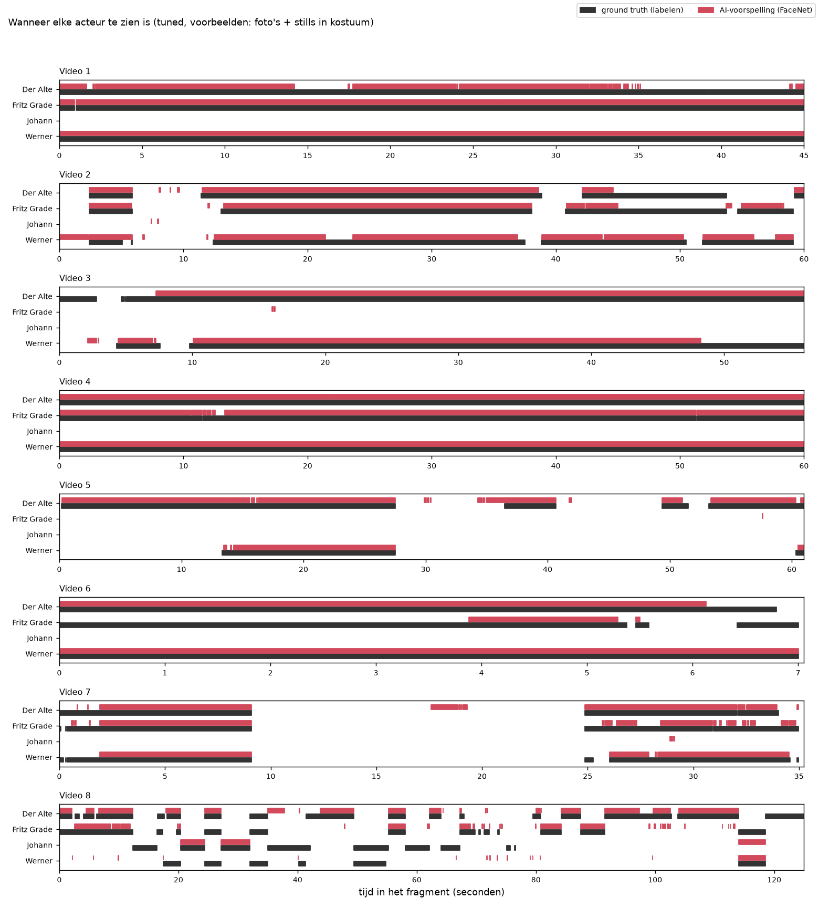
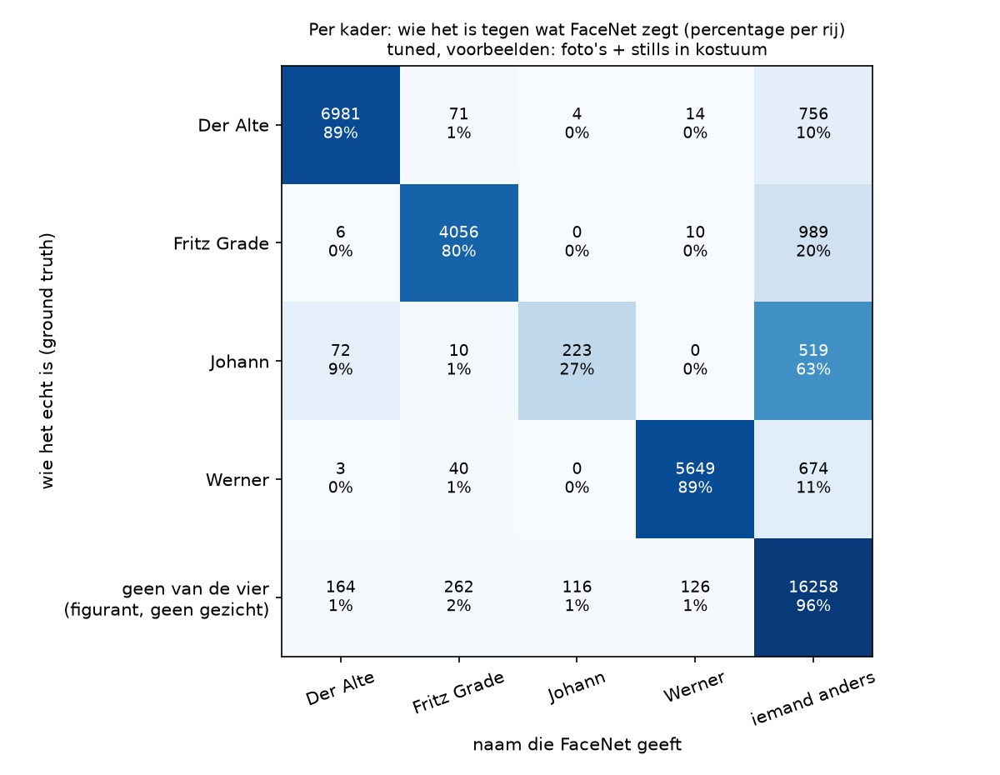
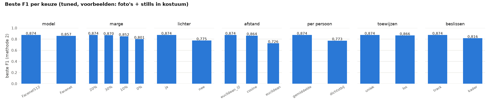
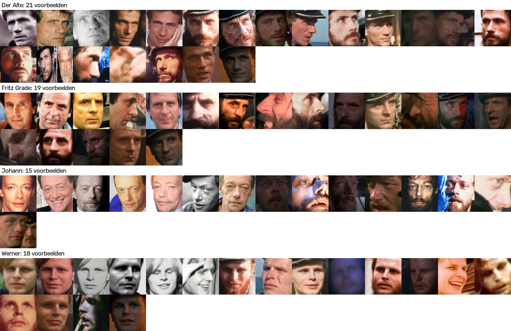

# Tuned (voorbeelden: foto's + stills in kostuum)

In dit experiment staat FaceNet zo goed mogelijk afgesteld op deze set voorbeelden. De winnende instellingen staan hieronder. De uitleg van het experiment staat in [de README van tuned](../../README.md).

## De instellingen

| Instelling | Waarde |
|---|---|
| Model | Facenet512 |
| Extra ruimte om het kader | 20% |
| Donkere gezichten lichter maken | ja |
| Afstand | genormaliseerde Euclidische afstand |
| Per persoon | de afstand tot het gemiddelde van de voorbeeldfoto's |
| Toewijzen | per beeld elke persoon hoogstens één keer |
| Beslissen | per track |
| Drempel | 1,1076 |

## Methode 1: per beeld

We weten wie er in elk beeld te zien is, en tellen per persoon in hoeveel beelden FaceNet die persoon ziet. *Goed* is een beeld waarin FaceNet de persoon terecht ziet, *fout* een beeld waarin FaceNet de persoon ten onrechte ziet, en *gemist* een beeld waarin de persoon wel staat maar FaceNet de persoon niet ziet. Waar in het beeld FaceNet de persoon ziet, maakt bij deze methode niet uit.

| Acteur | Ground truth (beelden) | FaceNet (beelden) | Foutmarge | Goed | Fout | Gemist | Precisie | Recall | F1 |
|---|---|---|---|---|---|---|---|---|---|
| Der Alte | 8.326 | 7.226 | 13,2% | 7.040 | 186 | 1.286 | 0,974 | 0,846 | 0,905 |
| Fritz Grade | 5.321 | 4.439 | 16,6% | 4.368 | 71 | 953 | 0,984 | 0,821 | 0,895 |
| Johann | 849 | 343 | 59,6% | 223 | 120 | 626 | 0,650 | 0,263 | 0,374 |
| Werner | 6.494 | 5.799 | 10,7% | 5.685 | 114 | 809 | 0,980 | 0,875 | 0,925 |
| **samen** | 20.990 | 17.807 | 15,2% | 17.316 | 491 | 3.674 | 0,972 | 0,825 | **0,893** |



## Methode 2: per gezicht

We weten ook waar elk gezicht staat. Een naam van FaceNet telt alleen als goed als het kader met die naam minstens 30% overlapt met het kader van die persoon in de ground truth. *Gemist* is verdeeld in: geen kader van de detector op die plek, wel een kader maar geen naam, of wel een kader maar een andere naam.

| Acteur | Gezichten | Goed | Fout benoemd | Gemist | waarvan geen kader | waarvan geen naam | waarvan andere naam | Precisie | Recall | F1 |
|---|---|---|---|---|---|---|---|---|---|---|
| Der Alte | 8.326 | 6.984 | 242 | 1.342 | 707 | 599 | 36 | 0,967 | 0,839 | 0,898 |
| Fritz Grade | 5.321 | 4.093 | 346 | 1.228 | 515 | 694 | 19 | 0,922 | 0,769 | 0,839 |
| Johann | 849 | 223 | 120 | 626 | 61 | 483 | 82 | 0,650 | 0,263 | 0,374 |
| Werner | 6.494 | 5.649 | 150 | 845 | 328 | 473 | 44 | 0,974 | 0,870 | 0,919 |
| **samen** | 20.990 | 16.949 | 858 | 4.041 | 1.611 | 2.249 | 181 | 0,952 | 0,807 | **0,874** |



De instellingen zijn gekozen op dezelfde beelden als waarop gemeten is; deze F1 is daardoor wat te gunstig. De eerlijke schatting, waarbij de instelling steeds op de andere filmpjes gekozen is, geeft een F1 van **0,834** (zie `eerlijke_schatting.csv`). Alle geprobeerde instellingen staan in `alle_instellingen.csv`, en per filmpje de beste instelling in `beste_per_filmpje.csv`.





## Het filmpje

[`filmpje.mp4`](filmpje.mp4) is alle filmpjes achter elkaar, met een vierkantje om elk gezicht dat FaceNet als een van de vier personen herkent, en de naam erbij.

## De bestanden in deze map

| Bestand | Wat erin staat |
|---|---|
| `voorspellingen.csv` | Per kader wie FaceNet zegt dat het is (`facenet`), de dichtstbijzijnde persoon (`dichtstbij`), de afstand (`afstand`) en de voorbeeldfoto die de doorslag gaf (`foto`). |
| `gebruik_per_foto.csv` | Per voorbeeldfoto hoe vaak die foto de doorslag gaf, en hoe vaak dat goed of fout was. |
| `methode_1_tabel.csv`, `methode_1_tabel.png`, `methode_1_tijdlijn.png` | De uitkomst van methode 1. |
| `methode_2_tabel.csv`, `methode_2_tabel.png` | De uitkomst van methode 2. |
| `methode_2_verwarring.csv`, `methode_2_verwarring.png` | Per kader wie het echt is tegen de naam van FaceNet. |
| `methode_2_overlap.csv` | De uitkomst van methode 2 bij andere grenzen voor de overlap. |
| `filmpje.mp4` | Het filmpje. |

## Zo maak je dit opnieuw

Vanuit de map `experimenten` (installeren: zie [de uitleg over alle experimenten](../../../README.md#installeren-op-mac-en-windows)).

Op een Mac:

```bash
.venv/bin/python tuned/draai_alles.py --voorbeelden fotos_en_kostuum
```

Op Windows:

```bat
.venv\Scripts\python tuned\draai_alles.py --voorbeelden fotos_en_kostuum
```
