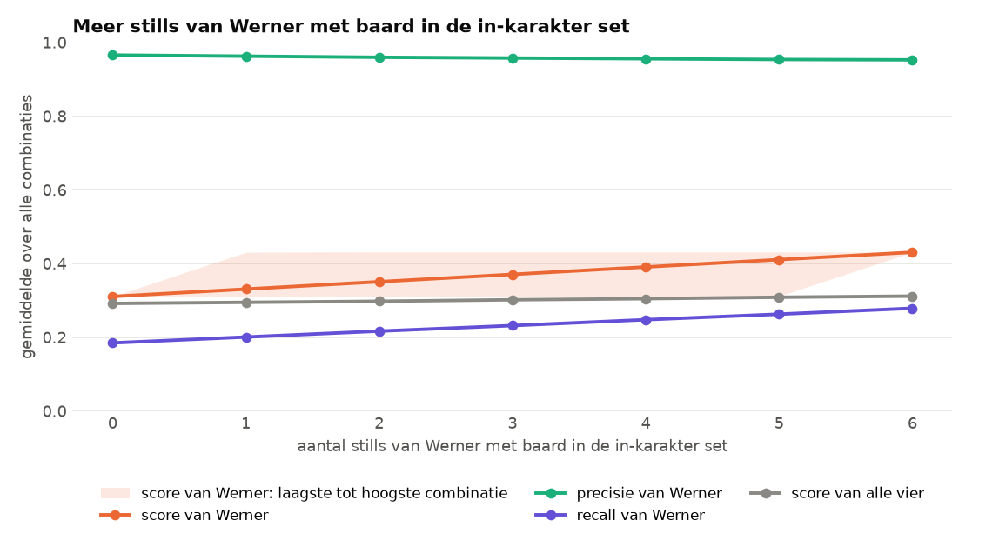
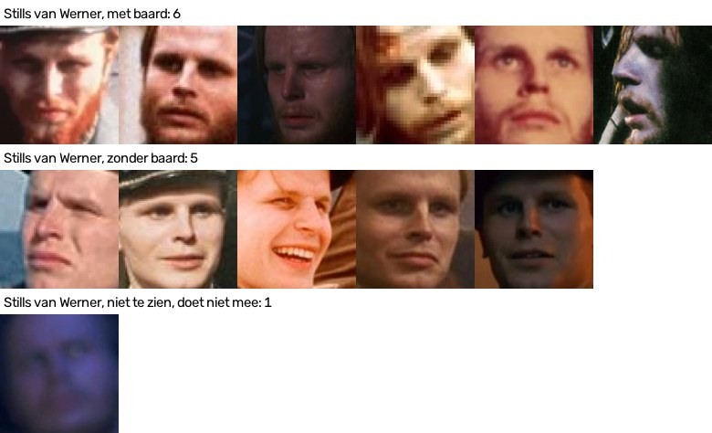
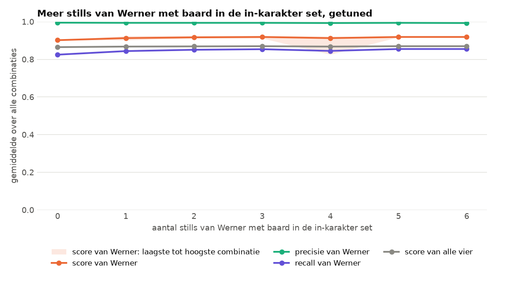

# Werner met baard

> **De vraag.** Vindt FaceNet Werner beter als er meer stills zijn waarop Werner een baard heeft?
>
> **Het antwoord.** Ja, bij FaceNet standaard: de score van Werner gaat van 0,311 naar 0,431, bijna helemaal door één still (`werner_and_fritz.png`). Bij het getunde model is de winst klein: de score van Werner gaat van 0,902 naar 0,919.



*FaceNet standaard. Zo lees je dit plaatje: van links naar rechts komen er steeds meer stills van Werner met baard bij. Oranje is de score van Werner, en die loopt op. Groen is de precisie: die blijft hoog, dus de naam Werner blijft kloppen. Paars is de recall: die stijgt, dus FaceNet vindt Werner vaker. Het lichtoranje vlak laat zien hoe ver de score uiteenloopt tussen de verschillende combinaties.*

Wat de woorden betekenen, staat in [de woordenlijst](../README.md#woordenlijst).


## Waarom dit experiment

Op een deel van de stills heeft Werner een baard, en op een deel niet. We willen weten of FaceNet Werner beter vindt als er meer voorbeelden met baard zijn. We gebruiken alleen stills. Beelden uit de filmpjes die we testen, mogen geen voorbeeld zijn.


## Hoe we het gedaan hebben

De stills van Werner, ingedeeld op baard:



*De 12 stills van Werner in de in-karakter set. Op 6 stills heeft Werner een baard, op 5 niet. Op 1 still is dat niet te zien, want die is te donker. Die still doet hier niet mee.*

1. We beginnen met de 5 stills zonder baard.
2. We voegen daar 1 tot en met 6 stills met baard aan toe.
3. Omdat het uitmaakt welke still je toevoegt, proberen we elke combinatie: 64 in totaal.
4. De andere drie personen blijven hetzelfde.
5. We meten per gezicht. Dat doen we met FaceNet standaard (drempel 0,80), en met het getunde model voor de stills (drempel 1,0440). De drempel blijft steeds gelijk.


## Wat eruit kwam

De getallen zijn het gemiddelde van alle combinaties met dat aantal stills.

| Stills met baard | Standaard: precisie van Werner | Standaard: recall | **Standaard: score van Werner** | **Getuned: score van Werner** |
|---|---|---|---|---|
| 0 | 0,966 | 0,185 | **0,311** | **0,902** |
| 1 | 0,963 | 0,201 | **0,331** | **0,913** |
| 2 | 0,960 | 0,217 | **0,351** | **0,917** |
| 3 | 0,958 | 0,232 | **0,371** | **0,919** |
| 4 | 0,956 | 0,248 | **0,391** | **0,913** |
| 5 | 0,954 | 0,263 | **0,411** | **0,919** |
| 6 | 0,953 | 0,279 | **0,431** | **0,919** |



*Het getunde model. Dezelfde grafiek. Alle lijnen liggen hoog en lopen bijna vlak. Het lichtoranje vlak laat zien dat één combinatie van 4 stills lager uitkomt (0,826), terwijl andere combinaties 0,925 halen.*


## Wat dit betekent

- **Bij FaceNet standaard vindt FaceNet Werner vaker met meer stills met baard.** De recall gaat van 0,185 naar 0,279. De naam Werner blijft kloppen: de precisie blijft rond 0,95.
- **Bij FaceNet standaard gaat het om één foto, niet om het aantal.** Met alleen de still `werner_and_fritz.png` erbij is de score van Werner al 0,431. De andere vijf stills veranderen daar vrijwel niets aan.
- **Bij het getunde model maakt het weinig uit.** De score van Werner is met 5 stills zonder baard al 0,902. De beste combinatie haalt 0,925, met `werner_and_johann.jpg`.

Alle combinaties staan in [`alle_combinaties.csv`](resultaten/alle_combinaties.csv), en voor het getunde model in [`resultaten_tuned/alle_combinaties.csv`](resultaten_tuned/alle_combinaties.csv).


## Zo draai je het op een Mac en op Windows

Doe dit vanuit de map `experimenten`. Draai eerst de [basis](../basis/README.md) en [alleen in karakter](../alleen_in_karakter/README.md), en voor het getunde model ook [tuned](../tuned/README.md). Installeren hoeft één keer, zie [Installeren op Mac en Windows](../README.md#installeren-op-mac-en-windows).

Op een Mac:

```bash
.venv/bin/python werner_baard/draai.py
.venv/bin/python werner_baard/draai.py --model tuned
```

Op Windows:

```bat
.venv\Scripts\python werner_baard\draai.py
.venv\Scripts\python werner_baard\draai.py --model tuned
```
