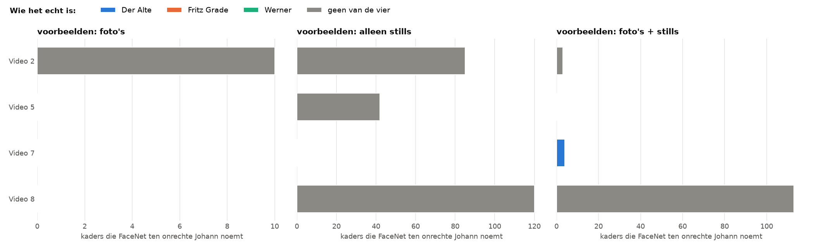
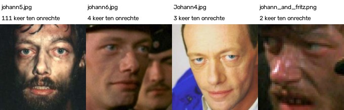

# Wie wordt als Johann herkend?

> **De vraag.** Als FaceNet ten onrechte Johann zegt, wie staat er dan echt?
>
> **Het antwoord.** Bij FaceNet standaard zijn dat 5.858 kaders, vooral op figuranten, dingen die geen gezicht zijn en Der Alte. De oorzaak is vooral één voorbeeldfoto: `johann3.png` is verantwoordelijk voor 86% van deze fouten. Bij het getunde model zijn het nog maar 120 kaders.


*FaceNet standaard. Zo lees je dit plaatje: elke balk is een filmpje, en een langere balk betekent meer kaders die FaceNet ten onrechte Johann noemt. De kleuren zeggen wie het kader echt is. Links gebruikt FaceNet alleen stills als voorbeeld, rechts foto's + stills. De twee kanten zijn bijna gelijk, want de gewone foto's maken hier geen verschil.*

Wat de woorden betekenen, staat in [de woordenlijst](../README.md#woordenlijst).


## Waarom dit experiment

In de [basis](../basis/README.md) met stills zegt FaceNet veel te vaak Johann: in 4.302 beelden, terwijl Johann maar in 849 beelden staat. We willen weten wie er dan echt staat.


## Hoe we het gedaan hebben

1. We nemen alle kaders waaraan FaceNet de naam Johann geeft, terwijl het kader niet op het gezicht van Johann ligt.
2. In de ground truth staat voor elk van die kaders wie het echt is: een van de andere drie personen, of geen van de vier (een figurant of iets dat geen gezicht is).
3. We tellen dat per filmpje.
4. We kijken welke voorbeeldfoto het meest op die kaders leek.
5. We doen dat met FaceNet standaard en met het getunde model.


## Wat eruit kwam met FaceNet standaard

In Video 1 tot en met 7 komt Johann helemaal niet voor. Toch noemt FaceNet daar 4.522 kaders Johann (met foto's + stills):

| Wie het echt is | Aantal kaders | Deel |
|---|---|---|
| Geen van de vier (een figurant, of geen gezicht) | 1.835 | 40,6% |
| Der Alte | 1.777 | 39,3% |
| Fritz Grade | 633 | 14,0% |
| Werner | 277 | 6,1% |

Over alle filmpjes samen zijn het 5.858 kaders. Met alleen de gewone foto's als voorbeeld zegt FaceNet nergens ten onrechte Johann.


*De vijf voorbeeldfoto's die het vaakst het meest op zo'n kader leken, met het aantal keer. `johann3.png` staat met 5.054 keer ver bovenaan.*


## Met het getunde model



*Het getunde model. Let op: de schaal is veel kleiner dan in het plaatje hierboven. Er staan maar vier filmpjes in, omdat FaceNet in de andere filmpjes nergens ten onrechte Johann zegt.*

| Voorbeelden | Kaders ten onrechte Johann | Waar |
|---|---|---|
| Foto's | 10 | allemaal in Video 2, op figuranten of dingen die geen gezicht zijn |
| Alleen stills | 247 | Video 2, 5 en 8, op figuranten of dingen die geen gezicht zijn |
| Foto's + stills | 120 | vooral Video 8 (113 kaders), op figuranten of dingen die geen gezicht zijn |

Bij foto's + stills komt het grootste deel van die 120 fouten door één foto: `johann5.jpg` (111 keer).



*Dezelfde foto's voor het getunde model, met het aantal keer dat die foto het meest op zo'n kader leek.*


## Wat dit betekent

- **Bij FaceNet standaard komt het grootste deel van de fouten door één donkere foto.** Van de 5.858 fouten komen er 5.054 door `johann3.png` (86%). Laat je die foto weg, dan gaat de score met 0,049 omhoog, zie [Leave-one-out](../leave_one_out/README.md).
- **Der Alte wordt bij FaceNet standaard het vaakst voor Johann aangezien**, en verder vooral figuranten en dingen die geen gezicht zijn.
- **Het getunde model lost dit bijna helemaal op.** Van 5.858 naar 120 fouten, en die vallen bijna allemaal in Video 8.

Alle getallen staan in [`johann_per_filmpje.csv`](resultaten/johann_per_filmpje.csv) en [`johann_per_foto.csv`](resultaten/johann_per_foto.csv), en voor het getunde model in [`resultaten_tuned/`](resultaten_tuned/).


## Zo draai je het op een Mac en op Windows

Doe dit vanuit de map `experimenten`. Draai eerst de [basis](../basis/README.md) en [alleen in karakter](../alleen_in_karakter/README.md), en voor het getunde model ook [tuned](../tuned/README.md). Installeren hoeft één keer, zie [Installeren op Mac en Windows](../README.md#installeren-op-mac-en-windows).

Op een Mac:

```bash
.venv/bin/python wie_wordt_johann/draai.py
.venv/bin/python wie_wordt_johann/draai.py --model tuned
```

Op Windows:

```bat
.venv\Scripts\python wie_wordt_johann\draai.py
.venv\Scripts\python wie_wordt_johann\draai.py --model tuned
```
