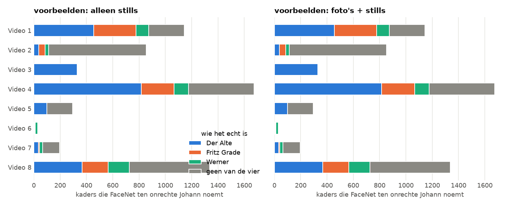
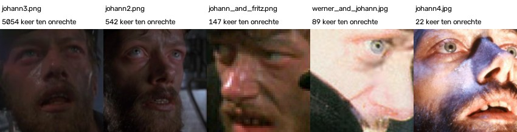

# Wie wordt als Johann herkend?

> **De vraag.** Als FaceNet ten onrechte Johann zegt, wie staat er dan echt?
>
> **Het antwoord.** In de filmpjes waarin Johann niet voorkomt, zijn dat vooral figuranten en dingen die geen gezicht zijn (41%) en Der Alte (39%). De oorzaak is vooral één voorbeeldfoto: `johann3.png` is verantwoordelijk voor 86% van deze fouten.



*Zo lees je dit plaatje: elke balk is een filmpje, en een langere balk betekent meer kaders die FaceNet ten onrechte Johann noemt. De kleuren zeggen wie het kader echt is. Links gebruikt FaceNet alleen stills als voorbeeld, rechts foto's en stills. De twee kanten zijn bijna gelijk, want de gewone foto's maken hier geen verschil.*

Wat de woorden betekenen, staat in [de woordenlijst](../README.md#woordenlijst).


## Waarom dit experiment

In de [basis](../basis/README.md) met stills zegt FaceNet veel te vaak Johann: in 4.302 beelden, terwijl Johann maar in 849 beelden staat. We willen weten wie er dan echt staat.


## Hoe we het gedaan hebben

1. We nemen alle kaders waaraan FaceNet (standaard, drempel 0,80) de naam Johann geeft, terwijl het kader niet op het gezicht van Johann ligt.
2. In de ground truth staat voor elk van die kaders wie het echt is: een van de andere drie personen, of geen van de vier (een figurant of iets dat geen gezicht is).
3. We tellen dat per filmpje.
4. We kijken welke voorbeeldfoto het meest op die kaders leek.

Met alleen de gewone foto's als voorbeeld zegt FaceNet nergens ten onrechte Johann. Daarom staan alleen de sets met stills in het plaatje.


## Wat eruit kwam

In Video 1 tot en met 7 komt Johann helemaal niet voor. Toch noemt FaceNet daar 4.522 kaders Johann (met foto's + stills):

| Wie het echt is | Aantal kaders | Deel |
|---|---|---|
| Geen van de vier (een figurant, of geen gezicht) | 1.835 | 40,6% |
| Der Alte | 1.777 | 39,3% |
| Fritz Grade | 633 | 14,0% |
| Werner | 277 | 6,1% |

Over alle filmpjes samen zijn het 5.858 kaders.



*De voorbeeldfoto's die het vaakst het meest op zo'n kader leken, met het aantal keer. Dit zijn de vijf foto's met de meeste fouten. `johann3.png` staat met 5.054 keer ver bovenaan.*


## Wat dit betekent

- **Van de 5.858 fouten komen er 5.054 door één foto** (86%): `johann3.png`, een donkere foto uit de film.
- **Laat je die foto weg, dan gaat de score per gezicht met 0,049 omhoog.** Dat staat bij [Leave-one-out](../leave_one_out/README.md).
- **Der Alte wordt het vaakst voor Johann aangezien**, en verder vooral figuranten en dingen die geen gezicht zijn.

Alle getallen staan in [`johann_per_filmpje.csv`](resultaten/johann_per_filmpje.csv) en [`johann_per_foto.csv`](resultaten/johann_per_foto.csv).


## Zo draai je het op een Mac en op Windows

Doe dit vanuit de map `experimenten`, nadat de [basis](../basis/README.md) en [alleen in karakter](../alleen_in_karakter/README.md) gedraaid hebben. Installeren hoeft één keer, zie [Installeren op Mac en Windows](../README.md#installeren-op-mac-en-windows).

Op een Mac:

```bash
.venv/bin/python wie_wordt_johann/draai.py
```

Op Windows:

```bat
.venv\Scripts\python wie_wordt_johann\draai.py
```
