# Het labelen: wie staat er in elk beeld?

> **Waarom dit nodig is.** We testen hoe goed het programma FaceNet vier personen uit de film *Das Boot* herkent: Der Alte, Fritz Grade, Johann en Werner. Om FaceNet te kunnen nakijken, moeten we eerst zelf zeker weten wie er in elk beeld staat.
>
> **Hoe ver het is.** Het labelen is klaar. De uitkomst staat in [`ground_truth.csv`](output/stap_3_fouten_verbeteren/ground_truth.csv). Wie die lijst alleen wil gebruiken, hoeft niets te draaien.

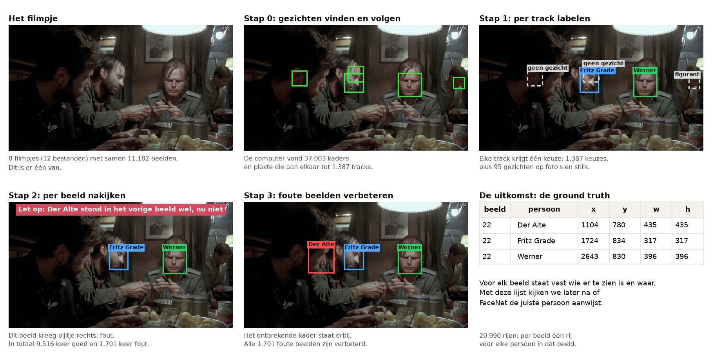

*Zo lees je dit plaatje: één beeld (Das Boot 1, beeld 23) gaat van links naar rechts en van boven naar onder door het hele proces. De computer vond vijf kaders. Bij het labelen kreeg elk kader de naam die voor zijn hele track gekozen was. Bij het nakijken bleek dat er een persoon ontbrak, en bij het verbeteren kwam dat kader erbij. De getallen onder elk plaatje gaan over alle filmpjes samen.*

**In deze uitleg:**
[De uitkomst](#de-uitkomst-de-ground-truth) ·
[De vier stappen](#het-labelen-in-vier-stappen) ·
[Stap 0](#stap-0-de-gezichten-vinden-en-volgen) ·
[Stap 1](#stap-1-per-track-labelen) ·
[Stap 2](#stap-2-per-beeld-nakijken) ·
[Stap 3](#stap-3-de-foute-beelden-verbeteren) ·
[Wat het opleverde](#wat-nakijken-en-verbeteren-heeft-opgeleverd) ·
[Wat er in deze map staat](#wat-er-in-deze-map-staat) ·
[Installeren](#installeren-op-mac-en-windows) ·
[Alles opnieuw doen](#alles-opnieuw-doen-en-waar-je-op-moet-letten)


## De uitkomst: de ground truth

De **ground truth** is een tabel die met de hand gemaakt en gecontroleerd is. Er staat per beeld in welke van de vier personen er te zien is, en waar. De experimenten vergelijken elke naam van FaceNet met deze tabel.

Het bestand is [`output/stap_3_fouten_verbeteren/ground_truth.csv`](output/stap_3_fouten_verbeteren/ground_truth.csv), met 20.990 rijen. Elke rij is één persoon in één beeld. Dit zijn de rijen van het beeld hierboven:

| beeld | persoon | x | y | w | h | herkomst |
|---|---|---|---|---|---|---|
| 22 | Der Alte | 1104 | 780 | 435 | 435 | stap_3 |
| 22 | Fritz Grade | 1724 | 834 | 317 | 317 | stap_3 |
| 22 | Werner | 2643 | 830 | 396 | 396 | stap_3 |

Zo lees je een rij:

- `beeld` telt vanaf 0. Op het scherm van de programma's telt een beeld vanaf 1 (dit is daar *beeld 23*).
- `x` en `y` zijn de linkerbovenhoek van het kader, `w` en `h` de breedte en de hoogte, in pixels.
- `herkomst` zegt uit welke stap de rij komt: stap 1 (17.098 rijen) of stap 3 (3.892 rijen).
- Een beeld zonder een van de vier personen heeft geen rij. In 9.849 van de 11.182 beelden staat minstens één van de vier.

In het bestand staan ook de kolommen `fragment` (Video 1 tot en met 8), `bestand` (de naam van het videobestand) en `tijd_s` (het aantal seconden vanaf het begin van het fragment). Hetzelfde voor de gelabelde foto's en stills staat in [`ground_truth_fotos_en_stills.csv`](output/stap_3_fouten_verbeteren/ground_truth_fotos_en_stills.csv).


## Het labelen in vier stappen

**De woorden die je hier nodig hebt:**

| Woord | Wat het betekent |
|---|---|
| **Beeld** (*frame*) | Een video is een reeks losse beelden die snel na elkaar komen, meestal 25 per seconde. |
| **Detector** | Het programma dat in een beeld gezichten zoekt. Wij gebruiken de MediaPipe Face Detector. |
| **Kader** | De rechthoek die de detector om een gezicht zet. |
| **Score van een kader** | Een getal van 0 tot 1 dat zegt hoe zeker de detector is dat er een gezicht in het kader staat. |
| **Track** | Hetzelfde gezicht, gevolgd over beelden na elkaar. Een track is dus een reeks kaders. |
| **Beeldwissel** | De plek waar de film ineens naar een ander shot springt. |
| **Label** | De keuze die een mens maakt: wie staat er in dit kader? De persoon die kiest, noemen we de *labelaar*. |
| **Still** | Een los beeld uit de film. |

In [de woordenlijst met plaatjes](../experimenten/README.md#woordenlijst) zie je hoe een kader en een track eruitzien.

**De vier stappen.** Bij elk gezicht in elk beeld met de hand zeggen wie het is, zou 37.003 keer kiezen betekenen. Daarom zoekt en volgt de computer eerst de gezichten, zodat een mens alleen per track hoeft te kiezen. Dat gaat snel, maar de labelaar ziet van een track maar één beeld, en de computer mist ook gezichten. Daarom is daarna elk beeld nagekeken, en is elk fout beeld met de hand verbeterd.

| Stap | Wat er gebeurt | Code | Uitkomst |
|---|---|---|---|
| **0. Voorbereiding** | De computer zoekt de gezichten, volgt ze en zet alles klaar om te labelen. | [`stap_0_voorbereiding/`](stap_0_voorbereiding/) | 37.003 kaders in 1.387 tracks |
| **1. Per track labelen** | Een mens kiest per track wie het is. | [`stap_1_tracks_labelen/`](stap_1_tracks_labelen/) | 1.482 keuzes |
| **2. Per beeld nakijken** | Een mens bekijkt elk beeld met de namen erbij en zegt goed of fout. | [`stap_2_beelden_nakijken/`](stap_2_beelden_nakijken/) | 9.516 keer goed, 1.701 keer fout |
| **3. Foute beelden verbeteren** | Een mens zet in elk fout beeld de kaders van de vier personen goed. Daarna worden alle stappen samengevoegd. | [`stap_3_fouten_verbeteren/`](stap_3_fouten_verbeteren/) | de ground truth |

De uitkomst van elke stap is de invoer van de volgende stap. Elke stap heeft een eigen map met code en een eigen map in [`output/`](output/).

## Stap 0: de gezichten vinden en volgen

**Waarom.** De computer zoekt de gezichten en plakt de kaders van hetzelfde gezicht aan elkaar tot tracks. De uitkomsten van deze stap liggen vast, dus deze stap hoef je niet opnieuw te doen.

### Hoe het werkte

**1. Gezichten zoeken.** De MediaPipe Face Detector bekijkt elk beeld van elk filmpje. Standaard telt de detector alleen kaders met een score van minstens 0,5. In de donkere, drukke scènes mist de detector dan veel gezichten. Daarom bewaren we alles vanaf 0,3. Kaders met een score van 0,2 tot 0,3 gebruiken we alleen om een track te laten doorlopen. Een kader dat geen gezicht blijkt, is geen probleem: bij het labelen wordt dat *Geen gezicht*. Een gezicht zonder kader is wel een probleem, want dat komt niet vanzelf in de ground truth.

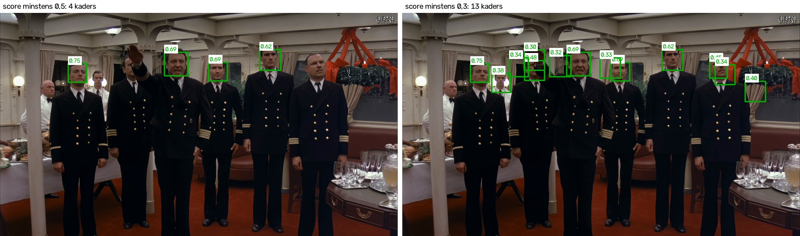

*Hetzelfde beeld twee keer. Links de kaders met een score van minstens 0,5 (vier kaders), rechts de kaders met een score van minstens 0,3 (dertien kaders).*

**2. Gezichten volgen.** De computer gaat de beelden op volgorde langs, en plakt kaders aan elkaar die bij hetzelfde gezicht horen. Bij een beeldwissel stoppen alle tracks.

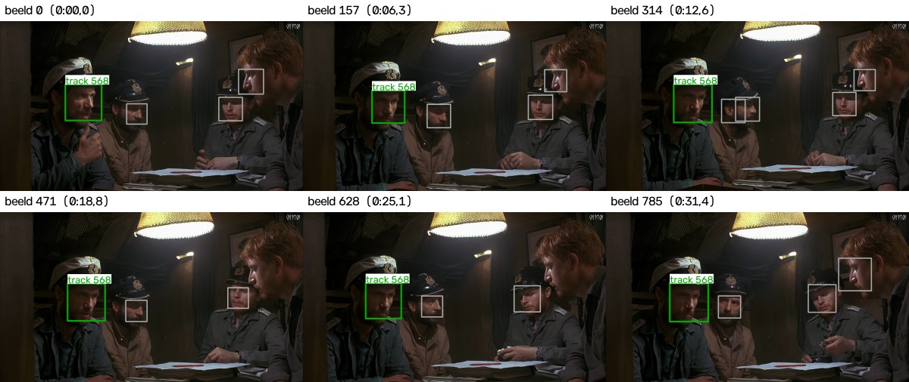

*Zes beelden uit één track in Das Boot 4b (het tweede stuk van Video 4). Het groene kader blijft op hetzelfde gezicht, ook als het gezicht beweegt. De grijze kaders zijn andere tracks.*

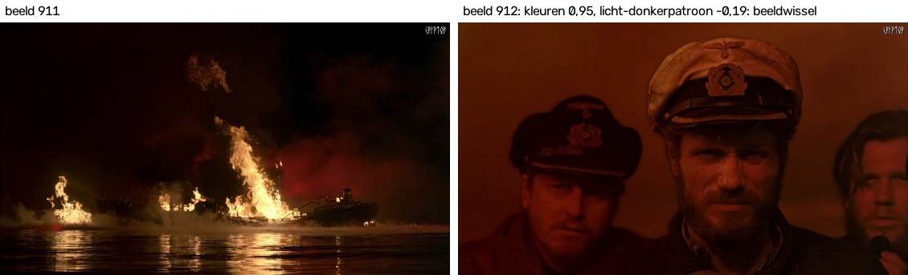

*Een beeldwissel in Video 5. De computer vergelijkt elk beeld op twee manieren met het vorige beeld: de kleuren en het licht-donkerpatroon. Hoe hoger het getal, hoe meer de beelden op elkaar lijken. Hier lijken de kleuren nog op elkaar (0,95), maar het licht-donkerpatroon niet meer (-0,19). De computer laat hier alle tracks stoppen.*

<details>
<summary><b>De zes regels van het volgen</b> (klik om open te klappen)</summary>

1. **Let op beeldwissels.** Lijkt een beeld te weinig op het vorige beeld (gelijkenis van de kleuren lager dan 0,9, of gelijkenis van het licht-donkerpatroon lager dan 0,7), dan stoppen alle tracks.
2. **Het kader moet bijna op dezelfde plek staan.** Het nieuwe kader en het laatste kader van de track moeten minstens 30% overlappen.
3. **De omgeving moet nog hetzelfde zijn.** Een ruim gebied rond het kader moet nog lijken op hetzelfde gebied in het vorige beeld (gelijkenis minstens 0,6).
4. **Een gezicht mag even weg zijn.** Is er geen passend kader, dan wacht de computer hoogstens 12 beelden (een halve seconde), maar nooit over een beeldwissel heen.
5. **Een zwak kader mag een track alleen verlengen.** Een kader met een score van 0,2 tot 0,3 mag een track die al loopt laten doorlopen, maar begint nooit een track.
6. **Een kader met een score vanaf 0,3 dat nergens bij past, begint een nieuwe track.**

Een fout in de ground truth is erger dan extra werk. Daarom zijn de regels streng waar twee personen door elkaar kunnen raken (regel 1 tot en met 3), en ruim waar alleen extra werk dreigt (regel 4 en 5).

</details>

**3. Alle tracks controleren.** Een track krijgt maar één label, dus het kader mag niet halverwege naar een ander gezicht springen. Daarom is elke track van twee of meer kaders kader voor kader bekeken: 810 tracks met samen 36.506 kaders. In 44 tracks stond het kader voor een deel op iets anders (285 kaders, 0,8% van alle kaders). Die tracks zijn op die plekken geknipt. Naast die 810 tracks waren er 497 tracks van één kader, samen 1.307. Door het knippen werden het 1.387 tracks.

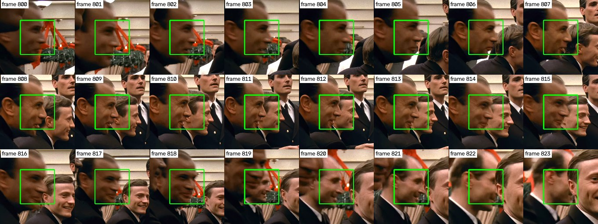

*Een track die overspringt: tot en met beeld 818 staat het groene kader op het gezicht vooraan, in beeld 819 springt het kader naar het gezicht erachter. Na het knippen zijn het twee tracks.*

Ook elk van de 11.182 beelden is bekeken om te tellen hoe vaak de detector een gezicht mist. Daarbij hadden 10.867 gezichten geen kader, ook gezichten van figuranten (een gezicht dat in 50 beelden gemist wordt, telt 50 keer). Ook stonden 4.691 kaders niet op een gezicht. De detector alleen was dus niet genoeg. Daarom waren stap 2 en 3 nodig.

**4. Klaarzetten om te labelen.** Van elke track kiest het programma één beeld om te laten zien: het beeld waarin het kader groot is en de detector het zekerst is. Dat beeld komt in de labelapp.

<details>
<summary><b>Zelf doen op een Mac en op Windows</b> (klik om open te klappen)</summary>

Dit is alleen nodig als je de uitkomsten zelf opnieuw wilt maken. Installeren staat [verderop](#installeren-op-mac-en-windows). Zoeken en volgen duurt ongeveer een uur.

Op een Mac, vanuit de map `labelen`:

```bash
.venv/bin/python stap_0_voorbereiding/1_track_faces.py
.venv/bin/python stap_0_voorbereiding/2_check_all_tracks.py
.venv/bin/python stap_0_voorbereiding/3_make_label_items.py
```

Op Windows, vanuit de map `labelen`:

```bat
.venv\Scripts\python stap_0_voorbereiding\1_track_faces.py
.venv\Scripts\python stap_0_voorbereiding\2_check_all_tracks.py
.venv\Scripts\python stap_0_voorbereiding\3_make_label_items.py
```

Het eerste script zoekt en volgt de gezichten, het tweede maakt plaatjes om de tracks te controleren, en het derde zet alles klaar voor de labelapp. Met `--beelden` achter het tweede script komen er ook plaatjes van elk beeld (samen ongeveer 1,5 GB).

Geeft een programma een andere uitkomst dan de vastgelegde bestanden, dan schrijft het programma de nieuwe uitkomst ernaast, als `<naam>.nieuw.<ext>`. Waarom, staat bij [Waar je op moet letten](#waar-je-op-moet-letten).

</details>

### Wat eruit kwam

37.003 kaders in 1.387 tracks, in [`output/stap_0_voorbereiding/`](output/stap_0_voorbereiding/).

<details>
<summary><b>Welke bestanden er staan, en wat erin staat</b> (klik om open te klappen)</summary>

| Bestand | Wat erin staat |
|---|---|
| `tracks/detections_0.3.csv` | Elk van de 37.003 kaders: bestand (`video`), `frame`, `time_s`, kader (`x`, `y`, `w`, `h`), `score`, of het een verlenging is (`verlengd`), `track`, en de track van vóór het knippen (`track_ongeknipt`). |
| `tracks/tracks_0.3.csv` | Elke track van de 1.387: eerste en laatste beeld, tijd, aantal kaders. |
| `tracks/frames.csv` | Elk van de 11.182 beelden: tijd, hoeveel het beeld op het vorige lijkt, en of het een beeldwissel is (`cut`). |
| `tracks/detections_0.5.csv`, `tracks/tracks_0.5.csv` | Dezelfde lijsten met alleen kaders vanaf score 0,5, om later te kunnen vergelijken. |
| `tracks/run_info.json` | Waarmee de uitkomsten gemaakt zijn: versies, instellingen en controlegetallen. |
| `controle/controle_alle_tracks.csv` | Het oordeel over elke gecontroleerde track, met de beelden waar de track fout gaat. |
| `controle/controle_alle_beelden.csv`, `controle/controle_alle_beelden_vondsten.csv` | De controle van elk beeld: gezichten zonder kader en kaders zonder gezicht. |
| `stills_index.csv` | Welk bestand bij welke still hoort. In de labelapp heet een still alleen `still_01` enzovoort. |
| `automatic_labels.csv` | De 21 foto's van de acteurs met één gezicht. Die krijgen hun label vanzelf: de foto staat in een map met de naam van de persoon. |

</details>


## Stap 1: per track labelen

**Waarom.** De ground truth moet onafhankelijk zijn van het programma dat we testen. Daarom kiest een mens, zonder hulp of suggesties van een computer.

### Hoe het werkte

De labelaar kreeg 1.422 items te zien: 1.387 tracks, 33 stills en 2 foto's van de acteurs waarop meer mensen staan. Samen zijn dat 1.482 gezichten. Van een track ziet de labelaar één beeld, met een geel kader om het gezicht. De keuze geldt voor de hele track.

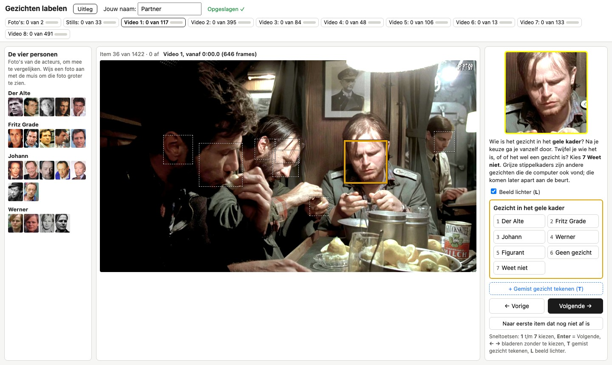

*Een track in de labelapp. Er is één geel kader: daarvoor geldt de keuze. De dunne stippelkaders zijn andere gevonden kaders; die komen elk in een eigen track aan de beurt.*

De labelaar kiest uit zeven knoppen:

| Knop | Toets | Wanneer |
|---|---|---|
| Der Alte, Fritz Grade, Johann, Werner | 1, 2, 3, 4 | Het kader staat om het gezicht van deze persoon, en de labelaar weet het zeker. |
| Figurant | 5 | Een gezicht dat niet een van de vier personen is. |
| Geen gezicht | 6 | Zeker geen gezicht, bijvoorbeeld een lamp, een hand of een oor. |
| Weet niet | 7 | De labelaar twijfelt. Een gok die fout is, zou FaceNet later onterecht fout rekenen. |

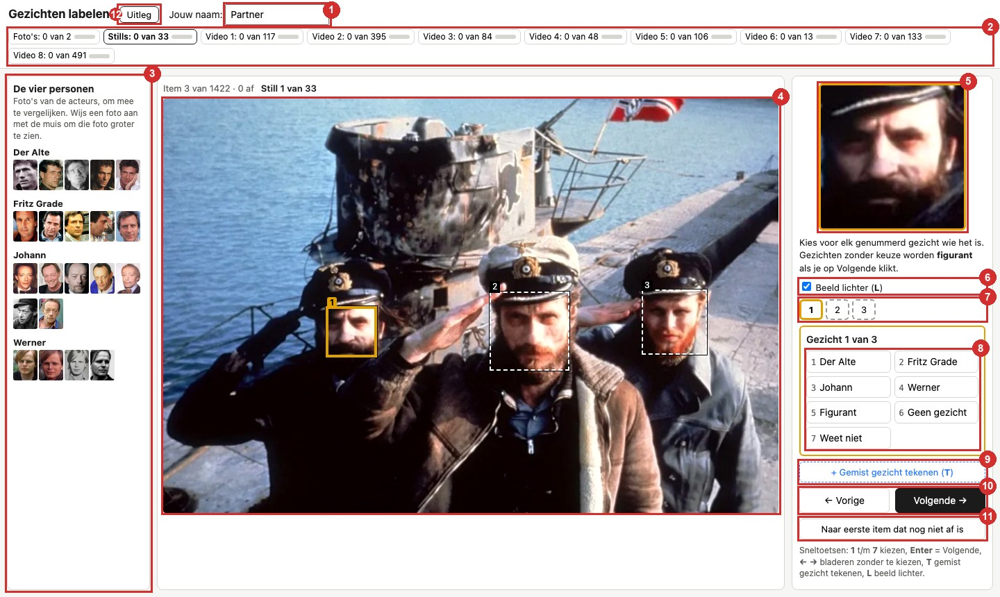

*Het scherm van de labelapp bij een still. (1) de naam van de labelaar, (2) de voortgang per deel, (3) foto's van de vier personen om mee te vergelijken, (4) het beeld met de kaders, (5) het gezicht dat aan de beurt is, groot, (6) Beeld lichter, (7) de nummers van de gezichten, (8) de knoppen om te kiezen, (9) een gemist gezicht zelf tekenen, (10) vorige en volgende, (11) naar het eerste item dat nog niet af is, (12) de korte uitleg.*

<details>
<summary><b>Waarom de app zo werkt</b> (klik om open te klappen)</summary>

De labelapp draait op de eigen computer en werkt in de browser. Er gaat niets via internet, en elke keuze wordt meteen bewaard.

- **Geen namen in beeld.** Bestandsnamen kunnen een naam bevatten en de labelaar sturen. Daarom heet een still in de app *Still 1 van 33*, en een filmpje *Video 1*.
- **Alles past op één scherm.** De labelaar hoeft nooit te scrollen.
- **Beeld lichter.** Veel scènes zijn erg donker. Deze stand maakt donkere gezichten lichter, zodat de labelaar ze kan herkennen.
- **Geen vergissingen door snel drukken.** Een ingedrukte toets en een dubbelklik tellen één keer, en de app laat pas kiezen als het nieuwe beeld er even staat.
- **Elke keuze is meteen veilig.** De app schrijft eerst een tijdelijk bestand en maakt reservekopieën. Lukt bewaren even niet, dan toont de app een rode balk.

</details>

<details>
<summary><b>Zelf doen op een Mac en op Windows</b> (klik om open te klappen)</summary>

De labelapp heeft alleen Python nodig (versie 3.8 of nieuwer), geen extra pakketten. De echte labels staan al in `output/`. Start je de app, dan begint de app met een lege lijst in een eigen bestand. De echte uitkomst verandert daar niet door.

**Op een Mac:** dubbelklik in de map `stap_1_tracks_labelen` op `START_MAC.command`. Zegt de Mac de eerste keer dat het bestand niet geopend kan worden, klik dan op **Gereed**, ga naar **Systeeminstellingen > Privacy en beveiliging**, en klik onderaan bij de melding over `START_MAC.command` op **Open toch**. Werkt dubbelklikken niet, typ dan vanuit de map `labelen`:

```bash
python3 stap_1_tracks_labelen/app.py
```

**Op Windows:** dubbelklik in de map `stap_1_tracks_labelen` op `START_WINDOWS.bat`. Zegt Windows *Windows heeft uw pc beveiligd*, klik dan op **Meer informatie** en **Toch uitvoeren**. Werkt dubbelklikken niet, typ dan vanuit de map `labelen`:

```bat
py stap_1_tracks_labelen\app.py
```

Er opent een venster met tekst, en daarna de labelpagina in de browser. Laat dat venster open zolang je labelt: het venster ís de app. De eerste keer start een korte rondleiding.

| Toets | Wat de toets doet |
|---|---|
| **1** t/m **7** | Kiezen (zie de tabel met knoppen hierboven) |
| **Enter** | Volgende |
| **←** / **→** | Vorige of volgende bekijken, zonder iets te kiezen |
| **T** | Een gemist gezicht van een van de vier personen zelf tekenen |
| **Delete** | Een getekend kader weghalen |
| **L** | Beeld lichter aan of uit |

**Stoppen en verdergaan.** Sluit het tabblad en het venster van de app. Start je de app later opnieuw uit dezelfde map, dan ga je verder waar je gebleven was.

**Als alles af is.** De keuzes staan in `labels.csv` in de map van de app. Kopieer dat bestand naar de map `output`.

Op een Mac:

```bash
cp stap_1_tracks_labelen/labels.csv output/stap_1_tracks_labelen/labels.csv
```

Op Windows:

```bat
copy stap_1_tracks_labelen\labels.csv output\stap_1_tracks_labelen\labels.csv
```

Omgekeerd kun je de echte keuzes in de app bekijken door dat bestand naar de map van de app te kopiëren.

<details>
<summary><b>De automatische tests van de app</b> (klik om open te klappen)</summary>

De app heeft 310 automatische tests: kiezen met muis en toetsen, verdergaan na een herstart, reservekopieën, beveiliging en het scherm op zeven groottes. Daarvoor zijn Python, Node 22 of nieuwer en Google Chrome nodig. Vanuit de map `labelen`, op een Mac:

```bash
bash stap_1_tracks_labelen/tests/run_tests.sh
```

</details>

</details>

### Wat eruit kwam

Alle 1.482 gezichten hebben een keuze, in [`output/stap_1_tracks_labelen/labels.csv`](output/stap_1_tracks_labelen/labels.csv).

| Keuze | Tracks | Alle gezichten (ook op foto's en stills) |
|---|---|---|
| Der Alte | 147 | 166 |
| Fritz Grade | 114 | 129 |
| Johann | 27 | 35 |
| Werner | 61 | 76 |
| Figurant | 328 | 355 |
| Geen gezicht | 708 | 719 |
| Weet niet | 2 | 2 |
| **samen** | **1.387** | **1.482** |

Meer dan de helft van de tracks is geen gezicht. Daar is de knop *Geen gezicht* voor: de detector ziet in deze 4K-beelden vaak een oor, een hand of een pet voor een gezicht aan, en volgt dat ding dan netjes van beeld tot beeld.

<details>
<summary><b>Hoe het bestand eruitziet</b> (klik om open te klappen)</summary>

Elke rij is één gezicht of één track. Dit zijn de eerste twee tracks (de kolommen `labeler`, `time` en `source` zijn hier weggelaten):

| face | item | label | how | frame | x | y | w | h |
|---|---|---|---|---|---|---|---|---|
| Das Boot 1 […].mp4#track0 | track:Das Boot 1 […].mp4#0 | Werner | chosen | 538 | 2505 | 831 | 411 | 411 |
| Das Boot 1 […].mp4#track1 | track:Das Boot 1 […].mp4#1 | DerAlte | chosen | 101 | 896 | 459 | 655 | 655 |

Het `frame` en het kader zijn van het beeld dat de labelaar te zien kreeg. In de kolom `how` staat `chosen`: de labelaar koos dit zelf. Getekende gezichten zijn er niet.

</details>


## Stap 2: per beeld nakijken

**Waarom.** Na stap 1 weten we per track wie het is. Toen we daaruit de tijdlijn tekenden (wanneer is elke persoon in beeld?), zaten er veel gaten in de lijn van een persoon. Dat komt doordat de detector een gezicht soms mist, en de labelaar van een track maar één beeld ziet. Daarom is elk beeld nog een keer met het oog bekeken.

### Hoe het werkte

Het programma laat achter elkaar alle 11.182 beelden zien, en daarna de 35 gelabelde foto's en stills. Bij elk beeld is er maar één vraag: **kloppen de namen in dit beeld?** Pijltje links is goed, pijltje rechts is fout.

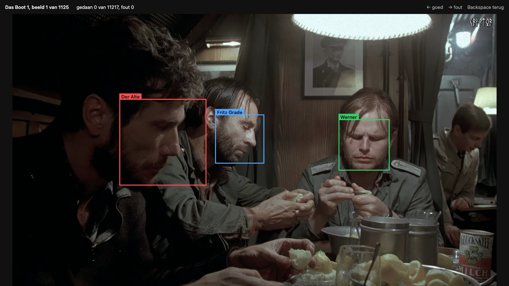

*Het programma van stap 2. Bovenaan staat welk beeld het is en hoeveel er gedaan zijn.*

- **Alleen de vier personen.** Figuranten en kaders met *Geen gezicht* staan er niet bij.
- **Eén kader per persoon.** Staat dezelfde persoon meer dan één keer in een beeld, dan maakt het programma er één groot kader van.
- **Een waarschuwing bij een gat.** Stond een persoon in het vorige beeld wel en in dit beeld niet, dan staat er bovenin een rode waarschuwing. Dat gebeurde bij 248 beelden, en 190 daarvan bleken inderdaad fout.
- **Niet per ongeluk te snel.** Een toets telt pas als het beeld er helemaal staat, en een ingedrukte toets telt één keer.

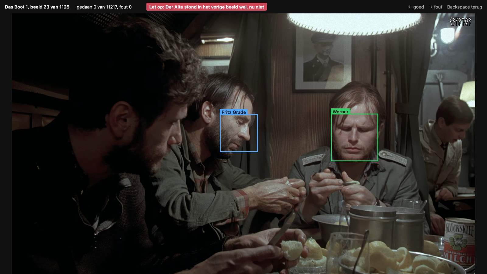

*Hetzelfde filmpje even later. Eén persoon stond in het vorige beeld wel en heeft hier geen kader meer. De waarschuwing staat in de balk bovenin.*

De beelden worden altijd op volgorde uit de video gelezen. Direct naar een beeldnummer springen is niet betrouwbaar: OpenCV geeft dan soms het beeld ervoor, en dan staat een kader op het verkeerde beeld.

<details>
<summary><b>Zelf doen op een Mac en op Windows</b> (klik om open te klappen)</summary>

Start het programma vanuit de map `labelen`. De pagina opent vanzelf in de browser. Stoppen doe je met Ctrl+C in de terminal.

Op een Mac:

```bash
.venv/bin/python stap_2_beelden_nakijken/check_labels.py
```

Op Windows:

```bat
.venv\Scripts\python stap_2_beelden_nakijken\check_labels.py
```

| Toets | Wat de toets doet |
|---|---|
| **←** | Goed: de namen in dit beeld kloppen |
| **→** | Fout: er klopt iets niet (een naam ontbreekt, staat fout of staat op de verkeerde plek) |
| **Backspace** | Eén beeld terug. Bij een nieuw oordeel over een beeld telt het laatste oordeel. |

Elk oordeel komt meteen in het bestand. Stop je en start je later opnieuw, dan ga je verder bij het eerste beeld zonder oordeel. Alle beelden hebben al een oordeel. Wil je het programma alleen proberen, zet er dan `--uitvoer proef` achter. De echte uitkomst verandert dan niet.

</details>

### Wat eruit kwam

Van de 11.217 beelden, foto's en stills kregen er **9.516 goed (84,8%)** en **1.701 fout (15,2%)**, in [`output/stap_2_beelden_nakijken/controle_labels.csv`](output/stap_2_beelden_nakijken/controle_labels.csv). Elke rij is één oordeel. Is een beeld vaker beoordeeld, dan telt de laatste rij van dat beeld.

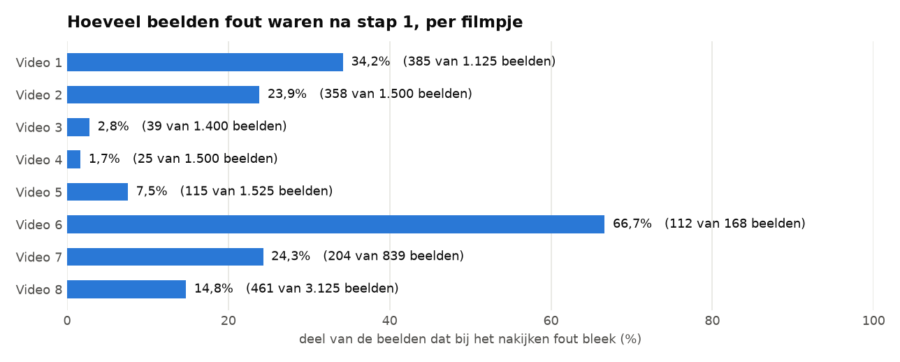

*Zo lees je dit plaatje: een langere balk betekent dat na stap 1 een groter deel van de beelden in dat filmpje fout was. In Video 3 en 4 klopte vrijwel alles al. In Video 6 was twee derde fout: dat filmpje is kort (168 beelden), en één persoon ontbrak daar lang.*


## Stap 3: de foute beelden verbeteren

**Waarom.** Stap 2 zegt welke beelden fout zijn, maar niet wat er wel moet staan. In deze stap worden de kaders van de vier personen in elk fout beeld goed gezet.

### Hoe het werkte

Het programma laat alleen de 1.701 foute beelden zien, één voor één.

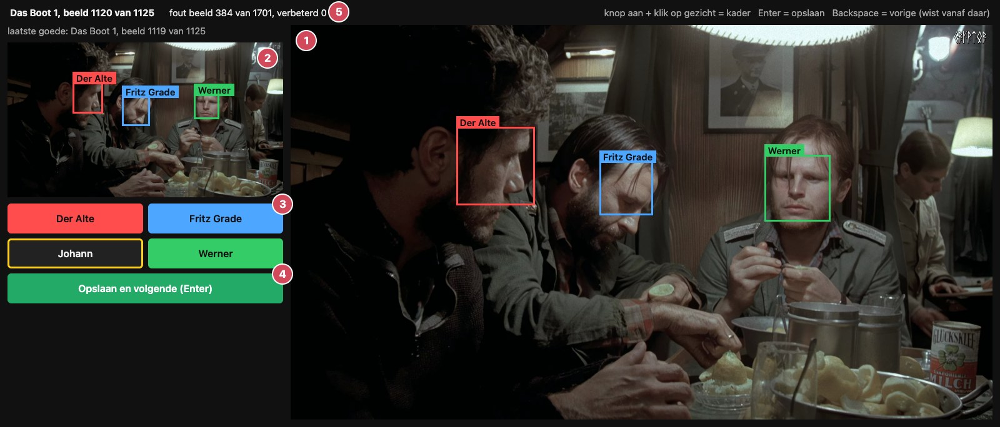

*Het programma van stap 3. (1) Rechts groot het foute beeld met de kaders van de vier personen. (2) Linksboven het laatste goede beeld ervoor. (3) Een knop per persoon: de knop is gekleurd als die persoon in het beeld staat. (4) Opslaan en naar het volgende foute beeld. (5) Hoeveel beelden er al verbeterd zijn.*

- **Het laatste goede beeld als voorbeeld.** Linksboven staat altijd het laatste goede beeld uit hetzelfde filmpje. Zo is te zien wie er net nog in beeld was.
- **Een kader erbij zetten.** Zet de knop van een persoon aan en klik op het gezicht. Vond de computer op die plek een kader, dan wordt dat kader gebruikt. Anders komt er een kader zo groot als het kader van die persoon in het laatste goede beeld.
- **Een kader weghalen.** Klik op een knop die aan staat. Om een kader te verplaatsen, zet je de knop uit en weer aan en klik je op de goede plek.
- **Doorwerken zonder alles opnieuw te doen.** In het volgende foute beeld staan dezelfde kaders al op dezelfde plek. In een reeks foute beelden na elkaar hoef je meestal alleen te controleren en op Enter te drukken.
- **Terug is echt terug.** Met Backspace ga je een fout beeld terug, en worden de verbeteringen van dat beeld en alle beelden erna gewist.

<details>
<summary><b>Zelf doen op een Mac en op Windows</b> (klik om open te klappen)</summary>

Start het programma vanuit de map `labelen`.

Op een Mac:

```bash
.venv/bin/python stap_3_fouten_verbeteren/fix_labels.py
```

Op Windows:

```bat
.venv\Scripts\python stap_3_fouten_verbeteren\fix_labels.py
```

| Handeling | Wat er gebeurt |
|---|---|
| Knop aan zetten, dan klikken op een gezicht | Om dat gezicht komt een kader met die naam |
| Klikken op een knop die aan staat | Het kader van die persoon gaat weg |
| **Enter** (of de groene knop) | Opslaan en naar het volgende foute beeld |
| **Backspace** | Terug naar het vorige foute beeld; dat beeld en alles erna wordt gewist |

Stop je en start je later opnieuw, dan ga je verder bij het eerste foute beeld dat nog niet verbeterd is. Alle foute beelden zijn al verbeterd. Wil je het programma alleen proberen, zet er dan `--uitvoer proef` achter.

Als alle beelden verbeterd zijn, maakt dit programma de ground truth.

Op een Mac:

```bash
.venv/bin/python stap_3_fouten_verbeteren/make_ground_truth.py
```

Op Windows:

```bat
.venv\Scripts\python stap_3_fouten_verbeteren\make_ground_truth.py
```

Het programma voegt alles samen. Kreeg een beeld in stap 2 *goed*, dan tellen de kaders uit stap 1. Kreeg een beeld *fout*, dan tellen de verbeterde kaders uit stap 3.

</details>

### Wat eruit kwam

Alle 1.701 foute beelden zijn verbeterd, in [`output/stap_3_fouten_verbeteren/correcties.csv`](output/stap_3_fouten_verbeteren/correcties.csv).

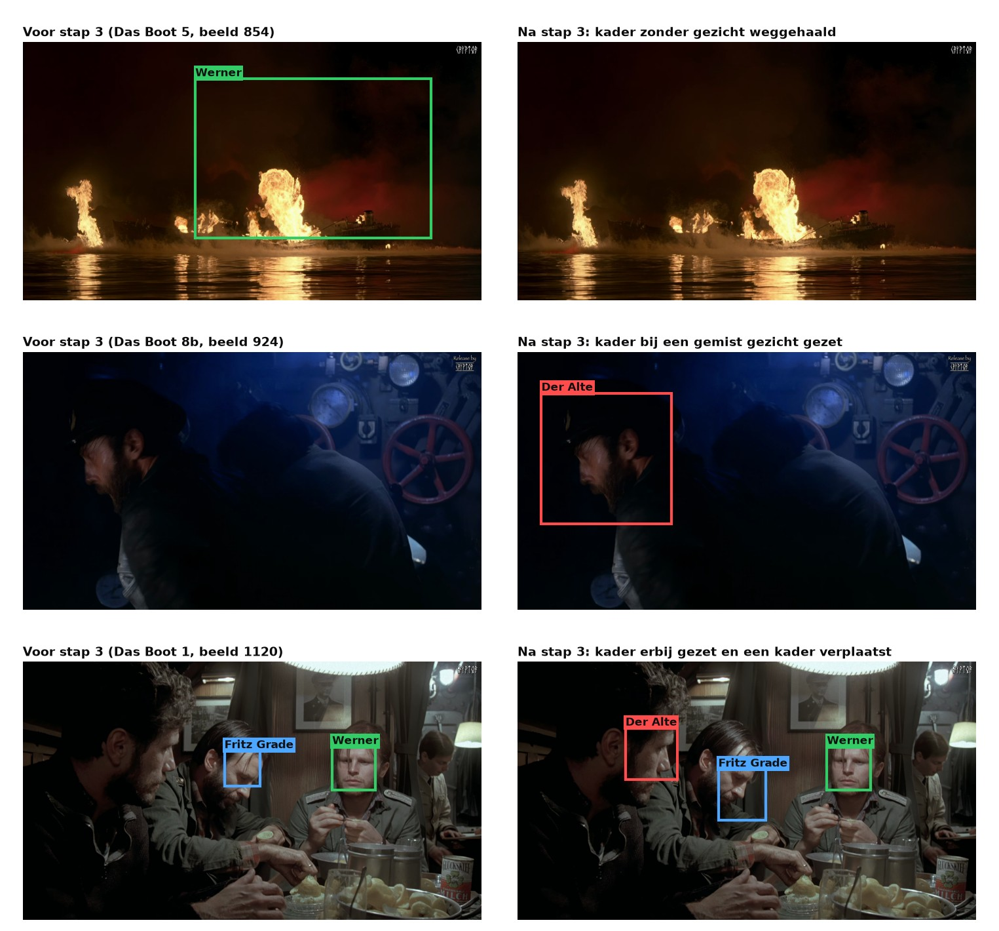

*Drie beelden voor en na het verbeteren. De namen zijn de keuzes uit de stappen 1 en 3.*

In de 1.699 foute beelden uit de filmpjes veranderde dit:

| Wat er veranderde | Aantal kaders |
|---|---|
| Een persoon erbij | 1.673 |
| Een kader verplaatst naar een andere plek | 306 |
| Een persoon weggehaald | 155 |
| Bleef ongeveer hetzelfde | 1.913 |

Meestal ging het dus om een persoon die wel in beeld is maar nog geen kader had. Van de 3.892 kaders in de verbeterde beelden zijn er 1.607 (41%) met de hand gezet, omdat de detector op die plek niets had gevonden. Zonder deze stap hadden die gezichten niet in de ground truth gestaan.

<details>
<summary><b>Hoe het bestand eruitziet</b> (klik om open te klappen)</summary>

Per opgeslagen beeld staat er per persoon één rij met het kader. Een rij zonder persoon betekent dat er geen van de vier in het beeld staat. Is een beeld opnieuw opgeslagen, dan telt de laatste keer, en een rij met persoon `-` betekent dat een verbetering gewist is.

Twee van de gelabelde stills waren in stap 2 fout (`still_09` en `still_31`) en zijn dus ook verbeterd.

</details>


## Wat nakijken en verbeteren heeft opgeleverd

| Persoon | Beelden na stap 1 | Beelden na stap 3 | Erbij | Losse stukken na stap 1 | Losse stukken na stap 3 |
|---|---|---|---|---|---|
| Der Alte | 7.671 | 8.326 | +655 (+8,5%) | 102 | 40 |
| Fritz Grade | 4.779 | 5.321 | +542 (+11,3%) | 92 | 36 |
| Johann | 775 | 849 | +74 (+9,5%) | 19 | 10 |
| Werner | 6.247 | 6.494 | +247 (+4,0%) | 59 | 27 |
| **samen** | **19.472** | **20.990** | **+1.518 (+7,8%)** | **272** | **113** |

Een *los stuk* is een aaneengesloten stuk film waarin een persoon in beeld is. Hoe minder losse stukken, hoe minder gaten in de lijn van die persoon.

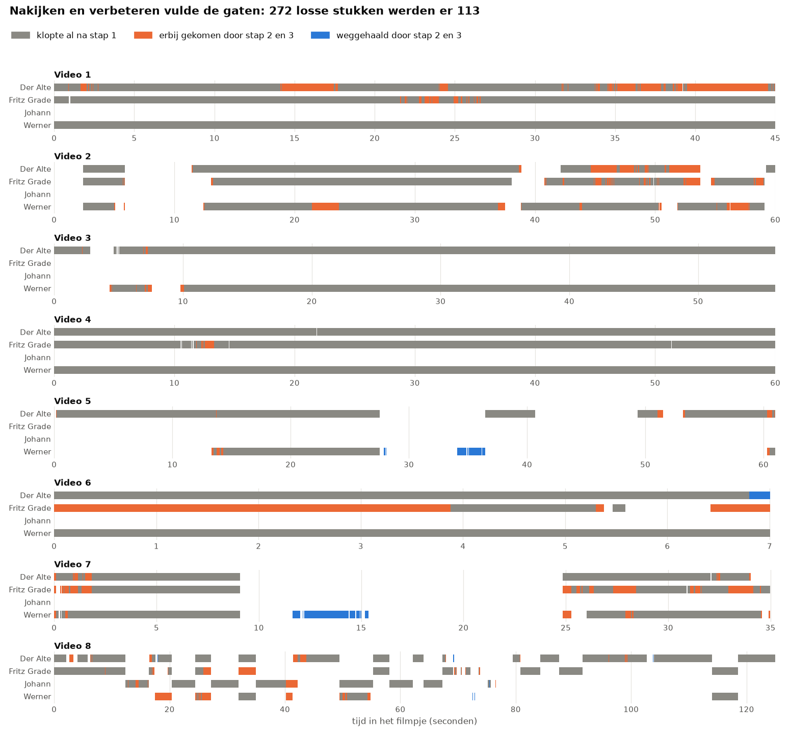

*Zo lees je dit plaatje: elke regel is een persoon, en de tijd loopt van links naar rechts. Grijs klopte al na stap 1. Oranje is erbij gekomen door stap 2 en 3, en blauw is weggehaald. De gaten zijn dus grotendeels gevuld.*

De ground truth laat nu veel beter zien wanneer iemand in beeld is. Dat is nodig, want de namen van FaceNet worden hiermee vergeleken.

**Hoe we de bestanden en de code gecontroleerd hebben.** Of de namen zelf kloppen, is in stap 2 nagekeken door één persoon.

- **De bestanden zijn nog precies dezelfde.** `0_check_setup.py` controleert de 12 videobestanden, de pixels van alle beelden, de foto's en de vastgelegde uitkomsten.
- **De code doet nog hetzelfde.** Stap 0 is in de mappenindeling van deze versie opnieuw gedraaid en gaf precies dezelfde tracks en dezelfde bestanden voor de labelapp.
- **De labelapp is getest.** Alle 310 automatische tests slagen.
- **De ground truth is los nageteld.** Een apart programma kwam op dezelfde aantallen per persoon uit.

**Wat er niet in zit.**

- **Alleen de vier personen zijn nagekeken.** Figuranten zijn in stap 2 en 3 niet nagekeken en staan niet in de ground truth. Hun labels staan alleen in `labels.csv`.
- **De plek van een verbeterd kader is minder precies dan de naam.** Een kader kan iets naast het gezicht staan, zeker bij de 1.607 kaders zonder kader van de detector. Bij een test per gezicht moet je daarom met overlap werken.
- **Elk beeld is door één persoon nagekeken.** We weten dus niet hoe vaak twee mensen het oneens zouden zijn.


## Wat er in deze map staat

De filmpjes staan één map hoger, in [`../filmpjes/`](../filmpjes/). Alle andere bestanden van het labelen staan in deze map.

<details>
<summary><b>Alle mappen en bestanden</b> (klik om open te klappen)</summary>

```
labelen/
├── README.md                       deze uitleg
├── requirements.txt                de pakketten die stap 0, 2 en 3 nodig hebben
├── checksums.sha256                controlegetallen van de vastgelegde bestanden
├── invoer/
│   ├── model/                      het model van de detector
│   └── pictures/                   de foto's van de acteurs en de stills uit de film
├── gedeeld/                        code die meer stappen gebruiken
├── stap_0_voorbereiding/
│   ├── 0_check_setup.py            controleert of de computer en de bestanden in orde zijn
│   ├── 1_track_faces.py            zoekt en volgt de gezichten
│   ├── 2_check_all_tracks.py       maakt de plaatjes waarmee alle tracks gecontroleerd zijn
│   └── 3_make_label_items.py       zet alles klaar voor de labelapp
├── stap_1_tracks_labelen/
│   ├── START_MAC.command           hiermee start je de labelapp op een Mac
│   ├── START_WINDOWS.bat           hiermee start je de labelapp op Windows
│   ├── app.py, web/                de labelapp
│   ├── items.json, images/         alles wat de labelapp laat zien
│   └── tests/                      de automatische tests van de labelapp
├── stap_2_beelden_nakijken/
│   ├── check_labels.py             het programma om elk beeld na te kijken
│   └── pagina.html                 de pagina in de browser
├── stap_3_fouten_verbeteren/
│   ├── fix_labels.py               het programma om foute beelden te verbeteren
│   ├── pagina.html                 de pagina in de browser
│   └── make_ground_truth.py        voegt alle stappen samen tot de ground truth
├── output/
│   ├── stap_0_voorbereiding/       de kaders, de tracks en de controle daarvan
│   ├── stap_1_tracks_labelen/      labels.csv
│   ├── stap_2_beelden_nakijken/    controle_labels.csv
│   └── stap_3_fouten_verbeteren/   correcties.csv en de ground truth
└── fotos/                          de plaatjes in deze uitleg
```

De plaatjes maakt [`fotos/maak_fotos.py`](fotos/maak_fotos.py) (daarvoor is ook matplotlib nodig). De schermafbeeldingen zijn gemaakt van de echte programma's.

</details>

<details>
<summary><b>De filmpjes: waar ze vandaan komen en hoe lang ze zijn</b> (klik om open te klappen)</summary>

We gebruiken acht fragmenten uit *Das Boot*. GitHub neemt geen bestanden groter dan 100 MB aan. Daarom zijn fragment 2, 4 en 8 in delen geknipt, zonder de beelden opnieuw te coderen. Samen zijn het 12 bestanden. De filmpjes hebben 25 beelden per seconde, behalve Video 6 en 7 (23,98), en zijn zonder geluid.

| Fragment | Bestanden | Lengte | Beelden | Grootte | Bron |
|---|---|---|---|---|---|
| Video 1 | Das Boot 1 | 0:45 | 1.125 | 3840 × 2160 | [YouTube](https://www.youtube.com/watch?v=Ek2omNPSOYc), 28:10 tot 28:55 |
| Video 2 | Das Boot 2a, 2b | 1:00 | 647 + 853 | 3840 × 2160 | [YouTube](https://www.youtube.com/watch?v=10EqNLl5ZSM), 13:15 tot 14:15 |
| Video 3 | Das Boot 3 | 0:56 | 1.400 | 3840 × 2160 | [YouTube](https://www.youtube.com/watch?v=kefBHWylmMk), 30:08 tot 31:04 |
| Video 4 | Das Boot 4a, 4b | 1:00 | 714 + 786 | 3840 × 2160 | [YouTube](https://www.youtube.com/watch?v=kefBHWylmMk), 45:35 tot 46:35 |
| Video 5 | Das Boot 5 | 1:01 | 1.525 | 3840 × 2160 | [YouTube](https://www.youtube.com/watch?v=kefBHWylmMk), 32:05 tot 33:06 |
| Video 6 | Das Boot 6 | 0:07 | 168 | 1920 × 1080 | [YouTube](https://www.youtube.com/watch?v=ofY2rexjmc4), 3:51 tot 3:58 |
| Video 7 | Das Boot 7 | 0:35 | 839 | 1920 × 1080 | [YouTube](https://www.youtube.com/watch?v=T-D6e3pjHKQ), 0:25 tot 1:00 |
| Video 8 | Das Boot 8a, 8b, 8c | 2:05 | 1.096 + 1.194 + 835 | 3840 × 2160 | aangeleverd bestand |
| **samen** | 12 bestanden | ongeveer 7,5 minuut | **11.182** | | |

</details>


## Installeren op Mac en Windows

Dit hoef je maar één keer te doen. Wie alleen de uitkomsten wil gebruiken, hoeft niets te installeren. Voor alleen labelen (stap 1) is alleen Python nodig, zie [Stap 1](#stap-1-per-track-labelen).

**1. Installeer Python 3.12** vanaf <https://www.python.org/downloads/>. Zet op Windows in het eerste scherm een vinkje bij *Add python.exe to PATH*.

**2. Zet het project op je computer.** Download de branch als [ZIP-bestand](https://github.com/arieknarie/KTAI/archive/refs/heads/final-version.zip) (ongeveer 1 GB) en pak het uit, of gebruik git:

```bash
git clone -b final-version https://github.com/arieknarie/KTAI.git
```

Zet de map niet in iCloud, OneDrive of een andere clouddienst, en op Windows in een map zonder letters als é in het pad.

**3. Open een terminal in de map `labelen`.** Een terminal is het venster waarin je opdrachten typt. Alle opdrachten in deze uitleg geef je vanuit deze map.

- **Mac:** open het programma Terminal, typ `cd ` (met een spatie erachter), sleep de map `labelen` naar het venster en druk op Enter.
- **Windows:** open de map `labelen` in de Verkenner, klik bovenin op de balk met de naam van de map, typ `cmd` en druk op Enter.

**4. Installeer de pakketten:** MediaPipe (vindt de gezichten), pandas en NumPy (rekenen met tabellen) en OpenCV (leest de video's).

Op een Mac:

```bash
python3.12 -m venv .venv
.venv/bin/pip install -r requirements.txt
```

Op Windows:

```bat
py -3.12 -m venv .venv
.venv\Scripts\pip install -r requirements.txt
```

**5. Controleer of alles klopt.** Dit programma kijkt of de versies kloppen, of alle bestanden nog dezelfde zijn als bij ons, en of deze computer de filmpjes op precies dezelfde manier uitleest. Staat er aan het eind *Alles in orde.*, dan is de computer klaar.

Op een Mac:

```bash
.venv/bin/python stap_0_voorbereiding/0_check_setup.py
```

Op Windows:

```bat
.venv\Scripts\python stap_0_voorbereiding\0_check_setup.py
```

Op Windows hebben we het installeren en de programma's niet uitgeprobeerd. De opdrachten zijn daar steeds hetzelfde, met `.venv\Scripts\python` in plaats van `.venv/bin/python` en `\` in plaats van `/`.


## Alles opnieuw doen, en waar je op moet letten

Dit is de volledige volgorde. Doe alles vanuit de map `labelen`.

| Stap | Wat je doet |
|---|---|
| Controleren | `0_check_setup.py` in `stap_0_voorbereiding` |
| 0. Zoeken en volgen | `1_track_faces.py` in `stap_0_voorbereiding` |
| 0. Tracks controleren | `2_check_all_tracks.py` in `stap_0_voorbereiding` |
| 0. Klaarzetten | `3_make_label_items.py` in `stap_0_voorbereiding` |
| 1. Labelen | dubbelklik `START_MAC.command` of `START_WINDOWS.bat` in `stap_1_tracks_labelen` |
| 2. Nakijken | `check_labels.py` in `stap_2_beelden_nakijken` |
| 3. Verbeteren | `fix_labels.py` in `stap_3_fouten_verbeteren` |
| 3. De ground truth maken | `make_ground_truth.py` in `stap_3_fouten_verbeteren` |

Een script start je op een Mac met `.venv/bin/python` en op Windows met `.venv\Scripts\python`, zoals bij elke stap hierboven staat.

### Waar je op moet letten

- **De uitkomsten liggen vast.** De labels horen bij precies deze kaders en tracknummers. Een andere computer of een andere versie van een pakket kan andere kaders en dus andere tracknummers geven, en dan passen de labels niet meer. Daarom staan de controlegetallen in `checksums.sha256`, en overschrijven de programma's die bestanden niet. Wil je bewust een nieuwe versie, dan moeten de controle, het labelen en het nakijken helemaal opnieuw.
- **Sla de CSV-bestanden niet op in Excel.** Bekijken mag, maar Excel slaat een bestand net anders op, en dan klopt het controlegetal niet meer.
- **Geen iCloud of OneDrive.** Een clouddienst maakt soms kopieën met namen als `000010 2.jpg`, en dat kan het project beschadigen. `0_check_setup.py` waarschuwt daarvoor.
- **Op Windows: een pad zonder letters als é.** OpenCV kan op Windows soms geen bestanden lezen als er zulke letters in het pad staan.

| Wat je ziet | Wat je doet |
|---|---|
| `FOUT:` aan het eind van `0_check_setup.py` | Lees de regel: die zegt welk bestand of welke versie niet klopt. Gebruik dan de vastgelegde uitkomsten en draai stap 0 niet opnieuw. |
| De pagina van stap 2 of 3 opent niet vanzelf | Typ het adres over dat in de terminal staat, bijvoorbeeld `http://localhost:8020`. |
| Het eerste beeld na een herstart laadt lang | Dat klopt: de video wordt op volgorde gelezen tot het beeld waar je gebleven was. |
| `python3.12` of `py -3.12` wordt niet gevonden | Python 3.12 is nog niet geïnstalleerd, zie [Installeren](#installeren-op-mac-en-windows). |
| Een rode balk in de labelapp | De tekst in de balk zegt wat er aan de hand is. Meestal is het venster van de app gesloten: start de app opnieuw. |
