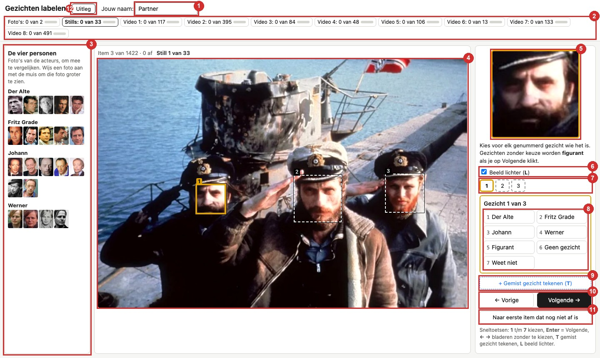
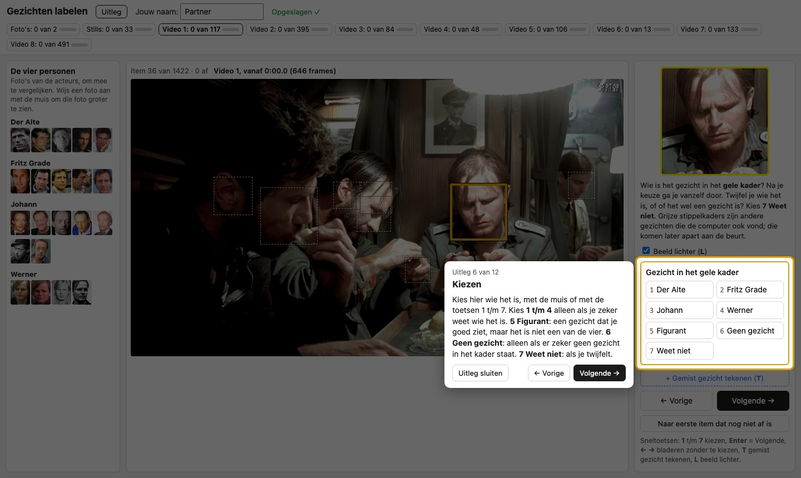
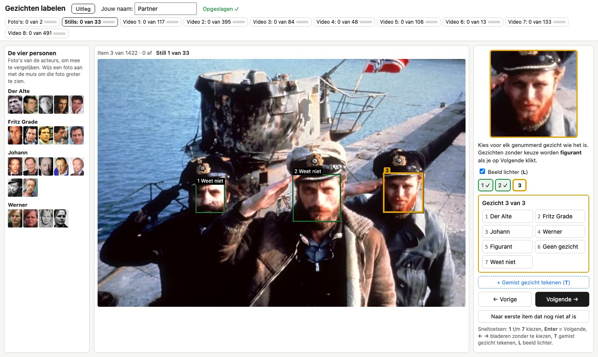
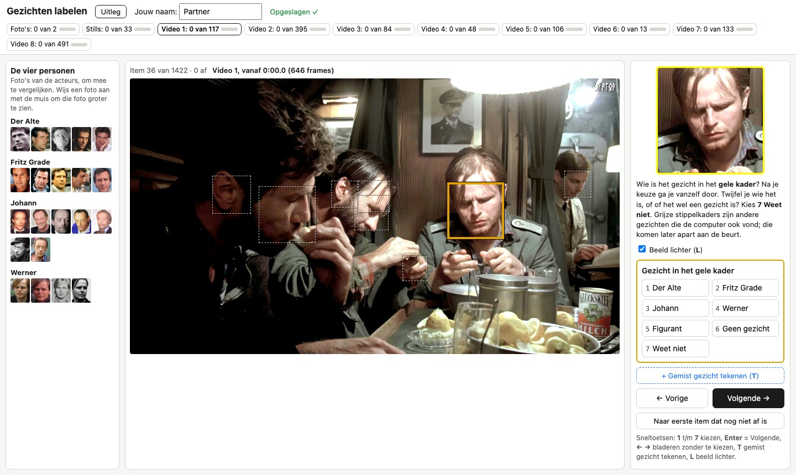
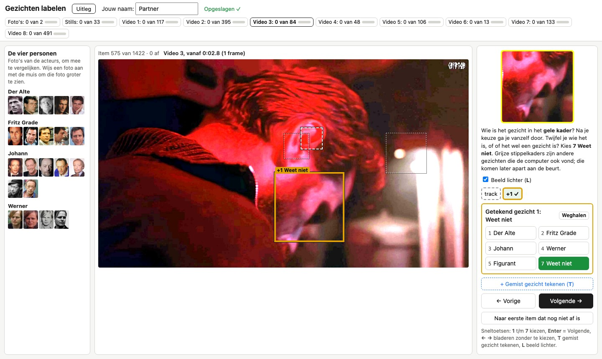
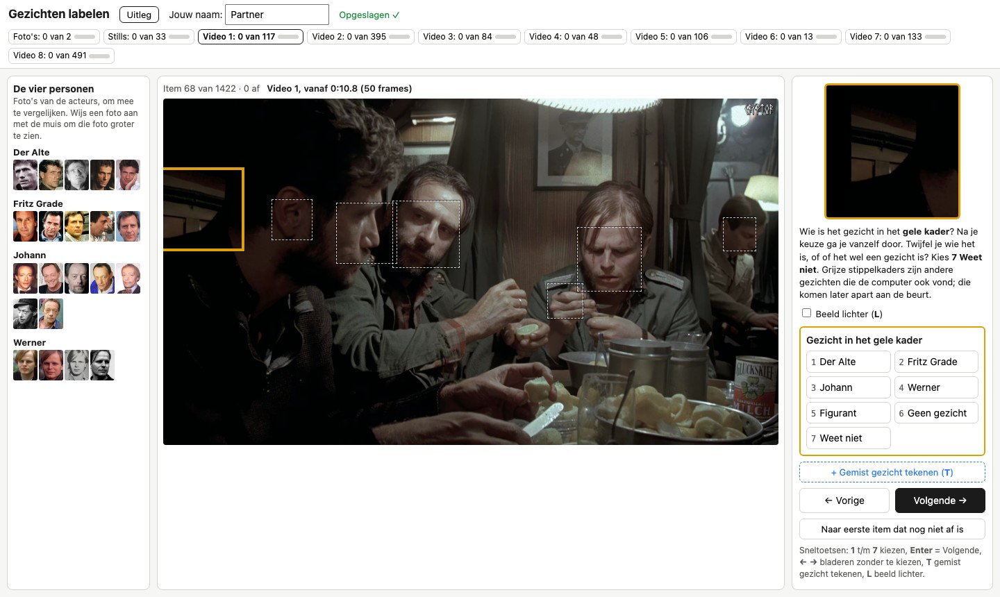
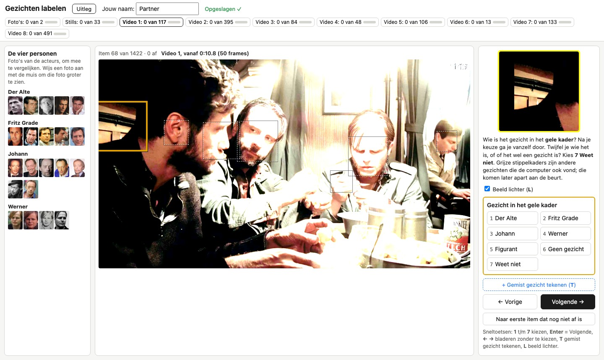
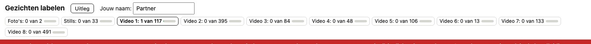

# Handleiding: gezichten labelen

Fijn dat je helpt! In deze handleiding staat stap voor stap wat je moet doen.
Je hoeft niets te weten van computers of programmeren. Lees de stappen van
boven naar beneden en doe ze één voor één.


## Waar gaat dit over?

We maken voor een studieopdracht een programma dat gezichten herkent in
fragmenten uit de film *Das Boot*. Het gaat om vier personen uit die film:
**Der Alte**, **Fritz Grade**, **Johann** en **Werner**. Om te kunnen
controleren of dat programma goed werkt, moeten we van tevoren zelf weten wie
er op elk beeld te zien is. Dat is jouw taak: bij elk gezicht aangeven wie het
is.

De computer heeft alles opgezocht wat op een gezicht lijkt en daar een kader
omheen gezet. Meestal staat er een gezicht in het kader, maar niet altijd. Jij
krijgt steeds een beeld te zien met een kader, en klikt aan wie of wat er in
dat kader staat. Soms mist de computer een gezicht. Is dat een gezicht van een
van de vier personen, dan teken je er zelf een kader omheen (zie 4.6); andere
gezichten zonder kader sla je over. Je kiest uit zeven knoppen:

- een van de vier personen: **Der Alte**, **Fritz Grade**, **Johann** of
  **Werner**;
- **Figurant**: een gezicht van iemand anders;
- **Geen gezicht**: in het kader staat iets dat geen gezicht is, bijvoorbeeld
  een lamp;
- **Weet niet**: je kunt niet zeggen wie het is.

Er zijn drie soorten beelden:

- **Foto's van de acteurs.** Je krijgt maar twee gewone foto's van de acteurs
  te zien: de twee waarop meer mensen staan. Daar wijs je aan wie wie is. De
  andere foto's van de acteurs zijn al gelabeld; die zie je in de app links,
  om mee te vergelijken.
- **Stills.** Een still is een losse foto uit de film. Er zijn er 33, met vaak
  meer gezichten op één still.
- **Stukjes video.** De computer heeft in acht filmfragmenten alles wat op een
  gezicht leek, gevolgd zolang het in beeld was. Zo'n stukje noemen we een
  **track**. Van elke track zie je één beeld, en jouw keuze geldt voor de hele
  track. Er zijn 1.387 tracks; de meeste kies je met één toets.

Elk beeld dat je labelt, heet in de app een **item**. Alles samen zijn het
1.422 items: 2 foto's, 33 stills en 1.387 tracks. Dat hoeft niet in één keer:
elke keuze wordt meteen bewaard, en je kunt stoppen en later verdergaan waar je
gebleven was.

Je doet alles op je eigen computer. Het programma waarmee je labelt (we noemen
het hierna "de app") draait alleen op jouw computer; er gaat niets via
internet. Als je klaar bent, en ook tussendoor, stuur je één bestand met je
keuzes naar Marc (stap 6).



*Zo ziet de app eruit. Links de foto's van de vier personen om mee te
vergelijken (in een smal venster staan die foto's boven het beeld), in het
midden het beeld met een kader om elk gezicht, rechts de knoppen om te kiezen.
De nummers worden uitgelegd in stap 4.*


## Stap 1: Python installeren (één keer)

De app heeft een gratis programma nodig dat **Python** heet. Kijk eerst of
Python al op je computer staat. Volg het deel voor jouw soort computer. Op
Windows hebben we de app en deze stappen nog niet zelf uitgeprobeerd. Gaat er
iets anders dan hier staat, stop dan en laat het Marc weten.

### Windows

1. Klik op de Start-knop, typ `cmd` en klik op **Opdrachtprompt**. Er opent een
   zwart venster waarin je tekst kunt typen.
2. Typ in dat zwarte venster `py --version` en druk op Enter.
   - Staat er iets als `Python 3.13.2`: Python staat er al. Ga naar stap 2.
   - Staat er een foutmelding: installeer Python zoals hieronder.
3. Ga in je browser naar <https://www.python.org/downloads/>. Bovenaan staat
   *Download the latest version for Windows*. Klik op de gele knop
   **Download Python install manager**.
4. Open het gedownloade bestand (de naam begint met `python-manager`). Klik in
   het venster dat opent op **Installeren**.
5. Na het installeren opent er vaak vanzelf een zwart venster met Engelse
   vragen, zoals *Install CPython now? [Y/n]*. Druk bij elke vraag alleen op
   **Enter**. Python wordt dan gedownload en geïnstalleerd. Wacht tot het
   venster vanzelf dichtgaat. Opent er geen zwart venster, dan is dat ook goed.
6. Sluit het zwarte venster van punt 1 en doe punt 1 en 2 nog een keer. De
   eerste keer kan `py --version` even duren. Daarna staat er iets als
   `Python 3.15.0`.

Lukt het zo niet? Gebruik dan het losse installatieprogramma. Klik op dezelfde
pagina, onder de gele knop, op de link in de zin *Or get the standalone
installer for Python …*. Open het gedownloade bestand, zet in het eerste scherm
een vinkje bij **Add python.exe to PATH** en klik op **Install Now**. Vraagt
Windows *Wilt u toestaan dat deze app wijzigingen aanbrengt op uw apparaat?*,
klik dan op **Ja**.

### Mac

1. Druk op **Cmd (⌘) + spatiebalk**, typ `Terminal` en druk op Enter. (Op een
   Mac heet de Enter-toets *return* ↩.) Er opent een venster waarin je tekst
   kunt typen (vaak wit, soms zwart).
2. Typ `python3 --version` en druk op Enter.
   - Staat er iets als `Python 3.12.3`: Python staat er al. Ga naar stap 2.
   - Verschijnt er een melding dat de opdracht *python3* ontwikkelaarstools
     nodig heeft: klik in die melding op **Niet nu** en installeer Python zoals
     hieronder.
   - Staat er een foutmelding: installeer Python zoals hieronder.
3. Ga in je browser naar <https://www.python.org/downloads/> en klik op de gele
   knop **Download Python 3.…** (het nummer maakt niet uit).
4. Open het gedownloade bestand in de map Downloads (de naam begint met
   `python-` en eindigt op `.pkg`).
5. Klik een paar keer op **Ga door**. Bij de licentie verschijnt een vraag:
   klik op **Akkoord**. Klik daarna op **Installeer**.
6. De Mac vraagt het wachtwoord waarmee je op de Mac inlogt (of je
   vingerafdruk). Vul dat in en klik op **Installeer software**.
7. Als de installatie klaar is, opent er vanzelf een map *Python 3.…*. Die map
   heb je niet nodig; sluit die map. Klik in het installatievenster op
   **Sluit**. Vraagt de Mac of het installatiebestand naar de prullenmand mag,
   dan mag dat.
8. Sluit Terminal en doe punt 1 en 2 nog een keer.

Elke versie vanaf Python 3.8 zou moeten werken, dus ook 3.10, 3.13 of 3.15.
Wij hebben de app uitgeprobeerd met Python 3.9 en 3.12. Je hoeft verder niets
te installeren.


## Stap 2: het project op je computer zetten (één keer)

Het project staat op GitHub, een website waar je programma's kunt delen.

1. Klik op deze link:
   <https://github.com/arieknarie/KTAI/archive/refs/heads/facenet-stress-tests-v2.zip>.
   Het project wordt dan gedownload als het bestand
   `KTAI-facenet-stress-tests-v2.zip`. Dat bestand is ongeveer 130 MB, dus het
   downloaden kan even duren.
2. **Alleen op Windows:** klik met de rechtermuisknop op het gedownloade
   ZIP-bestand en kies **Eigenschappen**. Zet onderaan, bij *Beveiliging*, een
   vinkje bij **Blokkering opheffen** en klik op **OK**. Dan houdt Windows het
   startbestand later niet tegen. Staat er geen *Beveiliging*, sla dit punt
   dan over.
3. Pak het ZIP-bestand uit. Op Windows: klik met de rechtermuisknop op het
   ZIP-bestand, kies **Alles uitpakken** en daarna **Uitpakken**. Op de Mac:
   dubbelklik op het ZIP-bestand (in Safari is het vaak al vanzelf uitgepakt).
4. Je hebt nu een map `KTAI-facenet-stress-tests-v2`. Laat die map in de map
   Downloads staan. Zet hem niet op het bureaublad of in Documenten: op veel
   computers kopieert OneDrive of iCloud die mappen steeds naar internet, en
   dat kan de app storen.
5. Open de map `KTAI-facenet-stress-tests-v2`. Op Windows staat daarin vaak
   nog een map met dezelfde naam; open die ook. Daarin staat de map
   `labeling`. In de map `labeling` staat de app. Meer dan die map heb je niet
   nodig. Kijk tijdens het labelen niet in de andere mappen van het project,
   en ook niet in de map `images` in `labeling`. Daar staan namen van mappen
   en bestanden die je bij het kiezen op een idee kunnen brengen, en het is de
   bedoeling dat je alleen naar de gezichten kijkt.

Werkt de link niet? Ga dan naar <https://github.com/arieknarie/KTAI>, klik
linksboven op de knop met het woord `main`, kies **facenet-stress-tests-v2**,
klik op de groene knop **Code** en daarna op **Download ZIP**.

Start de app nooit vanuit het ZIP-bestand zelf; pak het altijd eerst uit.


## Stap 3: de app starten

### Windows

1. Open de map `labeling`.
2. Dubbelklik op **`START_WINDOWS.bat`** (Windows laat soms alleen
   `START_WINDOWS` zien, zonder `.bat`).
3. De eerste keer kan Windows waarschuwen:
   - *Windows heeft uw pc beveiligd*: klik op **Meer informatie** en daarna op
     **Toch uitvoeren**.
   - *Bestand openen - beveiligingswaarschuwing*: klik op **Uitvoeren**.
   - Een melding van **Slim app-beheer** zonder knop om toch te starten: start
     de app dan met de hand (zie hieronder).

### Mac

1. Open de map `labeling`.
2. Dubbelklik op **`START_MAC.command`**.
3. De eerste keer zegt de Mac dat `START_MAC.command` niet geopend is, omdat
   Apple niet kan controleren of het bestand veilig is. Dat komt doordat het
   bestand niet bij Apple geregistreerd is, niet doordat er iets mis mee is.
   Klik op **Gereed** (niet op *Verplaats naar prullenmand*).
4. Kies in het Apple-menu (het appeltje linksboven) **Systeeminstellingen** >
   **Privacy en beveiliging**. Scroll omlaag naar *Beveiliging*. Klik bij de
   melding over `START_MAC.command` op **Open** (of **Open toch**). Klik in het
   venster dat dan verschijnt op **Open toch**, vul het wachtwoord van je Mac
   in en klik op **OK**. Doe dit binnen een uur na het dubbelklikken; is dat
   uur voorbij, dubbelklik dan eerst nog een keer op `START_MAC.command`.
5. Vraagt de Mac of *Terminal* toegang mag hebben tot bestanden in je map
   *Downloads* (of *Documenten*), klik dan op **Sta toe**. Zonder die
   toestemming kan de app de beelden niet lezen.

### Lukt het starten met dubbelklikken niet?

Dan kan het ook met de hand:

- **Windows:** open de map `labeling`, klik bovenin het venster in de balk
  waar de naam van de map staat, typ `cmd` en druk op Enter. Er opent een
  zwart venster. Typ daarin `py app.py` en druk op Enter.
- **Mac:** open Terminal (zie stap 1), typ `cd ` (met een spatie erachter),
  sleep de map `labeling` naar het Terminal-venster en druk op Enter. Typ
  daarna `python3 app.py` en druk op Enter.

### Wat je dan ziet

Er opent een venster met tekst: op Windows een zwart venster, op de Mac een
venster van Terminal. In deze handleiding heet dat venster verder **het venster
van de app**. Er staat ongeveer dit in:

```
De labelapp start ...
De labelapp draait.
Open deze pagina in je browser als die niet vanzelf opent: http://127.0.0.1:8765/
Labels worden opgeslagen in: ...\labeling\labels.csv
Stoppen: sluit dit venster (of druk op Ctrl+C).
```

Op Windows staat er eerst nog *Python wordt gezocht. De eerste keer kan dit
even duren ...*. Op de Mac staat de map van `labels.csv` er met schuine
strepen (`/`) in plaats van `\`.

**Laat het venster van de app open zolang je labelt.** Dat venster ís de app:
als je het sluit, wordt er niets meer bewaard. Druk er ook niet op Ctrl+C,
want daarmee stop je de app.

Na een paar seconden opent de app zelf een pagina in je browser. Dat is de
pagina waarop je labelt. Gebeurt dat niet, typ dan het adres uit het venster
van de app (bijvoorbeeld `http://127.0.0.1:8765/`) over in de adresbalk van je
browser. Dat adres werkt alleen op je eigen computer.

De eerste keer opent de app op die pagina een **korte uitleg**: een rondleiding
in twaalf kleine stappen langs alles wat je op het scherm ziet. Lees die uitleg
rustig door en klik steeds op **Volgende**; bij de laatste stap heet die knop
**Begin met labelen**. Later kun je de uitleg altijd weer openen met de knop
**Uitleg** bovenaan.




## Stap 4: labelen

### 4.1 Je naam invullen

Vul bovenaan bij **Jouw naam** je naam in en druk op Enter. Een voornaam of
je initialen is genoeg. Bij elke keuze wordt je naam bewaard, zodat later te
zien is wie wat gekozen heeft. Zonder naam bewaart de app niets en vraagt de app
eerst om je naam. De app onthoudt je naam voor de volgende keer.

### 4.2 Wat je op het scherm ziet


1. **Jouw naam.** Rechts daarvan staat **Opgeslagen ✓** zodra je keuze bewaard
   is.
2. **Voortgang.** Bovenaan, rechts, staat voor elk deel hoeveel items al af
   zijn, bijvoorbeeld *Stills: 3 van 33*. De delen heten *Foto's*, *Stills*
   en *Video 1* tot en met *Video 8*. Klik op een deel om naar het eerste item
   van dat deel te gaan dat nog niet af is.
3. **De vier personen.** Foto's van de acteurs, om mee te vergelijken. Houd de
   muis op een foto om die foto groter te zien.
4. **Het beeld.** Bij een foto of still staat om elk gezicht dat de computer
   gevonden heeft een kader. Bij een track is er één geel kader: het gezicht
   waarvoor je nu kiest. Dunne grijze stippelkaders zijn andere gezichten die
   de computer in hetzelfde beeld vond; die komen in een eigen track aan de
   beurt (zie 4.4). Boven het beeld staat welk item dit is, hoeveel items al
   af zijn, en waar het beeld vandaan komt, bijvoorbeeld
   *Item 34 van 2931 · 0 af* en *Still 32 van 33*.
5. **Uitvergroting.** Het gezicht waarvoor je nu kiest, nog een keer groot.
   Gezichten in de video's zijn vaak klein; hier zie je ze beter.
6. **Beeld lichter.** Staat standaard aan: een donker gezicht wordt vanzelf
   lichter gemaakt, een goed belicht gezicht blijft bijna zoals het is (zie
   4.7).
7. **Nummers van de gezichten.** Een knopje per gezicht, als er in het beeld
   meer dan één gezicht te kiezen is: bij een foto of still met meer
   gezichten, en bij een track met een zelf getekend kader (zie 4.6). Een
   groen knopje met ✓ is al gekozen, het gele knopje is het gezicht dat nu
   aan de beurt is, en een knopje met een grijze stippelrand heeft nog geen
   keuze. Klik op een knopje om naar dat gezicht te gaan.
8. **Keuzeknoppen.** Hiermee kies je wie het gezicht is. Het cijfer op de knop
   is de toets op je toetsenbord voor die keuze. Houd de muis op een knop voor
   een korte uitleg.
9. **Gemist gezicht tekenen.** Om zelf een kader te tekenen om een gezicht van
   een van de vier personen dat de computer gemist heeft (zie 4.6).
10. **Vorige** en **Volgende.** Naar het vorige of het volgende item. Wat
    **Volgende** doet als er nog een gezicht zonder keuze is, staat in 4.3 en
    4.8.
11. **Naar eerste item dat nog niet af is.** Springt naar het eerste item
    waarvoor nog niet alles gekozen is.
12. **Uitleg.** Opent de korte uitleg van de app opnieuw.

### 4.3 Een foto of een still met meer gezichten

Bij een foto of een still heeft elk gezicht een nummer.



- Het **gele kader** is het gezicht waarvoor je nu kiest. Dat gezicht staat ook
  uitvergroot rechts.
- Een **groen kader** met een woord erboven: voor dat gezicht heb je al
  gekozen; het woord is je keuze.
- Een **wit gestippeld kader**: voor dat gezicht heb je nog niets gekozen.

Zo werk je:

1. Kies voor het gezicht in het gele kader wie het is (klik op een knop of druk
   op het cijfer). De app gaat dan vanzelf naar het volgende gezicht waarvoor
   je nog niets gekozen hebt.
2. Wil je eerst een ander gezicht doen, klik dan op dat kader in het beeld of
   op het nummer van dat gezicht boven de knoppen.
3. Ben je klaar met dit beeld, klik dan op **Volgende** (of druk op Enter).
   Zijn er nog gezichten zonder keuze, dan verschijnt rechts, onder de
   uitvergroting, een geel vak dat zegt hoeveel. Klik dan nog een keer op
   **Volgende**: die gezichten worden dan **Figurant**. Kies je eerst nog een
   gezicht, dan verdwijnt het gele vak en waarschuwt de app bij de volgende
   klik op **Volgende** opnieuw. Laat een gezicht dus alleen zonder keuze als
   het zeker een figurant is. Is het een van de vier personen, geen gezicht,
   of kun je het niet herkennen, kies dat dan zelf.

### 4.4 Een stukje video (een track)

Bij de video's zie je van elke track één beeld: het beeld waarin het kader
groot is en de computer het zekerst was dat er een gezicht in het kader staat.
Je keuze geldt voor de hele track. Een kader betekent niet altijd dat er echt
een gezicht staat: vooral bij korte tracks, maar soms ook bij lange, staat er
iets anders in het kader, zoals een lamp, een meter met een wijzer, een hand
of een achterhoofd. Kijk dus eerst óf er een gezicht in het kader staat.



- Er is steeds één **geel kader**. Kies wie of wat er in dat kader staat.
- Andere gezichten die de computer in hetzelfde beeld vond, hebben een **dun
  grijs stippelkader**. Die kies je hier niet (je kunt er ook niet op
  klikken): elk van die gezichten hoort bij een eigen track en komt als apart
  item aan de beurt.
- Na je keuze ga je vanzelf naar het volgende item. Rechts boven het beeld
  staat dan in groen wat je net gekozen hebt (*Net gekozen: …*). Zie je dat je
  je vergist hebt, druk dan op **←** en kies opnieuw. De groene regel staat
  alleen bij het item direct na je keuze; blader je verder, dan verdwijnt de
  groene regel.
- Boven het beeld staat bijvoorbeeld *Video 2, vanaf 1:14.2 (54 frames)*. Dat
  betekent: de track komt uit video 2, begint na 1 minuut en 14,2 seconden,
  en de computer vond dit gezicht in 54 beelden. Een beeld uit een video heet
  in de app een *frame*. Een track van *1 frame* is dus iets wat de computer
  maar in één beeld voor een gezicht hield. Dat kan een gezicht zijn, maar ook
  iets anders.
- De tracks staan op volgorde van de video. Opeenvolgende items komen dus vaak
  uit dezelfde scène; dat helpt bij het herkennen.

### 4.5 Welke knop kies je?

| Knop | Wanneer |
|---|---|
| **1 Der Alte**, **2 Fritz Grade**, **3 Johann**, **4 Werner** | Het kader staat om het gezicht van deze persoon en je weet het **zeker**. Vergelijk met de foto's links. |
| **5 Figurant** | Het kader staat om een gezicht, je kunt het goed genoeg zien, en het is **niet** een van de vier personen. |
| **6 Geen gezicht** | Je weet **zeker** dat er geen gezicht in het kader staat: bijvoorbeeld een lamp, een hand, een achterhoofd of kleding. |
| **7 Weet niet** | Er staat wel een gezicht in het kader, maar je kunt niet zeggen wie het is: te donker, te wazig, te klein of te ver weggedraaid. Kies dit ook als je twijfelt of er wel een gezicht in het kader staat. |

Een paar regels:

- **Gok niet.** Twijfel je tussen twee personen, of tussen een van de vier en
  een figurant, kies dan **Weet niet**. Een eerlijk *weet niet* is voor het
  onderzoek beter dan een gok: een gok die fout is, zou het
  herkenningsprogramma straks onterecht fout rekenen.
- Twijfel je of er wel een gezicht in het kader staat, kies dan ook **Weet
  niet**. Kies **Geen gezicht** alleen als je het zeker weet.
- Staat het kader maar half op een gezicht, maar herken je het gezicht wel,
  kies dan wie het is.
- Staan er twee gezichten in één kader, kies dan het gezicht dat het grootste
  deel van het kader vult. Lukt dat niet, kies dan **Weet niet**.
- Kies op grond van het gezicht in het kader. Bij de stills en de video's
  staat daarom geen bestandsnaam boven het beeld, en de stills staan in een
  willekeurige volgorde. Bij de video's mag je wel gebruiken dat opeenvolgende
  tracks vaak uit dezelfde scène komen (zie 4.4).

### 4.6 Een gezicht zonder kader

De computer mist soms een gezicht: dan staat er helemaal geen kader om dat
gezicht, ook geen dun grijs stippelkader. Zie je een gezicht van **een van de
vier personen** zonder enig kader, teken er dan zelf een kader omheen. Zo
weten we toch dat die persoon in dat beeld staat, en zien we hoe vaak de
computer juist de vier personen mist. Een gezicht met een dun grijs
stippelkader heeft de computer wel gevonden; dat teken je niet, want dat
gezicht komt in een eigen track aan de beurt. Gemiste gezichten van
figuranten hoef je niet te tekenen: dat zou in drukke scènes veel tijd kosten.

Zo werk je:

1. Klik op **+ Gemist gezicht tekenen** (of druk op **T**). De knop wordt
   blauw, en boven het beeld wordt de muis een kruisje.
2. Sleep met de muis een kader om het gezicht: druk de muisknop in bij een
   hoek van het gezicht, beweeg naar de schuin tegenoverliggende hoek en laat
   los. Wil je toch niet tekenen, druk dan op **Esc**.
3. Het getekende kader is nu aan de beurt (geel). Kies wie het is, net als bij
   een ander gezicht. De knop *Geen gezicht* staat er dan niet bij: heb je per
   ongeluk iets getekend dat geen gezicht is, klik dan op **Weghalen** (boven
   de keuzeknoppen) of druk op Delete.
4. Bij een track gaat de app na je keuze voor het getekende gezicht niet
   vanzelf door. Had je voor het gele kader van de computer nog niets
   gekozen, dan is dat kader weer aan de beurt. Teken een gemist gezicht dus
   het liefst vóórdat je het gele kader kiest. Ben je al verder gegaan, druk
   dan op **←** om terug te gaan, teken en kies, en klik daarna op
   **Volgende**.

Bij een track staan na het tekenen boven de keuzeknoppen twee knopjes:
*track* is het gele kader van de computer, *+1* het eerste getekende kader. Bij
een foto of still krijgt een getekend kader het volgende nummer. Een getekend
kader is blauw als het niet aan de beurt is. Wil je nog een gezicht tekenen,
klik dan opnieuw op **+ Gemist gezicht tekenen**.

Een getekend kader waarvoor je nog niets gekozen hebt, wordt niet bewaard: kies
dus altijd wie het is, of haal het weg. Een getekend kader dat je later
weghaalt, verdwijnt ook uit je keuzes. Gebruik **Weet niet** als je denkt dat
het een van de vier is, maar niet zeker weet wie.



*Een zelf getekend kader bij een track. Het getekende kader is aan de beurt
(geel). Rechts staan de knopjes track en +1, en de knop Weghalen.*

### 4.7 Een donker beeld

Veel beelden uit de film zijn erg donker. Daarom staat **Beeld lichter**
standaard aan: hoe donkerder het gezicht in het kader, hoe lichter de app het
beeld en de uitvergroting maakt. Met de toets **L** (of het vinkje) zet je het
uit en weer aan, bijvoorbeeld om het beeld te zien zoals het echt is. De app
onthoudt of **Beeld lichter** aan of uit staat.





### 4.8 Sneltoetsen

Met het toetsenbord gaat het labelen veel sneller:

| Toets | Wat de toets doet |
|---|---|
| **1** t/m **7** | Kiezen (dezelfde volgorde als de knoppen) |
| **Enter** | Volgende (zoals de knop Volgende) |
| **←** | Vorige item bekijken, zonder iets te kiezen |
| **→** | Volgende item bekijken, zonder iets te kiezen (bijvoorbeeld om een track over te slaan) |
| **T** | Gemist gezicht tekenen aan of uit (zie 4.6); **Esc** stopt met tekenen |
| **Delete** | Het getekende kader dat aan de beurt is weghalen |
| **L** | Beeld lichter aan of uit |

- De cijfers **1** t/m **7** werken op de rij met cijfers boven de letters en
  op het blok met cijfers rechts op het toetsenbord, ook op een
  AZERTY-toetsenbord (Belgisch of Frans) zonder Shift.
- Een toets die je ingedrukt houdt, telt maar één keer.
- Een dubbelklik of twee snelle toetsaanslagen tellen ook maar één keer: de
  app laat je pas kiezen als het nieuwe beeld er een fractie van een seconde
  staat. Zo kies je nooit per ongeluk voor een gezicht dat je nog niet gezien
  hebt.
- Druk je bij een track op Enter (of klik je op **Volgende**) voordat je
  gekozen hebt, dan gaat de app niet verder. Rechts, onder de uitvergroting,
  verschijnt dan een geel vak: *Kies eerst wie het is (1 t/m 7). Wil je deze
  track overslaan, druk dan op →.* Een track overslaan kan dus alleen met
  **→**.
- Terwijl je je naam typt, werken de sneltoetsen niet. Druk na je naam op
  Enter.

### 4.9 Klaar

Als alle items af zijn, verschijnt bovenaan een **groene balk** met *Klaar!*.
In die balk staat ook waar het bestand met je keuzes staat. Ga dan naar stap 6.

Ben je bij het laatste item, maar staan er eerder nog items open, dan zegt de
app hoeveel. Klik dan op **Naar eerste item dat nog niet af is**.


## Stap 5: stoppen en later verdergaan

- Alles wat je kiest, is meteen bewaard. Er is geen opslaan-knop.
- **Stoppen:** sluit het tabblad met de labelpagina (of de browser) en daarna
  het venster van de app. Vraagt de Mac of het proces in het venster beëindigd
  mag worden, klik dan op **Beëindig**. Vraagt de browser of je de pagina wilt
  verlaten, kies dan om op de pagina te blijven (bijvoorbeeld met
  **Annuleren**): er is dan nog een keuze niet bewaard. Kijk wat er in de rode
  balk staat en zie [Problemen oplossen](#problemen-oplossen).
- **Verdergaan:** start de app opnieuw zoals in stap 3, **uit dezelfde map**. De
  app gaat verder bij het item waar je gebleven was.
- **Download het project niet opnieuw.** In een nieuwe download staan je
  keuzes niet in de map `labeling`: de app begint daar weer bij het eerste
  item, en je keuzes raken verspreid over twee mappen.
- Bij het starten, en daarna elk kwartier dat je labelt, maakt de app een
  reservekopie van je keuzes in de map `labeling/backups`. De laatste 40
  reservekopieën blijven bewaard.
- Heb je per ongeluk twee keer op het startbestand geklikt? Dan opent de app
  gewoon de pagina van de app die al draait. Sluit dan alleen het venster
  waarin staat *Dit venster mag je sluiten*; het andere venster is de app en
  moet open blijven.
- Staat de labelpagina in twee tabbladen open, dan werkt alleen het nieuwste
  tabblad; het oudere tabblad zegt dat je het kunt sluiten.


## Stap 6: je keuzes naar Marc sturen

Al je keuzes staan in één bestand: **`labels.csv`** in de map `labeling` op je
eigen computer. Marc heeft dat bestand nodig om met het project verder te
gaan. Stuur het bestand daarom naar Marc, bijvoorbeeld als bijlage in een
mail.

**Wanneer?** Als bovenaan de groene balk met *Klaar!* staat. Stuur het bestand
ook tussendoor, bijvoorbeeld aan het eind van elke dag waarop je gelabeld hebt.
Zo is je werk ook veilig als er iets met je computer gebeurt, en kan Marc zien
hoe ver je bent. Daarna label je gewoon verder: het bestand `labels.csv` blijft
in de map `labeling` staan, de app blijft dat bestand gebruiken, en de
volgende keer stuur je het nieuwere bestand.

Zo stuur je het bestand:

1. Zoek het bestand `labels.csv` op je computer. In welke map het bestand
   staat, zie je in het venster van de app (achter *Labels worden opgeslagen
   in*) en in de groene balk als alles af is. Op Windows heet het bestand soms
   alleen `labels`, omdat Windows het stukje `.csv` niet laat zien.
2. Maak een nieuwe mail aan Marc en voeg het bestand toe als bijlage
   (bijvoorbeeld door het bestand vanuit de map naar de mail te slepen).
3. Zet in de mail hoeveel items af zijn, bijvoorbeeld *1200 van 2931*. Dat
   getal staat in de app boven het beeld, vóór het woord *af* (bijvoorbeeld
   *Item 1250 van 2931 · 1200 af*).

Dubbelklik niet op het bestand en sla het nooit op in Excel of een ander
programma: dat kan het bestand veranderen. Stuur alleen `labels.csv`, niet de
hele map en niet de map `backups`.


## Problemen oplossen

| Wat je ziet | Wat je doet |
|---|---|
| Een **rode balk** die begint met *Let op: … keuze(s) NIET opgeslagen* en waarin staat *De app reageert niet* | Het venster van de app is dicht of vastgelopen. Start de app opnieuw (stap 3). De app opent een nieuwe labelpagina en bewaart daar de keuzes die nog niet bewaard waren. Werk in die nieuwe pagina verder. |
| Een **rode balk** met *labels.csv is geopend in een ander programma* | Sluit Excel (of het andere programma waarin `labels.csv` openstaat) en kies gewoon verder. De keuzes die niet bewaard waren, worden dan alsnog bewaard. |
| Een **rode balk** met *Vul eerst bovenaan bij "Jouw naam" je naam in* | Typ je naam (met letters) in het vak **Jouw naam** bovenaan, druk op Enter en kies opnieuw. |
| In het venster van de app staat *Python 3.8 of nieuwer is niet gevonden* of *Python 3 is niet gevonden* | Python staat niet (goed) op je computer. Doe stap 1 opnieuw en controleer met `py --version` (Windows) of `python3 --version` (Mac) dat Python er nu staat. |
| Op de Mac verschijnt bij het starten een melding over *ontwikkelaarstools* | Python staat nog niet op de Mac. Klik op **Niet nu** en doe stap 1. |
| Op de Mac staat in het venster van de app *Operation not permitted* | Terminal mag de map niet lezen. Kies Apple-menu > **Systeeminstellingen** > **Privacy en beveiliging** > **Bestanden en mappen** > **Terminal** en zet **Map Downloads** (of de map waarin het project staat) aan. Start de app daarna opnieuw. |
| In het venster van de app staat *De map is nog niet uitgepakt* | Je hebt het startbestand in het ZIP-bestand geopend. Pak het ZIP-bestand eerst uit (stap 2) en start daarna opnieuw. |
| De browser opent niet vanzelf | Typ het adres uit het venster van de app over in de adresbalk van je browser. |
| De browser laat een foutpagina zien: de pagina is niet bereikbaar, of de verbinding is geweigerd | Het venster van de app is dicht. Start de app opnieuw (stap 3); er opent dan vanzelf een nieuwe labelpagina. |
| De pagina is leeg of zegt dat de gegevens niet geladen konden worden | Start de app met `START_WINDOWS.bat` of `START_MAC.command`, niet door een bestand in de map `web` te openen. |
| Ik heb per ongeluk iets verkeerds gekozen | Ga met **←** of **Vorige** terug en klik de juiste keuze aan. De nieuwe keuze vervangt de oude. |
| De sneltoetsen doen niets | Je typt waarschijnlijk nog in het vak met je naam. Druk op Enter, of klik even op het beeld. |
| Mijn naam is weg | Je browser onthoudt je naam per adres en per browser. Misschien is de app op een ander adres gestart (bijvoorbeeld `:8766` in plaats van `:8765`), omdat een ander programma het gewone adres al gebruikte. Of je gebruikt een andere browser dan de vorige keer. Je keuzes zijn niet weg: die staan in `labels.csv`. Vul je naam opnieuw in. |
| In het venster van de app of in een rode balk staat *labels.csv heeft niet de goede kolommen* | `labels.csv` is in een ander programma opgeslagen. Sluit het venster van de app. Geef `labels.csv` in de map `labeling` de naam `labels_kapot.csv`. Kopieer uit de map `labeling/backups` de nieuwste reservekopie (met de laatste datum en tijd in de naam) naar de map `labeling` en noem de kopie `labels.csv` (zie je op Windows geen `.csv` achter bestandsnamen, typ dan alleen `labels`). Start de app opnieuw. Je verliest hooguit de keuzes van het laatste kwartier. |



*Een voorbeeld van de rode balk. De tekst in de balk zegt wat er aan de hand
is.*


## Wat er in de map labeling staat

| Bestand of map | Wat het is |
|---|---|
| `START_WINDOWS.bat`, `START_MAC.command` | Hiermee start je de app. |
| `README.md` | Deze handleiding. |
| `docs/` | De plaatjes in deze handleiding. |
| `app.py` | De app zelf (een klein Python-programma). |
| `web/` | De labelpagina. |
| `items.json` | Alles wat gelabeld moet worden, met de kaders van de gezichten. |
| `images/` | De beelden die de app laat zien. Open deze map niet tijdens het labelen (zie stap 2). |
| `automatic_labels.csv` | De foto's van de acteurs waarop maar één gezicht staat; die zijn al gelabeld via de naam van hun map. |
| `labels.csv` | **Jouw keuzes**, ook voor de kaders die je zelf getekend hebt. Dit bestand ontstaat bij je eerste keuze. In stap 6 stuur je dit bestand naar Marc. |
| `backups/` | Reservekopieën van `labels.csv`. |
| `.labelapp.lock`, `.labelapp.port`, `labels_….tmp` | Hulpbestanden van de app. Laat ze staan en stuur ze niet mee. |
